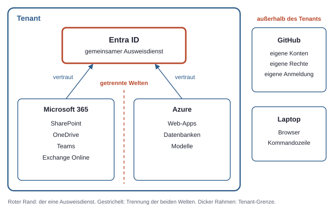
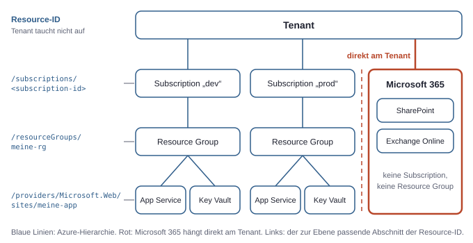
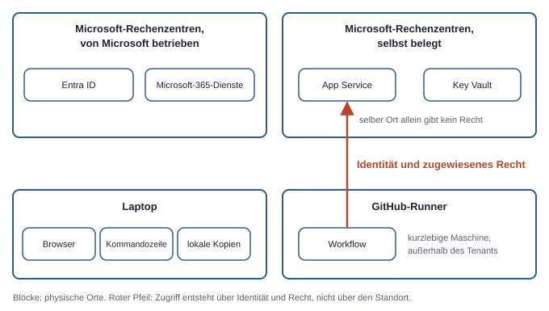
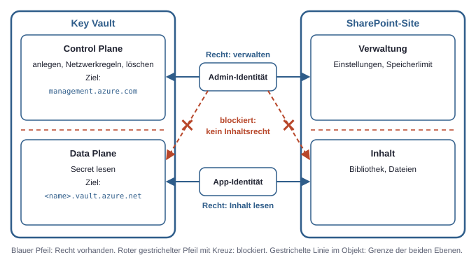

# 1. Die Landkarte: Was liegt wo?

Eine Datei in SharePoint, eine Web-App in Azure und ein automatisierter Ablauf auf GitHub wirken wie Teile derselben Umgebung. Oft gehören sie auch zum selben Vorhaben. Technisch liegen sie aber in verschiedenen Systemen, mit verschiedenen Verwaltungsoberflächen und verschiedenen Rechtemodellen.

Viele Fehlersuchen im Microsoft-Umfeld enden deshalb bei derselben Einsicht: Das Recht existiert, nur an der falschen Stelle. Wer in Azure die höchste Verwaltungsrolle hat, kommt damit nicht an Dateien in SharePoint. Wer auf GitHub Admin eines Repositorys ist, hat damit noch kein Recht in Azure.

Die Landkarte unterscheidet deshalb drei Dinge, die im Alltag gern zusammenfließen: wo Identitäten liegen, wo Daten liegen und wo Rechenleistung läuft.

## Der Tenant als oberste Grenze

Ein **Tenant** ist der abgeschlossene Bereich einer Organisation in der Microsoft-Cloud, mit eigenen Identitäten, Daten und Regeln. Er ist die äußerste Grenze auf der Karte. Zwei Tenants teilen sich zwar dieselbe Plattform, sehen aber standardmäßig nichts voneinander. Ein Test-Tenant und ein Firmen-Tenant sind deshalb so getrennt wie zwei fremde Firmen, auch wenn dieselbe Person beide bedient.

Jeder Tenant trägt zwei Kennungen. Die Tenant-ID ist eine unveränderliche GUID, die in Tokens und Konfigurationen auftaucht. Dazu kommt eine lesbare Standarddomain wie `contoso.onmicrosoft.com`. Eigene Domains lassen sich ergänzen, an der Identität des Tenants ändert das nichts. Technisch maßgeblich ist immer die ID.

Das Grundmuster lautet: eine Organisation, ein Verzeichnis, viele Dienste. Das Verzeichnis ist der zentrale Bestand aller Nutzer, Gruppen, Apps und Geräte des Tenants. Die Dienste greifen auf dieses eine Verzeichnis zu, statt jeweils eine eigene Nutzerverwaltung mitzubringen. Größere Organisationen betreiben manchmal mehrere Tenants, aber der Normalfall und das sinnvolle Denkmodell ist einer pro Organisation.

Aus der Grenze folgt eine praktische Regel: Rechte wandern nicht von selbst über Tenants hinweg. Soll eine Person aus einem anderen Tenant Zugriff erhalten, wird sie als eigenes Objekt im Ziel-Tenant vertreten, und dort bekommt dieses Objekt die Rechte (siehe Kapitel 2, Identitäten und Tokens).

## Entra ID als gemeinsamer Ausweisdienst

**Entra ID** ist der Identitätsdienst des Tenants: Er kennt Nutzer, Gruppen und Apps und stellt Tokens aus. Ein **Token** ist ein signierter, zeitlich begrenzter Ausweis. Entra ID ist damit mehr als eine Login-Seite: Es prüft, wer anfragt, und stellt einen Ausweis aus. Vorgelegt wird dieser Ausweis dann bei anderen Diensten, die ihn selbst prüfen.

Tenant und Entra ID werden oft synonym verwendet, sind aber nicht dasselbe. Der Tenant ist die Grenze, Entra ID ist der Dienst darin, der die Identitäten führt. Im Azure-Portal heißt die Tenant-ID an manchen Stellen deshalb auch „Directory ID“. Gemeint ist derselbe Wert.

Hinter diesem Ausweisdienst liegen zwei getrennte Welten.

**Microsoft 365** ist die Sammlung der Dienste für Zusammenarbeit, etwa SharePoint, OneDrive, Teams und Exchange Online. Diese Dienste betreibt Microsoft vollständig selbst. Sichtbar sind nur Inhalte und Einstellungen, keine Server und keine Ressourcen. Bezahlt wird üblicherweise pro Nutzer über Lizenzen.

**Azure** ist die Cloud-Plattform für eigene Ressourcen wie Web-Apps, Datenbanken und Modelle. Hier wird selbst gebaut und betrieben, was gebraucht wird. Bezahlt wird üblicherweise nach Verbrauch.

Beide Welten vertrauen demselben Entra ID, teilen sich sonst aber wenig. Ein Tenant kann Microsoft 365 ohne eine einzige Azure-Ressource nutzen und umgekehrt. Dass dieselbe Person sich bei beiden anmeldet, verbindet nur die Identität, nicht die Rechte. Auch die Portale bilden diese Trennung ab:

| Oberfläche | Adresse | Was dort verwaltet wird |
|---|---|---|
| Entra Admin Center | `entra.microsoft.com` | Nutzer, Gruppen, Apps, Anmelderegeln |
| Microsoft 365 Admin Center | `admin.microsoft.com` | Lizenzen, Einstellungen, Einstieg in die Admin Center der einzelnen Dienste |
| Azure-Portal | `portal.azure.com` | Subscriptions, Resource Groups, Ressourcen |

Dazu kommen weitere Orte, etwa für SharePoint, Teams, Foundry und die Power Platform, jeweils mit eigener Rolle und eigenem Rechtesystem (siehe Kapitel 12, Plattformen und Verwaltungsorte).

Eine Verwechslung liegt hier nahe: Das Azure-Portal enthält einen Eintrag „Microsoft Entra ID“. Das macht Entra ID nicht zu einer Azure-Ressource. Das Portal ist nur eine weitere Tür zum selben Verzeichnis. Auch ein Tenant ohne jede Azure-Nutzung hat ein vollständiges Entra ID.



*Entra ID ist der eine gemeinsame Ausweisdienst, Microsoft 365 und Azure sind dahinter getrennte Welten, und GitHub liegt außerhalb der Tenant-Grenze.*

## Wie Azure am Tenant hängt

Azure hat eine eigene Hierarchie, die in Microsoft 365 kein Gegenstück besitzt. Ihr Einstieg ist die **Subscription**: die Abrechnungs- und Rechtegrenze in Azure, die an genau einen Tenant gebunden ist. Umgekehrt kann ein Tenant beliebig viele Subscriptions haben, typisch etwa getrennt nach Entwicklung und Produktion.

Das Wort führt leicht in die Irre. Auch Microsoft-365-Lizenzen werden im Alltag oft als „Abonnement“ bezeichnet. Mit einer Azure-Subscription haben sie nichts zu tun. Wer Microsoft-365-Lizenzen besitzt, hat dadurch noch keine Subscription, in der sich Azure-Ressourcen anlegen lassen.

Innerhalb einer Subscription ordnet die **Resource Group** die Dinge: ein logischer Ordner für zusammengehörige Azure-Ressourcen. Eine **Ressource** ist dann das einzelne verwaltete Objekt, etwa eine Web-App oder ein Key Vault. Ein **Key Vault** ist der Azure-Dienst für Geheimnisse, Schlüssel und Zertifikate. Jede Ressource liegt in genau einer Resource Group, jede Resource Group in genau einer Subscription. Sinnvoll ist es, in einer Resource Group zu bündeln, was gemeinsam entsteht und gemeinsam wieder verschwindet.

Diese Hierarchie ist nicht nur Ablage. Sie steckt direkt in der Adresse jeder Ressource, ihrer Resource-ID:

```text
/subscriptions/<subscription-id>
  /resourceGroups/meine-rg
    /providers/Microsoft.Web/sites/meine-app
```

Der Zeilenumbruch dient nur der Lesbarkeit, die ID ist eine durchgehende Zeichenkette. Der Tenant taucht darin nicht auf, weil er sich aus der Subscription ergibt. Welcher Tenant und welche Subscription gerade aktiv sind, zeigt die Azure CLI, das Kommandozeilenwerkzeug `az`:

```bash
az account show --query "{tenant:tenantId, subscription:id, name:name}"
```

Dieser Befehl lohnt sich vor jeder Änderung, sobald ein Konto Zugriff auf mehrere Tenants oder Subscriptions hat. Viele Fehler entstehen schlicht im falschen Kontext.

Oberhalb der Subscriptions lassen sich zusätzlich Management Groups anlegen, die mehrere Subscriptions zusammenfassen. Für einen kleinen Tenant sind sie meist entbehrlich. Wichtig ist zunächst nur, dass Rechte in dieser Hierarchie entlang der Ebenen nach unten wirken (siehe Kapitel 3, Die drei Rechtesysteme).



*Azure-Ressourcen hängen über Resource Group und Subscription am Tenant, Microsoft-365-Inhalte hängen direkt am Tenant und tauchen in dieser Hierarchie nicht auf.*

## Wo was physisch läuft

Die logische Karte sagt noch nicht, auf welchem Rechner etwas passiert. Diese zweite Sicht hilft bei der Frage, wo Code ausgeführt wird und wo Daten tatsächlich liegen. Vier Orte reichen für das Grundbild.

**Microsoft-Rechenzentren, von Microsoft betrieben.** Hier laufen Entra ID und die Microsoft-365-Dienste. Auf die Server gibt es keinen Zugriff, sie erscheinen in keiner Verwaltungsoberfläche. Die Inhalte aus SharePoint, OneDrive und Exchange Online liegen dort, in einer Region, die vom Tenant abhängt.

**Microsoft-Rechenzentren, selbst belegt.** Azure-Ressourcen liegen ebenfalls bei Microsoft, aber in einer selbst gewählten Region. **App Service** ist dafür ein typisches Beispiel: ein Azure-Dienst, der Web-Apps auf verwalteten Servern betreibt. Der eigene Code läuft dort, um Betriebssystem und Patches kümmert sich Microsoft.

**Der Laptop.** Browser, lokale Entwicklung und Kommandozeile laufen auf dem eigenen Gerät. Das Gerät kann als Objekt im Verzeichnis bekannt und von **Intune**, dem Dienst zur Geräteverwaltung und Compliance-Prüfung, verwaltet sein (siehe Kapitel 6, Geräte und Zugriffsregeln). Daten können dort als lokale Kopie landen, etwa durch die OneDrive-Synchronisation. Der Laptop ist also auch ein Datenstandort, nicht nur ein Anzeigegerät.

**Der GitHub-Runner.** Ein **Runner** ist der Rechner, auf dem ein automatisierter Ablauf von GitHub ausgeführt wird. Von GitHub bereitgestellte Runner sind kurzlebige virtuelle Maschinen. Alternativ lassen sich eigene Runner betreiben.

Der physische Ort und die Berechtigung sind zwei getrennte Fragen. Ein Prozess auf einem App Service hat nicht deshalb Zugriff auf einen Key Vault, weil beide im selben Rechenzentrum stehen oder in derselben Resource Group liegen. Zugriff entsteht über eine Identität und ein zugewiesenes Recht. Umgekehrt kann ein Runner außerhalb des Tenants eine Ressource im Tenant ändern, wenn er die passende Identität nutzen darf.



*Der physische Ort entscheidet nicht über den Zugriff, sondern Identität und zugewiesenes Recht.*

Die folgende Übersicht fasst die Trennung nach den drei Grundfragen zusammen; Workflows in der GitHub-Zeile sind die automatisierten Abläufe, die auf dem Runner laufen:

| Bereich | Identitäten | Daten | Rechenleistung |
|---|---|---|---|
| Entra ID | Nutzer, Gruppen, Apps, Geräteobjekte | Verzeichnisdaten, Protokolle | von Microsoft betrieben, nicht sichtbar |
| Microsoft 365 | nutzt Entra ID | Dateien, Mails, Chats, Listen | von Microsoft betrieben, nicht sichtbar |
| Azure | nutzt Entra ID | Inhalte der eigenen Ressourcen | eigene Ressourcen, etwa App Service |
| GitHub | eigene Konten | Code, Workflows, hinterlegte Geheimnisse | Runner |
| Laptop | meldet sich mit einer Identität an | lokale Kopien, Caches | das Gerät selbst |

## GitHub als eigenes System außerhalb des Tenants

GitHub gehört zwar zum Microsoft-Konzern, liegt technisch aber außerhalb des Tenants. Es hat eigene Konten, eigene Rechte und eine eigene Anmeldung. Eine **GitHub Organization** ist dort der gemeinsame Firmenbereich mit eigenen Mitgliedern und Rechten. Sie ist kein Teil von Entra ID und taucht im Verzeichnis nicht auf. Je nach Plan lässt sich die Anmeldung an Entra ID koppeln, das Rechtemodell auf GitHub bleibt dennoch ein eigenes.

Für die Karte zählt vor allem **GitHub Actions**, die in GitHub eingebaute Automatisierung über Workflow-Dateien. Ein **Workflow** ist eine YAML-Datei in `.github/workflows`, die festlegt, wann welche Schritte laufen. Soll ein Workflow in Azure ausrollen, muss er die Tenant-Grenze von außen überqueren.

Diese Überquerung braucht eine explizite Vertrauensbeziehung. Der Weg ohne gespeichertes Secret ist die **Workload Identity Federation**: eine Vertrauensregel, mit der ein externes Token, etwa von GitHub, gegen ein Entra-Token getauscht wird. Auf der Karte ist das eine einzelne, bewusst eingerichtete Brücke zwischen zwei sonst getrennten Systemen. Auch ein bei GitHub gespeichertes **Client Secret**, das Passwort einer App, das dauerhaft gespeichert bleibt und deshalb abfließen kann, ist eine solche Brücke (siehe Kapitel 7, Server und GitHub).

Daraus folgt eine einfache Prüffrage: Wenn in einem GitHub-Repository etwas schiefgeht, was kann dadurch im Tenant passieren? Die Antwort hängt allein davon ab, welche Brücken existieren und welche Rechte an ihnen hängen.

## Control Plane und Data Plane

Quer zu allen bisherigen Trennungen liegt die wichtigste Denktrennung des gesamten Themas. Fast jeder Dienst hat zwei Ebenen.

Die **Control Plane** ist die Verwaltungsebene einer Ressource: anlegen, konfigurieren, löschen. Die **Data Plane** ist die Ebene der eigentlichen Inhalte einer Ressource oder eines Dienstes: Dateien, Geheimnisse, Modellaufrufe. Die Begriffe stammen aus der Azure-Welt, das Denkmodell passt aber auch auf Microsoft 365 und GitHub.

Die Trennung hat Folgen für Rechte, wie ein Key Vault zeigt. Den Tresor anzulegen, seine Netzwerkeinstellungen zu ändern oder ihn zu löschen ist Control Plane. Ein darin gespeichertes Secret zu lesen ist Data Plane. Beide Ebenen lassen sich getrennt vergeben. Dafür dient die **Rollenzuweisung**, die Verknüpfung aus Identität, Rolle und Scope (Azure), also der Ebene, auf der die Rolle gilt. So kann jemand den Tresor vollständig verwalten, ohne ein einziges Geheimnis zu sehen.

In Azure zeigt sich die Trennung sogar in den Adressen. Verwaltungsaufrufe gehen an einen zentralen Endpunkt, Inhaltszugriffe an den Dienst selbst:

| Vorgang | Ebene | Ziel |
|---|---|---|
| Key Vault anlegen oder löschen | Control Plane | `management.azure.com` |
| Secret aus dem Key Vault lesen | Data Plane | `<name>.vault.azure.net` |

Dasselbe Muster gilt außerhalb von Azure, nur ohne so klare Adressen. Eine **Site** ist ein SharePoint-Bereich mit Bibliotheken, Listen und eigenen Rechten. Bei einer SharePoint-Site sind Einstellungen und Speicherlimits eher Verwaltung, die Dateien darin sind Inhalt. Bei GitHub sind die Einstellungen einer GitHub Organization Verwaltung, Code und Workflows sind Inhalt. Wie weit Admin-Rollen im Einzelfall in die Inhalte hineinreichen, ist je nach Dienst unterschiedlich geregelt (siehe Kapitel 4, Admin-Rollen).

Bei einem Berechtigungsproblem lohnt sich deshalb als erste Frage: Geht es um das Verwalten des Objekts oder um seinen Inhalt? Owner ist die höchste Verwaltungsrolle in Azure. Die Fehlermeldung „Forbidden“ beim Lesen eines Secrets trotz Owner-Rolle auf der Subscription ist genau dieser Fall. Das Recht existiert, aber auf der anderen Ebene.

Die Trennung ist allerdings keine absolute Sicherheitsgrenze. Wer die Control Plane voll beherrscht, kann sich oft selbst den Weg zur Data Plane öffnen, indem er sich die fehlende Rolle zuweist. Verwaltungsrechte bleiben also heikel, auch wenn sie den Inhalt nicht direkt freigeben. Die Trennung erklärt, welches Recht gerade fehlt oder wirkt. Sie ersetzt keine Sorgfalt bei der Vergabe.



*Das Recht, ein Objekt zu verwalten, und das Recht, seinen Inhalt zu lesen, sind zwei verschiedene Rechte; wer eines hat, hat das andere nicht automatisch.*

## Die Leitfrage für jeden Zugriff

Die Karte verdichtet sich zu einer Frage, die sich auf jeden einzelnen Zugriff anwenden lässt: **Wer, mit welchem Token, an welchem Dienst, mit welchem Recht?**

**Wer** meint den **Principal**, also den Oberbegriff für alles, dem Rechte zugewiesen werden können: Nutzer, Gruppe, Service Principal, Managed Identity. Nicht nur Menschen greifen zu. Ein **Service Principal** ist die lokale Vertretung einer App in einem Tenant, eine **Managed Identity** die von Azure verwaltete Identität einer Ressource (siehe Kapitel 2, Identitäten und Tokens).

**Mit welchem Token** zielt auf den konkreten Ausweis. Entscheidend ist dabei das Feld `aud`, die **Audience**: der Dienst, für den das Token ausgestellt ist. Ein **Access Token** gilt über `aud` für genau einen Zieldienst. Ein Token für die Azure-Verwaltung nützt daher nichts bei einem anderen Dienst (siehe Kapitel 2, Identitäten und Tokens).

**An welchem Dienst** ordnet den Zugriff auf der Karte ein: Entra ID, ein Microsoft-365-Dienst, die Azure-Verwaltung, die Data Plane einer Ressource oder GitHub. Für viele Daten aus Microsoft 365 und Entra ID ist der Dienst die **Graph API**, die gemeinsame REST-API unter `graph.microsoft.com`. Der Dienst ist es auch, der das Token prüft und über den Zugriff entscheidet, nicht Entra ID.

**Mit welchem Recht** ist die letzte Station. Das Recht kann im Token stehen oder beim Dienst hinterlegt sein. Welches System gerade zuständig ist, ergibt sich aus dem Dienst (siehe Kapitel 3, Die drei Rechtesysteme). Eine **Anwendungsberechtigung** ist ein App-Recht, das ohne angemeldeten Nutzer gilt.

Drei typische Zugriffe, in dieses Raster eingeordnet:

| Zugriff | Wer | Token (`aud`) | Dienst | Recht |
|---|---|---|---|---|
| Ein Admin löscht per `az` eine Web-App | Nutzer | `https://management.azure.com` | Azure-Verwaltung (Control Plane) | Rollenzuweisung auf der Resource Group |
| Eine laufende App liest ein Secret | Managed Identity | `https://vault.azure.net` | Key Vault (Data Plane) | Rollenzuweisung auf dem Key Vault |
| Ein Hintergrunddienst liest Dateien einer Site | Service Principal | `https://graph.microsoft.com` | Graph API | Anwendungsberechtigung am Service Principal |

Die Zeilen sehen ähnlich aus und unterscheiden sich doch in jeder Spalte. Darum hilft das Raster bei der Fehlersuche: Ein gescheiterter Zugriff lässt sich Feld für Feld durchgehen. War es die erwartete Identität? War das Token für diesen Dienst ausgestellt? Ist es der richtige Dienst auf der richtigen Ebene? Und liegt das Recht in dem System, das dieser Dienst tatsächlich auswertet?
