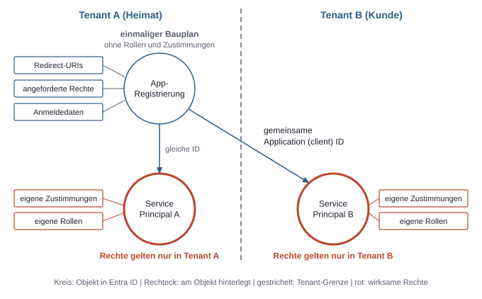
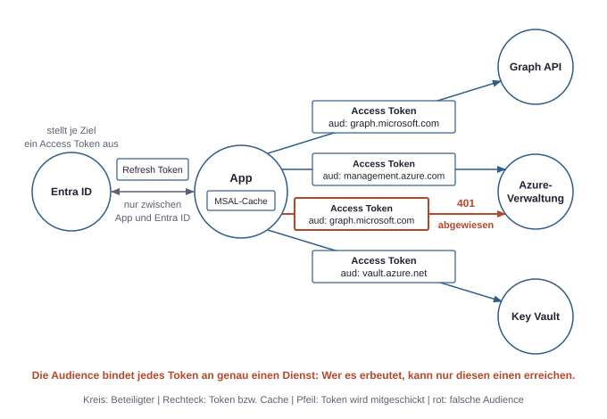
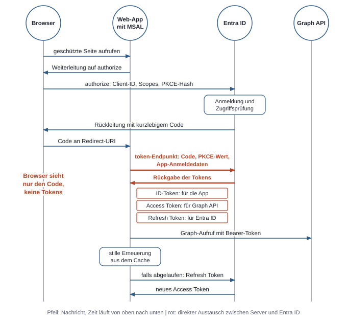
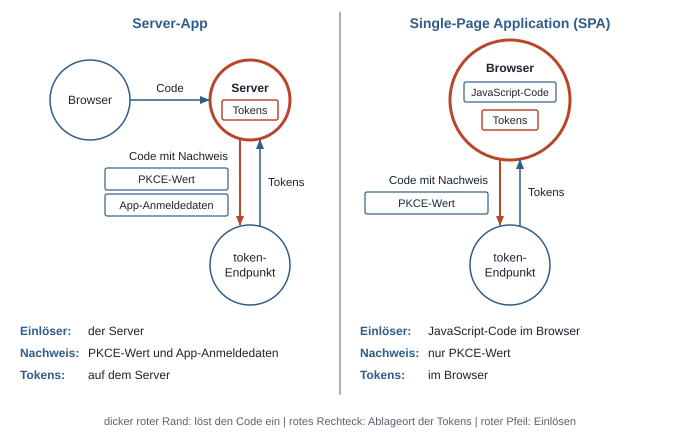

# 2. Identitäten und Tokens: Wer ist wer?

Bevor ein Dienst über ein Recht entscheiden kann, muss er wissen, wer anfragt. In der Microsoft-Welt ist dieses „Wer“ nicht immer ein Mensch. Es kann auch ein Skript, eine Web-App oder ein Workflow sein. Alle diese Akteure sind in Entra ID als Objekte hinterlegt. Der Oberbegriff dafür lautet **Principal**: alles, dem Rechte zugewiesen werden können. Das Grundmodell hat zwei Hälften. Die erste Hälfte ist das Verzeichnis, in dem die Identitäten dauerhaft liegen. Die zweite Hälfte sind die Tokens, also signierte und zeitlich begrenzte Ausweise, die Entra ID aus einer erfolgreichen Anmeldung erzeugt. Dienste sehen bei einer Anfrage nicht die Anmeldung, sondern nur das Token.

## Menschen: Member und Gast

Ein **Member** ist ein reguläres internes Nutzerkonto des Tenants. Ein **Gast** ist ein externes Konto, das per Einladung als eigenes Objekt im Tenant vertreten ist. Beide sind Nutzerobjekte und unterscheiden sich unter anderem in der Eigenschaft `userType`, die `Member` oder `Guest` lautet.

Der wichtige Unterschied liegt darin, wo die Anmeldung stattfindet. Ein Member meldet sich normalerweise mit den Anmeldedaten seines eigenen Tenants an. Ein Gast meldet sich bei seinem Heimat-Anbieter an, etwa dem Tenant seiner eigenen Firma. Der einladende Tenant speichert also kein Passwort des Gasts, verwaltet aber das Gastobjekt und dessen Rechte. Daraus folgt: Dieselbe Person kann in zwei Tenants zwei verschiedene Objekte mit verschiedenen IDs haben. Am Benutzernamen ist ein Gast oft erkennbar, weil er typischerweise den Zusatz `#EXT#` enthält, zum Beispiel `nutzer_contoso.com#EXT#@fabrikam.onmicrosoft.com`.

Eine Anwendung sollte Nutzer nicht am Benutzernamen wiedererkennen, denn dieser kann sich ändern. Stabil ist die Object ID, die im Token als `oid` erscheint, zusammen mit der Tenant-ID.

## Gruppen: Sicherheitsgruppe und Microsoft-365-Gruppe

Rechte direkt an einzelne Personen zu vergeben, skaliert schlecht. Gruppen bündeln deshalb Principals, und Rechte hängen dann an der Gruppe. Entra ID kennt dafür zwei Arten mit unterschiedlichem Zweck. Eine **Sicherheitsgruppe** dient vor allem zum Zuweisen von Rechten. Sie hat außer ihren Mitgliedern keine eigenen Inhalte. Mitglieder können Nutzer, Service Principals, Geräte und andere Gruppen sein.

Eine **Microsoft-365-Gruppe** ist dagegen ein Arbeitsraum mit Mitgliederliste. An ihr hängen gemeinsame Dienste wie Team, Site und Postfach. Wer zur Gruppe hinzugefügt wird, bekommt damit Zugang zu diesen Inhalten (siehe Kapitel 5, Daten und Freigaben). Ihre Mitglieder sind Nutzer, verschachtelte Gruppen sind nicht vorgesehen.

Mitgliedschaften können fest eingetragen oder bei entsprechender Lizenz dynamisch aus Nutzerattributen berechnet werden. Praktisch ist noch eine Eigenheit von Tokens: Sie können Gruppen-IDs im Claim `groups` tragen, wenn die App das so konfiguriert. Bei sehr vielen Gruppen steht dort jedoch nur ein Hinweis, dass die vollständige Liste separat abzufragen ist. Eine App darf sich also nicht blind darauf verlassen, dass der Claim vollständig vorhanden ist.

## Apps: App-Registrierung und Service Principal

Auch Software meldet sich an, und dafür braucht sie eine Identität. Hier trennt Entra ID zwei Objekte, die oft verwechselt werden. Die **App-Registrierung** ist der globale Steckbrief der App. Sie liegt im Heimat-Tenant und beschreibt Name, Redirect-URIs, angeforderte Rechte und Anmeldedaten. Ein Redirect-URI ist die Adresse, an die Entra ID den Browser nach der Anmeldung zurückschickt. Die App-Registrierung ist der Bauplan. Sie selbst erhält aber keine Rollen und keine Zustimmungen.

Der **Service Principal** ist die lokale Vertretung dieser App in einem bestimmten Tenant. An ihm hängen die Zustimmungen und Rollen, und er ist der Principal, der tatsächlich handelt. Im Portal erscheint er als **Enterprise Application**, was nur ein anderer Name für dasselbe Objekt ist.

Sinnvoll wird die Trennung bei Apps, die in mehreren Tenants laufen. Es gibt genau eine App-Registrierung, aber je Tenant, der die App nutzt, einen eigenen Service Principal. Jeder Tenant entscheidet dadurch selbst, was die App bei ihm darf, ob sie aktiv ist und welche Nutzer sie verwenden dürfen. Auch Dienste von Microsoft wie die Graph API sind in jedem Tenant als Service Principal vertreten, obwohl ihre App-Registrierung nicht dort liegt.



*Die App-Registrierung ist der einmalige Bauplan; wirksame Rechte hängen am Service Principal und gelten daher immer nur in dessen Tenant.*

Die Verwirrung im Alltag entsteht vor allem durch die vielen IDs. Eine App hat mindestens drei davon:

| Kennung | Gehört zu | Eigenschaft | Typische Verwendung |
|---|---|---|---|
| Application (client) ID | App-Registrierung | in allen Tenants gleich | `client_id` bei der Anmeldung, im Token als `appid` oder `azp` |
| Object ID der App-Registrierung | App-Registrierung | nur im Heimat-Tenant | Verwaltung der Registrierung |
| Object ID des Service Principals | Service Principal | je Tenant verschieden | Rollenzuweisungen, im reinen App-Token als `oid` |

Ein häufiger Fehler ist es, in einer Rollenzuweisung die falsche Object ID einzutragen, nämlich die der App-Registrierung. Azure-Rollen und andere Zuweisungen zielen immer auf den Service Principal (siehe Kapitel 3, Die drei Rechtesysteme).

In der Azure CLI wird die Trennung gut sichtbar, weil es zwei getrennte Befehle gibt:

```bash
az ad app create --display-name meine-app
az ad sp create --id <client-id>
az ad sp show --id <client-id> --query id -o tsv
```

Der erste Befehl erzeugt die App-Registrierung, der zweite den Service Principal im aktuellen Tenant. Der dritte gibt dessen Object ID aus. Das Portal legt beim Registrieren beide Objekte zusammen an und verbirgt die Trennung dadurch. Im Entra Admin Center liegen sie unter *Applications* in den getrennten Bereichen *App registrations* und *Enterprise applications*.

## Managed Identity: Identität ohne gespeichertes Geheimnis

Läuft Code auf einer Azure-Ressource, stellt sich eine einfache Frage: Wo soll das Passwort liegen, mit dem sich der Code anmeldet? Jede Antwort verschiebt das Problem nur, denn auch das Geheimnis für den Geheimnisspeicher muss irgendwo stehen. Die **Managed Identity** löst das auf. Sie ist eine von Azure verwaltete Identität einer Ressource, die ohne gespeichertes Secret auskommt. Technisch ist sie ein Service Principal ohne selbst gepflegte App-Registrierung. Azure verwaltet die darunterliegenden Anmeldedaten und rotiert sie, ohne dass sie jemals im Code oder in der Konfiguration erscheinen. Die laufende App fragt ihr Token bei einem lokalen Endpunkt der Azure-Plattform an. Auf einem App Service stehen dessen Adresse und ein Prüfwert in den Umgebungsvariablen `IDENTITY_ENDPOINT` und `IDENTITY_HEADER`. Die Azure-SDKs erledigen das über Klassen wie `ManagedIdentityCredential`. Dieser Endpunkt ist nur von der Ressource aus erreichbar, weshalb sich das Verfahren nicht einfach auf einem Laptop nachstellen lässt.

| | System-assigned | User-assigned |
|---|---|---|
| Lebenszyklus | gebunden an die Ressource, wird mit ihr gelöscht | eigene Ressource, unabhängig |
| Zuordnung | genau eine Ressource | mehrere Ressourcen möglich |
| Rechte vor dem Anlegen der Ressource vergebbar | nein | ja |

System-assigned ist die einfachere Wahl, wenn die Identität genau zu einer Ressource gehört, denn beim Löschen bleibt nichts zurück. User-assigned lohnt sich, wenn mehrere Ressourcen dieselben Rechte brauchen oder wenn Ressourcen häufig neu aufgebaut werden. Rollenzuweisungen müssen dann nicht jedes Mal neu entstehen, was auch Wartezeiten beim Ausrollen vermeidet.

```bash
az webapp identity assign --name meine-app --resource-group meine-rg
```

Der Befehl schaltet eine System-assigned Identity ein. Seine Ausgabe enthält eine `principalId`, die Object ID des zugehörigen Service Principals, an die Rollen vergeben werden. Eine User-assigned Identity wird separat mit `az identity create` angelegt und hat zusätzlich eine `clientId`. Der Code braucht diese, um die richtige Identität zu wählen, wenn einer Ressource mehrere zugeordnet sind. Im Portal erscheinen Managed Identities unter *Enterprise applications*, wenn der Filter auf den Anwendungstyp entsprechend gesetzt ist. Zwei Grenzen sind wichtig. Eine Managed Identity ist für Code auf Azure gedacht, nicht für Skripte auf fremden Rechnern. Außerdem speichert die Plattform ihre Tokens länger zwischen, teils bis zu rund 24 Stunden. Eine geänderte Gruppenmitgliedschaft wirkt deshalb unter Umständen erst deutlich verzögert.

## Anmeldedaten von Apps im Vergleich

Eine App-Registrierung muss gegenüber Entra ID beweisen, dass der Aufrufer wirklich diese App ist. Dafür gibt es drei Mechanismen, die sich vor allem darin unterscheiden, was im Fall eines Abflusses verloren ist.

Ein **Client Secret** ist das Passwort einer App. Es ist eine Zeichenkette, die bei jeder Token-Anfrage mitgeschickt wird. Es ist am einfachsten einzurichten und zugleich am leichtesten zu verlieren. Es landet in Konfigurationsdateien, Umgebungsvariablen oder Chatverläufen. Wer es kopiert hat, kann es von jedem Rechner aus nutzen, solange es gültig ist und Conditional Access nicht greift, also die Regeln in Entra ID, die anhand von Nutzer, App, Gerät und Risiko über Anmeldungen entscheiden. Außerdem läuft es ab, und ein vergessener Ablauf führt zu einem Ausfall.

Bei einem **Zertifikat** wird nur der öffentliche Schlüssel an der App-Registrierung hinterlegt. Der private Schlüssel bleibt bei der App und signiert für jede Anfrage eine kurzlebige Bestätigung, die `client_assertion`. Über die Leitung läuft also kein wiederverwendbares Geheimnis. Der private Schlüssel lässt sich zudem im Key Vault oder in Hardware so ablegen, dass er nicht exportierbar ist. Der Preis ist mehr Aufwand beim Ausstellen und Erneuern.

Ein **Federated Credential** ist eine konkrete Vertrauensregel an einer Identität, die Issuer, Subject und Audience festlegt. Es gibt dabei gar kein Geheimnis in Entra ID. Stattdessen stellt ein externes System der laufenden Software ein eigenes Token aus. Entra ID prüft dieses Token gegen die Regel und tauscht es gegen ein Entra-Token. Dieses Verfahren heißt **Workload Identity Federation**. Eine Regel für GitHub legt beispielsweise das Subject `repo:contoso/meine-app:ref:refs/heads/main` fest und vertraut damit nur Tokens für diesen Branch in diesem Repository. Auch eine User-assigned Managed Identity kann eine solche Regel tragen und ist dann ausnahmsweise von außerhalb von Azure nutzbar (siehe Kapitel 7, Server und GitHub).

| | Client Secret | Zertifikat | Federated Credential |
|---|---|---|---|
| Was der Aufrufer besitzt | Zeichenkette | privaten Schlüssel | externes, kurzlebiges Token |
| Was Entra ID kennt | das Secret | den öffentlichen Schlüssel | die Vertrauensregel |
| Dauerhaft kopierbar | ja | nur wenn der Schlüssel exportierbar ist | nein |
| Pflege | regelmäßig erneuern und verteilen | regelmäßig erneuern | Regel pflegen, keine Rotation |
| Voraussetzung | keine | Schlüsselverwaltung | Aussteller, der OIDC unterstützt, den Standard für signierte Herkunftsnachweise |

Für die Auswahl ergibt sich eine einfache Rangfolge. Code auf Azure nutzt eine Managed Identity. Externe Systeme mit eigenem Aussteller, etwa GitHub Actions, nutzen ein Federated Credential. Andere externe Systeme nutzen ein Zertifikat. Ein Client Secret bleibt für Experimente und für Fälle, in denen nichts anderes möglich ist.

## Die drei Tokens einer Anmeldung

Entra ID stellt bei einer Nutzeranmeldung bis zu drei Tokens mit unterschiedlichen Empfängern und Aufgaben aus.

Das **ID-Token** ist für die App selbst bestimmt und sagt ihr, wer sich angemeldet hat. Seine Audience ist deshalb die Client-ID der App. Es berechtigt zu nichts und gehört nicht als Ausweis an eine API.

Das **Access Token** ist für genau einen Zieldienst bestimmt und trägt Rechte in `scp` oder `roles`. Die App schickt es als `Authorization: Bearer <token>` mit. Bearer bedeutet: Wer das Token hat, kann es benutzen. Deshalb ist es kurzlebig, typischerweise etwa eine Stunde. Für die App ist es eine undurchsichtige Zeichenkette, die sie nur weiterreicht. Prüfen muss es der Zieldienst.

Das **Refresh Token** ist länger gültig, oft Tage bis Wochen, und wird nur an Entra ID geschickt, um neue Access Tokens zu holen. Es ist kein JWT, das die App auswerten soll, und gehört wie ein Passwort geschützt. Eine App, die sich ohne Nutzer selbst anmeldet, erhält kein Refresh Token. Sie meldet sich bei Bedarf einfach erneut mit ihren Anmeldedaten an.

## Was im Access Token steht

Ein Access Token ist in vielen Fällen ein JWT, dessen Inhalt sich dekodieren lässt, etwa lokal mit einem eigenen Skript oder mit dem Werkzeug `jwt.ms`. Das folgende Beispiel ist ein gekürztes Token für die Graph API, das eine App im Namen eines Nutzers erhalten hat:

```json
{
  "aud": "https://graph.microsoft.com",
  "iss": "https://sts.windows.net/<tenant-id>/",
  "tid": "<tenant-id>",
  "oid": "<object-id-des-nutzers>",
  "appid": "<client-id>",
  "upn": "nutzer@contoso.onmicrosoft.com",
  "scp": "Files.Read User.Read",
  "exp": 1793900000
}
```

Fordert eine App das Token ohne Nutzer an, fehlen `upn` und `scp`. Stattdessen steht dort etwa `"roles": ["Sites.Selected"]`, und `oid` zeigt auf den Service Principal.

Die wichtigsten Claims bedeuten Folgendes:

| Claim | Bedeutung | Prüffrage |
|---|---|---|
| `aud` | die Audience, also der Dienst, für den das Token gilt | Bin ich als Dienst gemeint? |
| `iss` | der Aussteller | Kommt es von einem vertrauten Aussteller? |
| `tid` | der Tenant, in dem das Token ausgestellt wurde | Ist es der erwartete Tenant? |
| `oid` | die Object ID des handelnden Principals in diesem Tenant | Wer genau handelt? |
| `appid` oder `azp` | die Client-ID der aufrufenden App, je nach Token-Version | Welche App ruft auf? |
| `scp` | Delegierte Berechtigungen, durch Leerzeichen getrennt | Was darf die App im Namen des Nutzers? |
| `roles` | Anwendungsberechtigungen als Liste | Was darf die App selbst? |
| `exp` | Ablaufzeitpunkt als Unix-Zeit | Ist es noch gültig? |

Mit `scp` und `roles` lassen sich die beiden Betriebsarten schnell auseinanderhalten: Steht `scp` im Token, handelt eine App für einen Nutzer. Steht dort kein `scp` und `oid` zeigt auf einen Service Principal, handelt die App für sich. Bei eigenen APIs kann `roles` zusätzlich App-Rollen eines Nutzers enthalten (siehe Kapitel 3, Die drei Rechtesysteme).

Das Token enthält aber längst nicht jedes Recht. Azure-Rollen oder die Mitgliedschaft in einer Site stehen nicht darin. Der jeweilige Dienst liest die `oid` und schlägt diese Rechte selbst nach. Ein gültiges Token bedeutet deshalb nur: Die Identität ist bestätigt und das Token passt zum Dienst. Es bedeutet nicht, dass die konkrete Aktion erlaubt ist. Die Prüfung beim Zieldienst folgt immer demselben Muster. Der Dienst holt die öffentlichen Signaturschlüssel von Entra ID und prüft die Signatur. Dann prüft er Gültigkeitszeit, Aussteller und Audience und erst danach die Rechte. Weil die Prüfung mit öffentlichen Schlüsseln erfolgt, muss er Entra ID dafür nicht bei jeder Anfrage kontaktieren.

## Warum jeder Zieldienst ein eigenes Access Token braucht

Ein Access Token für die Graph API wird von Azure abgelehnt, obwohl es echt und gültig ist. Der Grund ist die Audience. Jeder Dienst akzeptiert nur Tokens, deren `aud` auf ihn zeigt. Diese Regel ist eine Sicherheitsgrenze. Ein Dienst sieht zwangsläufig jedes Token, das er empfängt. Gälte das Token überall, könnte ein kompromittierter oder bösartiger Dienst es gegen alle anderen einsetzen. Mit der Audience-Bindung ist der Schaden auf den Dienst begrenzt, der es ohnehin schon hat. Außerdem bleiben die Tokens klein und enthalten nur die Rechte für dieses eine Ziel. Eine App, die mehrere Dienste aufruft, hält deshalb mehrere Access Tokens parallel. Beim Anfordern nennt sie jeweils das Ziel, zum Beispiel:

| Zieldienst | Typische Audience beziehungsweise Ressource |
|---|---|
| Graph API | `https://graph.microsoft.com` |
| Azure-Verwaltung (Control Plane) | `https://management.azure.com` |
| Key Vault (Data Plane) | `https://vault.azure.net` |
| Azure OpenAI und andere Cognitive Services (Data Plane) | `https://cognitiveservices.azure.com` |
| SharePoint direkt | `https://contoso.sharepoint.com` |

Die Azure CLI zeigt das Verhalten direkt: `az account get-access-token --resource <ziel>` liefert demselben Konto je nach Ziel ein anderes Token.

Ein einzelnes Refresh Token kann dabei oft Access Tokens für mehrere Dienste beschaffen, sofern die nötigen Zustimmungen vorliegen. Der Nutzer muss sich deshalb nicht für jeden Dienst neu anmelden. Die Anfrage nennt das Ziel über den Parameter `scope`, etwa `https://graph.microsoft.com/Files.Read`. Dieser OAuth-Scope ist nicht mit dem **Scope (Azure)** einer Rollenzuweisung zu verwechseln. Die Schreibweise `https://graph.microsoft.com/.default` fordert alle bereits für die App hinterlegten Rechte an und ist bei Apps ohne Nutzer der Normalfall.



*Die Audience bindet jedes Access Token an genau einen Dienst und begrenzt so den Schaden, wenn ein Dienst oder Token kompromittiert wird.*

Ein 401 mit Hinweis auf eine ungültige Audience ist daher ein Token-Problem. Die Lösung ist kein zusätzliches Recht, sondern ein Token für das richtige Ziel.

## Ablauf einer Browser-Anmeldung mit MSAL

**MSAL** ist Microsofts Bibliothek, mit der Apps Tokens holen und zwischenspeichern. Sie nimmt der App das Protokoll ab, das bei einer Browser-Anmeldung meist der OAuth-Authorization-Code-Flow mit PKCE ist. Bei PKCE erzeugt die App für jede Anmeldung einen Zufallswert und sendet zunächst nur dessen Hash. Den Wert selbst zeigt sie erst beim Einlösen des Codes vor, sodass ein abgefangener Code wertlos bleibt.

Der Ablauf gilt hier für eine Web-App, deren eigener Server den Code einlöst und danach die Graph API aufruft.



*Bei einer App mit eigenem Server sieht der Browser nur den kurzlebigen Code, während die Tokens im direkten Austausch zwischen Server und Entra ID entstehen und jedes einen eigenen Empfänger hat.*

1. **Einstieg.** Ein Nutzer ruft eine geschützte Seite auf. Die App findet keine Sitzung und lässt MSAL eine Anmelde-URL erzeugen. Sie zeigt auf den `authorize`-Endpunkt des Tenants und enthält Client-ID, Redirect-URI, gewünschte Scopes, den PKCE-Hash sowie die Prüfwerte `state` und `nonce`.
2. **Anmeldung.** Der Browser landet bei Entra ID. Dort finden Passworteingabe und MFA, also die Anmeldung mit mehr als einem Faktor, statt. Entra ID wertet auch Conditional Access aus (siehe Kapitel 6, Geräte und Zugriffsregeln). Fehlt die Zustimmung für die App, wird sie jetzt abgefragt (siehe Kapitel 3, Die drei Rechtesysteme).
3. **Rückleitung.** Entra ID schickt den Browser mit einem kurzlebigen Code zurück an den Redirect-URI. Diese Adresse muss exakt in der App-Registrierung eingetragen sein, sonst bricht der Vorgang mit dem Fehler `AADSTS50011` ab. Die Prüfung verhindert, dass ein Code an eine fremde Adresse gelangt.
4. **Einlösen.** Der Server der App schickt Code, PKCE-Wert und seine App-Anmeldedaten direkt an den `token`-Endpunkt. Der Browser ist daran nicht beteiligt und sieht die Tokens nicht.
5. **Antwort.** Entra ID liefert ID-Token, Access Token und, falls `offline_access` angefordert wurde (der Scope, der ein Refresh Token anfordert), ein Refresh Token. MSAL kümmert sich dabei um Teile der Protokollprüfung und legt die Tokens im Cache ab. Die App wertet die Identität aus dem ID-Token aus und richtet ihre eigene Sitzung ein.
6. **Dienstaufruf.** Die App sendet das Access Token an die Graph API. Die Graph API prüft Signatur, Audience und Ablauf und wertet dann die Rechte in `scp` aus.
7. **Erneuerung.** Für spätere Aufrufe fragt die App MSAL erneut nach einem Token, etwa mit `acquire_token_silent` in Python oder `acquireTokenSilent` in JavaScript. MSAL liefert ein noch gültiges Token aus dem Cache oder holt mit dem Refresh Token still ein neues. Der Nutzer bemerkt davon nichts, solange keine erneute Interaktion nötig ist.

Eine Browser-App, die den Code ohne eigenen Server einlöst, also eine Single-Page Application, läuft nach demselben Muster ab, verlagert aber die Serverschritte in den Browser. Sie kann kein Geheimnis bewahren und meldet sich deshalb nur über PKCE ohne App-Anmeldedaten an. Der JavaScript-Code im Browser schickt Code und PKCE-Wert ohne Client Secret direkt an den `token`-Endpunkt, Schritt 4 gilt hier also nicht. Zudem liegen ihre Tokens im Browser, wodurch sich das Risiko durch Script-Angriffe erhöht. Ihr Refresh Token ist deshalb kürzer gültig. Auch die Anmelde-URL aus Schritt 1 entsteht im Browser, der Graph-Aufruf aus Schritt 6 geht direkt vom Browser aus, und die serverseitige Sitzung aus Schritt 5 entfällt. Der Redirect-URI muss in der App-Registrierung als Plattform „Single-page application“ eingetragen sein, sonst schlägt der Code-Tausch aus dem Browser fehl.



*Die beiden Varianten unterscheiden sich darin, wer den Code einlöst, mit welchem Nachweis, und wo danach die Tokens liegen.*

Zwischen dem Lebenszyklus der Tokens und dem der App-Sitzung besteht keine feste Kopplung. Eine Sitzung kann weiterlaufen, während das Access Token längst abgelaufen ist. Umgekehrt beendet das Abmelden aus der App nicht automatisch die Sitzung bei Entra ID. Nach einer Sperrung des Kontos kann ein bereits ausgestelltes Access Token bis zu seinem Ablauf weiter funktionieren, weil der Zieldienst es meist nur lokal prüft. Das ist der Preis dafür, dass Tokens ohne Rückfrage geprüft werden können.
