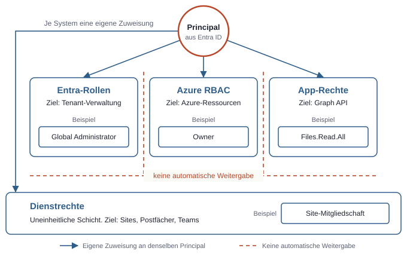
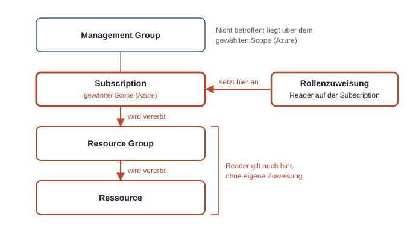
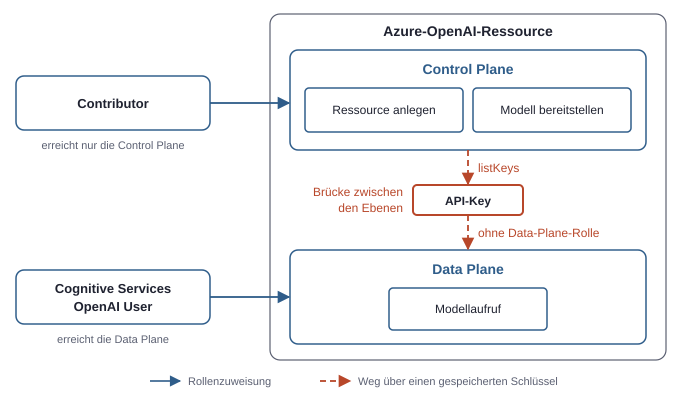
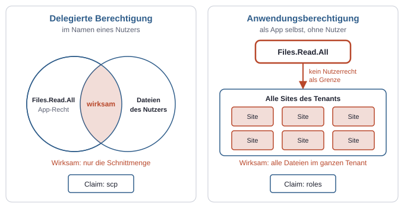

# 3. Die drei Rechtesysteme: Warum „Admin“ nicht gleich „darf alles“ ist

Ein Konto ist Global Administrator und sieht in der Subscription-Liste des Azure-Portals trotzdem nichts. Ein anderes Konto ist Owner einer Subscription und kann keinen einzigen Nutzer anlegen. Beides ist kein Fehler. Das Wort „Admin“ beschreibt in der Microsoft-Welt keine allgemeine Macht, sondern immer ein Recht innerhalb eines bestimmten Systems.

Drei zentral verwaltete Rechtesysteme stehen nebeneinander: Entra-Rollen regeln die Verwaltung des Tenants, Azure RBAC regelt den Zugriff auf Azure-Ressourcen, und App-Rechte regeln, was eine App über die Graph API tun darf. Darunter liegt eine vierte Schicht, die kein einheitliches System ist: die Rechte, die jeder Dienst auf seinen eigenen Daten führt, etwa die Mitgliedschaften einer SharePoint-Site. Daneben hat die Abrechnung ein eigenes Rollensystem dafür, wer kaufen, bezahlen und Verträge unterschreiben darf (siehe Kapitel 11, Lizenzen und Abrechnung).

Die Systeme teilen sich dieselben Identitäten aus Entra ID, aber nicht ihre Zuweisungen. Ein Recht in einem System erzeugt kein Recht in einem anderen. Bei jedem Rechteproblem lautet die erste Frage deshalb: Welches System entscheidet hier überhaupt?



*Dieselbe Identität kann in jedem System andere Rechte haben, und zwischen den Säulen und der Schicht gibt es keine automatische Weitergabe.*

| System oder Schicht | Beantwortet die Frage | Typisches Beispiel | Wo zugewiesen |
|---|---|---|---|
| Entra-Rollen | Wer verwaltet den Tenant? | User Administrator | Entra Admin Center, Bereich „Roles & admins“ |
| Azure RBAC | Wer darf was an welcher Ressource? | Contributor auf einer Resource Group | Azure-Portal, Bereich „Access control (IAM)“ |
| App-Rechte | Was darf eine App über die Graph API? | `Sites.Read.All` | Angefordert in der App-Registrierung, per Consent wirksam an der Enterprise Application |
| Dienstrechte | Wer kommt an diesen konkreten Inhalt? | Mitglied einer Site | Im jeweiligen Dienst, etwa in SharePoint |

## Entra-Rollen: den Tenant verwalten

Eine Entra-Rolle ist eine administrative Rolle im Tenant. Sie erlaubt Verwaltungsaufgaben an Objekten von Entra ID und an den Einstellungen von Diensten. Der User Administrator verwaltet Nutzerkonten, der Groups Administrator Gruppen, der Global Administrator nahezu alles auf dieser Ebene.

Der Geltungsbereich ist normalerweise der ganze Tenant. Eine Entra-Rolle kennt keine Subscription und keine Resource Group, weil sie Azure-Ressourcen gar nicht betrifft. Deshalb sieht ein frisch ernannter Global Administrator im Azure-Portal zunächst keine Subscription, solange ihm dort niemand etwas zugewiesen hat.

Zugewiesen wird eine Entra-Rolle an Nutzer, an dafür zugelassene Gruppen oder an Service Principals. Welche Rolle konkret was darf und welche davon sich selbst weitere Rechte verschaffen kann, ist eine eigene Frage (siehe Kapitel 4, Admin-Rollen).

## Azure RBAC: Ressourcen verwalten

Azure RBAC ist das Rechtesystem für Azure-Ressourcen. Es besteht aus genau drei Bausteinen, die eine Rollenzuweisung verknüpft:

- **Principal:** wer das Recht erhält, also Nutzer, Gruppe, Service Principal oder Managed Identity.
- **Rolle:** welche Aktionen erlaubt sind, festgelegt in einer Rollendefinition.
- **Scope (Azure):** wo das Recht gilt.

Der Scope (Azure) folgt einer festen Hierarchie: Management Group, Subscription, Resource Group, Ressource. Rechte werden nach unten vererbt: Wer Reader auf einer Subscription ist, ist auch Reader auf jeder Resource Group und jeder Ressource darin. Zuweisungen addieren sich. Ein niedrigerer Scope kann ein höher vergebenes Recht im Normalfall nicht wieder entziehen.



*Eine Zuweisung gilt für alles darunter, deshalb bestimmt der gewählte Scope (Azure) die Reichweite.*

Least Privilege heißt hier vor allem: den kleinsten passenden Scope (Azure) wählen. Eine Zuweisung sieht auf der Kommandozeile so aus:

```bash
az role assignment create --assignee <principal-id> --role "Reader" --scope /subscriptions/<subscription-id>/resourceGroups/meine-rg
```

Die vorhandenen Zuweisungen zeigt im Portal der Bereich „Access control (IAM)“, den es auf jeder Scope-Ebene gibt. Auf der Kommandozeile hilft `az role assignment list --assignee <principal-id> --all --include-inherited`.

Drei allgemeine Rollen tauchen fast überall auf:

| Rolle | Darf | Darf nicht |
|---|---|---|
| Owner | Ressourcen vollständig verwalten und Rollen zuweisen | Allein durch die Rolle Inhalte über die Data Plane lesen |
| Contributor | Ressourcen vollständig verwalten | Rollen zuweisen; allein durch die Rolle Inhalte über die Data Plane lesen |
| Reader | Ressourcen und ihre Konfiguration ansehen | Etwas ändern |

Auch Gruppen, App-Registrierungen und Sites kennen Besitzer. Diese haben mit der Azure-Rolle Owner nichts zu tun.

### Control Plane gegen Data Plane

Die wichtigste Unterscheidung in Azure RBAC ist die zwischen Control Plane und Data Plane, also Verwalten gegen Inhalt. Rollendefinitionen bilden diese Trennung direkt ab. Das Feld `actions` listet Control-Plane-Aktionen, das Feld `dataActions` listet Data-Plane-Aktionen. Das folgende Beispiel nutzt den Storage Account, eine Azure-Ressource für die Datenablage, und den Blob, eine dort gespeicherte Datei. Der gekürzte Vergleich zweier eingebauter Rollen zeigt den Unterschied:

```json
{
  "roleName": "Owner",
  "actions": ["*"],
  "dataActions": []
}
```

```json
{
  "roleName": "Storage Blob Data Reader",
  "actions": ["Microsoft.Storage/storageAccounts/blobServices/containers/read"],
  "dataActions": ["Microsoft.Storage/storageAccounts/blobServices/containers/blobs/read"]
}
```

Das Sternchen des Owners gilt nur für `actions`. Wer Owner eines Storage Accounts ist, darf ihn löschen, aber mit dieser Rolle allein keinen Blob per Entra-Anmeldung lesen. Umgekehrt darf der Storage Blob Data Reader Blobs lesen, aber den Storage Account nicht umkonfigurieren.

Ein gutes Beispiel für die Trennung sind KI-Modelle in Azure. Mit der Rolle Contributor lässt sich eine Azure-OpenAI-Ressource anlegen und ein Modell bereitstellen. Für den eigentlichen Modellaufruf mit einem Entra-Token braucht der Principal aber eine Data-Plane-Rolle wie „Cognitive Services OpenAI User“. Diese Rolle erlaubt den Aufruf, aber nicht das Verwalten der Ressource. Nach demselben Muster funktionieren etwa „Key Vault Secrets User“ für Geheimnisse im Key Vault und die „Storage Blob Data“-Rollen für Blobs.



*Verwaltungsrechte und Inhaltsrechte sind getrennt zugewiesen, und gespeicherte Schlüssel bilden eine Brücke von der einen Ebene zur anderen.*

Die Trennung hat eine Lücke, die in der Praxis oft übersehen wird. Viele Dienste bieten neben der Entra-Anmeldung API-Keys an. Das Abrufen eines solchen Schlüssels ist eine Control-Plane-Aktion (`listKeys`), die in Owner und Contributor enthalten ist. Wer den Schlüssel hat, erreicht die Data Plane ohne Data-Plane-Rolle. Deshalb lässt sich die Anmeldung per Schlüssel bei vielen Diensten abschalten, damit nur noch die Rollenzuweisung zählt. Ein Owner erreicht die Data Plane außerdem, indem er sich selbst eine Data-Plane-Rolle zuweist.

## App-Rechte: was eine App über die Graph API darf

Bei der Graph API erhält eine App keine Rolle auf einem Scope (Azure), sondern benannte Rechte wie `User.Read` oder `Files.Read.All`. Davon gibt es zwei Arten, und der Unterschied entscheidet darüber, wie weit eine App reicht.

**Delegierte Berechtigung:** Die App handelt im Namen eines angemeldeten Nutzers. Das Token enthält das Recht im Claim `scp`, und zwar als einen durch Leerzeichen getrennten Text.

```json
{
  "aud": "https://graph.microsoft.com",
  "tid": "<tenant-id>",
  "oid": "<object-id-des-nutzers>",
  "scp": "Files.Read.All User.Read"
}
```

**Anwendungsberechtigung:** Die App handelt als sie selbst, ohne Nutzer. Das Token enthält das Recht im Claim `roles` als Liste, und ein `scp` fehlt.

```json
{
  "aud": "https://graph.microsoft.com",
  "tid": "<tenant-id>",
  "oid": "<object-id-des-service-principal>",
  "roles": ["Files.Read.All"]
}
```

Beide Tokens tragen hier denselben Rechtenamen, und doch bedeutet er etwas völlig anderes. Das liegt an der Schnittmengenregel:

- Bei einer Delegierten Berechtigung ist das wirksame Recht die Schnittmenge aus dem Recht der App und dem Recht des Nutzers. `Files.Read.All` erlaubt hier nur, was der Nutzer selbst lesen dürfte. Das „All“ meint alle für ihn zugänglichen Dateien, nicht alle Dateien des Tenants.
- Bei einer Anwendungsberechtigung gibt es keinen Nutzer und damit keine Schnittmenge. `Files.Read.All` erlaubt das Lesen aller Dateien im ganzen Tenant. Die Mitgliedschaften einzelner Sites spielen dafür keine Rolle.



*Derselbe Rechtename reicht bei einer Anwendungsberechtigung viel weiter, weil kein Nutzerrecht ihn begrenzt.*

Die Reichweite der Anwendungsberechtigung ist der Grund für das Recht Sites.Selected. Es erlaubt zunächst nichts, und jede Site wird einzeln freigegeben. So bekommt ein Skript Zugriff auf genau eine Site statt auf alle (siehe Kapitel 5, Daten und Freigaben).

Der Claim `roles` ist übrigens nicht Graph-spezifisch. Auch eigene APIs können App-Rollen definieren, die dann im selben Claim erscheinen. Entscheidend ist immer die Audience: Rechte in einem Token gelten nur für den Dienst aus `aud`. Ein Graph-Token öffnet keine Azure-Ressource. Für Azure-Verwaltungsaufrufe braucht es ein eigenes Token mit der Audience `https://management.azure.com`, und dieses Token enthält keine Rollenzuweisungen. Azure prüft sie erst beim Aufruf.

### Consent und Admin Consent

Dass eine App ein Recht anfordert, gibt ihr dieses Recht noch nicht. Erst der Consent, also die Zustimmung eines Nutzers oder Admins, macht es wirksam. Admin Consent ist die Zustimmung eines Admins für den ganzen Tenant.

| Art des Rechts | Wer kann zustimmen |
|---|---|
| Delegierte Berechtigung mit geringer Reichweite, etwa `User.Read` | Der Nutzer selbst, sofern die Tenant-Einstellungen das zulassen |
| Delegierte Berechtigung mit hoher Reichweite, etwa `User.ReadWrite.All` | Nur ein Admin |
| Anwendungsberechtigung | Immer nur ein Admin |

Dazu passt die Trennung aus App-Registrierung und Service Principal (siehe Kapitel 2, Identitäten und Tokens). Im Portal heißt der Service Principal Enterprise Application. Daraus ergeben sich zwei Orte, die oft verwechselt werden:

| Ort im Entra Admin Center | Zeigt | Merksatz |
|---|---|---|
| App registrations → App → „API permissions“ | Die Rechte, die die App anfordert, mit Status und Schaltfläche für Admin Consent | Was die App haben möchte |
| Enterprise applications → App → „Permissions“ | Die Rechte, denen in diesem Tenant zugestimmt wurde | Was die App hier wirklich hat |

Weichen beide Listen voneinander ab, fehlt meist ein Consent. Oder ein Recht wurde nachträglich ergänzt, ohne erneut zuzustimmen. Außerdem gilt: Ein bereits ausgestelltes Access Token ändert sich nicht. Nach einem neuen Consent braucht die App ein neues Token, sonst fehlt das Recht weiter in `scp` oder `roles`.

## Rechte auf den Daten: was die Dienste selbst führen

Unter den drei Systemen liegen die Rechte der Dienste auf ihren eigenen Inhalten. Sie werden nicht in Entra ID als Rolle geführt, sondern im Dienst selbst.

- **SharePoint:** Eine Site hat Rollen wie Owner, Member und Visitor. Bei Sites, die zu einem Team gehören, ergibt sich das meist aus der Mitgliedschaft in der Microsoft-365-Gruppe.
- **Exchange Online:** Postfachrechte wie „Full Access“ oder „Send As“ werden pro Postfach vergeben.
- **Teams:** Jedes Team unterscheidet Besitzer, Mitglieder und Gäste.

Auch diese Schicht begrenzt, was ein „Admin“ tatsächlich erreicht. Eine Delegierte Berechtigung scheitert an fehlenden Dienstrechten des Nutzers, selbst wenn das Token korrekt ist. Und eine hohe Entra-Rolle ist keine Mitgliedschaft: Der Global Administrator ist nicht automatisch Mitglied jeder Site. Er kann sich allenfalls Zugang verschaffen, was etwas anderes ist und nachvollziehbar bleibt (siehe Kapitel 4, Admin-Rollen). Wie sich Rechte innerhalb einer Site verteilen und durch Freigaben ausweiten, gehört zur Datenebene (siehe Kapitel 5, Daten und Freigaben).

## Fehler zuordnen: Welches System ist zuständig?

Die HTTP-Statuscodes geben die erste Richtung vor. 401 bedeutet in der Regel: Das Token fehlt, ist abgelaufen oder passt nicht zum Dienst. 403 bedeutet in der Regel: Das Token ist in Ordnung, aber das Recht fehlt. Ganz einheitlich halten sich die Dienste nicht daran. Der Fehlercode im Antworttext ist deshalb verlässlicher als der Status allein.

| Symptom | Typischer Fehlercode | Zuständig | Prüfen |
|---|---|---|---|
| Token-Abruf scheitert, Consent fehlt | `AADSTS65001` | Consent | Enterprise Application → „Permissions“; Admin Consent erteilen |
| Token-Abruf scheitert, Anmeldedaten falsch | `AADSTS7000215` | Kein Rechtesystem, sondern die Anmeldung | Client Secret und seine Gültigkeit |
| 401 bei der Graph API | `InvalidAuthenticationToken` | Token | Ablauf und `aud` |
| 401 bei der Azure-Verwaltung | `InvalidAuthenticationTokenAudience` | Token | `aud` muss zur Azure-Verwaltung passen |
| 403 bei einer Verwaltungsaktion in Azure | `AuthorizationFailed` | Azure RBAC, Control Plane | Die Meldung nennt Aktion und Scope (Azure); Rollenzuweisung prüfen |
| 403 beim Lesen eines Blobs oder Geheimnisses | `AuthorizationPermissionMismatch`, `ForbiddenByRbac` | Azure RBAC, Data Plane | Data-Plane-Rolle zuweisen; Owner reicht hier nicht |
| 403 bei Graph-Aufrufen zu Nutzern oder Gruppen | `Authorization_RequestDenied` | App-Rechte, bei delegiertem Zugriff auch Entra-Rolle | `scp` oder `roles`; Entra-Rolle des Nutzers |
| 403 beim Lesen einer Datei über die Graph API, Recht steht im Token | `accessDenied` | Dienstrechte | Site-Mitgliedschaft des Nutzers oder Freigabe bei Sites.Selected |
| 404, obwohl das Element existiert | `itemNotFound` | Möglicherweise Dienstrechte | Manche Dienste verbergen Elemente ohne Zugriff ganz |
| Option im Entra-Bereich des Portals gesperrt | Meist Hinweis im Portal | Entra-Rolle | „Roles & admins“ → eigene Zuweisungen |

Die Reihenfolge der Diagnose ergibt sich aus dieser Tabelle. Zuerst das Token ansehen: Passt `aud` zum Zieldienst? Stehen die erwarteten Rechte in `scp` oder `roles`? Ein Token lässt sich zum Testen mit einem JWT-Decoder lesen, etwa mit dem Microsoft-Tool `jwt.ms`. Stimmt das Token, liegt das Problem beim Zieldienst und seinen eigenen Zuweisungen. Nach einer neuen Azure-Rollenzuweisung kann es zudem einige Minuten dauern, bis sie greift.

## Drei Skripte, drei Antworten

Drei alltägliche Aufgaben zeigen, wie die Systeme auseinanderfallen. Der Principal des Skripts ist jeweils frei wählbar. Entscheidend ist, welches System die Aufgabe prüft.

**Eine Datei in SharePoint lesen.** Der Aufruf geht an die Graph API, also zählen App-Rechte und Dienstrechte. Läuft das Skript im Namen eines Nutzers, reicht eine Delegierte Berechtigung wie `Files.Read.All`, und der Nutzer braucht selbst Zugriff auf die Datei. Läuft es ohne Nutzer, ist Sites.Selected als Anwendungsberechtigung mit Freigabe für genau diese Site die enge Variante. `Files.Read.All` als Anwendungsberechtigung funktioniert auch, öffnet aber alle Dateien des Tenants. Azure-Rollen helfen hier nicht. Läge die Datei stattdessen in einem Azure Storage Account, wäre die Antwort eine ganz andere: Data-Plane-Rolle „Storage Blob Data Reader“.

**Eine Web-App neu starten.** Das ist eine Control-Plane-Aktion in Azure, also zählt allein Azure RBAC. Der Principal braucht eine Rolle mit der Aktion `Microsoft.Web/sites/restart/action`, etwa „Website Contributor“ auf genau dieser Ressource. Graph-Rechte und Consent spielen keine Rolle. Der Aufruf selbst ist kurz: `az webapp restart --name meine-app --resource-group meine-rg`.

**Einen Nutzer anlegen.** Das ist ein Graph-Aufruf (`POST /users`) auf ein Objekt von Entra ID. Ohne Nutzer braucht die App die Anwendungsberechtigung `User.ReadWrite.All` mit Admin Consent. Im Namen eines Nutzers braucht sie die gleichnamige Delegierte Berechtigung, und zusätzlich muss der Nutzer eine passende Entra-Rolle wie User Administrator haben. Hier wird die Schnittmengenregel sichtbar: Ein Nutzer ohne diese Rolle scheitert, auch wenn die App das Recht hat. Azure Owner hilft hier ebenfalls nicht.

| Aufgabe | Entscheidendes System | Mindestrecht ohne Nutzer | Mindestrecht im Namen eines Nutzers |
|---|---|---|---|
| Datei in SharePoint lesen | App-Rechte und Dienstrechte | Sites.Selected plus Freigabe der Site | `Files.Read.All` plus Zugriff des Nutzers auf die Datei |
| Web-App neu starten | Azure RBAC, Control Plane | Rolle mit Neustart-Aktion auf der Ressource | Dieselbe Rolle für den Nutzer |
| Nutzer anlegen | App-Rechte und Entra-Rolle | `User.ReadWrite.All` mit Admin Consent | `User.ReadWrite.All` plus User Administrator |
