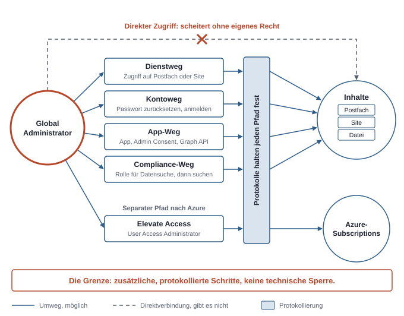
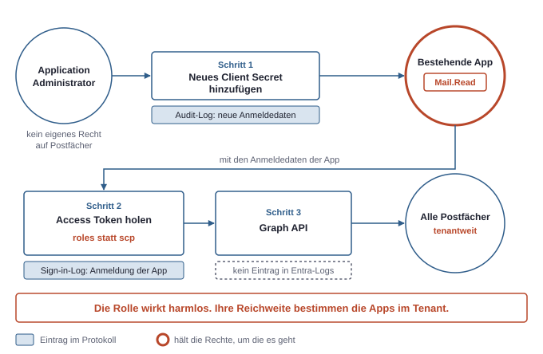
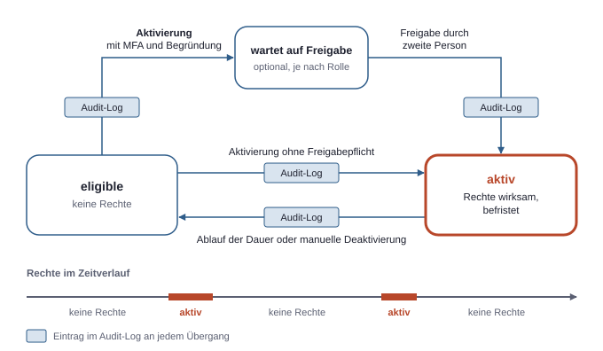

# 4. Admin-Rollen: Wer sieht und darf was wirklich?

Die Bezeichnung „Admin“ sagt wenig darüber aus, was ein Konto tatsächlich kann. Aussagekräftig wird eine Rolle erst durch drei getrennte Fragen:

1. **Was darf sie verwalten?** Das ist der offizielle Zweck der Rolle.
2. **Sieht sie Inhalte direkt?** Gemeint sind E-Mails, Dateien und Chats, nicht nur Einstellungen.
3. **Kann sie sich mehr Rechte verschaffen?** Eine Rolle, die sich selbst erweitern kann, ist effektiv mächtiger, als ihre Beschreibung vermuten lässt.

Die dritte Frage ist für die Sicherheit oft die wichtigste. Eine Rolle ohne direkten Inhaltsblick schützt Inhalte nur begrenzt, wenn sie sich diesen Blick mit zwei Klicks selbst einrichten kann. Der Unterschied liegt dann nicht im Können, sondern darin, dass der Umweg Spuren hinterlässt und eine bewusste Handlung erfordert.

## Die wichtigen Rollen im Überblick

Die meisten Rollen hier sind Entra-Rollen. Azure Owner und Contributor gehören dagegen zu Azure RBAC. Sie stehen hier in derselben Tabelle, weil dieselben drei Fragen auch für sie gelten (siehe Kapitel 3, Die drei Rechtesysteme). Entra-Rollen finden sich im Entra Admin Center unter „Roles & admins“. Die Tabelle beschreibt den Standardfall und vereinfacht bewusst. Die genauen Einzelrechte einer Rolle stehen in Microsofts Rollenreferenz und ändern sich gelegentlich.

| Rolle | Darf verwalten | Sieht Inhalte direkt? | Kann sich mehr Rechte verschaffen? |
|---|---|---|---|
| **Global Administrator** | Nahezu alle Verwaltungsfunktionen in Entra ID und den Microsoft-365-Diensten | Nein, nicht automatisch | Ja, praktisch unbegrenzt, auch auf Azure |
| **Global Reader** | Nichts; liest Einstellungen und Verwaltungsdaten dienstübergreifend | Nein | Nein; sieht aber die Konfiguration des ganzen Tenants |
| **Application Administrator** | App-Registrierungen und Enterprise Applications, einschließlich ihrer Anmeldedaten | Nein | Indirekt ja, über Identitäten von Apps mit hohen Rechten |
| **Cloud Application Administrator** | Wie Application Administrator, aber ohne Application Proxy, der interne Web-Apps über Entra ID veröffentlicht | Nein | Indirekt ja, auf demselben Weg |
| **User Administrator** | Nutzerkonten und Gruppen, Passwort-Resets für Nutzer und einen Teil der niedrig privilegierten Admins | Nein | Indirekt: Übernahme von Konten über Passwort-Resets und Zugang über Gruppen; keine Vergabe von Entra-Rollen |
| **Groups Administrator** | Gruppen und Gruppeneinstellungen | Nein | Indirekt: Eigene Aufnahme in Gruppen, die Rechte oder Datenzugriff vermitteln |
| **Privileged Role Administrator** | Zuweisung von Entra-Rollen, Einstellungen von PIM | Nein | Ja, kann auch Global Administrator vergeben |
| **SharePoint Administrator** | SharePoint-Einstellungen und Sites im ganzen Tenant | Nein, nicht automatisch | Innerhalb von SharePoint ja: kann sich als Administrator einer Site eintragen |
| **Exchange Administrator** | Exchange Online: Postfächer, Mailflow, Einstellungen | Nein, nicht automatisch | Innerhalb von Exchange ja: kann sich Zugriffsrechte auf Postfächer einrichten |
| **Teams Administrator** | Teams-Dienst, Richtlinien, Team- und Gruppenverwaltung | Nein | Innerhalb des Dienstes indirekt: Zugang zu Team-Inhalten über Mitgliedschaften; das öffnet keine privaten Chats |
| **Security Reader** | Nichts; liest Sicherheitsdaten, Berichte und Protokolle | Nein; Protokolle können aber Metadaten wie Dateinamen oder Betreffzeilen enthalten | Nein |
| **Azure Owner** | Ressourcen im jeweiligen Scope (Azure), einschließlich Rollenzuweisungen | Nicht automatisch auf der Data Plane | Ja, im eigenen Scope (Azure), auch für Rollen auf der Data Plane |
| **Azure Contributor** | Ressourcen im jeweiligen Scope (Azure), aber keine Rollenzuweisungen | Nicht über Datenrollen, aber oft über abrufbare Schlüssel | Indirekt: über Schlüssel, Konfigurationen und den Code von Apps mit eigener Identität |

Aus der Tabelle ergibt sich ein Muster. Fast keine dieser Rollen liest Inhalte direkt, und trotzdem haben viele einen Weg dorthin. „Sieht nicht direkt“ bedeutet deshalb nicht „kommt nicht heran“.

## Global Administrator: kein Inhaltsblick, aber offene Türen

Ein Global Administrator kann zunächst keine fremden Postfächer öffnen. Der Aufruf einer fremden Datei oder E-Mail scheitert, solange das Konto dort kein Recht besitzt, denn die Rechte auf den Daten führt der jeweilige Dienst selbst. Diese Trennung ist real, und sie ist auch nützlich: Versehentliches Mitlesen passiert so nicht, und jeder Zugriff erfordert einen zusätzlichen Schritt.

Eine verlässliche Grenze gegen einen entschlossenen Global Administrator ist sie allerdings nicht. Die Rolle kann jede andere Entra-Rolle vergeben, also auch sich selbst. Sie kann Passwörter anderer Konten zurücksetzen und Admin Consent erteilen. Daraus ergeben sich mehrere Umwege:

- **Dienstweg:** In Exchange Online oder SharePoint einen Zugriff auf ein Postfach oder eine Site einrichten.
- **Kontoweg:** Das Passwort eines Nutzers zurücksetzen und sich als dieser Nutzer anmelden.
- **App-Weg:** Eine App mit Anwendungsberechtigungen anlegen, Admin Consent erteilen und über die Graph API lesen.
- **Compliance-Weg:** Sich eine Rolle für rechtliche Datensuchen geben und über dieses Werkzeug suchen.

Keiner dieser Wege ist unsichtbar. Rollenvergaben, Passwort-Resets, Consent-Vorgänge und neue Apps werden im Audit-Log festgehalten, dem Protokoll administrativer Änderungen. Eine spätere Prüfung kann also feststellen, dass etwas Ungewöhnliches passiert ist. Verhindern kann sie es nicht.



*Kein direkter Inhaltsblick heißt nicht kein Zugang: Die Grenze des Global Administrators ist eine Grenze aus zusätzlichen, protokollierten Schritten und keine technische Sperre.*

### „Elevate Access“: der Übergang nach Azure

Entra-Rollen und Azure RBAC sind getrennt. Ein frisch ernannter Global Administrator sieht deshalb im Azure-Portal möglicherweise keine einzige Subscription. Umgekehrt kann ein Azure Owner keinen Nutzer im Tenant anlegen, nur weil er eine Subscription besitzt.

Für einen Fall gibt es eine bewusste Brücke, und zwar für Situationen, in denen niemand mehr Zugriff auf eine Subscription hat. Ein Global Administrator kann in Entra ID unter „Properties“ die Einstellung „Access management for Azure resources“ einschalten. Dasselbe geht über die API:

```bash
az rest --method post \
  --url "https://management.azure.com/providers/Microsoft.Authorization/elevateAccess?api-version=2016-07-01"
```

Damit erhält das eigene Konto die Azure-Rolle User Access Administrator am obersten Scope (Azure) `/`. Diese Rolle darf Rollenzuweisungen verwalten, und zwar für alle Management Groups und Subscriptions des Tenants. Der Global Administrator kann sich also selbst zum Owner jeder Subscription machen. Für die Wirkung ist oft eine neue Anmeldung nötig, weil bestehende Tokens die Änderung nicht sofort abbilden.

Die Erhöhung sollte nur vorübergehend bestehen. Anschließend wird die Einstellung wieder ausgeschaltet.

Für das Modell zählt: Global Administrator umfasst Azure nicht von Haus aus, kann sich den Zugriff aber jederzeit nehmen. Der Schutz einer Subscription endet deshalb faktisch beim Schutz der Global-Administrator-Konten.

## Azure Owner und Contributor: dieselbe Frage auf der Ressourcenebene

Contributor darf alles an einer Ressource verwalten, nur keine Rechte vergeben. Das klingt nach einer klaren Grenze, doch sie hält auf der Data Plane nur teilweise. Viele Dienste erlauben auf der Control Plane den Abruf von Zugriffsschlüsseln. Wer den Schlüssel eines Dienstes abruft, kommt anschließend an dessen Daten, ohne dass ihm eine Datenrolle zugewiesen wurde (siehe Kapitel 3, Die drei Rechtesysteme).

Zwei weitere Wege sind typisch:

- Die Konfiguration einer Web-App kann Werte wie Verbindungszeichenfolgen enthalten, die ein Contributor lesen kann.
- Hat eine App eine Managed Identity, kann ein Contributor neuen Code auf diese App ausrollen. Dieser Code läuft dann mit den Rechten der Identität, auch wenn der Contributor selbst diese Rechte nicht hat.

Owner geht einen Schritt weiter: Da er Rollen zuweisen darf, kann er sich im eigenen Scope (Azure) selbst eine Datenrolle geben. Die Grenzen von Owner und Contributor sind also in beiden Fällen eher Stufen als Mauern. Der wichtigste Hebel ist deshalb ein enger Scope (Azure): Ein Contributor an einer einzelnen Resource Group richtet weit weniger Schaden an als einer an der ganzen Subscription.

## Warum App-Admins und Anwendungsberechtigungen heimlich mächtig sind

Application Administrator und Cloud Application Administrator klingen nach Verwaltungsarbeit an Portalseiten. Ihre Macht liegt woanders: Sie dürfen Anmeldedaten zu bestehenden Apps hinzufügen. Damit können sie sich anschließend **als diese App** anmelden.

Das wird gefährlich, sobald irgendeine App im Tenant hohe Anwendungsberechtigungen besitzt. Eine Rolle ohne eigenes Recht auf Postfächer übernimmt dann das Recht der App. Der Ablauf ist kurz:

```bash
# Fügt der App ein weiteres Client Secret hinzu, ohne die vorhandenen zu ersetzen
az ad app credential reset --id <client-id> --append
```

Mit dem neuen Client Secret holt sich die Person über den Client-Credentials-Flow ein Access Token. Das ist ein OAuth-Ablauf, bei dem sich die App selbst anmeldet und kein Nutzer beteiligt ist. Das Token sieht etwa so aus:

```json
{
  "aud": "https://graph.microsoft.com",
  "tid": "<tenant-id>",
  "appid": "<client-id>",
  "roles": ["Mail.Read", "Sites.Read.All"]
}
```

Es enthält keine Angabe zu einem Nutzer, und es greift keine Schnittmenge mit dessen Rechten. Das Token gilt tenantweit für alle Postfächer und Sites, die diese Berechtigungen abdecken.



*Die Rechte einer App werden zu den Rechten aller, die ihre Anmeldedaten ändern dürfen; die Rolle wirkt harmlos, ihre Reichweite bestimmen die Apps im Tenant.*

Eine Einschränkung gilt: Admin Consent für Anwendungsberechtigungen der Graph API können diese beiden Rollen nicht selbst erteilen. Sie können also keine beliebig neue Macht erzeugen, sondern übernehmen die Macht, die bereits vergeben wurde. In einem Tenant mit vielen alten, hoch berechtigten Apps ist das allerdings kein großer Trost.

Der gleiche Hebel steckt in einigen Anwendungsberechtigungen selbst. `RoleManagement.ReadWrite.Directory` erlaubt die Vergabe von Entra-Rollen. `Application.ReadWrite.All` erlaubt Änderungen an Apps und damit auch das Hinzufügen von Anmeldedaten. `AppRoleAssignment.ReadWrite.All` erlaubt die Vergabe von App-Rechten. Eine App mit einem dieser Rechte ist faktisch ein privilegierter Admin, nur taucht sie in keiner Liste von Admin-Konten auf. Hinzu kommt: Auch eingetragene Besitzer einer App-Registrierung können Anmeldedaten hinzufügen, ganz ohne Admin-Rolle.

Daraus folgen konkrete Gegenmaßnahmen:

- Apps mit hohen Anwendungsberechtigungen regelmäßig unter „Enterprise applications“ prüfen und nicht mehr benötigte entfernen.
- Breite Rechte vermeiden und engere Varianten wählen, etwa Sites.Selected statt `Sites.Read.All` (siehe Kapitel 5, Daten und Freigaben).
- Besitzer von hoch berechtigten Apps klein halten und App-Admin-Rollen so behandeln wie die Rechte der mächtigsten App im Tenant.
- Keine dauerhaften Client Secrets verwenden, wo eine Managed Identity oder ein Federated Credential ausreicht.
- Neue Anmeldedaten an Apps im Audit-Log überwachen, denn dieses Ereignis ist ein starkes Warnsignal.

## Hohe Rechte begrenzen

### Least Privilege in der Praxis

Least Privilege heißt bei Admin-Rollen zuerst: Global Administrator ist keine Standardrolle für Admin-Arbeit. Microsoft empfiehlt, weniger als fünf solcher Konten zu führen. Für die meisten Aufgaben gibt es eine engere Rolle:

| Aufgabe | Ausreichende Rolle |
|---|---|
| Konfiguration eines Tenants prüfen | Global Reader |
| Anmeldungen und Sicherheitsberichte ansehen | Security Reader |
| Nutzer anlegen und Passwörter zurücksetzen | User Administrator |
| Apps registrieren und konfigurieren | Cloud Application Administrator |
| Sites und Freigabeeinstellungen verwalten | SharePoint Administrator |
| Einer App Graph-Anwendungsberechtigungen freigeben | Privileged Role Administrator, nur vorübergehend |

### Getrennte Admin-Konten

Ein Admin-Konto sollte nicht das Alltagskonto sein. Wer im selben Konto E-Mails liest, im Web surft und Admin-Rechte hält, setzt diese Rechte jedem Phishing-Link aus. Üblich ist deshalb ein zweites, reines Cloud-Konto, etwa `admin-name@contoso.onmicrosoft.com`. Es besitzt kein Postfach und keine Produktivlizenzen, und es wird nur für Verwaltungsaufgaben genutzt.

Durch die Trennung lassen sich auch die Zugriffsregeln getrennt verschärfen, zum Beispiel über Conditional Access (siehe Kapitel 6, Geräte und Zugriffsregeln). MFA gehört für Admin-Konten zum Mindeststandard. Sinnvoll sind dabei phishing-resistente Verfahren wie FIDO2-Sicherheitsschlüssel.

### PIM: Rechte nur bei Bedarf

Dauerhafte Rollen haben einen Nachteil: Ein gestohlenes Konto bringt die Rechte sofort mit. PIM (Privileged Identity Management) kehrt das um, denn Admin-Rechte werden dabei nur bei Bedarf und befristet aktiviert. PIM setzt eine höherwertige Entra-Lizenz voraus.

Das Konto ist statt dauerhaft aktiv nur *eligible*, also für die Rolle zugelassen. In diesem Zustand hat es die Rechte nicht. Zur Aktivierung ruft die Person die Rolle in PIM auf und durchläuft die eingestellten Bedingungen, typischerweise MFA, eine Begründung und je nach Rolle die Freigabe durch eine zweite Person. Danach ist die Rolle für eine begrenzte Dauer aktiv und fällt automatisch zurück.



*Unter PIM ist ein gestohlenes Konto im Normalzustand rechtlos: Hohe Rechte existieren nur in kurzen, begründeten und protokollierten Zeitfenstern.*

Der Nutzen ist doppelt. Das Zeitfenster für den Missbrauch schrumpft, und jede Aktivierung erzeugt einen nachvollziehbaren Eintrag mit Begründung. PIM lässt sich nicht nur auf Entra-Rollen anwenden, sondern auch auf Azure-Rollen und die Mitgliedschaft in Gruppen. Zu beachten ist: Privileged Role Administrator kann die PIM-Einstellungen selbst ändern und gehört deshalb zu den am strengsten zu behandelnden Rollen.

### Break-Glass-Konto: der Notausgang

Strenge Regeln können auch aussperren: Eine fehlerhafte Conditional-Access-Regel, ein Ausfall des MFA-Dienstes oder der Weggang der einzigen Admin-Person können dazu führen, dass niemand mehr verwalten kann. Dafür gibt es das Break-Glass-Konto, ein Notfallkonto mit hohen Rechten, das von üblichen Zugriffsregeln gezielt ausgenommen ist.

Bewährt haben sich diese Regeln:

- Zwei solche Konten, reine Cloud-Konten auf der `onmicrosoft.com`-Domain und ohne Bindung an eine einzelne Person.
- Dauerhafte Rolle Global Administrator, weil ein Notfall nicht von einer Aktivierung abhängen darf.
- Starke Anmeldung mit getrennt und sicher verwahrtem Faktor, etwa einem FIDO2-Schlüssel im Tresor. Microsoft erzwingt MFA für Verwaltungsportale zunehmend, daher sollte kein Break-Glass-Konto ohne zweiten Faktor geplant werden.
- Ein Alarm bei jeder Anmeldung, denn im Normalbetrieb wird das Konto nie benutzt und jeder Login ist ein Ereignis.
- Regelmäßige Tests, damit der Notausgang im Ernstfall tatsächlich funktioniert.

## Nachvollziehen: Was Admins nachträglich sehen und was nicht

Zwei Protokolle in Entra ID bilden die Grundlage. Beide liegen im Entra Admin Center im Bereich „Monitoring & health“.

- **Audit-Log:** Hält administrative Änderungen fest, etwa neue Rollenzuweisungen, Passwort-Resets, Consent-Vorgänge und neue Anmeldedaten an Apps. Es beantwortet die Frage „Wer hat was geändert?“.
- **Sign-in-Log:** Das Protokoll der Anmeldungen. Es zeigt Konto, App, Zieldienst, IP-Adresse, Zeit, Ergebnis und die angewendeten Zugriffsregeln. Anmeldungen von Service Principals und Managed Identities erscheinen in eigenen Ansichten, was bei der Suche nach App-Missbrauch leicht übersehen wird.

Ebenso wichtig sind die Grenzen dieser beiden Protokolle:

| Frage | Antwort aus den Entra-Protokollen? |
|---|---|
| Wer hat wem eine Rolle gegeben? | Ja, Audit-Log |
| Hat sich dieses Konto oder diese App angemeldet? | Ja, Sign-in-Log |
| Welche E-Mail oder Datei wurde danach geöffnet? | Nein; das steht, wenn überhaupt, in den Protokollen des jeweiligen Dienstes |
| Welche Graph-Aufrufe hat ein Token ausgelöst? | Nein; dafür braucht es eine eigene, separat einzurichtende Protokollierung |
| Was hat ein Azure-Admin an einer Ressource geändert? | Nein; dafür ist das Activity Log von Azure zuständig |
| Was hat jemand auf der Data Plane gelesen? | Nein; das muss je Ressource über Diagnoseeinstellungen aktiviert werden |

Die entscheidende Lücke ist die zwischen Anmeldung und Handlung. Das Sign-in-Log zeigt, dass eine App ein Token erhalten hat, aber nicht, welche Postfächer sie anschließend gelesen hat. Zugriffe auf Dateien und Postfächer laufen über das dienstübergreifende Audit in Microsoft Purview, Microsofts Lösung für Compliance und Datenverwaltung. Umfang und Aufbewahrung dieses Audits hängen von der Lizenz ab.

Dazu kommt die Aufbewahrung. Die Entra-Protokolle werden je nach Lizenz nur wenige Wochen vorgehalten, ohne Premium-Lizenz nur etwa eine Woche. Wer längere Spuren braucht, leitet die Protokolle per Diagnoseeinstellung an ein externes Ziel weiter, zum Beispiel an einen Log-Analytics-Workspace, einen Azure-Bereich zum Sammeln und Abfragen von Protokollen. Wer genug Rechte hat, kann diese Weiterleitung aber auch abschalten. Protokolle machen Missbrauch deshalb nur dann verlässlich nachweisbar, wenn sie bei einer zweiten Stelle landen, auf die die betreffende Person keinen Zugriff hat.

## Kleine gegen große Firma: Wer verwaltet was?

Die Rollen sind überall dieselben, aber ihre Verteilung unterscheidet sich stark.

| Bereich | Kleine Firma | Große Firma |
|---|---|---|
| **Tenant und Identitäten** | Eine oder zwei Personen, oft ein externer Dienstleister, mit Global Administrator | Identity-Team mit User, Groups und Application Administrator; Global Administrator nur per PIM und für wenige Personen |
| **Rollenvergabe** | Dieselbe Person | Eigene Stelle mit Privileged Role Administrator, Freigabe durch eine zweite Person |
| **Microsoft-365-Dienste** | Miterledigt von derselben Person | Eigene Teams mit SharePoint, Exchange und Teams Administrator |
| **Azure** | Owner an der einzigen Subscription | Plattform-Team als Owner an Management Groups, Fachteams als Contributor an ihrer Resource Group |
| **Sicherheit** | Gelegentlicher Blick in die Protokolle | Eigenes Team mit Security Reader, Protokolle zentral und außerhalb der Reichweite der Admins |

Die kleine Firma kann Aufgaben nicht personell trennen, und das ist kein Versäumnis, sondern eine Folge ihrer Größe. Wegen dieser Konzentration zählen die wenigen günstigen Maßnahmen dort umso mehr: getrennte Admin-Konten, starke MFA, zwei Break-Glass-Konten, wenige hoch berechtigte Apps und Protokolle, die lange genug aufbewahrt werden. Liegt die Verwaltung bei einem externen Dienstleister, kommt die Frage hinzu, welche Rollen er hält und wie die Firma die Kontrolle behält (siehe Kapitel 14, Mit externem IT-Dienstleister).

In der großen Firma verschiebt sich das Problem. Die Rollen sind sauber getrennt, doch über viele Jahre sammeln sich Apps, Besitzer und alte Zuweisungen an. Dort sind es weniger die benannten Global Administrators, die übersehen werden, als die App mit weitreichenden Rechten, die niemand mehr einem Team zuordnen kann.
