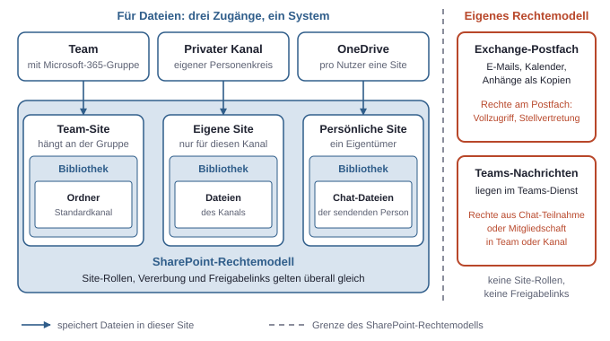
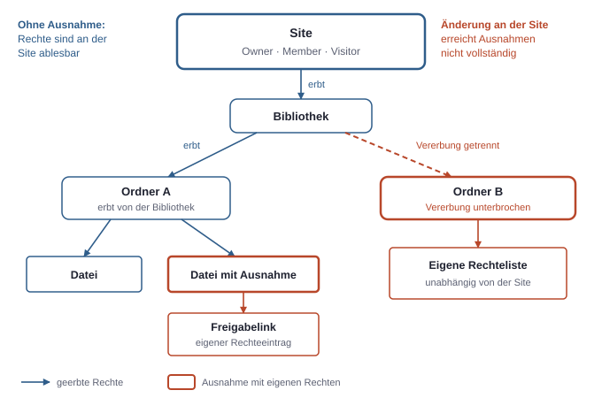
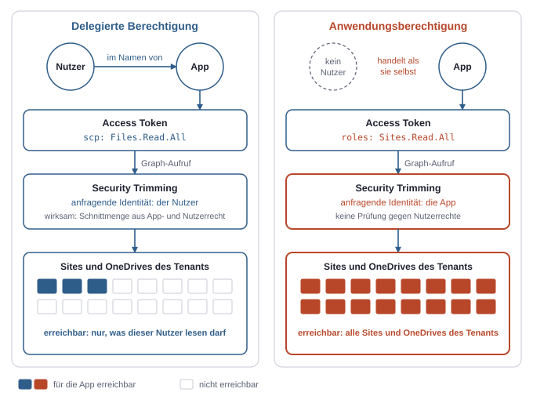
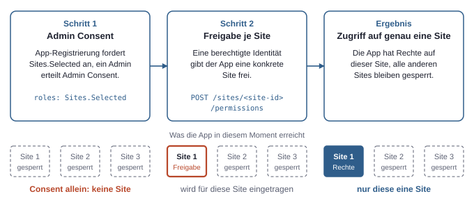
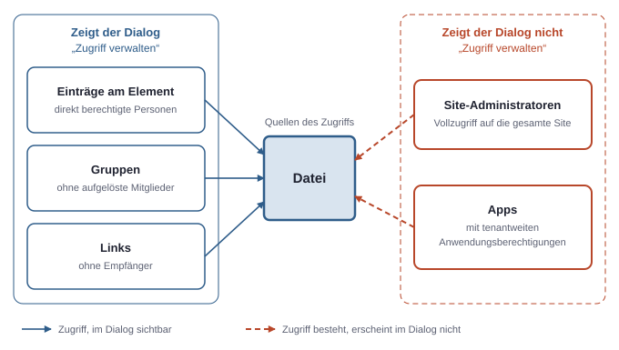

# 5. Daten und Freigaben: Wer kommt an welche Datei?

Eine Datei in Microsoft 365 hat keine einzelne Stelle, an der ihre Rechte stehen. Ob jemand sie öffnen kann, ergibt sich aus dem Ort, an dem sie liegt, aus den Rollen auf diesem Ort, aus Abweichungen auf Ordner- oder Dateiebene und aus allen Links, die irgendwann erzeugt wurden. Dazu kommen Apps, die über ganz eigene Wege zugreifen.

Das Grundmodell ist trotzdem überschaubar: Fast alle Dateien liegen in SharePoint, die Rechte fließen von oben nach unten, und Freigaben schaffen Ausnahmen. Suche, Graph API und KI-Dienste bauen auf diesem Modell auf und führen kein eigenes.

## Wo die Daten wirklich liegen

Teams, OneDrive und SharePoint wirken im Alltag wie drei getrennte Ablagen. Für Dateien sind sie im Kern ein einziges System. Eine **Site** ist ein SharePoint-Bereich mit Bibliotheken, Listen und eigenen Rechten, und eine **Bibliothek** ist eine Dokumentablage innerhalb einer Site. Fast jede Datei in Microsoft 365 liegt in irgendeiner Bibliothek irgendeiner Site.

**SharePoint** ist die sichtbare Form dieses Systems. Eine Site hat eine Adresse wie `https://contoso.sharepoint.com/sites/projekt-a` und mindestens eine Bibliothek.

**Teams** speichert Dateien nicht selbst. Zu jedem Team gehört eine Microsoft-365-Gruppe, und an dieser Gruppe hängt eine SharePoint-Site. Ein Standardkanal ist darin ein Ordner in der Standardbibliothek. Die Registerkarte „Dateien“ im Kanal ist nur eine andere Ansicht auf diesen Ordner. Private und geteilte Kanäle bekommen eine eigene Site, weil ihr Personenkreis vom Team abweicht. Die Teamzugehörigkeit bestimmt also die Dateirechte, weil sie über die Gruppe in die Site durchschlägt.

**OneDrive** ist eine persönliche Site pro Nutzer, mit einer Adresse der Form `https://contoso-my.sharepoint.com/personal/<nutzer>`. Technisch gelten dieselben Regeln wie in SharePoint: Bibliothek, Vererbung, Freigabelinks. Der Unterschied ist organisatorisch. Der Nutzer ist alleiniger Eigentümer und entscheidet selbst über Freigaben.

**Dateien aus Teams-Chats** liegen deshalb nicht „im Chat“. Eine in einem Einzel- oder Gruppenchat gesendete Datei landet im OneDrive der sendenden Person und wird für die Chatteilnehmer freigegeben. Wer also einen Chat-Anhang bereitstellt, erzeugt damit eine Freigabe in der eigenen persönlichen Site.

Getrennt davon liegen zwei Dinge, die nicht dem SharePoint-Rechtemodell folgen:

- **Exchange Online** speichert Postfächer mit E-Mails, Kalendern und Anhängen. Die Rechte hängen am Postfach, zum Beispiel über Vollzugriff oder Stellvertretung, und kennen weder Site-Rollen noch Freigabelinks.
- **Teams-Nachrichten** liegen im Teams-Dienst und nicht in einer Bibliothek. Wer sie lesen darf, ergibt sich aus der Teilnahme am Chat oder der Mitgliedschaft im Team oder Kanal.

Ein Anhang in einer Mail ist außerdem eine Kopie. Sie liegt im Postfach und hat mit den Rechten der Originaldatei nichts mehr zu tun. Wer dort später den Zugriff entzieht, erreicht die verschickte Kopie nicht.



*Teams und OneDrive sind für Dateien nur andere Zugänge zu SharePoint-Sites; nur Postfächer und Chat-Nachrichten folgen einem eigenen Rechtemodell.*

## Site-Rollen und Vererbung

Eine SharePoint-Gruppe existiert nur innerhalb ihrer Site und nicht in Entra ID. Jede Site bringt drei Standardrollen mit, die als SharePoint-Gruppen angelegt sind:

| Site-Rolle | Berechtigungsstufe | Typische Bedeutung |
|---|---|---|
| Owner | Vollzugriff | Inhalte bearbeiten, Mitglieder und Rechte verwalten |
| Member | Bearbeiten | Dateien anlegen, ändern und löschen |
| Visitor | Lesen | Dateien ansehen und herunterladen |

„Member“ bedeutet hier etwas anderes als das Member-Konto im Tenant. Das Member-Konto beschreibt ein reguläres internes Nutzerkonto, die Site-Rolle Member beschreibt ein Bearbeitungsrecht auf einer Site. Auch ein Gast kann auf einer Site die Rolle Member haben, wenn er in die entsprechende SharePoint-Gruppe aufgenommen wird.

Bei Sites, die zu einer Microsoft-365-Gruppe gehören, sind die Rollen mit der Microsoft-365-Gruppe gekoppelt. Die Besitzer der Microsoft-365-Gruppe sind Owner der Site, die Mitglieder der Microsoft-365-Gruppe sind Member der Site. Wer jemanden zum Team hinzufügt, gibt ihm damit Bearbeitungsrechte auf die Dateien des Teams. Die Visitor-Rolle hat keine Entsprechung in der Microsoft-365-Gruppe und wird direkt in SharePoint gepflegt.

Darüber steht noch der **Site-Administrator**, ein Konto mit Vollzugriff auf die gesamte Site, auch auf Bereiche mit abweichenden Rechten. Diese Zuweisung wird leicht übersehen, weil sie nicht in den drei Standard-SharePoint-Gruppen auftaucht. SharePoint-Administratoren können sich selbst dorthin bringen (siehe Kapitel 4, Admin-Rollen).

**Vererbung** ist die Standardregel, dass Elemente die Rechte ihres übergeordneten Elements übernehmen. Die Bibliothek erbt von der Site, der Ordner von der Bibliothek, die Datei vom Ordner. Solange niemand eingreift, reicht ein Blick auf die Site, um alle Rechte darin zu kennen. Das ist der Grund, warum das Modell überhaupt beherrschbar ist.

Auf jeder Ebene lässt sich die Vererbung aber unterbrechen. Ein Ordner bekommt dann eigene Berechtigungen, die sich unabhängig von der Site weiterentwickeln. Solche Eingriffe entstehen auf zwei Wegen:

1. **Bewusst:** Jemand richtet für einen Ordner „Personal“ eigene Rechte ein und entfernt die Site-Member.
2. **Nebenbei:** Jemand gibt eine einzelne Datei per Link frei. Damit erhält die Datei einen eigenen Rechteeintrag, ohne dass jemand aktiv über Vererbung nachgedacht hat.

Der zweite Weg ist der häufigere. In einer lange genutzten Site entstehen so viele kleine Ausnahmen, die in der normalen Dateiansicht nicht auffallen.

Zwei Folgen sind wichtig. Änderungen auf Site-Ebene erreichen Elemente mit eigenen Rechten nicht mehr: Wer jemanden aus der SharePoint-Gruppe der Site-Member entfernt, hat damit nicht den direkten Zugriff auf eine einzeln freigegebene Datei entzogen. Umgekehrt kann eine Datei weiter offen sein als ihr Ordner, denn ein Link auf einer einzelnen Datei öffnet genau diese Datei, auch wenn der Empfänger die Site sonst nicht sehen darf.

Für Ordner mit strengeren Anforderungen ist deshalb eine eigene Site meist die sauberere Lösung. Die Grenze ist dann sichtbar, und die Rollen lassen sich auf einen Blick prüfen. Ein Ordner mit unterbrochener Vererbung sieht dagegen aus wie jeder andere Ordner.



*Vererbung macht Rechte von der Site aus ablesbar; jede Ausnahme, auch ein einzelner Freigabelink, entkoppelt ein Element davon, sodass Änderungen an der Site es nicht mehr vollständig erreichen.*

## Freigabelinks

Ein **Freigabelink** ist ein Link, der Zugriff auf ein Element gewährt und je nach Art bestimmte Personen, die Organisation oder jeden umfasst. Außer bei „Personen mit vorhandenem Zugriff“ ist der Link also selbst eine Berechtigung und nicht bloß eine Adresse. Das unterscheidet ihn von der normalen Datei-URL, die nur funktioniert, wenn die Rechte schon anderswo bestehen.

| Link-Art | Wer kommt hinein? | Anmeldung nötig? | Bleibt der Personenkreis kontrolliert? |
|---|---|---|---|
| Personen mit vorhandenem Zugriff | Nur wer bereits Rechte hat, der Link gewährt nichts Neues | Ja | Ja, er ändert nichts |
| Bestimmte Personen | Namentlich angegebene Identitäten, auch Gäste | Ja | Ja, Weiterleiten hilft Dritten nicht |
| Personen in der Organisation | Jedes Member-Konto des Tenants, das den Link hat | Ja | Nein, nur durch Weitergabe begrenzt |
| Jeder („Anyone“) | Jeder, der den Link hat, auch ohne Konto | Nein | Nein, und ohne Identität im Protokoll |

Jeder Link trägt zusätzlich eine Stufe wie Anzeigen oder Bearbeiten. Welche Arten überhaupt erlaubt sind, was voreingestellt ist und ob Links ablaufen, legen Admins im SharePoint Admin Center fest, unter den Richtlinien zur Freigabe. Einzelne Sites können strenger sein als der Tenant, aber nicht lockerer. „Anyone“-Links sind in vielen Firmen deshalb abgeschaltet.

### Warum „alle in der Organisation“ gefährlich ist

Der „Anyone“-Link ist offensichtlich riskant, daher schaut man bei ihm genauer hin. Der Organisationslink ist tückischer, weil er harmlos wirkt. Mehrere Eigenschaften kommen dabei zusammen:

- **Der Personenkreis ist der ganze Tenant.** In einer großen Firma umfasst „intern“ zehntausende Konten, darunter Praktikanten, Dienstleister mit Member-Konto und kompromittierte Konten.
- **Niemand wird benannt.** Der Link enthält keine Liste von Personen. Niemand kann später aus ihm ablesen, wer gemeint war.
- **Er breitet sich aus.** Ein Link in einer Mail, einem Wiki oder einem Kanal wird weitergereicht, ohne dass die freigebende Person davon erfährt. Er funktioniert für jedes interne Konto, das ihn erhält.
- **Er lebt lange.** Ohne Ablaufrichtlinie bleibt er gültig, oft auch dann noch, wenn das Projekt längst beendet ist.
- **Er ist bequem.** Wo er voreingestellt ist, entsteht er ohne bewusste Entscheidung. Die Auswahl der genauen Empfänger kostet zusätzliche Klicks, der Organisationslink keine.

Eine verwandte Falle sitzt nicht in einem Link, sondern direkt in der Rechteliste: die eingebaute Gruppe „Jeder außer externen Benutzern“ (englisch „Everyone except external users“), die jedes interne Konto umfasst. Trägt jemand sie auf einer Site oder einem Ordner ein, ist der Inhalt für die gesamte Firma lesbar und auch auffindbar. Ähnlich wirken öffentliche Teams und Microsoft-365-Gruppen: „öffentlich“ heißt hier offen für den ganzen Tenant.

## Oversharing und was KI daran ändert

**Oversharing** ist der Zustand, in dem mehr Personen Zugriff haben als fachlich gewollt. Es entsteht selten durch einen einzelnen Fehler. Meist sammelt es sich an: ein zu breit vergebener Link, ein öffentliches Team für eine Vertragsablage, ein Ordner, den jemand vor Jahren für eine Abteilung geöffnet hat, ein Mitglied, das nach einem Wechsel in der Gruppe geblieben ist.

Solange Dateien nur über Ordner und direkte Links gefunden werden, bleibt das oft folgenlos. Die Gehaltsliste in einer offenen Site ist zwar lesbar, aber niemand weiß, dass sie dort liegt, und niemand durchsucht von Hand fremde Sites. Faktisch schützt dabei nur die Unauffindbarkeit und kein Recht.

Microsoft 365 Copilot ist ein in die Microsoft-365-Dienste eingebetteter Assistent, der im Namen des Nutzers auf dessen Daten zugreift. KI-Assistenten wie dieser beseitigen den Schutz durch Unauffindbarkeit. Eine Frage wie „Was verdienen die Leute in meinem Team?“ durchsucht alles, was das Konto lesen darf, und fasst die Treffer in einer Antwort zusammen. Die KI umgeht dabei keine Rechte. Sie nutzt genau die Rechte, die schon vergeben waren. Das Problem war vorher da, es wird nur sichtbar. Das gilt genauso für die normale Suche und für jedes Skript, das im Namen eines Nutzers Dateien durchsucht, nur mit weniger Reichweite und Komfort.

Daraus ergibt sich die Reihenfolge für den Einsatz solcher Dienste: Zuerst Freigaben und offene Sites aufräumen, danach die KI einschalten. Filter und Ausschlüsse von der Suche können ein Hilfsmittel sein, ersetzen aber keine korrigierten Rechte, denn die Datei bleibt auf anderem Weg weiterhin lesbar.

## Security Trimming

**Security Trimming** ist die Filterung von Such- und Abrufergebnissen auf das, was die anfragende Identität sehen darf. Die Suche in SharePoint, Teams und Microsoft 365, die Graph API und die darauf aufbauenden KI-Dienste prüfen die Rechte zum Zeitpunkt der Abfrage. Treffer, auf die die Identität keinen Zugriff hat, erscheinen nicht.

Zwei Nutzer erhalten also für dieselbe Suchanfrage unterschiedliche Ergebnisse. Zwei Dinge folgen daraus. Security Trimming ist kein eigenes Rechtesystem, sondern eine Anwendung der vorhandenen Rechte; es kann Oversharing nicht ausgleichen, weil es zu breite Rechte für korrekt hält. Und die Filterung braucht eine Identität, gegen die sie prüft. Genau hier unterscheiden sich die beiden Berechtigungsarten der Graph API (siehe Kapitel 3, Die drei Rechtesysteme).

Bei einer **Delegierten Berechtigung** handelt die App im Namen eines angemeldeten Nutzers. Wirksam ist die Schnittmenge aus App-Recht und Nutzerrecht. Auch `Files.Read.All` wirkt delegiert daher nicht auf „alle Dateien“, sondern auf alle Dateien, die dieser Nutzer lesen darf. Der Name täuscht an dieser Stelle. Das Recht steht im Token in `scp`.

Bei einer **Anwendungsberechtigung** gibt es keinen Nutzer. Die App handelt als sie selbst, und ihr Recht gilt für den ganzen Tenant. `Sites.Read.All` als Anwendungsberechtigung liest jede Site, einschließlich aller OneDrives und unabhängig davon, wer sie freigegeben hat. Eine Filterung auf einen Personenkreis findet nicht statt, denn das Recht selbst lautet „alles“. Das Recht steht im Token in `roles`.

Das hat eine praktische Konsequenz für selbst gebaute Assistenten und Suchanwendungen. Baut jemand eine App, die Dokumente aus SharePoint indexiert und über eine Chat-Oberfläche anbietet, muss die App eine dieser Fragen beantworten: Mit wessen Rechten liest sie? Läuft sie mit einer Anwendungsberechtigung und antwortet jedem Nutzer aus demselben Index, hat sie das Security Trimming faktisch abgeschaltet. Jeder Nutzer sieht dann, was die App sehen darf, und nicht, was er selbst sehen darf. Die Filterung müsste die App selbst nachbauen, inklusive aller Änderungen an Rechten nach der Indexierung.



*Security Trimming prüft immer gegen die anfragende Identität; bei einer Anwendungsberechtigung ist das die App selbst, deren Recht den ganzen Tenant umfasst.*

## Sites.Selected: Skripte begrenzen

Für Automatisierung ist eine Delegierte Berechtigung oft unpassend, weil kein Mensch angemeldet ist. Ein Skript, das nachts Berichte in eine Bibliothek schreibt, braucht aber auch nicht jede Site des Tenants. Fließen seine Anmeldedaten ab, wäre mit `Sites.ReadWrite.All` jede Datei der Firma gefährdet.

Sites.Selected löst das in zwei Schritten. Die Berechtigung erlaubt zunächst nichts. Erst eine zusätzliche Freigabe auf einer konkreten Site gibt der App dort Rechte.

1. Die App-Registrierung fordert Sites.Selected als Anwendungsberechtigung an, und ein Admin erteilt dafür Admin Consent. Danach trägt das Token den Eintrag in `roles`, kann aber noch auf keine Site zugreifen.
2. Eine dafür berechtigte Identität, etwa mit `Sites.FullControl.All`, gibt der App die gewünschte Site frei. Die ID der Site liefert vorher ein Aufruf wie `GET /sites/contoso.sharepoint.com:/sites/projekt-a`.

```http
POST https://graph.microsoft.com/v1.0/sites/<site-id>/permissions
Content-Type: application/json

{
  "roles": ["write"],
  "grantedToIdentities": [
    { "application": { "id": "<client-id>", "displayName": "meine-app" } }
  ]
}
```



*Admin Consent allein erlaubt nichts; erst die Freigabe je Site schafft Zugriff.*

Das Ergebnis ist ein Skript, das bei einem Abfluss seiner Anmeldedaten nur diese eine Site gefährdet. Der gleiche Weg funktioniert auch für eine Managed Identity, der die Berechtigung zugewiesen wurde. Die Trennung ist auch organisatorisch nützlich: Admin Consent erteilt die zentrale IT einmalig, die Freigabe jeder Site bleibt eine einzelne, nachvollziehbare Entscheidung. `GET /sites/<site-id>/permissions` zeigt, welche Apps auf diese Weise auf einer Site eingetragen sind.

Sites.Selected gilt nur für Sites, also auch für OneDrive, aber nicht für Postfächer oder Chats. Für Exchange gibt es eigene Mechanismen, mit denen sich Anwendungsberechtigungen auf bestimmte Postfächer einschränken lassen. Ohne sie gilt zum Beispiel `Mail.Read` als Anwendungsberechtigung für jedes Postfach im Tenant.

## „Wer hat Zugriff?“ prüfen

Für diese Frage gibt es mehrere Werkzeuge, und jedes zeigt einen anderen Ausschnitt.

- **Auf der Datei oder dem Ordner:** Der Dialog „Zugriff verwalten“ zeigt direkt berechtigte Personen, Gruppen und vorhandene Links. Über die Graph API, die eine Bibliothek als „Drive“ bezeichnet, liefert `GET /drives/<drive-id>/items/<item-id>/permissions` dieselbe Art von Information.
- **Auf der Site:** Die Site-Einstellungen zeigen unter den Site-Berechtigungen die SharePoint-Gruppen. In den erweiterten Berechtigungen beantwortet „Berechtigungen prüfen“ die Frage für eine einzelne Person.
- **Für den ganzen Tenant:** Das SharePoint Admin Center zeigt aktive Sites mit Besitzern und Mitgliedern und, je nach Lizenz, Berichte über Links und breit freigegebene Inhalte.
- **Für Apps:** Im Entra Admin Center zeigt eine Enterprise Application unter den Berechtigungen, welche Rechte sie im Tenant hat. So fallen Apps mit `Sites.Read.All` oder ähnlich breiten Rechten auf, allerdings App für App.
- **Für die Vergangenheit:** Das dienstübergreifende Audit in Microsoft Purview zeigt, wer tatsächlich auf Dateien zugegriffen oder Links erzeugt hat, in lizenzabhängigem Umfang (siehe Kapitel 4, Admin-Rollen).

Die Antworten daraus sind nützlich, aber lückenhaft:

- **Anwendungsberechtigungen fehlen im Dateidialog.** „Zugriff verwalten“ zeigt keine App, die über `Sites.Read.All` alles lesen darf. Der Dialog kann eine kurze, harmlos wirkende Liste zeigen, obwohl ein Skript die Datei jederzeit lesen kann. Das ist die wichtigste Lücke.
- **Gruppen sind noch nicht aufgelöst.** Ein Eintrag „Projekt-A-Mitglieder“ oder „Jeder außer externen Benutzern“ kann für drei oder dreißigtausend Konten stehen. Die Mitgliedschaft muss getrennt geprüft werden und kann sich morgen ändern.
- **Links benennen keine Personen.** Bei einem Organisationslink oder „Anyone“-Link zeigt die Prüfung nur, dass er existiert. Wer ihn hat, lässt sich nicht ablesen, höchstens nachträglich aus dem Protokoll, und bei „Anyone“ auch dort nicht personenbezogen.
- **Admins erscheinen nicht immer.** Rollen wie SharePoint Administrator können sich Zugang verschaffen, ohne vorab auf der Site zu stehen.
- **Prüfungen sehen nur den Ort, nicht die Kopien.** Heruntergeladene Dateien, Mail-Anhänge und per OneDrive synchronisierte lokale Kopien liegen außerhalb des Modells. Ein entzogenes Recht löscht sie nicht (siehe Kapitel 6, Geräte und Zugriffsregeln).
- **Es gibt keine Gesamtsicht auf Ausnahmen.** Die Dateiansicht zeigt nicht, wo die Vererbung unterbrochen ist. Über eine ganze Site hinweg braucht es dafür ein Skript oder einen lizenzabhängigen Bericht.

Die ehrliche Antwort auf „Wer hat Zugriff auf diese Datei?“ besteht daher aus mehreren Teilen: die Einträge am Element, die aufgelösten Gruppen, die offenen Links, die Site-Administratoren, die Admin-Rollen, die sich Zugang verschaffen können, und alle Apps mit tenantweiten Anwendungsberechtigungen. Erst alle zusammen ergeben das Bild, und auch das gilt nur für den Moment der Prüfung. Kopien wie heruntergeladene Dateien und Mail-Anhänge bleiben dabei außerhalb.



*Welche dieser Quellen zeigt der Dateidialog, und welche nicht? Er zeigt Einträge am Element, Gruppen ohne aufgelöste Mitglieder und Links ohne Empfänger; Site-Administratoren und Apps zeigt er nicht.*
