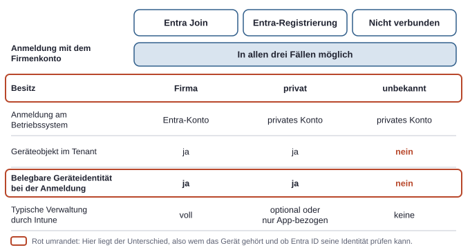
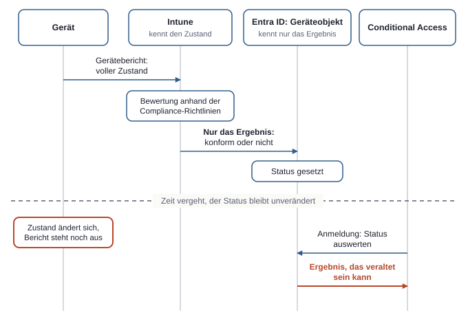
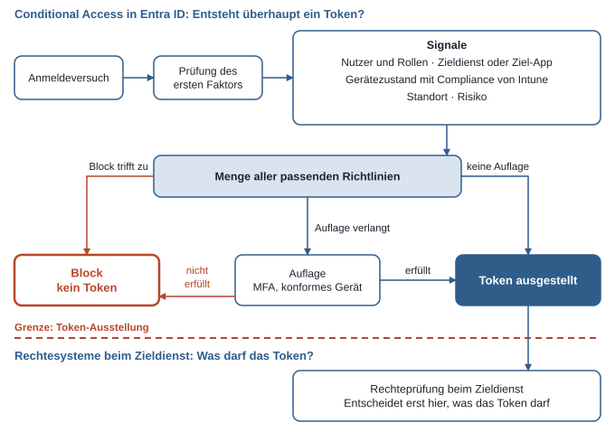
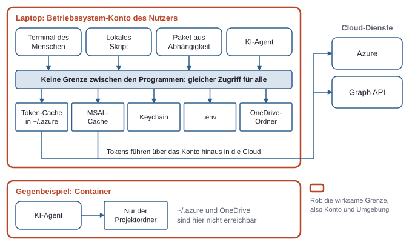

# 6. Geräte und Zugriffsregeln: Welche Rolle spielt der Laptop?

Rollen und Berechtigungen beantworten die Frage, was eine Identität darf. Sie sagen nichts darüber, von wo aus diese Identität gerade handelt. Ein Global Administrator auf einem gepflegten Firmenlaptop und derselbe Global Administrator auf einem fremden Rechner im Hotel haben dieselben Rechte, aber nicht dasselbe Risiko.

Der Laptop spielt deshalb zwei getrennte Rollen. Erstens ist er ein Signal bei der Anmeldung: Entra ID kann seinen Zustand in die Entscheidung einbeziehen, ob ein Token ausgestellt wird. Zweitens ist er ein Aufbewahrungsort: Nach der Anmeldung liegen dort Tokens, Geheimnisse und Dateien, und jedes lokal laufende Programm kommt potenziell an sie heran.

## Was Entra ID vom Gerät weiß

Ein Gerät kann in Entra ID als eigenes Objekt existieren, ähnlich wie ein Nutzer oder eine Gruppe. Es gibt drei grundlegende Zustände, die sich vor allem darin unterscheiden, wem das Gerät gehört und wie viel Entra ID darüber aussagen kann.

**Entra Join** bedeutet, dass ein Gerät als Firmengerät direkt mit Entra ID verbunden ist. Die Anmeldung am Betriebssystem läuft dann über das Entra-Konto, und das Gerät gehört organisatorisch zum Tenant. Das ist das typische Modell für neu ausgerollte Windows-Firmenlaptops.

**Entra-Registrierung** bedeutet, dass das Gerät Entra ID bekannt ist, aber im Wesentlichen privat verwaltet bleibt. Die Anmeldung am Betriebssystem läuft weiter über das private Konto, und das Firmenkonto kommt nur zusätzlich dazu. Das ist das typische Modell für private Geräte.

**Gar nicht verbunden** heißt, dass im Tenant kein Geräteobjekt existiert. Eine Anmeldung ist trotzdem möglich, denn sie gehört zum Nutzer und nicht zum Gerät. Entra ID sieht dann nur Merkmale der einzelnen Anmeldung wie Browser, Betriebssystem-Angabe und IP-Adresse, und diese Angaben sind nicht vertrauenswürdig belegt.

Der Unterschied zwischen dem zweiten und dem dritten Zustand ist also nicht, ob sich jemand anmelden kann. Der Unterschied ist, ob das Gerät sich gegenüber Entra ID ausweisen kann. Bei Entra Join und Entra-Registrierung erhält das Gerät eine eigene Identität mit kryptografischem Schlüsselmaterial. Damit lässt sich die Geräteangabe in einer Anmeldung belegen, statt sie nur zu behaupten.



*Das Firmenkonto kann sich in allen drei Fällen anmelden; die Zustände unterscheiden sich darin, wem das Gerät gehört und ob Entra ID seine Identität prüfen kann.*

Im Entra Admin Center zeigt die Geräteliste unter „Devices“ den Zustand als Join-Typ an, dort in den Microsoft-Bezeichnungen „Microsoft Entra joined“ und „Microsoft Entra registered“. Als dritter Wert kann „Microsoft Entra hybrid joined“ auftauchen. Das betrifft Geräte, die zugleich mit einem klassischen lokalen Active Directory verbunden sind, und spielt in einem reinen Cloud-Tenant keine Rolle.

Auf einem Windows-Gerät zeigt `dsregcmd /status` denselben Zustand lokal: `AzureAdJoined : YES` steht für Entra Join (der Feldname trägt noch den alten Produktnamen), `WorkplaceJoined : YES` für Entra-Registrierung.

Die Registrierung kann auch beiläufig passieren. Wer sich auf einem privaten Windows-Rechner in einer Office-App mit dem Firmenkonto anmeldet, bekommt oft einen Dialog angeboten, mit dem die Organisation das Gerät verwalten darf. Eine schnelle Bestätigung registriert das Gerät und meldet es je nach Tenant-Konfiguration auch in der Geräteverwaltung an. Unter „Einstellungen > Konten > Auf Arbeits- oder Schulkonto zugreifen“ lässt sich das prüfen und wieder trennen.

### Windows, Mac und Linux im Vergleich

Das Modell ist einheitlich, die Tiefe der Integration aber nicht. Windows ist die Referenzplattform, macOS ist gut abgedeckt, Linux-Desktops sind ein Randfall.

**Intune** ist der Dienst zur Geräteverwaltung und Compliance-Prüfung. Company Portal auf dem Mac und die Intune-App auf Linux sind die lokalen Apps, über die ein Gerät an Intune und Entra ID angebunden wird. Die Enterprise-SSO-Erweiterung gibt auf dem Mac die Anmeldung an Apps und Browser weiter, und Platform SSO verbindet zusätzlich die Anmeldung am Mac selbst mit dem Entra-Konto. Ein TPM ist ein Sicherheitschip, in dem Schlüssel so liegen, dass sie das Gerät nicht als Datei verlassen können, und die Secure Enclave erfüllt auf dem Mac dieselbe Aufgabe.

| Aspekt | Windows | macOS | Linux-Desktop |
|---|---|---|---|
| Firmengerät-Modell | Entra Join (nicht mit Home-Edition) | Verwaltung über Intune, Anmeldung über Platform SSO | Entra Join ist nicht der übliche Weg |
| Privates Gerät | Entra-Registrierung über Arbeits- oder Schulkonto | Entra-Registrierung über die App Company Portal | Registrierung über die Intune-App, nur für ausgewählte Distributionen |
| Single Sign-on im Browser | Direkt über Betriebssystem und Edge | Über Company Portal und Enterprise-SSO-Erweiterung | Über Edge und die Intune-App |
| Schutz von Schlüsseln | TPM | Secure Enclave | Abhängig von Hardware und Distribution |
| Lokale Prüfung | `dsregcmd /status` | Company Portal und Profile in den Systemeinstellungen | Intune-App |

Praktisch bedeutet das für einen Linux-Rechner vor allem eines: Sobald ein Tenant ein konformes Gerät verlangt, wird dieser Rechner schnell zum Sonderfall. Eine Linux-Entwicklungsmaschine braucht dann entweder eine unterstützte Konfiguration oder eine bewusste Ausnahme, oder die Arbeit läuft über ein anderes Gerät oder eine verwaltete Umgebung.

## Intune und Compliance

Entra ID weiß über ein Gerät nur wenig: dass es existiert, wie es verbunden ist, und wann es zuletzt aktiv war. Ob die Festplatte verschlüsselt ist, weiß Entra ID nicht. Dafür ist Intune zuständig. **Compliance** ist der von Intune gemeldete Status, ob ein Gerät die Firmenregeln erfüllt. Die Aufgaben lassen sich klar trennen: Entra ID kennt das Gerät als Identität. Intune kennt seinen technischen Zustand. Die Verbindung zwischen beiden ist schmal, denn Intune schreibt im Kern nur das Ergebnis der Prüfung an das Geräteobjekt in Entra ID.

Dazu wird das Gerät in Intune eingeschrieben, also unter Verwaltung gestellt, was bei Entra Join je nach Lizenz und Konfiguration automatisch geschehen kann. Im Intune Admin Center (`intune.microsoft.com`) legen Compliance-Richtlinien die Anforderungen fest, etwa Mindestversion des Betriebssystems, Datenträgerverschlüsselung (BitLocker oder FileVault), aktive Firewall und Gerätepasswort. Das Gerät meldet regelmäßig seinen Zustand, Intune bewertet ihn und setzt das Ergebnis am Geräteobjekt in Entra ID. Bei der nächsten passenden Anmeldung kann Entra ID diesen Status auswerten.



*Intune kennt den Zustand des Geräts, Entra ID erhält nur das Ergebnis, und dieses Ergebnis kann veraltet sein.*

Zwei Eigenheiten sind beim Einrichten wichtig. Der Status ist eine Momentaufnahme mit Verzögerung, ein gerade verändertes Gerät wird also nicht sofort neu bewertet. Außerdem legt eine tenantweite Intune-Einstellung fest, wie Geräte ohne zugewiesene Richtlinie gelten. Steht sie auf „konform“, sagt der Status „compliant“ bei diesen Geräten nichts aus. Diese Einstellung gehört deshalb früh auf die Prüfliste. Intune ist zudem lizenzabhängig und nicht in jedem Tenant enthalten.

### Trennung von privat und Firma

Geräteverwaltung bedeutet nicht, dass ein Unternehmen alles auf einem Gerät sehen und steuern muss. Es gibt zwei Modelle, die sich vor allem bei privaten Geräten unterscheiden.

Bei der Geräteverwaltung (MDM, Mobile Device Management) steht das ganze Gerät unter Verwaltung. Die Organisation kann Einstellungen erzwingen und im Extremfall das Gerät löschen. Das ist das normale Modell für Firmengeräte. Auch dann sieht sie keine privaten Inhalte wie Fotos oder Nachrichten, aber je nach Besitzart durchaus Gerätedaten und installierte Apps.

Bei der App-Verwaltung (MAM, Mobile Application Management) stehen nur einzelne Apps und die Firmendaten darin unter Regeln. Sogenannte App Protection Policies können etwa das Kopieren aus Outlook in eine private App verbieten oder eine PIN für die App verlangen. Auf privaten Smartphones ist das oft die bessere Wahl, denn beim Austritt lassen sich gezielt nur die Firmendaten entfernen.

Auf den Laptop lässt sich das App-Modell schlechter übertragen. Eine saubere Trennung auf demselben Betriebssystem-Konto gibt es dort kaum, weil Programme eines Nutzers sich gegenseitig erreichen können. Das hat direkte Folgen für lokal gespeicherte Tokens und Dateien.

## Conditional Access als Wenn-Dann-Regeln

**Conditional Access** sind Regeln in Entra ID, die anhand von Nutzer, App, Gerät und Risiko über Anmeldungen entscheiden. Die Intuition ist einfach: Jede Richtlinie ist ein Wenn-Dann-Satz. Wenn diese Person auf diese App unter diesen Bedingungen zugreift, dann ist der Zugriff nur unter diesen Auflagen erlaubt.

Die Richtlinien liegen im Entra Admin Center unter „Conditional Access“ und setzen in der Regel eine Lizenz ab Entra ID P1 voraus. Der Wenn-Teil nennt Nutzer (alle, Gäste, Inhaber bestimmter Entra-Rollen, jeweils mit Ausnahmen), den Zieldienst oder die Ziel-App (alle, Microsoft 365, eine einzelne Enterprise Application) und Bedingungen wie Standort, Geräteplattform, Client-Typ oder Anmelderisiko. Der Dann-Teil blockiert oder stellt Auflagen, etwa MFA oder ein konformes Gerät, und kann die Sitzung begrenzen, etwa über die Anmeldehäufigkeit.

**MFA** ist eine Anmeldung mit mehr als einem Faktor, etwa Passwort plus Bestätigung in der Authenticator-App. Die Stärke dieser Faktoren unterscheidet sich. Über sogenannte Authentication Strengths kann eine Richtlinie auch phishing-resistente Verfahren verlangen, also Passkeys oder Windows Hello for Business, bei denen ein Geheimnis nicht auf einer gefälschten Seite eingegeben werden kann.

### Wie die Entscheidung fällt

Drei Regeln erklären fast das gesamte Verhalten:

- **Conditional Access vergibt keine Rechte.** Es kann eine Anmeldung nur erschweren oder verhindern. Wer keine Rolle und keine Berechtigung hat, bekommt auch mit perfektem Gerät keinen Zugriff.
- **Alle passenden Richtlinien gelten zugleich.** Es gibt keine Reihenfolge und keine erste passende Regel. Treffen zwei Richtlinien zu, müssen beide Auflagen erfüllt sein. Ein Block gewinnt immer.
- **Ohne passende Richtlinie gibt es keine Auflage.** Conditional Access ist standardmäßig offen. Was keine Regel abdeckt, läuft ungehindert durch.

Die Prüfung findet statt, wenn Entra ID ein Token ausstellen soll, nach der Prüfung des ersten Faktors. Daraus folgt eine oft übersehene Grenze: Ein bereits ausgestelltes Access Token bleibt bis zu seinem Ablauf gültig, typischerweise etwa eine Stunde, auch wenn das Gerät inzwischen nicht mehr konform ist. Neue Regeln greifen spätestens, wenn neue Tokens geholt werden. Der Mechanismus Continuous Access Evaluation verkürzt diesen Zeitraum bei unterstützten Diensten für bestimmte Ereignisse wie das Sperren eines Kontos.



*Conditional Access entscheidet vor der Token-Ausstellung, ob überhaupt ein Token entsteht; was das Token dann darf, entscheiden erst die Rechtesysteme beim Zieldienst.*

### Beispiele

Vier Richtlinien decken in vielen kleinen Tenants einen großen Teil des Bedarfs ab:

| Wenn | Dann | Warum |
|---|---|---|
| Alle Nutzer, alle Zieldienste | MFA verlangen | Gestohlene Passwörter reichen allein nicht mehr |
| Inhaber von Admin-Rollen, alle Zieldienste | Phishing-resistente MFA und konformes Gerät verlangen | Admin-Konten sind das wertvollste Ziel |
| Alle Nutzer, Client-Typ Legacy Authentication | Blockieren | Alte Protokolle können MFA nicht abfragen |
| Alle Nutzer, Microsoft 365, nicht verwaltetes Gerät | Nur eingeschränkter Zugriff im Browser ohne Download | Firmendaten landen nicht auf fremden Rechnern |

Beim Einrichten gilt eine feste Reihenfolge. Zuerst kommt ein **Break-Glass-Konto** (siehe Kapitel 4, Admin-Rollen). Ohne ein solches Konto kann eine einzige fehlerhafte Richtlinie den ganzen Tenant aussperren. Danach läuft jede neue Richtlinie zunächst im Modus „Report-only“, in dem sie nur ausgewertet und protokolliert, aber nicht durchgesetzt wird.

Das Ergebnis steht im **Sign-in-Log**. Bei jedem Eintrag zeigt ein Reiter, welche Richtlinien griffen und mit welchem Ergebnis. Das What-If-Werkzeug spielt eine Anmeldung zusätzlich vorab durch. Erst danach wird die Regel eingeschaltet.

Beim Testen sind zwei Fehlercodes besonders häufig. `AADSTS53000` bedeutet, dass die Regel ein konformes Gerät verlangt und dieses Gerät die Anforderung nicht erfüllt. `AADSTS53003` bedeutet, dass eine Conditional-Access-Regel den Zugriff blockiert hat. In beiden Fällen ist die Ursache im Sign-in-Log zu finden. Auch der Browser spielt eine Rolle. Das Gerät kann seinen Zustand nur übermitteln, wenn der Browser dazu in der Lage ist. Edge mit angemeldetem Profil kann das in der Regel, andere Browser brauchen teils eine Erweiterung oder Konfiguration. Ein Inkognito-Fenster übermittelt den Zustand meist nicht. Eine Meldung, das Gerät sei nicht konform, kann daher auch auf einem einwandfreien Gerät auftauchen.

Conditional Access für Nutzer erfasst außerdem nicht alles. Regeln für Nutzer gelten nicht für Apps, die sich mit eigener Identität und einer Anwendungsberechtigung anmelden. Für solche Identitäten gibt es eigene, separat lizenzierte Regeln.

### Security Defaults für kleine Tenants

**Security Defaults** sind Grundschutz-Regeln ohne Einzelkonfiguration, etwa Pflicht-MFA, und typisch für kleine Tenants. Sie stehen ohne Zusatzlizenz bereit und sind bei neuen Tenants meist schon aktiv. Inhaltlich verlangen sie im Wesentlichen eine MFA-Registrierung aller Nutzer, MFA für Admins und bei Bedarf für andere Nutzer, und sie blockieren Legacy Authentication.

Security Defaults und Conditional Access schließen sich aus. Wer die erste eigene Richtlinie aktivieren will, muss vorher Security Defaults abschalten und den Schutz vollständig selbst nachbauen. Der häufigste Fehler in einem kleinen Tenant ist deshalb, die Security Defaults abzuschalten und danach nur eine einzelne Regel anzulegen, was schwächer ist als der Ausgangszustand. Security Defaults bieten dafür keine Ausnahmen, auch nicht für ein Break-Glass-Konto, und werten den Gerätezustand nicht aus. Ohne Lizenz bleiben sie die richtige Wahl.

Unabhängig von beiden Mechanismen verlangt Microsoft für Anmeldungen an Verwaltungsportalen und Verwaltungswerkzeugen zunehmend selbst MFA.

## Was lokal liegt

Nach der Token-Ausstellung beginnt die zweite Rolle des Laptops: Er bewahrt alles auf, was bei der Arbeit anfällt. Conditional Access prüft die Anmeldung, aber nicht, was danach mit dem Ergebnis auf der Festplatte passiert.

**Der Token-Cache von `az`.** Die Azure CLI legt ihre Daten im Verzeichnis `~/.azure` ab, darunter einen Token-Cache mit Access Tokens und Refresh Tokens. Auf Windows ist dieser Cache über DPAPI verschlüsselt, einen Betriebssystem-Dienst, der Daten an das Nutzerkonto bindet. Auf Linux und je nach Version auch auf macOS liegt er als lesbare Datei vor, geschützt nur durch die Dateirechte. Dateinamen und Details wechseln zwischen Versionen, aber das Modell bleibt: Ein `az login` hinterlässt dauerhaft nutzbares Material. Ein `az logout` entfernt es wieder.

**Der Token-Cache von MSAL.** MSAL hält Tokens zunächst nur im Speicher. Eine App, die Anmeldungen über Neustarts hinweg erhalten will, muss selbst einen dauerhaften Speicher einrichten, und ergänzende MSAL-Bibliotheken nutzen dafür die Mechanismen des Betriebssystems. Die Sicherheit hängt damit von der jeweiligen App ab. Ein Eigenbau, der den Cache in eine JSON-Datei schreibt, ist so sicher wie diese Datei.

**Keychain und vergleichbare Speicher.** Die Keychain ist der Geheimnisspeicher von macOS. Unter Windows entsprechen ihr Credential Manager und DPAPI, unter Linux Dienste wie libsecret. Sie sind deutlich besser als eine Textdatei, weil die Inhalte verschlüsselt sind und teils nur für bestimmte Programme freigegeben werden. Sie sind aber kein Schutz gegen beliebigen Code. Auf Windows kann über DPAPI grundsätzlich jeder Prozess desselben Nutzers entschlüsseln, und auf dem Mac genügt manchmal eine gedankenlos bestätigte Abfrage.

**Die OneDrive-Synchronisation.** Der OneDrive-Client spiegelt Dateien aus persönlichen OneDrive-Bereichen und eingebundenen Bibliotheken auf die Festplatte, je nach Einstellung als Platzhalter oder dauerhaft. Sobald eine Datei lokal liegt, ist sie eine gewöhnliche Datei. Die Rechte aus SharePoint schützen nur den Zugriff über den Dienst (siehe Kapitel 5, Daten und Freigaben), lokal gelten die Dateirechte des Betriebssystems. Ein später entzogener Zugriff löscht auch nicht jede bereits angefertigte Kopie. Genau deshalb verlangen Compliance-Richtlinien Datenträgerverschlüsselung, und deshalb beschränken viele Tenants die Synchronisation auf verwaltete Geräte.

**`.env`-Dateien.** Eine `.env` ist eine Textdatei im Projektordner, aus der Programme beim Start Konfiguration lesen. Dort landen schnell Client Secrets und Verbindungszeichenfolgen. Ein Eintrag in `.gitignore` verhindert nur den Commit, nicht das Lesen. Besser ist es, in der lokalen Entwicklung die eigene Anmeldung zu nutzen. Bibliotheken wie `DefaultAzureCredential` aus dem Azure SDK greifen dazu auf die `az`-Sitzung zurück, und ein Client Secret entfällt für diesen Fall.

**Das Primary Refresh Token.** Geräte mit Entra Join oder Entra-Registrierung halten zusätzlich ein Primary Refresh Token, ein geräte- und nutzergebundenes Token, das Single Sign-on über Apps und Browser ermöglicht. Es wird, soweit die Hardware es erlaubt, über TPM oder Secure Enclave geschützt. Darum ist die Anmeldung auf einem solchen Gerät oft unsichtbar. Das Fehlen eines Anmeldedialogs bedeutet aber nicht, dass keine Sitzung besteht.

**Gestohlene Tokens.** Ein gestohlenes Token umgeht viele Schutzmaßnahmen. Die MFA hat bereits stattgefunden und steht im Token als erledigt, wie dieser Ausschnitt aus einem Access Token für die Graph API zeigt:

```json
{
  "aud": "https://graph.microsoft.com",
  "tid": "<tenant-id>",
  "scp": "Files.Read.All User.Read",
  "amr": ["pwd", "mfa"],
  "deviceid": "<device-id>"
}
```

Dieser gekürzte Ausschnitt zeigt das Prinzip. `amr` nennt die benutzten Anmeldemethoden, `deviceid` das Gerät, sofern dieses sich ausweisen konnte. Wer das Token besitzt, kann es bis zum Ablauf verwenden, und ein abgeflossenes Refresh Token kann deutlich länger nützlich sein. Gerätegebundene Mechanismen wie das Primary Refresh Token im TPM und die Session-Regel Token Protection (nur für bestimmte Plattformen und Lizenzen) sollen genau das erschweren.

## Lokale Skripte laufen mit den eigenen Rechten

Ein Skript auf dem eigenen Rechner hat keine eigene Identität. Es läuft unter dem Betriebssystem-Konto seines Nutzers und kann, wenn zuvor `az login` erfolgte, dessen Tokens verwenden. Aus Sicht von Azure handelt nicht das Skript, sondern dieser Mensch.

```bash
# Welche Identität würde ein Skript jetzt benutzen?
az account show --query "{user:user.name, tenant:tenantId, sub:name}"

# Jedes Programm mit Zugriff auf az kann sich so ein Token holen:
az account get-access-token --resource https://graph.microsoft.com --query expiresOn
```

Daraus ergeben sich drei Konsequenzen:

- **In Azure sind die Rechte so groß wie die des Nutzers.** Ein Skript, das nur eine Liste von Resource Groups ausgeben soll, könnte mit denselben Tokens auch `az group delete` aufrufen, wenn der Nutzer Owner ist. Eine Begrenzung auf das, was das Skript fachlich braucht, gibt es nicht von selbst. Das Gleiche gilt für jede Abhängigkeit, die das Skript lädt. Ein kompromittiertes Paket aus einem öffentlichen Paketindex läuft ebenfalls unter dem Nutzerkonto und kann `~/.azure`, `.env`-Dateien und den OneDrive-Ordner lesen.
- **Conditional Access sieht keinen Unterschied.** Entra ID wertet die Richtlinien auch bei nicht-interaktiven Token-Abrufen aus, aber mit denselben Signalen von Nutzer und Gerät. Deshalb ist das Skript nicht vom Menschen zu unterscheiden. Spätere Token-Abrufe durch das Skript erscheinen höchstens als nicht-interaktive Anmeldungen im Sign-in-Log.
- **Die Protokolle nennen den Menschen.** Im **Audit-Log** und bei Azure-Änderungen im Activity Log steht der Nutzer als Handelnder. Ob er selbst oder sein Skript gehandelt hat, ist daraus nicht zu erkennen.

### Was das für KI-Agenten bedeutet

Ein lokaler KI-Agent, der Dateien lesen und Befehle ausführen darf, ist in diesem Modell einfach ein weiteres Programm unter dem Nutzerkonto. Er erbt damit dieselbe Reichweite: die `az`-Sitzung, den synchronisierten OneDrive-Ordner, `.env`-Dateien, teils auch freigegebene Keychain-Einträge. Bestätigungsabfragen im Agenten selbst sind nützlich, aber sie sind eine Funktion des Programms und keine Grenze, die das Betriebssystem oder Entra ID durchsetzt. Zwei Punkte unterscheiden einen Agenten von einem festen Skript. Sein Verhalten steht vorab nicht fest, weil er die Schritte selbst wählt. Und was er liest, kann sein Verhalten beeinflussen. Enthält ein Dokument aus dem synchronisierten Ordner versteckte Anweisungen, dann handelt der Agent möglicherweise danach, mit den Rechten des Nutzers. Dieser Angriff heißt Prompt Injection.

Die Gegenmaßnahmen folgen aus Least Privilege und zielen darauf, was am Arbeitsplatz des KI-Agenten überhaupt erreichbar ist:

- **Eigenes Konto mit wenig Rechten.** Der KI-Agent arbeitet unter einem Testkonto ohne Admin-Rolle, in Azure etwa mit einer Reader-Rolle auf einer einzelnen Resource Group, statt unter dem eigenen Admin-Konto.
- **Hohe Rechte gar nicht erst aktiv.** Bei befristet aktivierten Admin-Rechten über **PIM** (siehe Kapitel 4, Admin-Rollen) gibt es außerhalb der Aktivierung nichts zu missbrauchen.
- **Eingeschränkte Umgebung.** Ein Container oder eine VM, in die nur der Projektordner eingebunden ist, sieht weder `~/.azure` noch OneDrive.
- **Kurze Sitzungen und prüfbare Änderungen.** Eine separate `az`-Sitzung nur für die Aufgabe, danach `az logout`; die Arbeit läuft in Git und einer Testumgebung statt direkt gegen den produktiven Tenant.



*Auf dem Laptop trennt keine Grenze die Programme eines Nutzers voneinander; jedes davon erreicht dieselben Tokens und Daten, und die wirksame Grenze liegt beim Konto und der Umgebung.*

## Warum Admin-Arbeit oft nur von bestimmten Geräten erlaubt ist

Aus den beiden Rollen des Laptops ergibt sich die Begründung für eine häufige Regel: Admin-Portale sind nur von konformen, oft besonders abgesicherten Geräten aus erreichbar. Eine Admin-Sitzung ist nur so vertrauenswürdig wie das Gerät, auf dem sie läuft. MFA beweist, dass der richtige Mensch sich angemeldet hat. Sie beweist nicht, dass auf dem Gerät keine Schadsoftware mitliest und das entstandene Token abgreift. Eine solche Richtlinie zielt typischerweise auf Inhaber von Entra-Rollen oder auf die Ziel-App „Microsoft Admin Portals“ und verlangt ein konformes Gerät plus phishing-resistente MFA. Für Azure-Verwaltung gilt die gleiche Logik, auch weil `az` und Portal an dieselbe Control Plane gehen.

Das strengste Modell ist die Privileged Access Workstation, ein Gerät, das ausschließlich für Admin-Aufgaben genutzt wird und auf dem kein E-Mail-Client, kein allgemeines Surfen und keine Entwicklungsumgebung läuft. Der Grund ist einfach: E-Mail und Web sind die häufigsten Einfallstore, und auf diesem Gerät gibt es beides nicht. Für kleine Organisationen ist das oft zu aufwendig. Eine pragmatische Zwischenstufe sind ein separates Admin-Konto, das nur für diese Aufgabe verwendet wird, ein konformes Gerät und befristete Rechte über PIM. Die Ausnahme bleibt das Break-Glass-Konto (siehe Kapitel 4, Admin-Rollen). Es ist von Geräteregeln ausgenommen, damit der Tenant auch bei Ausfall von Intune oder bei einer fehlerhaften Regel erreichbar bleibt.

## Getrennte Browser-Profile und Testkonten in der Praxis

Wer mehrere Konten und Tenants betreut, hat ein ganz alltägliches Problem: Im Browser ist immer genau die Sitzung aktiv, die zuletzt benutzt wurde. Eine Änderung im falschen Tenant ist dann schnell passiert. Getrennte Profile lösen das.

Ein Browser-Profil ist ein vollständig getrennter Bereich mit eigenen Cookies, Sitzungen und Erweiterungen. Es ist etwas anderes als ein Inkognito-Fenster, denn es bleibt dauerhaft bestehen und kann, wie oben beschrieben, in Edge auch den Gerätezustand mitgeben. Eine brauchbare Aufteilung sieht so aus:

| Profil | Konto | Zweck |
|---|---|---|
| Privat | Privates Microsoft-Konto | Alles außerhalb der Arbeit |
| Alltag | `nutzer@contoso.onmicrosoft.com` | E-Mail, Teams, Dokumente, keine Admin-Rolle |
| Admin | `admin@contoso.onmicrosoft.com` | Nur Portale; kein allgemeines Surfen |
| Test | Testnutzer ohne Rollen, auch als Gast | Prüfen, was ein normaler Nutzer wirklich sieht |

Eine auffällige Farbe je Profil verringert Verwechslungen spürbar. Zudem sollten die Konten verschiedene Rollen spiegeln, damit sich Berechtigungen überprüfen lassen. Eine Admin-Sicht zeigt fast immer mehr als eine normale Sicht. Ob eine Freigabe oder Regel wie geplant wirkt, zeigt erst die Anmeldung als normaler Member und als Gast.

Dasselbe Prinzip gilt für die Kommandozeile. Die Azure CLI liest ihr Konfigurationsverzeichnis aus einer Umgebungsvariable, sodass sich Sitzungen sauber trennen lassen:

```bash
# Eigene az-Sitzung nur für den Test-Tenant
export AZURE_CONFIG_DIR="$HOME/.azure-test"
az login --tenant <tenant-id>
az account show --query tenantId
```

Vor jeder ändernden Aktion lohnt sich ein kurzer Blick auf `az account show`. Das prüft, in welchem Tenant und welcher Subscription der nächste Befehl tatsächlich wirkt. Für Testkonten gelten dieselben Regeln wie für echte Konten. Auch sie sind vollwertige Principals und brauchen MFA, sobald sie mehr als nichts dürfen. Ihre Passwörter gehören in einen Passwort-Manager und nicht in eine `.env`. Vergessene Testkonten mit alten Rollen sind ein bekannter Weg in einen Tenant, deshalb lohnt sich eine regelmäßige Durchsicht.
