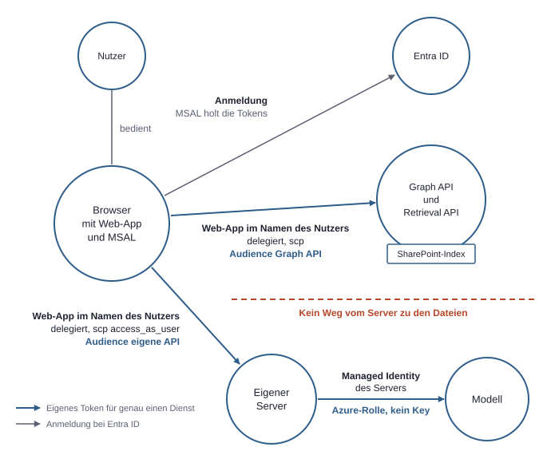

# 8. Ein Beispielprojekt eingeordnet: Vom Test-Tenant in eine Firma

Das Beispielprojekt beantwortet Fragen zu Dokumenten aus SharePoint. Eine Web-App sucht passende Textstellen, und ein Modell formuliert daraus eine Antwort mit Quellen. Das Verfahren heißt RAG: erst Textstellen suchen, dann das Modell nur daraus antworten lassen.

Für die Rechte zählt weniger die Antwort als die Frage hinter jedem Schritt: Wer handelt hier gerade, und woher weiß das System, dass er das darf? Der Aufbau läuft in einem Test-Tenant mit erfundenen Daten. Alle Schlüsse daraus sind vorläufig. Aussagen zum Einsatz in einer Firma sind deshalb als Empfehlung gekennzeichnet und beschreiben keinen bestehenden Zustand.

## Der Aufbau: Jeder Pfeil hat eine Identität

Der Aufbau besteht aus fünf Teilen: dem Browser mit der Web-App, einem eigenen Server, der Graph API, der Retrieval API und dem Modell. Die Retrieval API ist ein Microsoft-Dienst, der zu einer Frage passende Textstellen aus dem indexierten Bestand liefert. Crawling, Indexierung und Rechtefilter übernimmt dabei Microsoft, die Web-App baut nur die Antwortschicht darauf.

Eine Frage läuft in dieser Reihenfolge durch das System:

1. Der Nutzer meldet sich im Browser an. MSAL läuft dort und holt die Tokens nach dem Muster einer Single-Page Application (siehe Kapitel 2, Identitäten und Tokens). Der eigene Server ist an der Anmeldung nicht beteiligt, und die Web-App sieht das Passwort nie.
2. Der Browser ruft die Retrieval API mit dem delegierten Zugriff des Nutzers auf und bekommt Textstellen aus bis zu 25 Dateien zurück, gefiltert nach dessen Rechten.
3. Der Browser schickt Frage und Textstellen mit einem zweiten Token an den eigenen Server.
4. Der Server prüft dieses Token und ruft das Modell mit seiner Managed Identity auf.
5. Die Antwort geht mit den Quellen zurück an den Browser.



*Der Gesamtaufbau des Projekts, an jedem Pfeil stehen handelnde Identität und Art des Tokens. Es gibt nicht „den“ Zugriff, sondern pro Pfeil ein eigenes Token für genau einen Dienst, und der Server hat bewusst keinen Weg zu den Dateien.*

| Pfeil | Wer handelt | Token | Woran das Recht hängt |
|---|---|---|---|
| Browser zu Graph API und Retrieval API | Web-App im Namen des Nutzers | Access Token mit `scp`, Audience Graph API | Schnittmenge aus App-Recht und Nutzerrecht |
| Browser zu eigenem Server | Web-App im Namen des Nutzers | Access Token mit `scp: access_as_user`, Audience eigene API | Eigener Scope der App und Prüfung am Server |
| Server zu Modell | Managed Identity des Servers | Token aus der Managed Identity | Azure-Rolle für das Modell, kein Key |

Die Audience trennt die ersten beiden Zeilen. Ausschnitte der beiden delegierten Tokens zeigen den Unterschied:

```json
{ "aud": "https://graph.microsoft.com", "tid": "<tenant-id>", "scp": "<delegierte-graph-rechte>" }
{ "aud": "<eigene-api>",                "tid": "<tenant-id>", "scp": "access_as_user" }
```

Ein Graph-Token lehnt der Server ab, denn es ist für einen anderen Dienst ausgestellt. Der Browser braucht deshalb zwei Tokens, obwohl derselbe Nutzer dieselbe App bedient.

### Delegierter Datenzugriff aus dem Browser

Der Browser ruft die Graph API und die Retrieval API selbst auf. Die Graph API liefert nur, was der angemeldete Nutzer sehen darf. Die App muss also keine eigene Rechteprüfung nachbauen, denn das Security Trimming übernimmt der Dienst.

Daraus folgt ein wichtiger Sicherheitsgewinn: Der Server hält keine Rechte auf Dateien. Geht er verloren, sind die Dateien nicht direkt betroffen. Der Preis steht im Abschnitt zur offenen Grenze.

Das Security Trimming sagt allerdings nur, was gezeigt werden darf. Es sagt nichts über Vollständigkeit. Im Test lieferte eine breite Stichwortfrage 19 von 24 Projekten, alle geprüften Werte stimmten, und die Lücke wurde in der Antwort nicht erwähnt. Ein fehlender Treffer belegt also nicht, dass ein Recht fehlt.

### Prüfung des eigenen Scopes am Server

Der Browser darf das Modell nicht direkt aufrufen, weil er dafür Rechte in Azure bräuchte. Der Server ist deshalb die Schleuse. Damit er eine Anfrage einordnen kann, stellt die App-Registrierung einen eigenen delegierten Scope bereit, nach dem Muster `api://<client-id>/access_as_user`. Dieser Scope steht als `scp` im Token und hat nichts mit dem Scope (Azure) einer Rollenzuweisung zu tun.

Der Server prüft fünf Dinge am Token: Signatur, Ablauf, Tenant, Audience und Scope. Fehlt das Token, antwortet er mit 401.

### Managed Identity zum Modell

Für den letzten Pfeil wechselt die Identität. Der Server handelt hier nicht mehr im Namen des Nutzers, sondern als eigene Azure-Identität ohne gespeichertes Secret. Das Recht liegt als Rollenzuweisung in Azure, im Projekt mit der Rolle „Cognitive Services OpenAI User“. Das Modell erfährt über diese Identität also nicht, welcher Nutzer gefragt hat.

### Sites.Selected für Skripte ohne Nutzer

Ein Skript ohne Nutzer hat keine Schnittmenge, die es begrenzt. Mit `Sites.Read.All` könnte es alle Sites lesen. Ein Test im Projekt prüft deshalb die engere Variante mit Sites.Selected. Das Recht steht als Anwendungsberechtigung in `roles` im Token.

| Zeitpunkt | Freigegebene Site | Andere Site |
|---|---|---|
| Vor der Freigabe | 403 | 403 |
| Nach der Freigabe für genau eine Site | 200 | 403 |

Der Test zeigt, dass es zwei Schritte in zwei Systemen braucht. Das App-Recht liegt in Entra ID, die Freigabe auf der Site. Wer die Freigabe setzt, braucht selbst weitergehende Rechte, im Test `Sites.FullControl.All`. Das Testskript nutzt daher zwei verschiedene Identitäten: eine zum Freigeben und eine zum Lesen. Außerdem entstand beim Registrieren der App noch kein Service Principal, er musste eigens angelegt werden.

## Wer im Projekt welches Recht hält

Im Projekt gibt es sechs Beteiligte, von denen die Pfeile oben nur einen Teil zeigen. Ihre Rechte liegen an unterschiedlichen Stellen (siehe Kapitel 3, Die drei Rechtesysteme).

| Beteiligter | Identität | Art des Rechts | Wo es liegt | Wichtigste Grenze |
|---|---|---|---|---|
| Nutzer | Konto im Tenant | Eigene Rechte auf Sites und, im Test, hohe Rollen | SharePoint, Entra ID, Azure | Im Test ungewöhnlich weit |
| Web-App | App-Registrierung und Service Principal; am Server eine Managed Identity | Delegiert zu Graph API und Retrieval API, eigener Scope, Azure-Rolle zum Modell | Entra ID und Azure RBAC | Keine Rechte des Servers auf Dateien |
| Lokales Skript | App mit angemeldetem Nutzer | Delegiert, im Token als `scp` | Entra ID | Nur Rechte, denen zugestimmt wurde |
| Testskript ohne Nutzer | App ohne Nutzer | Sites.Selected in `roles` | Entra ID und die einzelne Site | Nur freigegebene Sites |
| Teams-Tab | Dieselbe Web-App im Teams-Rahmen | Dieselben delegierten Rechte | Entra ID | Keine eigene Datenlogik im Paket |
| Copilot-Studio-Agent und Flow | Agent mit Wissensquelle, Flow mit Verbindungen | Eine Verbindung ist der gespeicherte Zugang eines Nutzers zu einem Dienst, den ein Flow oder Agent mitbenutzt | Copilot Studio, Dataverse, Power Automate | Handarbeit im Browser, an eine Person gebunden |

**Lokales Skript.** Es meldet sich über den Browser an und handelt delegiert. Sein Rechteumfang ist im Token ablesbar und zusätzlich durch die Rechte der App begrenzt: Fehlt dort `Mail.Read`, kann es keine Mails lesen, auch wenn der Nutzer selbst Mails lesen darf.

**Fehler aus dem Test.** Mehrere Fehler im Test zeigen, wie eng und unterschiedlich Rechte wirken:

- Die Azure CLI konnte keine SharePoint-Dateien laden, obwohl der Nutzer Admin war. Sie bekommt nur feste Graph-Rechte, und wirksam ist nur die Schnittmenge, also muss auch die App das Recht haben.
- `Group.ReadWrite.All` erlaubte nicht, andere Nutzer zu lesen. Rechte sind enger geschnitten, als sie klingen.
- Ein neu ergänztes Recht, dem noch niemand zugestimmt hatte, ließ eine Messung mit „Nicht angemeldet“ ausfallen. Stilles Erneuern holt ein neues Token ohne sichtbare Anmeldung. Es bekommt nur Rechte mit Consent.
- Ein Parameter der Graph-Suche führte delegiert zu einem Fehler 400, weil er nur für Aufrufe als App gilt.

**Teams-Tab.** Er ist dieselbe Webseite in einem Rahmen. Das hochgeladene Paket sagt Teams nur, welche Adresse es anzeigen soll. Die Anmeldung übernimmt Nested App Authentication, ein Verfahren, bei dem Teams als Vermittler die Anmeldung für die eingebettete App abwickelt. Ein Token-Tausch über den Server entfällt damit. Dafür braucht die App-Registrierung einen speziellen Redirect-URI nach dem Muster `brk-multihub://…`, und der Server muss Teams das Einrahmen der Seite erlauben.

**Copilot-Studio-Agent und Flow.** Copilot Studio ist Microsofts Baukasten für Agenten, Power Automate führt Flows aus, also automatisierte Abläufe. Beide wirken wie reine Klickoberflächen, liegen aber als Daten vor. Der Agent besteht aus YAML-Dateien mit Anweisungen, Modell, Websuche-Einstellung und SharePoint als Wissensquelle. Der Flow ist ein Datensatz in Dataverse, dem Datenspeicher der Power Platform, und enthält JSON. Die Genehmigungsregel darin ist ein einfacher Ausdruck ohne KI.

Die Grenze liegt bei den Verbindungen. Eine Verbindung etwa zu SharePoint gehört einem Nutzer und wird im Browser erteilt. Der Testflow lief nur, weil bereits eine solche Verbindung vorhanden war. Damit hängt ein scheinbar eigenständiger Ablauf an einer konkreten Person.

## Was im Test-Tenant anders ist

Der Test-Tenant verdeckt Probleme, die erst in einer Firma auffallen. Am stärksten wirkt, dass das Konto, mit dem aufgebaut wurde, alle Rollen gleichzeitig vereint.

| Thema | Im Test-Tenant | Warum das täuscht |
|---|---|---|
| Rollen | Das Konto, mit dem aufgebaut wurde, hat Admin-Rechte, ist Owner auf der Subscription, Nutzer und Entwickler | Jeder Consent und jede Rollenzuweisung gelingt sofort, ohne dass jemand gefragt wird |
| Zugriffsregeln | Security Defaults | Es gibt keine fein abgestimmten Regeln nach App, Gerät oder Risiko |
| Daten | Erfundene Daten | Oversharing hat keine Folgen, und die echten Berechtigungsstrukturen fehlen |
| Deployment | Manuell per Zip-Paket | Es läuft kein automatischer Workflow, dessen Identität oder Rechte sich prüfen ließen |

Ein Fehler zeigt, dass schon Security Defaults Entscheidungen erzwingen. Der Entra-Fehler `AADSTS530035` blockierte die Device-Code-Anmeldung. Das ist die Anmeldung über einen Code auf einem zweiten Gerät. Die Lösung war nicht, den Schutz abzuschalten, sondern den erlaubten Weg über die normale Browser-Anmeldung zu nehmen. Diese Haltung lässt sich auf strengere Regeln übertragen.

Die Sammelrolle verdeckt auch den Unterschied zwischen zwei Fragen: Funktioniert die App, oder funktioniert sie nur für diesen Admin? Delegierte Rechte sind eine Schnittmenge. Prüft nur ein Konto mit weitreichendem Zugriff, testet es den Rechtefilter kaum. Mit einem zweiten Konto auf einer privaten Site wurde das im Test nicht geprüft.


*Links vereint im Test-Tenant das Konto, mit dem aufgebaut wurde, alle Rollen, rechts sind dieselben Rollen als empfohlene Trennung im Firmen-Tenant auf verschiedene Identitäten verteilt. Was im Test wie ein einziges Recht aussieht, sind in Wahrheit mehrere getrennte Verantwortungen, die in einer Firma auf verschiedene Identitäten gehören.*

## Was in einer Firma die IT übernimmt

Der folgende Zuschnitt ist eine Empfehlung und eine typische Annahme. Die tatsächliche Aufteilung hängt vom Unternehmen und von seinen Lizenzen ab. Liegt die IT bei einem externen Dienstleister, verschiebt sich dieselbe Aufteilung auf zwei Parteien (siehe Kapitel 14, Mit externem IT-Dienstleister).

| Bereich | Typischerweise bei der IT | Beim Projektteam |
|---|---|---|
| Identitäten | Konten, Gruppen, Gäste, Offboarding | Benennen, wer Zugriff braucht |
| Apps | App-Registrierung oder deren Freigabe, Admin Consent | Liste der nötigen Rechte mit Begründung |
| Zugriffsregeln | Conditional Access, Geräte, Intune | Melden, welche Anmeldewege die App nutzt |
| Azure | Subscription, Budgets, Grundregeln | Ressourcen im zugewiesenen Rahmen |
| Daten | Site-Struktur, Freigaberegeln | Auswahl der fachlich passenden Sites |
| Protokolle | Audit-Log und Sign-in-Log | Eigene Anwendungsprotokolle |

### Was konkret zu erfragen ist

| Thema | Fragen an die IT |
|---|---|
| Apps und Consent | Dürfen Entwickler App-Registrierungen selbst anlegen? Wer erteilt Admin Consent, und welche Begründung wird erwartet? Wer setzt die Freigabe bei Sites.Selected auf der einzelnen Site? |
| Anmeldung und Geräte | Welche Conditional-Access-Regeln gelten für Web-App, lokales Skript und Teams-Tab? Muss das Gerät die Compliance erfüllen, auch beim Entwickler-Laptop? Welche Anmeldewege sind gesperrt? |
| Azure und Modell | In welcher Subscription und Resource Group darf das Projekt arbeiten? Welche Rollenzuweisungen sind für Entwickler und Managed Identities vorgesehen? Welche Modelle und Regionen sind für welche Daten zugelassen? |
| Teams und Power Platform | Wer darf ein App-Paket in Teams hochladen und freigeben? Wem soll eine Flow-Verbindung gehören, und was geschieht, wenn diese Person das Unternehmen verlässt? Welche Wissensquellen und welche Websuche sind für Agenten erlaubt? |
| Daten und Nachweise | Welche Sites dürfen in einen Test, und wurden sie vorab auf Oversharing geprüft? Sind die nötigen Lizenzen vorhanden? Wer kann Audit-Log und Sign-in-Log für das Projekt einsehen? |

## Checkliste für den Übergang

Alle Punkte sind Empfehlungen für den Einsatz in einer Firma; einzelne wurden im Test bereits erprobt.

| Punkt | Was zu tun ist |
|---|---|
| Getrennte Konten | Das Alltagskonto hält keine Admin-Rollen. Hohe Rollen liegen auf einem eigenen Konto und werden, wo die Lizenz es erlaubt, über PIM befristet aktiviert (siehe Kapitel 4, Admin-Rollen). |
| Least-Privilege-Rollen | Delegierte Rechte werden auf das reduziert, was die App wirklich aufruft. Skripte ohne Nutzer erhalten Sites.Selected statt `Sites.Read.All`. Das hohe Recht zum Setzen der Freigabe bleibt bei einer eigenen Identität. |
| Git und GitHub mit OIDC | Ein Workflow in GitHub Actions ersetzt das Zip-Deployment und meldet sich über OIDC und ein Federated Credential an, nicht mit einem Client Secret. Branch-Schutz sichert den Branch, von dem aus ausgerollt wird. Deployment-Identität und Laufzeit-Identität werden getrennt (siehe Kapitel 7, Server und GitHub). |
| Rollen pro Ressource | Rollenzuweisungen werden auf die einzelne Ressource gesetzt, nicht auf die ganze Subscription. |
| Testdaten | Vor echten Daten steht ein Testbereich mit einer eng umrissenen Site und bekannter Rechtestruktur. Der Rechtefilter wird mit zwei Nutzern geprüft, die Unterschiedliches sehen dürfen. |
| Consent-Prozess | Jedes Recht wird mit Zweck, Art und Verantwortlichem dokumentiert, bevor Admin Consent beantragt wird. Flow-Verbindungen bekommen einen klaren Verantwortlichen. |

Für die Laufzeit-Identität sieht eine Rollenzuweisung auf genau eine Ressource so aus:

```bash
az role assignment create \
  --assignee <principal-id> \
  --role "Cognitive Services OpenAI User" \
  --scope <ressourcen-id-des-modells>
```

## Die offene Grenze: Browser und Prompt Injection

Der Aufbau ist so angelegt, dass die App nicht mehr sehen kann als der Nutzer; auf einer privaten Site mit zweitem Konto ist das nicht geprüft. Offen bleibt, wie weit man dem vertrauen kann, was im Namen dieses Nutzers geschieht.

### Vertrauen in den Browser-Kontext

Die Textstellen werden im Browser geholt und dann an den Server geschickt. Der Server kann deshalb nicht prüfen, ob sie wirklich aus SharePoint kommen. Er prüft, wer fragt, aber nicht, ob der mitgeschickte Text echt ist. Für einen Test ist das in Ordnung.

Zwei Folgen sind für die Rechte wichtig:

- **Die Tokens leben im Browser.** Code, der im Kontext der Seite läuft, kann mit den delegierten Rechten des Nutzers handeln. Die Liste in `scp` bestimmt also auch den möglichen Schaden, und jedes überflüssige Recht vergrößert ihn.
- **Der Server verleiht sein Modellrecht weiter.** Ein gültiges Token öffnet den Weg zur Managed Identity und damit zum Modell, unabhängig davon, woher der mitgeschickte Text stammt.

**Empfehlung für ein Produkt:** Der Abruf der Textstellen über den Server ist zu überlegen. Dann weiß der Server, woher sie stammen. Der Preis ist, dass er selbst an Daten herankommt und sein Verlust schwerer wiegt. Der jetzige Aufbau tauscht also Herkunftsprüfung gegen einen rechtefreien Server, und diese Abwägung gehört bewusst entschieden.

### Prompt Injection als Rechtefrage

Prompt Injection bedeutet, dass in Daten versteckte Anweisungen vom Modell wie Befehle behandelt werden. Im Projekt erklärt der Systemprompt die Textstellen ausdrücklich zu Daten. Das senkt das Risiko, schließt es aber nicht aus.

Technisch ist das auch eine Frage nach Rechten, denn das Schreibrecht auf ein Dokument wird zu Einfluss auf das, was andere als Antwort lesen. Wer eine einzige Datei in einer Site ändern darf, kann so die Antworten für alle Leser dieser Site mitprägen. Oversharing wirkt dabei doppelt: Es vergrößert den Kreis der Leser und den Kreis der möglichen Schreiber.


*Eine versteckte Anweisung gelangt über ein Dokument und die Textstellen zum Modell und von dort je nach Aufbau zu unterschiedlich weitreichenden Wirkungen. Der Systemprompt ist keine Rechtegrenze; was eine eingeschleuste Anweisung erreichen kann, bestimmen die Rechte der Identität, die auf die Modellausgabe hin handelt.*

Entscheidend ist daher, welche Rechte dort erreichbar sind, wo die Modellausgabe weiterverarbeitet wird:

| Stelle | Frage an den Aufbau | Empfehlung |
|---|---|---|
| Antwort im Browser | Kann Modelltext als Code in die Seite gelangen, die Tokens hält? | Modellausgabe und Quellenlinks wie fremde Eingaben behandeln |
| Antwort beim Leser | Hält der Leser eine falsche Antwort für belegt? | Quellen prüfbar anzeigen und Grenzen des Abrufs nennen |
| Agent mit Wissensquelle | Welche Quellen und welche Websuche kann der Agent zugleich nutzen? | Quellen und Websuche gezielt festlegen, Kombination vorab prüfen |
| Flow mit Verbindungen | Löst Modelltext Aktionen aus, und mit wessen Verbindung? | Feste Regeln bevorzugen und Verbindungen eng halten |

Ein Modell lässt sich nicht zuverlässig dazu bringen, Daten und Anweisungen immer zu unterscheiden. Die belastbare Grenze ziehen deshalb die Rechte: enge `scp`-Listen, Sites.Selected, einzelne Rollenzuweisungen und Verbindungen mit klarem Besitzer. Sie begrenzen auch dann den Schaden, wenn das Modell einer eingeschleusten Anweisung folgt.
