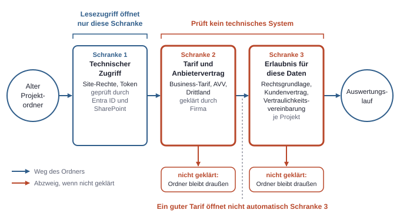

# 10. Bauen ohne Admin-Rechte: Woran es in einer Firma hapert

Solange ein KI-Agent im eigenen Test-Tenant mit erfundenen Daten arbeitet, sind alle Fragen technisch: Welches Konto, welches Recht, welche Sandbox? Mit dem ersten echten Kundendokument kommen drei Fragen dazu, die kein Portal beantwortet. Welcher Tarif gilt? Ist er für Kundendaten freigegeben? Welche Projektdaten dürfen überhaupt ausgewertet werden?

Ein denkbarer Auslöser in einer kleinen Beratung ist ein einmaliger Auswertungslauf über alte Kundenprojekte: Der KI-Agent liest abgeschlossene Projektordner und zieht daraus Muster, Vorlagen oder Lessons Learned. Technisch ist das ein Nachmittag. Organisatorisch hängt es an Personen, Verträgen und Entscheidungen, die bisher niemand für diesen Fall getroffen hat.

## Die Rolle: Wer baut, aber nichts verwaltet

Gemeint ist eine Person, die kein Admin ist. Sie hält keine Entra-Rolle mit Tenant-Reichweite, legt keine Regeln fest und erteilt keinen Admin Consent. Sie ist auch keine Beraterin im klassischen Sinn, die Workshops hält und Konzepte abliefert. Sie baut lokal mit einem KI-Agenten wie Claude Code oder Codex funktionierende Dinge, oft schneller, als die Firma darüber nachdenken kann.

Das passt weder in die IT noch in den Fachbereich sauber. Für die IT sieht die Arbeit nach nicht verwalteten Werkzeugen auf einem Laptop aus, also nach einem Risiko ohne klaren Eigentümer. Für den Fachbereich und die Geschäftsführung sieht sie nach Technik aus, also nach etwas, das die IT schon geregelt haben wird. Die Folge ist eine Lücke: Jede Stelle nimmt an, eine andere habe die Frage geklärt. Weil niemand sonst den Anlass hat, landen die Fragen bei der Person, die den Lauf starten will. Sie darf die meisten davon nicht selbst entscheiden, aber sie muss sie stellen.

Dafür bringt die Rolle etwas mit, das sonst fehlt. Nur wer den KI-Agenten tatsächlich betreibt, kann sagen, welche Dateien er liest, was davon an den KI-Anbieter geht und wo Reste liegen bleiben (siehe Kapitel 9, KI-Agenten im Rechtemodell). Eine Datenschutzbeauftragte oder ein Geschäftsführer kann ohne diese Angaben nichts prüfen. Die praktische Aufgabe der Rolle lautet deshalb: Entscheidungen so vorbereiten, dass andere sie in kurzer Zeit treffen können.

## Test-Tenant und Firmendaten: Was sich wirklich ändert

Im Test-Tenant ist die Person, die den KI-Agenten betreibt, alles zugleich (siehe Kapitel 8, Ein Beispielprojekt eingeordnet). Die Daten sind erfunden, also kommt bei einem Abfluss oft niemand zu Schaden. Fehler kosten dort meist nur Zeit; lokale Daten auf dem Rechner bleiben ein Restrisiko (siehe Kapitel 9, KI-Agenten im Rechtemodell).

Mit echten Projektdaten bleibt die Technik fast gleich, aber vier Dinge kippen:

- **Es gibt Betroffene.** In den Dokumenten stehen echte Firmeninterna und Personenbezogene Daten, also Informationen, die sich auf eine identifizierte oder identifizierbare Person beziehen.
- **Es gibt Dritte mit Rechten.** Kunden haben oft Verträge, in denen steht, was mit ihren Informationen geschehen darf.
- **Der KI-Anbieter wird zum Empfänger.** Was der KI-Agent liest, geht als Prompt an den KI-Anbieter. Aus einem lokalen Skript wird ein Datenfluss an einen externen Empfänger; ob das eine Weitergabe im Sinne des Vertrags ist, hängt vom Wortlaut ab.
- **Fehler lassen sich schlecht zurückholen.** Git rollt Code zurück, aber keine Daten, die bereits beim KI-Anbieter liegen.

### Lesezugriff ist keine Erlaubnis

Am häufigsten kippt die Einschätzung an dieser Stelle: Die Person hat Zugriff auf die alten Projektordner in SharePoint, also darf der KI-Agent sie doch lesen. Technisch stimmt das, denn er läuft mit ihren Rechten, und Security Trimming lässt alles durch, was sie sehen darf. Rechtlich und vertraglich beantwortet das aber nichts. Eine Rollenzuweisung oder Site-Mitgliedschaft sagt, dass eine Identität zugreifen kann. Sie sagt nicht, dass die Inhalte für diesen Zweck an diesen Empfänger gehen dürfen. Bei alten Projekten kommt Oversharing hinzu. Abgeschlossene Sites werden selten aufgeräumt, und mancher Zugriff stammt aus längst beendeten Projekten oder einem zu weiten Freigabelink (siehe Kapitel 5, Daten und Freigaben). Dass etwas lesbar ist, kann also schon ein Versehen sein.

*Ein alter Projektordner muss drei unabhängige Schranken passieren, bevor er in den Auswertungslauf darf. Lesezugriff öffnet nur die erste; die beiden anderen prüft kein technisches System, und ein guter Tarif öffnet nicht automatisch die dritte.*

### Warum der einmalige Lauf nicht harmloser ist

„Nur einmal“ klingt nach geringem Risiko. Die Dauer eines Laufs sagt aber wenig darüber aus, was er anfasst. Ein KI-Agent, der einmal über zwanzig alte Projekte läuft, kann in einer Sitzung mehr Kundeninhalte an den KI-Anbieter schicken als ein regelmäßig genutztes Werkzeug in Monaten. Dazu kommen Eigenheiten alter Bestände:

- **Niemand hat den Überblick.** Das Projektteam ist teils weg, und E-Mail-Exporte, Protokolle mit Namen und Kundenunterlagen liegen neben harmlosen Vorlagen.
- **Die Verträge sind alt.** Sie entstanden, bevor KI-Werkzeuge ein Thema waren, und sind oft nicht griffbereit. Eine Vertraulichkeitsvereinbarung ist ein Vertrag, der die Nutzung und Weitergabe vertraulicher Informationen begrenzt; ob eine solche Pflicht noch läuft, muss man nachlesen.
- **Der Zweck ist neu.** Die Unterlagen entstanden für ein bestimmtes Projekt, die Auswertung dient der Beratung selbst. Ob das gedeckt ist, ist eine eigene Frage an den Datenschutz und an den Vertrag.
- **Der Lauf hinterlässt Spuren.** Einmal ausgeführt, liegen die Inhalte an mehreren Orten, teils für Wochen.

*Der Datenweg eines einmaligen Auswertungslaufs von der Quelle bis zum Ergebnis; Fristen und Befehle gelten als Beispiel Claude Code. Der Lauf endet nicht mit dem Prozess: Inhalte liegen danach an mehreren Orten, und auch das Ergebnis selbst kann noch Kundeninformationen tragen.*

## Consumer-Tarif gegen Business-Tarif

Die erste offene Frage lässt sich noch am ehesten klar beantworten. Ob ein Consumer-Tarif oder ein Business-Tarif gilt (siehe Kapitel 9, KI-Agenten im Rechtemodell), entscheidet das angemeldete Konto samt Vertrag, nicht der Name des Werkzeugs. Derselbe KI-Agent, etwa Claude Code oder Codex, kann unter beiden laufen. Das gilt auch, wenn die Firma einen Consumer-Tarif erstattet: Die Erstattung allein ändert die Einstufung nach den Anbieterbedingungen wohl nicht. Das ist beim KI-Anbieter zu prüfen.

Der Stand vom November 2026 sieht so aus, kann sich aber ändern und ist vor einer Entscheidung beim KI-Anbieter nachzulesen. Drei Begriffe aus der Tabelle vorab: Drittplattformen sind Cloud-Dienste anderer Firmen, über die sich das Modell beziehen lässt, etwa Microsoft Foundry. Zero Data Retention heißt im Grundsatz, dass der KI-Anbieter die Inhalte nicht über die Anfrage hinaus aufbewahrt; der genaue Umfang steht im Vertrag. Der AVV ist der Vertrag zur Auftragsverarbeitung nach Art. 28 DSGVO, der regelt, wie ein Dienstleister Personenbezogene Daten im Auftrag verarbeitet.

| Punkt | Claude Code, Consumer-Tarif (Free, Pro, Max, Ultra) | Claude Code, Business-Tarif (Team, Enterprise, API, Drittplattformen) | Codex, Consumer-Tarif (Free, Plus, Pro) | Codex, Business-Tarif (Business, Enterprise, API) |
|---|---|---|---|---|
| Training | Eigene Wahl im Konto | Nein, außer bei ausdrücklicher Zustimmung, etwa über ein Partnerprogramm | Datenfreigabe standardmäßig an, abschaltbar; Details für Codex einzeln prüfen | Standardmäßig nein |
| Aufbewahrung beim KI-Anbieter | 5 Jahre mit, 30 Tage ohne erlaubte Modellverbesserung | Standardmäßig 30 Tage; Zero Data Retention nur für berechtigte Enterprise-Konten nach Prüfung | Beim KI-Anbieter prüfen | API: bis zu 30 Tage zur Missbrauchskontrolle; Zero Data Retention für berechtigte Endpunkte; Business, Enterprise: beim KI-Anbieter prüfen |
| AVV | Verbraucherbedingungen; AVV hier nicht belegt, Bedingungen prüfen | In den Vertragsunterlagen des Tarifs prüfen | Verbraucherbedingungen; AVV hier nicht belegt, Bedingungen prüfen | DPA verfügbar; prüfen, ob er abgeschlossen ist |

Das DPA in der letzten Spalte ist die englische Bezeichnung für einen Datenverarbeitungsvertrag des KI-Anbieters. Ob er die Anforderungen an einen AVV im konkreten Fall erfüllt, prüft der Datenschutz. „Verfügbar“ heißt außerdem nicht „abgeschlossen“.

### Warum ein privates Konto kein tragfähiger Weg ist

Für Firmen- und Kundendaten ist ein privates Konto kein tragfähiger Weg, auch wenn das Training abgeschaltet ist, weil das Abschalten nur eine von mehreren Fragen löst. Zu prüfen ist, ob Vertragspartner des KI-Anbieters die Person ist und die Firma damit keinen eigenen Vertrag über die Verarbeitung ihrer Daten hat. Zu prüfen ist auch, ob die Firma bei einem solchen Konto überhaupt Vorgaben durchsetzen und nachvollziehen kann, was geschah. Und wer eigenmächtig Firmendaten über ein privates Konto verarbeitet, schafft ein eigenes Risiko, denn er bleibt arbeitsrechtlich an interne Regeln gebunden.

Bei kleinen Firmen ist die Lage oft: Es gibt gar keinen Business-Tarif, und die Person nutzt ihr eigenes Konto für Tests. Für erfundene Daten mag das niemanden stören. Für den Lauf über alte Projekte ist ein eigener Vertrag der Firma aber in der Praxis die Mindestvoraussetzung; hinreichend ist er nicht.

### Was ein Business-Tarif nicht löst

Auch ein Zertifikat des KI-Anbieters macht den konkreten Einsatz noch nicht zulässig. Offen bleiben auch mit bestem Tarif: ob ein AVV tatsächlich abgeschlossen ist und genügt, die Rechtsgrundlage, der Drittlandtransfer und vor allem das, was mit den Kunden vereinbart ist. Die Rechtsgrundlage ist der rechtliche Erlaubnisgrund, auf den sich eine Verarbeitung Personenbezogener Daten stützt. Der Drittlandtransfer ist die Übermittlung solcher Daten in ein Land außerhalb der EU.

Für die zweite Frage heißt das: „Freigegeben für Kundendaten“ ist keine Eigenschaft eines Tarifs. Der Tarif kann eine interne Freigabe der Firma tragen, und die gilt nur so weit, wie die jeweiligen Kundenverträge es zulassen.

Eine Variante, die sich zu erfragen lohnt: Claude Code kann das Modell über Microsoft Foundry beziehen. Welche Daten dabei wohin gehen, hängt an der Bereitstellungsart „Hosted on Azure“ oder „Hosted on Anthropic“ (siehe Kapitel 9, KI-Agenten im Rechtemodell). Auch bei „Hosted on Azure“ sind AVV, Rechtsgrundlage und Drittland zu prüfen. Die Vertragsfragen gegenüber Kunden löst es nicht.

## Recht kompakt

Alles in diesem Abschnitt ist Orientierung und keine Rechtsberatung. Die Angaben beziehen sich auf Deutschland und die EU, und aus ihnen folgt kein sicheres Urteil über einen konkreten Lauf. Ihr Zweck: erkennen, welche Frage bei wem landen muss. Bei Unsicherheit entscheidet nicht die Person, die den KI-Agenten bedient.

### DSGVO, Auftragsverarbeitung und Drittland

Projektdokumente enthalten Personenbezogene Daten fast immer, etwa Namen in Protokollen, E-Mails und Signaturen. Sobald solche Daten an einen KI-Anbieter gehen, braucht es eine Rechtsgrundlage und in der Regel einen AVV. Verantwortlich ist die Stelle, die über Zweck und Mittel der Verarbeitung entscheidet. Auftragsverarbeitung bedeutet, dass ein Dienstleister Personenbezogene Daten nach Weisung des Verantwortlichen verarbeitet. Ist die Firma für die Daten selbst die Verantwortliche, bleibt sie in der Pflicht, auch wenn der KI-Agent auf dem Laptop einer einzelnen Person läuft.

Eine Ausnahme von dieser Lage ist die Sonderfrage bei Beratungen, die vor dem Lauf zu klären ist. An den Datenschutz gehen dazu je Projekt zwei Fragen. Hat die Beratung die Daten in eigener Verantwortung verarbeitet, oder war sie selbst Dienstleister des Kunden, also Auftragsverarbeiter, der nach dessen Weisung arbeitet? Dürfen Daten aus einem abgeschlossenen Projekt für den neuen Zweck überhaupt noch genutzt werden? War sie Dienstleister, dürfte es deutlich enger werden, weil der Kunde mitreden müsste.

Namen zu schwärzen ist oft eine sinnvolle Vorstufe. Ob das reicht, ist ebenfalls eine Frage an den Datenschutz: Lassen sich Personen weiterhin aus Rolle, Projekt und Kontext erkennen, und wären sie damit noch identifizierbar?

Liegt die Verarbeitung außerhalb der EU, sind zusätzlich die Regeln zum Drittlandtransfer nach Art. 44 ff. DSGVO zu prüfen. Für die Praxis zählt, wo der gewählte Tarif die Daten verarbeitet und was der Vertrag dazu sagt. Manche KI-Anbieter bieten europäische Datenresidenz an, die Bedingungen sind aber je Tarif zu prüfen.

**Wer prüft:** Bei Personenbezogenen Daten werden Datenschutzbeauftragte und Rechtsberatung eingebunden; ist niemand für den Datenschutz benannt, veranlasst das die Geschäftsführung. Die Vertragsunterlagen beschafft die Geschäftsführung oder IT.

### Geschäftsgeheimnis

Ein Geschäftsgeheimnis ist eine geheime Information mit wirtschaftlichem Wert, die durch angemessene Maßnahmen geschützt wird (§ 2 Nr. 1 GeschGehG). Der Schutz hängt also an den Maßnahmen. Eine unkontrollierte Nutzung externer Tools kann deshalb den Schutz selbst schwächen, bei eigenen Informationen wie bei denen von Kunden. Das ist eine Risikoeinschätzung und kein sicheres Urteil. Eine schriftliche Regel, wer welches Werkzeug mit welchen Daten nutzt, kann bereits ein Teil solcher Maßnahmen sein. **Wer prüft:** Geschäftsführung, bei konkreten Zweifeln mit Rechtsberatung.

### Vertraulichkeitsvereinbarung gegenüber Kunden

Für den Lauf ist die Vertraulichkeitsvereinbarung oft eine der schwersten Hürden, und sie wird leicht übersehen. Vertraulichkeitsvereinbarungen und Projektverträge können die Weitergabe an Dritte oder Unterauftragnehmer einschränken, also an Firmen, die ein Dienstleister für Teile seiner Leistung einsetzt, und ein KI-Anbieter könnte je nach Wortlaut darunterfallen. Auch ein guter Tarif löst das nicht automatisch. Zwei Dinge sind getrennt zu lesen. Die Weitergabe betrifft die Frage, ob der Inhalt zum KI-Anbieter darf. Die Nutzung betrifft die Frage, ob aus den Unterlagen eines Kunden Erkenntnisse für andere Kunden entstehen dürfen. Gerade Lessons Learned und Vorlagen zielen auf diese Wiederverwendung. Das Ergebnis einer Auswertung kann also problematisch sein, selbst wenn der Datenweg in Ordnung ist. **Wer prüft:** Geschäftsführung im jeweiligen Vertrag, in Zweifelsfällen Rechtsberatung. Eine Erlaubnis, die der Vertrag nicht hergibt, dürfte in der Regel nur der Kunde erteilen können; im Einzelfall klärt das die Rechtsberatung.

### Betriebsrat, falls vorhanden

Gibt es einen Betriebsrat, kann § 87 Abs. 1 Nr. 6 BetrVG relevant werden: Mitbestimmung bei technischen Einrichtungen, die zur Überwachung von Verhalten oder Leistung bestimmt sind. Das kann Nutzungs-Logs und Telemetrie betreffen. Kleine Beratungen haben oft keinen, dann entfällt der Punkt. **Wer prüft:** Geschäftsführung mit dem Betriebsrat, im Einzelfall.

### EU AI Act, Art. 4

Art. 4 betrifft KI-Kompetenz. Die Pflicht gilt unabhängig von Risikoklasse und Unternehmensgröße für Anbieter, die ein KI-System entwickeln und auf den Markt bringen, und für Betreiber, also Stellen, die ein KI-System in eigener Verantwortung einsetzen. Sie kann also auch eine kleine Beratung betreffen, die KI-Werkzeuge einsetzt, sofern sie als Betreiber gilt; der Umfang ist zu prüfen. Nach der Änderung durch den Digital Omnibus (2026) sollen Anbieter und Betreiber Maßnahmen zur Unterstützung der KI-Kompetenz treffen. Der genaue Wortlaut ist in EUR-Lex zu prüfen. Praktisch dürfte eine kurze, dokumentierte interne Einweisung in Werkzeug, Datenregeln und Grenzen ein vernünftiger Anfang sein. **Wer prüft:** Geschäftsführung, den genauen Umfang im Zweifel mit Rechtsberatung.

## Wer was entscheidet

Beim Einsatz eines KI-Agenten fallen in einer kleinen Beratung Rollen oft zusammen. Die IT ist vielleicht eine Person oder ein externer Dienstleister, die Geschäftsführung ist zugleich Projektleitung. Die Entscheidungen bleiben trotzdem verschieden, und sie sollten getrennt festgehalten werden. Wie sich Rollen, Anfragen und Kosten mit einem externen Dienstleister verteilen, ist eigens beschrieben (siehe Kapitel 14, Mit externem IT-Dienstleister).

| Stelle | Entscheidet | Liefert oder bereitet vor | Woran es realistisch hängen bleibt |
|---|---|---|---|
| Bauende Person | Wie der freigegebene Lauf technisch abgesichert wird | Datenflussskizze, Projektliste, Probelauf, Dokumentation | Fängt an, bevor die Antworten da sind, weil es technisch geht |
| IT | Konten, Geräte, Managed Settings (siehe Kapitel 9, KI-Agenten im Rechtemodell), erlaubte MCP-Server, Zugriff auf Quellen | Auskunft über bestehende Regeln | Keine Zeit oder kein Regelwerk für KI-Agenten vorhanden |
| Geschäftsführung | Ob der Lauf gewollt ist, welcher Tarif gekauft wird, welches Risiko die Firma trägt | Kundenverträge, Kontakt zu Kunden | Sagt mündlich „klingt gut“, und das wird als Freigabe missverstanden |
| Datenschutz | Einordnung zu Personenbezogenen Daten, AVV, Drittland | Vorgaben zum Umgang mit den Daten | Niemand benannt oder extern und nur mit klarer Vorlage schnell |
| Kunde | Was mit seinen Unterlagen über den Vertrag hinaus geschehen darf | Antwort auf eine konkrete Anfrage | Alte Ansprechpartner sind weg; Nachfragen fühlt sich unangenehm an |

Aus der Tabelle folgen drei praktische Regeln. Erstens gehört jede Freigabe dokumentiert, etwa in einer knappen E-Mail. Sie muss nennen, was genau freigegeben ist. Zweitens kann die Geschäftsführung ein Risiko für die Firma tragen, dürfte aber in der Regel keine Rechte des Kunden oder betroffener Personen wegentscheiden können; im Zweifel klärt das die Rechtsberatung. Drittens ist das Fehlen einer Antwort keine Zustimmung. Bleibt die Lage eines Projekts unklar, bleibt das Projekt draußen.

## Datenklassen als Werkzeug

Die Debatte „dürfen wir KI-Agenten nutzen?“ ist zu grob, um beantwortet zu werden. Handhabbar wird sie, wenn sie sich an Datenklassen statt an Werkzeugen ausrichtet. Fünf Klassen reichen für den Anfang. Die Tabelle ist eine Orientierung und ersetzt weder eine Firmenregel noch eine Prüfung.

| Klasse | Beispiele | Mindest-Setup (macht den Einsatz nicht allein zulässig) | Vorher zu klären |
|---|---|---|---|
| Erfunden | Testdaten im Test-Tenant | Eigener Test-Tenant und Testkonto (siehe Kapitel 9, KI-Agenten im Rechtemodell) | Nichts Besonderes; firmeneigener Code gehört aber schon zur nächsten Klasse |
| Intern | Eigene Vorlagen, interner Code, Prozessdokumente ohne Personenbezug | Business-Tarif über Firmenkonto | Interne Regel oder Zustimmung von Geschäftsführung und IT; Geschäftsgeheimnis: Bleiben die angemessenen Maßnahmen gewahrt? |
| Personenbezogen | Protokolle mit Namen, E-Mails, Signaturen, Kontaktlisten | Business-Tarif, AVV, geklärter Drittlandtransfer, Sandbox, begrenzte Eingabe | Datenschutzbeauftragte und Rechtsberatung einbinden, Rechtsgrundlage |
| Kundendaten | Projektunterlagen, Kundencode, Angebote, Analysen | Wie personenbezogen, dazu Freigabe je Projekt | Vertrag und Vertraulichkeitsvereinbarung je Kunde, gegebenenfalls Zustimmung des Kunden |
| Besonders sensibel | Gesundheitsdaten, Berufsgeheimnisse, ähnlich heikle Bestände | Standardmäßig kein Lauf. Zero Data Retention oder ein Modell in Azure ändern daran nichts von selbst: Diese Varianten klären keine Rechtsfrage; ob überhaupt ein Lauf infrage kommt, entscheiden Datenschutzbeauftragte und Rechtsberatung. | Datenschutzbeauftragte und Rechtsberatung |

Bei Mischungen überlagern sich die Klassen, und es gelten die Anforderungen aller betroffenen Klassen: Zwanzig harmlose Vorlagen und ein E-Mail-Export gelten zusammen als personenbezogen und als Kundendaten. Entlasten lässt sich ein Lauf nur durch Auswahl. Eine aus einem Projekt herausgezogene eigene Methodenvorlage kann, wenn sie wirklich kundenneutral ist und das geprüft ist, den Kundenvertrag womöglich nicht berühren.

Alte Kundenprojekte landen fast immer in der vierten Klasse, und zwar zusätzlich zur dritten; die Anforderungen beider Klassen gelten nebeneinander. Oft zeigt die Einordnung aber, dass ein großer Teil des gewünschten Nutzens aus der zweiten Klasse kommt, also aus solchen eigenen Vorlagen und Methoden. Das ist häufig der beste erste Schritt.

## Fragen, die vor dem Lauf zu klären sind

**An die Geschäftsführung:**
- Gibt es einen Business-Tarif bei einem KI-Anbieter, und welcher ist es genau? Falls nein: Wird einer gekauft?
- Welcher Nutzen soll aus der Auswertung entstehen, und darf das Ergebnis in neue Kundenprojekte einfließen?
- Wer liest die Kundenverträge und Vertraulichkeitsvereinbarungen, und wer spricht bei Bedarf mit den Kunden?
- Gibt es einen Betriebsrat und eine benannte Stelle für den Datenschutz?

**An die IT:**
- Gibt es eine Regel für KI-Agenten auf Firmengeräten, und dürfen Quelldaten lokal kopiert werden?
- Lassen sich Vorgaben zentral setzen, etwa über Managed Settings bei Claude Code oder Managed Configuration bei Codex (siehe Kapitel 9, KI-Agenten im Rechtemodell)?
- Wie werden Laptop-Backups und Synchronisierung behandelt, wenn lokal Klartext-Transkripte liegen?

**An den Datenschutz:**
- Welche Rechtsgrundlage kommt für die Auswertung in Betracht, und reicht der ursprüngliche Projektzweck?
- War die Beratung in den betroffenen Projekten Verantwortliche oder Auftragsverarbeiter des Kunden, hat sie also selbst über die Verarbeitung entschieden oder nach dessen Weisung gearbeitet?
- Genügt der Vertrag des Tarifs als AVV, und wie ist der Drittlandtransfer geregelt?
- Welche Datenarten müssen vorab heraus, und wie lange dürfen Transkripte und Ergebnisse bleiben?

**An den Kunden, falls der Vertrag es verlangt:**
- Dürfen die Unterlagen mit dem Werkzeug eines namentlich genannten Dienstleisters ausgewertet werden, und dürfen anonymisierte Erkenntnisse daraus in andere Projekte einfließen?

## Vom Test zur Freigabe: Eine Reihenfolge

Die Reihenfolge ist so gewählt, dass frühe, billige Schritte teure Klärungen ersparen. Vor allem schickt bis zum eigentlichen Lauf kein KI-Agent eine einzige Kundendatei an ein Modell.

*Elf Schritte vom Test-Tenant bis zum abgeschlossenen Auswertungslauf. Kundendaten erreichen das Modell erst ganz am Ende; die meisten Hürden sind vorher ohne einen einzigen Modellaufruf mit Kundendaten zu klären, und einzelne Projekte können unterwegs ausscheiden, ohne den Lauf zu stoppen.*

1. **Nutzen und Datenfluss auf einer Seite beschreiben.** Was soll herauskommen, reicht vielleicht die Klasse „intern“? Welches Werkzeug, welches Konto, welche Daten, wohin gehen sie, wo bleiben Reste? Diese Seite ist die Grundlage aller weiteren Gespräche.
2. **Tarif und Vertrag klären.** Ohne Firmenvertrag endet der Weg hier. Konto, Aufbewahrung, Trainingseinstellung und Verarbeitungsort werden festgehalten, außerdem, ob ein AVV tatsächlich abgeschlossen ist und genügt.
3. **Projektliste anlegen, ohne Inhalte zu öffnen.** Die Liste enthält nur Metadaten, die aus der Projektverwaltung ohnehin bekannt sind. Die Datenarten sind darin als „vermutet“ gekennzeichnet.
4. **Datenschutz prüfen lassen.** Vorlage sind die Seite aus Schritt 1 und die Liste. Ergebnis sind Auflagen, etwa auszuschließende Ordner oder Aufbewahrungsfristen.
5. **Verträge je Projekt prüfen.** Jedes Projekt bekommt einen Status: geht, nur nach Rückfrage beim Kunden, geht nicht. Ein unklarer Status zählt als „geht nicht“.
6. **Probelauf ohne Kundendaten.** Zuerst mit erfundenen Daten, die alten Unterlagen nachgebildet sind. Interne Dokumente kommen danach nur dazu, wenn dafür die Zustimmung vorliegt und ein Business-Tarif genutzt wird. So zeigt sich, ob die Auswertung den Nutzen überhaupt liefert, bevor jemand einen Kunden fragt.
7. **Kunden anfragen.** Das betrifft nur Projekte mit dem Status „nur nach Rückfrage beim Kunden“ und nur dann, wenn der Probelauf den Nutzen gezeigt hat.
8. **Kundenantwort abwarten.** Eine Zustimmung wird festgehalten und setzt das Projekt auf „geht“. Eine Absage oder fehlende Antwort setzt es auf „geht nicht“.
9. **Schriftlich freigeben lassen.** Die Freigabe nennt Projekte, Tarif, Konto, Zeitraum, Setup und Löschtermin.
10. **Den Lauf eng ausführen.** Nur über die freigegebene Kopie und im abgesicherten Setup.
11. **Prüfen, aufräumen, dokumentieren.** Ergebnis fachlich und auf Kundeninhalte prüfen, Reste löschen, in wenigen Sätzen festhalten, was wann womit lief.

Die Liste nach Schritt 5 kann so einfach aussehen:

| Projekt | Zeitraum | Rolle der Beratung | Vertrag und Vertraulichkeit | Datenarten (vermutet) | Status |
|---|---|---|---|---|---|
| Projekt A | abgeschlossen | laut Datenschutz: eigene Verantwortung | Vertrag geprüft, Nutzung und Weitergabe erlaubt laut Geschäftsführung | nur Vorlagen und Konzepte | geht |
| Projekt B | abgeschlossen | noch offen | Weitergabe an Dritte nur mit Zustimmung | Protokolle mit Namen | Kunde fragen |
| Projekt C | abgeschlossen | Dienstleister des Kunden | Vertrag nicht auffindbar | E-Mail-Export | geht nicht |

### Wie der Lauf selbst aussieht

Wenn die Freigabe steht, setzt die Technik sie um. Harte Grenze, Umgang mit nicht vertrauenswürdigen Dokumenten und MCP-Server folgen den Grundsätzen für KI-Agenten (siehe Kapitel 9, KI-Agenten im Rechtemodell). Speziell für den Einmallauf kommen vier Punkte hinzu:

- **Kopie statt Direktzugriff.** Nur freigegebene Ordner werden in einen eigenen Arbeitsordner kopiert. Der KI-Agent bekommt keine `az`-Sitzung und keinen breiten Graph-Zugriff auf den Bestand. Muss ein Skript direkt aus SharePoint lesen, begrenzt Sites.Selected es auf einzelne Sites (siehe Kapitel 5, Daten und Freigaben). Eine Cloud-Sitzung legt die Daten zusätzlich in eine VM oder einen Container beim KI-Anbieter und müsste ausdrücklich freigegeben sein.
- **Feedback abschalten.** Die Feedback-Befehle von Claude Code schicken das Transkript samt Code an den KI-Anbieter (siehe Kapitel 9, KI-Agenten im Rechtemodell). Für den Lauf gehört `DISABLE_FEEDBACK_COMMAND=1` gesetzt.
- **Transkripte in den Löschtermin einplanen.** Die lokalen Session-Transkripte im Klartext (siehe Kapitel 9, KI-Agenten im Rechtemodell) enthalten Kundeninhalte und zählen zum Löschtermin, ebenso Kopien in Backups. Transkripte aus Desktop oder Cowork sind gesondert zu prüfen. Auch bei Codex ist vorab zu klären, was lokal liegen bleibt.
- **Ergebnis als Kundendaten behandeln, bis es geprüft ist.** Eine Zusammenfassung kann Namen, Zahlen und Eigenheiten eines Kunden enthalten. Ein Mensch liest das Ergebnis, bevor es den Arbeitsordner verlässt.

Der Aufwand passt gut zur Rolle: Wenig davon erfordert Admin-Rechte, und das meiste ist Vorbereitung, die ohnehin nur die bauende Person leisten kann. Am Ende steht eine Vorlage, die den nächsten Prüfprozess verkürzt; neue Projekte und Daten sind neu zu prüfen. Daraus kann eine Regel der Firma werden, wo vorher nur Annahmen waren.
