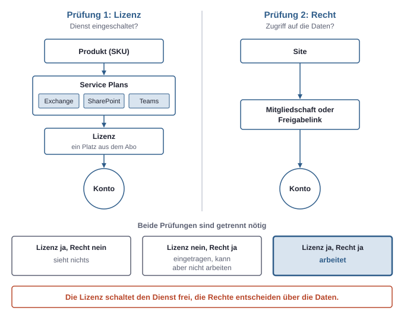
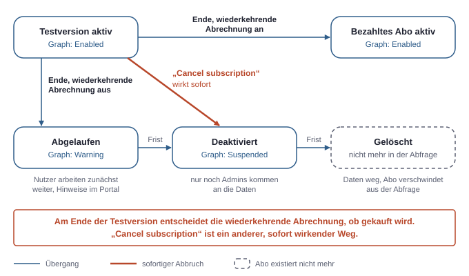
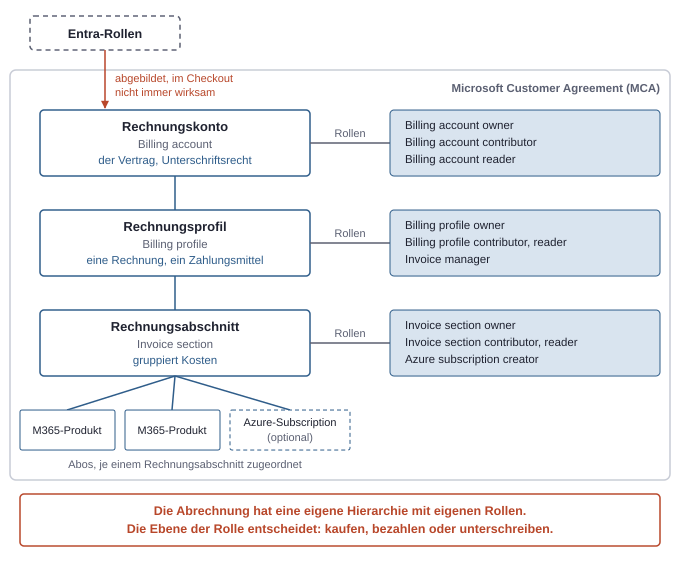
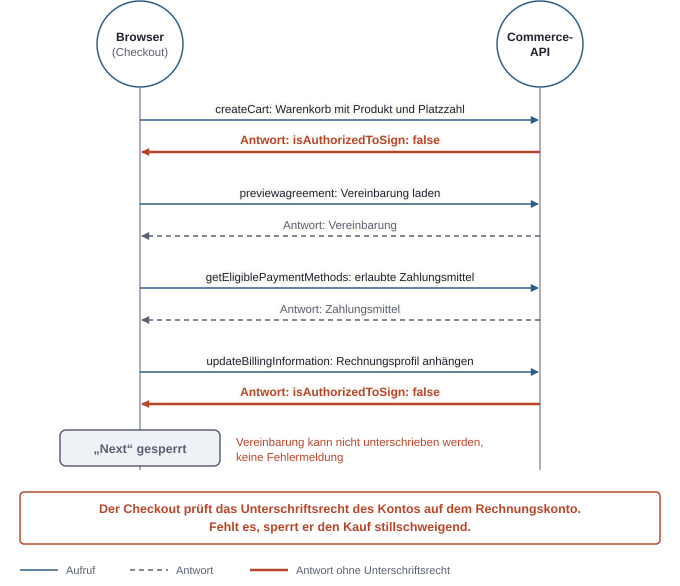

# 11. Lizenzen und Abrechnung: Wer bezahlt, wer darf kaufen?

Eine Lizenz ist kein Recht im Sinne der übrigen Rechtesysteme. Sie entscheidet nicht, wer eine Datei lesen oder eine Ressource ändern darf. Sie entscheidet, ob ein Dienst für ein Konto überhaupt eingeschaltet ist und welche Funktionen ein Tenant nutzen kann.

Daneben steht die Abrechnung. Sie hat eigene Rollen, die festlegen, wer kaufen, bezahlen und Verträge mit Microsoft unterschreiben darf. Diese Abrechnungsrollen bilden ein weiteres Rechtesystem neben Entra-Rollen, Azure RBAC und App-Rechten (siehe Kapitel 3, Die drei Rechtesysteme). Es folgt demselben Muster: eigene Zuweisungen, eigener Zielbereich, und ein Recht in einem anderen System hilft nur, wenn es ausdrücklich verknüpft ist.

Produktnamen, Preise und die Oberfläche der Abrechnung ändern sich bei Microsoft häufig. Portalbeschriftungen werden hier auf Englisch wiedergegeben, so wie sie im Test-Tenant zu sehen waren. Sie können abweichen.

## Produkt, Lizenz, Service Plan

Ein **Abonnement**, kurz Abo, ist in Microsoft 365 der Vertrag über eine bestimmte Anzahl Lizenzen eines Produkts. Mit einer Subscription in Azure hat es nichts zu tun (siehe Kapitel 1, Die Landkarte). Drei weitere Begriffe werden im Alltag oft vermischt:

- Ein **Produkt** ist das, was im Marketplace des Microsoft 365 Admin Center gekauft wird, etwa „Microsoft 365 Business Standard“ oder „Power Automate Premium“. Technisch heißt es **SKU**. In der Graph API trägt es eine GUID (`skuId`) und einen Kurznamen (`skuPartNumber`) wie `O365_BUSINESS_PREMIUM` oder `POWERAUTOMATE_ATTENDED_RPA`, der mit dem Marketingnamen oft wenig zu tun hat. Der erste steht für Business Standard, der zweite für Power Automate Premium.
- Eine **Lizenz** ist ein einzelner Platz aus einem Abo. Ein Abo über 25 Lizenzen erlaubt es, das Produkt 25 Konten zuzuweisen. Erst die Zuweisung an ein Konto schaltet für dieses Konto etwas frei.
- Ein **Service Plan** ist ein Baustein innerhalb eines Produkts, etwa Exchange Online, SharePoint oder Teams. Ein Produkt bündelt viele Service Plans. Bei der Zuweisung lassen sich einzelne davon abschalten.

## Was eine Lizenz bewirkt und was nicht

Eine zugewiesene Lizenz bewirkt, dass der Dienst für das Konto bereitgestellt wird. Mit einer Lizenz, die Exchange Online enthält, entsteht ein Postfach. Mit SharePoint und OneDrive bekommt das Konto einen eigenen OneDrive. Fehlt die Lizenz, ist der Dienst für dieses Konto aus oder gar nicht vorhanden.

Eine Lizenz kann außerdem eine Funktion für den Tenant freischalten. Conditional Access setzt Entra ID P1 voraus, PIM Entra ID P2 oder Entra ID Governance (siehe Kapitel 6, Geräte und Zugriffsregeln, und Kapitel 4, Admin-Rollen). Copilot mit Zugriff auf Arbeitsdaten braucht eine Copilot-Lizenz für jedes Konto, das ihn nutzt. Einige Copilot-Funktionen lassen sich stattdessen nutzungsbasiert abrechnen (siehe unten).

Was eine Lizenz nicht bewirkt: Sie gibt kein Recht auf Daten. Ein Konto mit allen Lizenzen sieht trotzdem nur das, worauf es Zugriff hat, über Mitgliedschaften oder Freigabelinks (siehe Kapitel 5, Daten und Freigaben). Umgekehrt kann ein Konto ohne Lizenz als Mitglied oder Besitzer einer Site eingetragen sein. Es kann die Inhalte dann nur nicht selbst über die Oberfläche nutzen.



*Zwei getrennte Prüfungen: Die Lizenz schaltet den Dienst frei, die Rechte entscheiden über die Daten; erst wenn beides zutrifft, kann ein Konto mit einer Datei arbeiten.*

## Lizenzen per Kommandozeile abfragen

Das Admin Center zeigt Lizenzen unter „Billing“, „Your products“ und unter „Licenses“. Schneller und vollständiger ist die Graph API. Zwei Abfragen beantworten die häufigsten Fragen.

`/subscribedSkus` zeigt die Produkte des Tenants mit belegten und verfügbaren Plätzen. `/directory/subscriptions` zeigt die Abos selbst, einschließlich der Angabe, ob es eine Testversion ist, und dem Datum des nächsten Schritts im Lebenszyklus:

```bash
az rest --method get \
  --url "https://graph.microsoft.com/v1.0/directory/subscriptions" \
  --query "value[].{sku:skuPartNumber, status:status, testversion:isTrial, naechsterSchritt:nextLifecycleDateTime, plaetze:totalLicenses}" \
  -o table
```

`nextLifecycleDateTime` ist bei einer Testversion das Ende, bei einem gekündigten Abo der nächste Abbauschritt. Die Zeiten stehen in UTC. Ob sich eine Testversion danach in ein bezahltes Abo umwandelt, zeigt die Abfrage nicht. Das steht nur in der Abrechnung. Welche Lizenzen ein einzelnes Konto hat, steht unter `/users/<user-id>/licenseDetails`.

## Lebenszyklus eines Abos

Ein Abo durchläuft feste Zustände. Die genauen Fristen hängen von der Abo-Art ab und haben sich mehrfach geändert. Das Grundmuster bleibt gleich.



*Am Ende einer Testversion entscheidet die wiederkehrende Abrechnung, ob gekauft wird; „Cancel subscription“ ist ein anderer, sofort wirkender Weg.*

Solange ein Abo aktiv ist, steht es in der Graph API auf `Enabled`. Läuft es ohne Verlängerung aus, arbeiten Nutzer zunächst weiter, und das Portal zeigt Warnungen (`Warning`). Danach wird das Abo deaktiviert, und nur noch Admins kommen an die Daten (`Suspended`). Am Ende wird gelöscht, und das Abo verschwindet aus der Abfrage. Daneben kennt die API weitere Werte wie `Expired` und `LockedOut`. Die Phasen dauern zusammen meist Wochen. Wer Daten aus einem auslaufenden Abo braucht, sollte sie trotzdem vor dem Ende sichern und sich nicht auf die Fristen verlassen.

## Testversionen: der Unterschied zwischen „aus“ und „kündigen“

Bei Testversionen entsteht der häufigste teure Fehler. Die **wiederkehrende Abrechnung** ist die Einstellung, ob ein Abo am Ende seiner Laufzeit automatisch verlängert oder, bei einer Testversion, gekauft wird. Ist in der Abrechnung ein Zahlungsmittel hinterlegt, starten Testversionen in der Regel mit eingeschalteter wiederkehrender Abrechnung. Am Ende wandeln sie sich dann ohne weitere Rückfrage in ein bezahltes Abo um. Microsoft kündigt das vorher per E-Mail an.

Die Produktseite einer Testversion im Admin Center zeigt deshalb zwei Spalten: „Trial subscription“ ist das laufende Abo. „Paid subscription“ ist eine Vorschau auf das Abo, das beim Ende entstehen würde. Es existiert noch nicht, und es wurde noch nichts berechnet. Die Vorschau kann von der Ankündigungsmail abweichen, etwa bei der Platzzahl: Die Mail kann alle Plätze der Testversion rechnen, die Vorschau nur die tatsächlich zugewiesenen.

Zum Abschalten gibt es in der Spalte „Trial subscription“ zwei Wege, die sehr ähnlich klingen:

| Aktion | Wirkung |
|---|---|
| **Wiederkehrende Abrechnung aus:** „Edit recurring billing“, dann „Cancel on expiration“ | Testversion läuft bis zum Ende weiter, danach wird nichts gekauft |
| **Abo kündigen:** „Cancel subscription“ | Testversion wird sofort deaktiviert |

Der erste Weg ist fast immer der richtige. Die Bestätigung spricht von einer „Scheduled change“, die entfernt wird. Gemeint ist der geplante Kauf. Danach steht unter „Recurring billing“ ein Ablaufdatum, und der Status im Admin Center bleibt „Active“, in der Graph API `Enabled`. Die Spalte „Paid subscription“ bietet nur noch an, die Abrechnung wieder einzuschalten. Die Änderung wird einige Sekunden bis Minuten lang als „pending transaction“ angezeigt.

Pro Tenant gibt es von jedem Produkt meist nur eine Testversion. Andere Produkte derselben Familie, etwa Business Premium nach Business Standard, lassen sich oft trotzdem testen. Eine neue Testversion hat oft eine feste Platzzahl, die sich im Checkout nicht ändern lässt.

## Die Abrechnungshierarchie

Wer direkt bei Microsoft kauft, rechnet heute meist über eine **Microsoft Customer Agreement** ab, kurz MCA. Das ist ein Vertrag zwischen Microsoft und dem Käufer, an dem eine eigene Hierarchie hängt. Sie ist unabhängig von der Struktur aus Tenant, Subscription und Resource Group. Andere Wege, etwa der Kauf über einen Microsoft-Partner (CSP) oder ein Enterprise Agreement, haben eine andere Struktur und andere Rollen. In Firmen ist der Partnerweg häufig. Was er für Rollen und Abrechnung bedeutet, ist eigens beschrieben (siehe Kapitel 14, Mit externem IT-Dienstleister). Das Folgende gilt für Direktkäufe unter einer MCA.



*Die Abrechnung hat ihre eigene Hierarchie mit eigenen Rollen; wer auf welcher Ebene sitzt, entscheidet, was er kaufen, bezahlen oder unterschreiben darf.*

- Das **Rechnungskonto** (Billing account) ist der Vertrag selbst. Hier wird festgelegt, wer im Namen des Käufers Vereinbarungen mit Microsoft unterschreiben darf.
- Ein **Rechnungsprofil** (Billing profile) erzeugt eine Rechnung und trägt ein Zahlungsmittel, etwa eine Kreditkarte. Ein Rechnungskonto kann mehrere Profile haben, zum Beispiel für getrennte Kostenstellen.
- Ein **Rechnungsabschnitt** (Invoice section) gliedert die Kosten auf einer Rechnung. Abos werden einem Abschnitt zugeordnet.

Auch eine Azure-Subscription hängt unter einer MCA an einem Rechnungsabschnitt. Rechte auf der Subscription gibt das nicht, die regelt weiterhin Azure RBAC.

## Zwei Rechnungskonten in einem Tenant

Ein Tenant kann mehrere Rechnungskonten haben. Ein typischer Weg dahin ist das kostenlose Startguthaben für Azure. Es gibt sie nur bei einer eigenen Registrierung, die eine Person mit Zahlungsmittel und Identitätsprüfung abschließt. Dabei legt Microsoft ein Rechnungskonto vom Typ **Individual** an, das auf die Person lautet. Microsoft-365-Käufe der Organisation laufen dagegen über ein Rechnungskonto vom Typ **Business**.

Im Test-Tenant sah das so aus:

| Rechnungskonto | Typ | Abos |
|---|---|---|
| Name der Organisation | Business | Microsoft-365-Produkte, Power Automate Premium |
| Name der Person | Individual | die Azure-Subscription mit dem Startguthaben |

Beide Konten waren mit demselben Tenant verknüpft, im Admin Center unter „Associated billing tenants“. Deshalb funktionierte technisch alles zusammen: Identitäten, Anmeldung und Rechte kommen aus Entra ID, und die Subscription gehört zum Tenant. Nur die Rechnungen laufen getrennt. Das hat Folgen, die man kennen sollte. Die Azure-Kosten landen auf der Rechnung der Person, nicht der Organisation. Ein Billing account owner der Organisation sieht diese Kosten nicht automatisch. Und die Rollen auf dem einen Konto gelten nicht für das andere.

Per Kommandozeile lassen sich alle Rechnungskonten mit ihren Abos auflisten. Die Abfrage geht über die Billing-API von Azure, die auch die Microsoft-365-Abos zeigt:

```bash
az rest --method get \
  --url "https://management.azure.com/providers/Microsoft.Billing/billingAccounts?api-version=2024-04-01" \
  --query "value[].{name:name, anzeige:properties.displayName, vertrag:properties.agreementType}"

az rest --method get \
  --url "https://management.azure.com/providers/Microsoft.Billing/billingAccounts/<billing-account-name>/billingSubscriptions?api-version=2024-04-01" \
  --query "value[].properties.{produkt:productType, art:productCategory, status:status}" -o table
```

`productCategory` ist bei Microsoft-365-Abos `SeatBased`, also pro Platz, und bei Azure `UsageBased`, also nach Verbrauch.

## Abrechnungsrollen

Auf jeder Ebene gibt es eigene Abrechnungsrollen. Im Admin Center liegen sie unter „Billing“, „Billing accounts“, dann das Konto und der Reiter „Billing account roles“. Die Rollen eines Profils stehen eine Ebene tiefer unter „Billing profiles“. „View related role assignments“ zeigt beide Ebenen zusammen. Per Kommandozeile liefert der Pfad `/billingRoleAssignments` unter dem Rechnungskonto dieselbe Liste.

| Rolle | Ebene | Rollen vergeben | Bearbeiten und kaufen | Vereinbarungen unterschreiben | Ansehen |
|---|---|---|---|---|---|
| **Billing account owner** | Rechnungskonto | ja | ja | ja | ja |
| **Billing account contributor** | Rechnungskonto | nein | ja | laut Portal ja | ja |
| **Billing account reader** | Rechnungskonto | nein | nein | nein | ja |
| **Billing profile owner** | Rechnungsprofil | auf dem Profil | Zahlungsmittel, Rechnungen, Käufe auf diesem Profil | nein | ja |

Die Zeilen zum Rechnungskonto geben die Häkchen wieder, die das Admin Center beim Zuweisen zeigt. Ob ein Contributor im Checkout tatsächlich unterschreiben kann, ist nicht geprüft. Auf dem Profil gibt es zusätzlich Contributor, Reader und Invoice manager, der nur Rechnungen verwaltet. Auf dem Rechnungsabschnitt gibt es entsprechende Rollen und den **Azure subscription creator**, der neue Azure-Subscriptions auf diesen Abschnitt anlegen darf.

In einer Firma werden die Rollen oft getrennt. Die Geschäftsführung ist Billing account owner und unterschreibt. Die Buchhaltung ist Billing profile owner, wenn sie nur Rechnungen und Zahlungsmittel eines Profils pflegen soll. Die IT hält Entra-Rollen wie License Administrator oder User Administrator und kann damit vorhandene Lizenzen zuweisen, aber keine neuen kaufen.

### Abgebildete Entra-Rollen

Das Rechnungskonto zeigt einige Entra-Rollen als eigene Einträge an. Im Test-Tenant waren das:

| Eintrag | Abrechnungsrolle |
|---|---|
| Global Administrator | Billing account owner |
| Billing Administrator | Billing account contributor |
| Global Reader | Billing account reader |

Das sind keine Personen, sondern Abbildungen: Wer die Entra-Rolle hat, soll die Abrechnungsrolle automatisch mitbekommen. In der Billing-API stehen sie mit dem Typ `DirectoryRole`, direkt zugewiesene Personen mit dem Typ `User`. Billing Administrator ist eine eigene Entra-Rolle für Käufe, Abos und Rechnungen. Sie ist die übliche Wahl, wenn die Buchhaltung im Admin Center alles Kaufmännische erledigen soll, und reicht damit weiter als ein Billing profile owner.

## Praxisfall: „Next“ bleibt grau

Im Test-Tenant ließ sich eine neue Testversion nicht starten. Der Checkout zeigte 0,00 € und ein gültiges Zahlungsmittel, aber der Knopf „Next“ blieb grau, in jedem Browser und für jedes Produkt. Eine Fehlermeldung gab es nicht.

Einen Hinweis lieferten die Entwicklertools des Browsers. Im Reiter „Network“ zeigt der Checkout eine Reihe von Aufrufen an `commerceapi.office.net`. Das ist eine interne, nicht dokumentierte Schnittstelle, deren Namen sich ändern können:



*Der Checkout prüft das Unterschriftsrecht des angemeldeten Kontos auf dem Rechnungskonto und sperrt den Kauf ohne dieses Recht stillschweigend.*

Die Antworten von `createCart` und `updateBillingInformation` enthalten den Warenkorb als JSON. Der entscheidende Ausschnitt:

```json
"agreementType": "MCA",
"isAuthorizedToSign": false,
"isAuthorizedToRead": true
```

Das Konto durfte das Rechnungskonto lesen, aber die Vereinbarung nicht unterschreiben. Der Checkout verlangt diese Zustimmung offenbar auch für eine kostenlose Testversion. Beim Produkt selbst stand `"error": null`, an ihm lag es also nicht.

Das Konto war Global Administrator und damit laut Abbildung Billing account owner. Der Checkout hat die abgebildete Rolle hier offenbar nicht als Unterschriftsrecht gewertet. Ein Global Administrator kann sich die Rolle aber jederzeit selbst direkt zuweisen, über „Assign roles“ auf dem Rechnungskonto. Das wurde gemacht. Die Billing-API zeigte die direkte Zuweisung danach, und die MCA stand auf `Active`. Der Checkout lieferte unmittelbar danach trotzdem weiter `false`. Allerdings verwendete er noch denselben Warenkorb, erkennbar an der unveränderten `id`, und dieselbe Sitzung. Ob die Rolle nur verzögert ankommt, ob ein neuer Warenkorb nötig ist oder ob eine andere Ursache dahintersteckt, ist offen. Auch am nächsten Tag blieb der Kaufen-Knopf grau, mit frischer Anmeldung und neuem Warenkorb. Das Konto hatte inzwischen beide Rollen: Billing account owner und Billing profile owner. In Entra ID war nichts auffällig. Die Antwort des Checkouts enthielt drei Felder, die alle auf `false` standen: `isAuthorizedToSign`, `isAvsFullValidationSucceeded` (die Adressprüfung) und `isCustomerConsented`.

Die Agreements-Liste zeigte einen Hinweis. Als Unterzeichner der MCA war nicht das Arbeitskonto im Tenant eingetragen, sondern ein privates Microsoft-Konto mit persönlicher E-Mail-Adresse. Damit wurde der Vertrag ursprünglich angenommen. Die naheliegende Vermutung: Der Checkout verlangt, dass der unterschreibende Nutzer derjenige ist, der die MCA angenommen hat, oder er scheitert an der Adressprüfung. Eine Abrechnungsrolle allein reicht dann nicht. Das ist eine Hypothese, geprüft ist sie nicht. Geklärt war das zum Stand des Texts nicht.

Für die Praxis folgt daraus: Wer einen Tenant anlegt, sollte die MCA gleich mit dem Arbeitskonto annehmen, das später kauft. Ein privates Konto als Unterzeichner wirkt harmlos, kann aber Käufe für Konten im Tenant blockieren.

Zwei Dinge lassen sich trotzdem mitnehmen. Erstens ist ein Global Administrator in der Abrechnung nicht automatisch handlungsfähig, kann sich die nötige Rolle aber selbst geben. Zweitens liefern die Entwicklertools im Browser bei stummen Fehlern im Admin Center oft den Grund. Die vielen roten Einträge in der Console sind dabei meist Rauschen, etwa blockierte Telemetrie oder nicht vorhandene Einstellungen. Aufschlussreich sind die Antworten der fachlichen Aufrufe im Reiter „Network“. Sie enthalten Adresse, Telefonnummer und Teile des Zahlungsmittels. Die Anfragen selbst tragen Bearer-Tokens und Cookies, und ein exportierter Mitschnitt (HAR-Datei) enthält beides. Solche Daten gehören nicht ungeschwärzt in Tickets oder Chats.

## Azure: Guthaben, Ausgabenlimit und Budget

Azure rechnet nicht über Lizenzen ab, sondern nach Verbrauch. Für einen Test-Tenant sind zwei Einstellungen der Subscription wichtig, und sie lassen sich per Kommandozeile lesen:

```bash
az rest --method get \
  --url "https://management.azure.com/subscriptions/<subscription-id>?api-version=2022-12-01" \
  --query "{name:displayName, status:state, angebot:subscriptionPolicies.quotaId, ausgabenlimit:subscriptionPolicies.spendingLimit}"
```

- **Angebot** (`quotaId`): Unter anderem steht `FreeTrial_…` für das kostenlose Startangebot mit Guthaben und `PayAsYouGo_…` für nutzungsbasierte Abrechnung. Andere Vertragsarten zeigen andere Kennungen.
- **Ausgabenlimit** (`spendingLimit`): Bei `On` deaktiviert Azure die Subscription, sobald das Guthaben aufgebraucht ist, und stoppt die Ressourcen. Die Daten bleiben zunächst erhalten. Bei `Off` läuft alles weiter und wird über das Zahlungsmittel abgerechnet. `CurrentPeriodOff` schaltet das Limit nur für den laufenden Abrechnungszeitraum ab.

Dazu kommt das **Budget**. Es ist keine Einstellung der Subscription, sondern ein eigenes Objekt in Cost Management, dem Azure-Dienst für Kostenauswertung. Ein Budget schickt Warnungen bei Schwellen wie 50 und 90 Prozent. Es stoppt nichts.

Ein Portalname wie „Azure Trial“ sagt wenig. Steht das Angebot schon auf Pay-as-you-go und das Ausgabenlimit auf `Off`, endet mit dem Guthaben nicht die Nutzung, sondern nur die Gratisphase. Was dann noch läuft, etwa ein App-Service-Plan oder ein Modell-Deployment, wird normal berechnet. Wer das nicht will, löscht die Ressourcen vor dem Ende des Guthabens.

Einige Microsoft-365-Funktionen rechnen nutzungsbasiert über eine Azure-Subscription ab, etwa Pay-as-you-go für Copilot-Agenten. Dafür wird im Admin Center eine Abrechnungsrichtlinie angelegt, die eine Subscription und eine Resource Group verknüpft. In dieser Resource Group entstehen eigene Abrechnungsobjekte. Wer eine Subscription aufräumt, sollte vorher prüfen, ob solche Verknüpfungen daran hängen.

## Power Platform: Standard- und Premium-Connectors

**Power Automate** ist der Automatisierungsdienst von Microsoft, Teil der Power Platform. Ein **Flow** ist dort ein automatisierter Ablauf aus einem Auslöser und Aktionen. Ein **Connector** ist der Baustein, über den ein Flow einen Dienst anspricht, etwa SharePoint. **Dataverse** ist die Datenbank der Power Platform, und **AI Builder** stellt KI-Aktionen bereit, etwa „Run a prompt“.

Power Automate hat eine eigene Lizenzlogik. Flows mit **Standard-Connectors** wie SharePoint, OneDrive, Outlook oder Approvals sind in den meisten Microsoft-365-Lizenzen enthalten, ebenso der manuelle Auslöser per Knopf. **Premium-Connectors** brauchen eine eigene Lizenz wie Power Automate Premium. Dazu gehören der HTTP-Auslöser und HTTP-Aktionen, Dataverse und in der Regel auch AI Builder. Im Portal markiert eine kleine Raute einen Flow mit Premium-Bausteinen. Verlässlich ist sie nicht für jeden Baustein.

Welche Bausteine ein Flow nutzt, lässt sich ohne Portal prüfen, wenn die Umgebung eine Dataverse-Datenbank hat. Cloud-Flows sind dort Datensätze in der Tabelle `workflows` mit `category` gleich 5:

```bash
URL=https://<umgebungs-url>
TOKEN=$(az account get-access-token --resource $URL --query accessToken -o tsv)
curl -s -H "Authorization: Bearer $TOKEN" \
  "$URL/api/data/v9.2/workflows?\$filter=category%20eq%205&\$select=name,statecode,clientdata"
```

Die Adresse der Umgebung steht im Power Platform Admin Center bei der Umgebung. Sie enthält eine Regionskennung und sieht etwa so aus: `https://<org>.crm4.dynamics.com`. Das Feld `clientdata` ist ein JSON-Text, der erst geparst werden muss. Darin stehen:

- **Auslöser** unter `properties.definition.triggers`: `Request` mit `kind` gleich `Http` ist Premium, mit `kind` gleich `Button` Standard.
- **Aktionen** unter `properties.definition.actions`, verschachtelt in Bedingungen und Schleifen. Integrierte HTTP-Aktionen tauchen nur hier auf, nicht bei den Connections.
- **Connectors** unter `properties.connectionReferences`, etwa `shared_sharepointonline` oder `shared_commondataserviceforapps` für Dataverse.

`statecode` ist 1 für eingeschaltete und 0 für ausgeschaltete Flows. Damit lässt sich vor dem Ende einer Premium-Lizenz entscheiden, welcher Flow danach nicht mehr läuft. Ein ausgeschalteter Flow mit Premium-Auslöser ist unkritisch, ein eingeschalteter mit AI Builder nicht.

Auch hier wirkt ein eigenes Rechtesystem. Die Abfrage zeigt nur Flows, die das Konto über seine Sicherheitsrolle in Dataverse sehen darf. Für alle Flows einer Umgebung braucht es eine Rolle wie System Administrator. Ältere Flows, die nicht in Dataverse liegen, fehlen in der Liste.

## Checkliste vor dem Ende eines Testzeitraums

1. **Enddaten abfragen:** `directory/subscriptions` mit `nextLifecycleDateTime`, in Ortszeit umgerechnet.
2. **Wiederkehrende Abrechnung prüfen:** Für jede Testversion im Admin Center, bei Bedarf „Cancel on expiration“. Nicht „Cancel subscription“.
3. **Abhängigkeiten klären:** Welche Flows nutzen Premium-Bausteine, welche Konten verlieren mit der Lizenz Postfach oder OneDrive, welche Tests brauchen Copilot.
4. **Azure prüfen:** Angebot und Ausgabenlimit lesen, laufende Ressourcen löschen oder bewusst weiterlaufen lassen. Bei mehreren Rechnungskonten nachsehen, auf welchem die Subscription hängt.
5. **Daten sichern:** Was nur in einem auslaufenden Dienst liegt, vor dem Ende exportieren.
6. **Abrechnungsrollen klären:** Wer soll künftig kaufen und unterschreiben dürfen? In einem Firmen-Tenant ist das eine Entscheidung der Geschäftsführung, nicht der IT.
