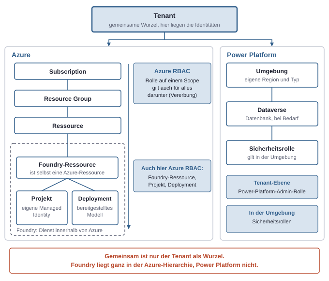
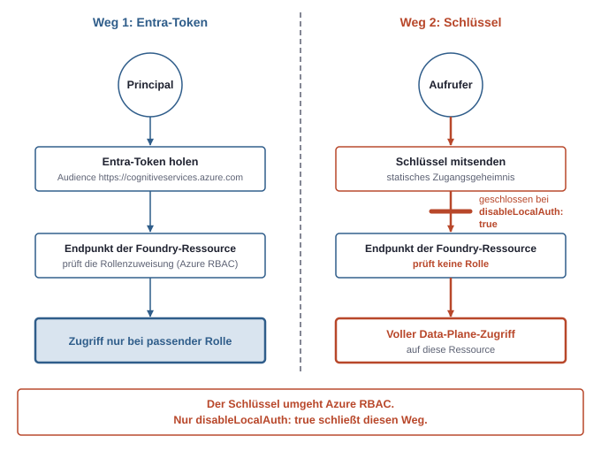
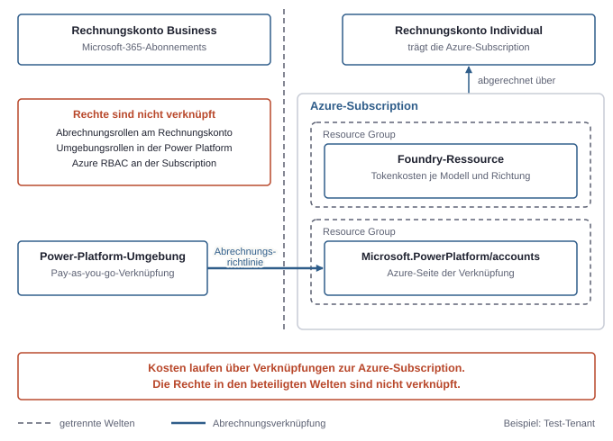
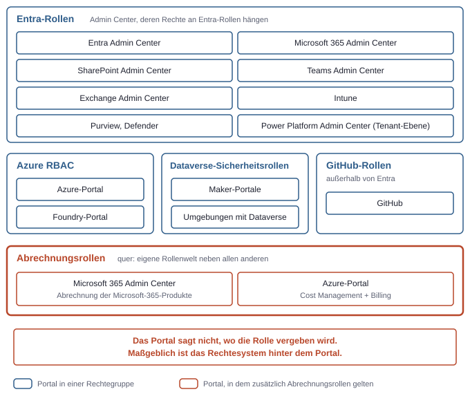

# 12. Plattformen und Verwaltungsorte: Azure, Foundry, Power Platform

Azure, Foundry und die Power Platform liegen im selben Tenant, folgen aber jeweils einer eigenen Hierarchie. Jede Hierarchie hat eigene Verwaltungsorte, eigene Rollen und eine eigene Art, Kosten zu erzeugen. Wer in einem fremden Tenant etwas sucht, muss zuerst wissen, in welcher Welt das Gesuchte liegt. Danach ergeben sich Portal, Rechtesystem und Abrechnung fast von selbst.

## Drei Hierarchien nebeneinander

Alle drei Welten hängen am **Tenant**, denn dort liegen die Identitäten. Darunter gehen sie getrennte Wege.

- **Azure** gliedert nach Abrechnung und Rechten: Tenant, Subscription, Resource Group, Ressource.
- **Foundry** ist kein eigener Tenant-Bereich, sondern ein Dienst innerhalb von Azure: eine Foundry-Ressource, darunter Projekte, daneben Deployments.
- **Power Platform** gliedert nach Umgebungen: Tenant, Umgebung, bei Bedarf eine Dataverse-Datenbank, darin Sicherheitsrollen.



*Die drei Welten teilen sich nur den Tenant als Wurzel; Foundry sitzt vollständig innerhalb der Azure-Hierarchie, die Power Platform hat ihre eigene.*

## Azure: Subscription, Resource Group, Ressource

Eine **Subscription** gliedert sich in **Resource Groups** und diese in **Ressourcen** wie eine Web-App, einen Key Vault oder eine Foundry-Ressource, und Rollen nach **Azure RBAC** vererben sich von jedem Scope nach unten (siehe Kapitel 3, Die drei Rechtesysteme).

Die Resource Group ist das wichtigste Werkzeug, um Rechte praktisch zu schneiden. Eine Gruppe soll Dinge enthalten, die gemeinsam entstehen, gemeinsam gelöscht werden und von denselben Personen verwaltet werden. Der Schnitt nach Zweck ist robuster als der nach Ressourcentyp. Ein Beispiel aus dem Test-Tenant, abstrahiert:

- `rg-<foundry>` enthält nur die Foundry-Ressource.
- `rg-<web>` enthält die Web-Apps samt App Service Plan (der Rechenkapazität, auf der die Web-Apps laufen), Managed Identity, Bot Service (dem Azure-Dienst, der Chat-Bots an Kanäle wie Teams anbindet) und Document Intelligence (dem Dienst, der Text und Felder aus Dokumenten ausliest).
- `rg-<powerplatform>` enthält die Azure-Vertretungen der Power-Platform-Konten.
- `NetworkWatcherRG` wird von Azure selbst angelegt und bleibt unberührt.

Wer eine einzelne Anwendung sperren oder löschen will, trifft damit genau eine Gruppe. Wer einer Person nur die Foundry-Ressource geben will, vergibt die Rolle auf `rg-<foundry>` und nicht auf der Subscription.

Eine verbreitete Verwechslung betrifft Region und Tenant. Die **Region** einer Ressource legt fest, in welchem Rechenzentrum sie läuft. Der Tenant legt fest, wem die Identitäten gehören. Beides ist unabhängig. Im Test-Tenant liegt die Power-Platform-Umgebung in der Schweiz und die Foundry-Ressource in Sweden Central, ohne dass das eine das andere festlegt. Die Region einer Ressource lässt sich in der Regel nicht ändern, praktisch hilft nur eine Neuanlage. Eine Subscription lässt sich in ein anderes Verzeichnis, also einen anderen Tenant, übertragen. Dabei gehen die Rollenzuweisungen verloren.

Ein wichtiger Befund aus der Praxis: Global Administrator in Entra ID gibt keine Rechte auf Azure-Ressourcen. Er kann sich aber selbst Zugriff verschaffen, indem er „Access management for Azure resources" einschaltet und damit die Rolle User Access Administrator auf dem Root-Scope erhält. Im Test-Tenant stand `Owner` auf der Subscription als eigene Rollenzuweisung neben der Entra-Rolle (siehe Kapitel 3, Die drei Rechtesysteme, und Kapitel 4, Admin-Rollen).

## Foundry als Azure-Dienst

Foundry (früher Azure AI Foundry) ist die Azure-Plattform, auf der Modelle bereitgestellt und KI-Anwendungen gebaut werden. Technisch ist die **Foundry-Ressource** eine gewöhnliche Azure-Ressource vom Typ `Microsoft.CognitiveServices/accounts` mit `kind: AIServices`. Sie liegt in einer Resource Group in einer Subscription und hat eine eigene Subdomain als Endpunkt. Darunter und daneben gibt es zwei weitere Begriffe:

- Ein **Projekt** ist ein Arbeitsbereich für Agenten und zugehörige Inhalte. Es liegt als Unterressource unter der Foundry-Ressource und hat eine eigene Managed Identity.
- Ein **Deployment** ist ein bereitgestelltes Modell mit eigenem Namen, das an der Foundry-Ressource hängt. Mehrere Deployments sind üblich, je eines pro Modell und Verwendungszweck. Beim Deployment-Typ `GlobalStandard` wird weltweit verarbeitet und nach Token abgerechnet. Die Region der Ressource garantiert dabei nicht den Ort der Verarbeitung.

### Control Plane und Data Plane

Auch bei der Foundry-Ressource trennt sich die **Control Plane** (Ressource und Deployments anlegen, Netzwerk und Schlüssel konfigurieren) von der **Data Plane** (Modell aufrufen, Agenten ausführen) (siehe Kapitel 3, Die drei Rechtesysteme). Wer Deployments anlegen darf, darf damit nicht automatisch Modelle aufrufen, und umgekehrt. Diese Trennung gilt allerdings nur, wenn lokale Schlüssel abgeschaltet sind, denn generische Control-Plane-Rollen wie `Owner` oder `Contributor` dürfen die Schlüssel auslesen und haben damit vollen Data-Plane-Zugriff (im Test-Tenant: `Owner` auf der Subscription, Schlüssel nicht abgeschaltet).

Das spiegelt sich in den Rollen. Alle sind Azure-RBAC-Rollen und werden auf Ressource, Resource Group oder Subscription zugewiesen. Die Namen ändern sich gelegentlich, das Muster bleibt:

| Rolle | Zweck |
|---|---|
| `Owner` (generisch) | Gesamte Control Plane einschließlich Rollenvergabe, darf Schlüssel auslesen |
| `Contributor` (generisch) | Control Plane ohne Rollenvergabe, darf Schlüssel auslesen |
| `Reader` (generisch) | Control Plane nur lesen |
| `Foundry User` (früher Azure AI User) | Nutzen und Agenten bauen, keine Verwaltung |
| `Foundry Project Manager` | Projekte und deren Zugriffe verwalten |
| `Foundry Account Owner` | Foundry-Ressource verwalten |
| `Cognitive Services OpenAI User` | OpenAI-Modelle aufrufen (Namen je Modellfamilie prüfen) |
| `Cognitive Services OpenAI Contributor` | Modelle aufrufen und Deployments verwalten |

Eine Web-App, die nur ein Modell aufrufen soll, bekommt `Cognitive Services OpenAI User` an ihrer Managed Identity, und zwar auf der Foundry-Ressource selbst und nicht auf der Resource Group. Das ist der kleinstmögliche Scope.

### Schlüssel gegen Entra-Token

Am Endpunkt gibt es zwei Anmeldewege. Mit einem Entra-Token (Audience `https://cognitiveservices.azure.com`) prüft Azure die Rollenzuweisung des Principals. Mit einem Schlüssel entfällt diese Prüfung. Wer den Schlüssel besitzt, darf alles auf der Data Plane dieser Ressource. Der Schlüsselweg lässt sich abschalten, indem die Eigenschaft `disableLocalAuth` auf `true` gesetzt wird. Im Test-Tenant war er noch eingeschaltet, genutzt wurde trotzdem die Entra-Anmeldung. Für alles außer schnellen Experimenten ist der Token-Weg vorzuziehen, weil er an eine Identität gebunden und im Log zuordenbar bleibt.



*Der Schlüssel umgeht Azure RBAC; nur disableLocalAuth: true schließt diesen Weg.*

### Portale

Das **Foundry-Portal** (`ai.azure.com`) dient zum Arbeiten mit Projekten, Deployments und dem Playground, einer Testoberfläche, in der sich ein Deployment direkt ausprobieren lässt. Die Ressource selbst, ihre Rollenzuweisungen und ihre Kosten stehen im Azure-Portal. Beide Portale zeigen dieselbe Ressource aus verschiedenen Blickwinkeln, die Rechte kommen in beiden aus Azure RBAC.

## Power Platform: Umgebung, Dataverse, Sicherheitsrollen

Die Power Platform umfasst unter anderem Power Apps, Power Automate und Copilot Studio. Ihr Ordnungsprinzip ist die **Umgebung** (Environment): ein abgegrenzter Bereich im Tenant, in dem Apps, Flows, Agenten und Verbindungen leben. Eine Umgebung hat eine Region und einen Typ.

- **Default**: Die Standardumgebung, die jeder Tenant automatisch hat und in der alle Nutzer arbeiten dürfen. Sie ist bequem und entsprechend schwer zu kontrollieren.
- **Developer**: Eine persönliche Entwicklerumgebung für eine Person.
- **Production** (Produktion) und **Sandbox**: Von Admins angelegte Umgebungen für Betrieb und Tests.

Eine Umgebung kann eine **Dataverse**-Datenbank besitzen. Sie ist die Datenbank der Umgebung und ist über eine Adresse der Form `https://<org>.crm<n>.dynamics.com` erreichbar, wobei die Ziffer `<n>` für die Region steht. Ob eine Umgebung Dataverse hat, entscheidet über das Rechtemodell:

- **Ohne Dataverse** gelten die Umgebungsrollen `Environment Admin` und `Environment Maker`.
- **Mit Dataverse** gelten **Sicherheitsrollen** wie `System Administrator`, `System Customizer`, `Environment Maker` und `Basic User`. Das ist ein eigenes Rechtesystem neben Entra-Rollen, Azure RBAC, Graph-Rechten und SharePoint-Rechten. Es wird nicht in Entra oder Azure gepflegt, sondern in der Umgebung selbst. Mit Dataverse werden die Umgebungsrollen zu Dataverse-Sicherheitsrollen, und `System Administrator` übernimmt die Funktion von `Environment Admin`.

Zusätzlich lässt sich der Zugang zu einer Umgebung mit Dataverse auf eine Sicherheitsgruppe in Entra beschränken. Auf Tenant-Ebene verwaltet die Entra-Rolle `Power Platform Administrator` (oder Global Administrator) alle Umgebungen.

### Maker-Portale arbeiten immer in einer Umgebung

`make.powerapps.com`, `make.powerautomate.com` und `copilotstudio.microsoft.com` sind die Orte, an denen gebaut wird. Sie zeigen immer nur den Inhalt der aktuell gewählten Umgebung. Wer einen Flow „nicht findet", sucht meist in der falschen Umgebung. **Verbindungen** (Connections), also angemeldete Instanzen eines Connectors mit den Zugangsdaten einer Person, gehören dieser Person und liegen in der Umgebung, in der sie angelegt wurden (siehe Kapitel 8, Ein Beispielprojekt eingeordnet).

### DLP-Richtlinien

**DLP-Richtlinien** (Data Loss Prevention) legen fest, welche Connectors in einer Umgebung zusammen in einem Flow oder einer App verwendet werden dürfen. Sie werden im Power Platform Admin Center gesetzt, entweder pro Umgebung oder tenantweit. Jeder Connector fällt in eine von drei Gruppen: geschäftlich, nicht geschäftlich oder blockiert. Connectors aus der geschäftlichen und der nicht geschäftlichen Gruppe dürfen in einem Flow nicht gemischt werden, blockierte Connectors sind ganz verboten. Sie regeln also die Kombination von Diensten und nicht die Rechte einzelner Personen. Mit DLP in Purview, das Inhalte wie Mails und Dateien schützt, haben diese Richtlinien nichts zu tun. Die Standardumgebung ist der typische Ort, an dem eine strenge Richtlinie zuerst sinnvoll ist.

## Wie die Welten verknüpft sind

Rechte sind in den drei Welten getrennt, die Abrechnung kann sie verbinden. Mehrere Wege verbinden sie:

- **Rechnungskonten**: Dieselben MCA-Rechnungskonten sind im Microsoft 365 Admin Center und im Azure-Portal (Cost Management + Billing) sichtbar. Lizenzen aus Microsoft-365-Abonnements, Azure-Verbrauch und Pay-as-you-go der Power Platform können dennoch auf unterschiedlichen Rechnungskonten oder Subscriptions landen. Im Test-Tenant hing die Azure-Subscription an einem Rechnungskonto vom Typ Individual, getrennt vom Business-Rechnungskonto der Microsoft-365-Produkte (siehe Kapitel 11, Lizenzen und Abrechnung).
- **Power Platform über eine Azure-Subscription abrechnen**: Verbrauchsbasierte Abrechnung, etwa für Copilot Credits (die Verbrauchseinheit, in der Copilot Studio die Nutzung von Agenten abrechnet), lässt sich an eine Azure-Subscription hängen. Auf Power-Platform-Seite heißt diese Verknüpfung **Abrechnungsrichtlinie** (billing policy). Die Verknüpfung erscheint in Azure als Ressource vom Typ `Microsoft.PowerPlatform/accounts`, im Detail kann das abweichen. Im Test-Tenant lagen zwei solche Ressourcen in einer eigenen Resource Group, entstanden beim Einrichten von Pay-as-you-go für Copilot Studio, und erzeugten Kosten von wenigen Cent in der Azure-Rechnung. Das Beispiel zeigt: Eine Einstellung auf Power-Platform-Seite kann Ressourcen und Kosten in Azure erzeugen.
- **Foundry über die Subscription abrechnen**: Die Tokens der Foundry-Ressource erscheinen je Modell und Richtung (Eingabe, Ausgabe, Cache) als eigene Zähler in Cost Management der Subscription (siehe Kapitel 11, Lizenzen und Abrechnung).
- **Rechte folgen der Abrechnung nicht**: Wer in der Power Platform eine Umgebung verwaltet, bekommt dadurch keine Rolle in der Azure-Subscription, an der die Abrechnung hängt. Umgekehrt gilt dasselbe. Allerdings ist die Verknüpfung selbst eine Azure-Ressource unter Azure RBAC: Wer `Owner` auf der Subscription ist, kann sie löschen und damit die Abrechnung der Umgebung kappen.



*Kosten laufen über Verknüpfungen von Power Platform und Foundry zur Azure-Subscription und zu einem Rechnungskonto, die Rechte in den beteiligten Welten bleiben getrennt.*

## Die große Übersicht der Verwaltungsorte

Jeder Verwaltungsort hat eine Adresse, einen Verwaltungsgegenstand und ein Rechtesystem, das dort gilt. Das Rechtesystem ist die entscheidende Spalte, denn es bestimmt, wo eine Rolle vergeben werden muss. Adressen und Portalnamen ändern sich gelegentlich.

| Ort | Adresse | Verwaltet | Rechtesystem | Typische Rolle |
|---|---|---|---|---|
| Entra Admin Center | `entra.microsoft.com` | Nutzer, Gruppen, Apps, Rollen, Conditional Access | Entra-Rollen | Global Administrator |
| Microsoft 365 Admin Center | `admin.cloud.microsoft` (früher `admin.microsoft.com`) | Lizenzen, Käufe, Abrechnung der Microsoft-365-Produkte, Einstieg in die Dienst-Admin-Center | Entra-Rollen, Abrechnung zusätzlich Abrechnungsrollen | Global Administrator, für die Abrechnung Billing account owner |
| SharePoint Admin Center | `<tenant>-admin.sharepoint.com` | Sites, Freigabe-Einstellungen | Entra-Rolle SharePoint Administrator | SharePoint Administrator |
| Teams Admin Center | `admin.teams.microsoft.com` | Teams-Richtlinien, Apps in Teams | Entra-Rolle Teams Administrator | Teams Administrator |
| Exchange Admin Center | `admin.exchange.microsoft.com` | Postfächer, Mailfluss | Entra-Rolle Exchange Administrator | Exchange Administrator |
| Intune | `intune.microsoft.com` | Geräte, Compliance | Entra- und Intune-Rollen | – |
| Purview, Defender | `purview.microsoft.com`, `security.microsoft.com` | Compliance, Sicherheit | Eigene Rollengruppen plus Entra-Rollen | – |
| Azure-Portal | `portal.azure.com` | Subscriptions, Resource Groups, Ressourcen; Cost Management + Billing | Azure RBAC, Abrechnung über Abrechnungsrollen | `Owner`, `Contributor`, `Reader` |
| Foundry-Portal | `ai.azure.com` | Projekte, Deployments, Agenten, Playground | Azure RBAC | `Foundry User` |
| Power Platform Admin Center | `admin.powerplatform.microsoft.com` | Umgebungen, Kapazität, DLP, Abrechnungsrichtlinien | Entra-Rolle Power Platform Administrator, in der Umgebung Dataverse-Sicherheitsrollen | `Power Platform Administrator` |
| Maker-Portale | `make.powerapps.com`, `make.powerautomate.com`, `copilotstudio.microsoft.com` | Apps, Flows, Agenten in einer Umgebung | Umgebungs- bzw. Dataverse-Rollen | `Environment Maker` |
| GitHub | `github.com` | Repositories, Actions | GitHub-Rollen, außerhalb von Entra | – |

Nach dem Rechtesystem sortiert ergibt sich ein klareres Bild als nach dem Produkt. Die meisten Admin Center hängen an Entra-Rollen, Azure-Portal und Foundry-Portal an Azure RBAC, die Maker-Portale an Umgebungs- bzw. Dataverse-Rollen, GitHub an einem eigenen System, und die Abrechnung zieht quer durch alles eine eigene Rollenwelt.



*Welches Portal man öffnet, sagt nicht, wo die benötigte Rolle vergeben wird; maßgeblich ist das Rechtesystem hinter dem Portal.*

## Nachprüfen per Kommandozeile

Die folgenden Abfragen lesen nur und verändern nichts. Voraussetzung ist ein Login per `az login --tenant <tenant-id>` im richtigen Tenant.

Aktuellen Kontext und alle sichtbaren Subscriptions anzeigen:

```bash
az account show --query "{tenant:tenantId, sub:name}" -o table
az account list --query "[].{name:name, id:id, state:state}" -o table
```

Resource Groups und Ressourcen einer Subscription auflisten, um die Schnitte nach Zweck zu sehen:

```bash
az group list --query "[].{name:name, region:location}" -o table
az resource list --resource-group rg-<zweck> \
  --query "[].{name:name, type:type, kind:kind}" -o table
```

Rollenzuweisungen auflisten, zuerst alle Zuweisungen innerhalb der Subscription, dann die auf einer einzelnen Ressource einschließlich der geerbten:

```bash
az role assignment list --all --include-inherited \
  --query "[].{principal:principalName, type:principalType, role:roleDefinitionName, scope:scope}" -o table
az role assignment list --include-inherited --scope \
  "/subscriptions/<subscription-id>/resourceGroups/rg-<foundry>/providers/Microsoft.CognitiveServices/accounts/<ressource>" \
  -o table
```

Die Foundry-Ressource, ihre Deployments und die Schlüsselfreigabe prüfen:

```bash
az cognitiveservices account show -g rg-<foundry> -n <ressource> \
  --query "{kind:kind, sku:sku.name, region:location, localAuthOff:properties.disableLocalAuth}"
az cognitiveservices account deployment list -g rg-<foundry> -n <ressource> \
  --query "[].{name:name, model:properties.model.name, sku:sku.name}" -o table
```

Ist `localAuthOff` leer oder `null`, ist die Eigenschaft nicht gesetzt, und die Schlüssel sind aktiv.

Projekte sind Unterressourcen. Wo die CLI keinen eigenen Befehl dafür bietet, hilft der allgemeine Zugriff auf die Verwaltungs-API:

```bash
az rest --method get --url \
  "https://management.azure.com/subscriptions/<subscription-id>/resourceGroups/rg-<foundry>/providers/Microsoft.CognitiveServices/accounts/<ressource>/projects?api-version=2025-06-01"
```

Die Version `2025-06-01` ist ein Beispiel, das im Test-Tenant funktioniert hat. Neuere Versionen können existieren. Welche verfügbar sind, zeigt der Ressourcenanbieter:

```bash
az provider show -n Microsoft.CognitiveServices \
  --query "resourceTypes[?resourceType=='accounts/projects'].apiVersions"
```

Power-Platform-Umgebungen liegen nicht in Azure, sondern in der BAP-API. Dafür wird ein Token für die Ressource `https://service.powerapps.com/` verwendet. Der Endpunkt `scopes/admin` verlangt eine Admin-Rolle, also Power Platform Administrator oder Global Administrator:

```bash
az rest --method get \
  --resource "https://service.powerapps.com/" \
  --url "https://api.bap.microsoft.com/providers/Microsoft.BusinessAppPlatform/scopes/admin/environments?api-version=2021-04-01" \
  --query "value[].{name:properties.displayName, type:properties.environmentSku, region:location, dataverse:properties.linkedEnvironmentMetadata.instanceUrl}"
```

Bei Umgebungen mit Dataverse liefert `dataverse` die Adresse der Datenbank, sonst bleibt das Feld leer. Auch `2021-04-01` ist eine Beispielversion aus dem Test-Tenant, neuere Versionen können existieren.

Die Azure-Vertretungen der Power-Platform-Konten erscheinen dagegen als normale Ressourcen:

```bash
az resource list --resource-type Microsoft.PowerPlatform/accounts -o table
```

## Checkliste: Orientierung in einem fremden Tenant

1. **Tenant und Identität klären**: In welchem Tenant ist man angemeldet, und mit welcher Rolle? `az account show` und das Entra Admin Center beantworten das.
2. **Azure-Seite erfassen**: Subscriptions, Resource Groups und deren Zweck auflisten. Auffällige Gruppen wie `NetworkWatcherRG` oder solche mit `Microsoft.PowerPlatform/accounts` einordnen.
3. **Rollenzuweisungen lesen**: Wer ist `Owner`, wer hat Rollen auf Ressourcenebene? Entra-Rollen allein sagen nichts über Azure.
4. **Foundry prüfen**: Welche Foundry-Ressourcen, Projekte und Deployments gibt es, ist `disableLocalAuth` gesetzt, und welche Identitäten haben welche Foundry-Rolle?
5. **Power-Platform-Umgebungen auflisten**: Welche Typen, welche Regionen, welche haben Dataverse? Danach die Sicherheitsrollen in den Umgebungen mit Dataverse ansehen.
6. **DLP-Richtlinien nachsehen**: Gilt eine tenantweite Richtlinie, und wie ist die Standardumgebung abgesichert?
7. **Abrechnung nachziehen**: Zu welchem Rechnungskonto gehört jede Subscription, und welche Verknüpfungen zwischen Power Platform und Azure bestehen?
8. **Für jedes Portal das Rechtesystem notieren**: Erst wenn feststeht, wo die jeweilige Rolle vergeben wird, lässt sich ein Rechteproblem sauber lösen.
