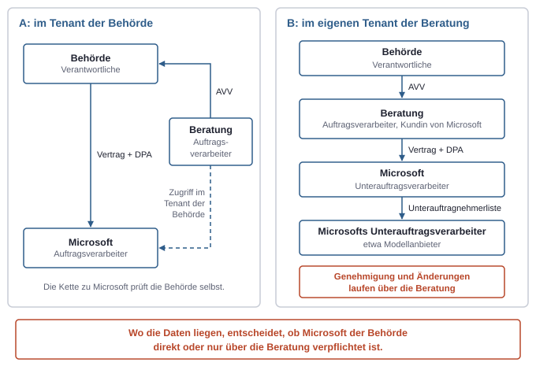
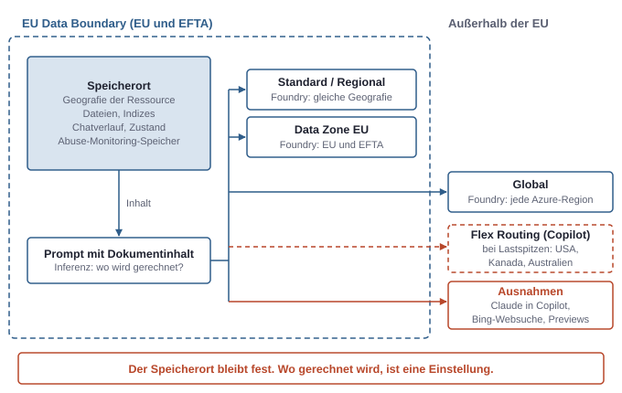
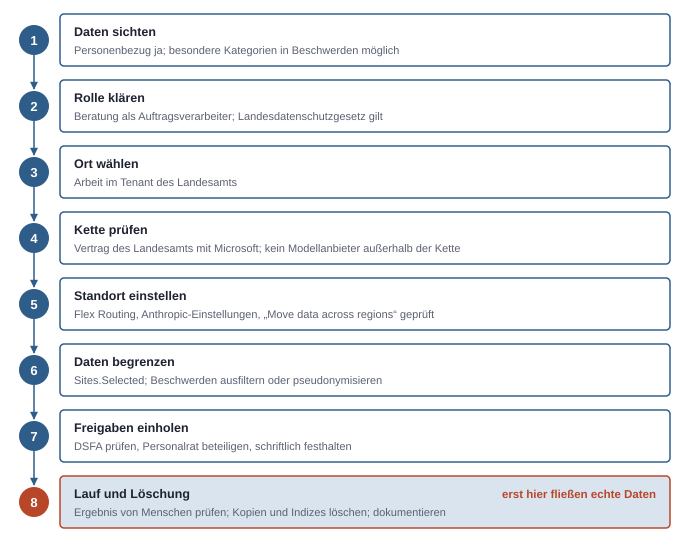

# 13. Rechtliche Einordnung, technisch gedacht: Welche Daten dürfen wohin?

Rechtsfragen bei KI-Läufen über Kundendaten wirken abstrakt, folgen aber einem sehr technischen Muster. Daten wandern von einer Station zur nächsten, und an jeder Station gibt es einen Vertrag, einen Ort und eine Rolle. Wer den Datenweg so zeichnen kann wie einen Token-Fluss, kann auch die Rechtsfragen sortieren.

Alles hier ist Einordnung und keine Rechtsberatung, Stand November 2026; unsichere Punkte sind als solche gekennzeichnet (siehe Kapitel 10, Bauen ohne Admin-Rechte).

## Der Datenweg als Kette

Die DSGVO unterscheidet den **Verantwortlichen** (Art. 4 Nr. 7) und den **Auftragsverarbeiter** (Art. 4 Nr. 8) (siehe Kapitel 10, Bauen ohne Admin-Rechte). Setzt ein Auftragsverarbeiter selbst wieder einen Dienstleister ein, ist das ein **Unterauftragsverarbeiter**. Er darf nur mit vorheriger schriftlicher Genehmigung des Verantwortlichen eingesetzt werden, entweder einzeln oder allgemein (Art. 28 Abs. 2). Bei einer allgemeinen Genehmigung muss jede geplante Änderung angekündigt werden, und der Verantwortliche kann widersprechen.

Eine dritte Rolle ist die **gemeinsame Verantwortlichkeit** (Art. 26). Sie liegt vor, wenn zwei Stellen Zwecke und Mittel gemeinsam festlegen. Dann braucht es eine eigene Vereinbarung, und Betroffene können sich an jede der beiden Stellen wenden.

Für eine Beratung, die für eine Behörde arbeitet, sieht die Kette typischerweise so aus:

1. **Betroffene Personen**, etwa Bürger, deren Anträge in den Unterlagen liegen.
2. **Die Behörde** als Verantwortliche, weil sie die Daten für ihre gesetzliche Aufgabe erhebt.
3. **Die Beratung**, meist als Auftragsverarbeiter, wenn sie nach Vorgabe der Behörde auswertet oder baut.
4. **Microsoft** als Auftrags- oder Unterauftragsverarbeiter, je nachdem, in wessen Tenant gearbeitet wird.
5. **Microsofts Unterauftragsverarbeiter**, darunter inzwischen auch Modellanbieter wie Anthropic und OpenAI.

### In wessen Tenant gearbeitet wird, ändert die Kette

Die wichtigste technische Entscheidung für die Rechtslage ist, wo die Daten verarbeitet werden. Es gibt zwei Varianten.

**Variante A: im Tenant der Behörde.** Die Beratung bekommt ein Gast- oder eigenes Konto im Tenant der Behörde und arbeitet dort, etwa mit Copilot Studio in einer Umgebung der Behörde. Die Behörde ist dann selbst Kundin von Microsoft. Microsoft ist ihr Auftragsverarbeiter nach dem Vertrag, den die Behörde mit Microsoft geschlossen hat. Die Beratung steht nicht zwischen Behörde und Microsoft, sondern daneben: als eigener Auftragsverarbeiter mit Zugriff. Für Microsofts Seite ist die Behörde zuständig.

**Variante B: im eigenen Tenant der Beratung.** Die Beratung kopiert Unterlagen in die eigene SharePoint-Site oder schickt sie an ein Modell in der eigenen Azure-Subscription. Jetzt ist die Beratung Kundin von Microsoft. Laut Microsofts Datenschutzvertrag ist Microsoft dann **Unterauftragsverarbeiter**, und die Beratung sichert zu, dass der Verantwortliche das genehmigt hat. Die Behörde muss Microsoft und dessen Unterauftragsverarbeiter also über den AVV mit der Beratung genehmigt haben. Ändert Microsoft seine Liste der Unterauftragsverarbeiter, muss die Beratung das an die Behörde weitergeben, damit deren Widerspruchsrecht greifen kann. Diese Pflicht zur Weitergabe ist eine Ableitung aus Art. 28 und kein ausdrücklicher Satz im Vertrag.



*Wo die Daten technisch liegen, entscheidet, ob Microsoft der Behörde direkt oder nur über die Beratung verpflichtet ist, und damit, wer für die Kette geradestehen muss.*

Variante A ist für die Beratung meist einfacher. Die Kette Behörde–Microsoft prüft die Behörde selbst, und die Beratung bringt keine eigenen Unterauftragsverarbeiter ein. Variante B ist technisch bequemer, lädt der Beratung aber die Verantwortung für die ganze Kette auf. Der erste Auftragsverarbeiter haftet gegenüber dem Verantwortlichen dafür, dass seine Unterauftragsverarbeiter ihre Pflichten erfüllen (Art. 28 Abs. 4).

### Wann die Beratung selbst Verantwortliche wird

Ein Auftragsverarbeiter, der selbst über Zwecke und Mittel entscheidet, gilt insoweit als Verantwortlicher (Art. 28 Abs. 10). Für eine Beratung ist das typisch in drei Fällen:

- Sie nutzt Kundendaten für eigene Zwecke, etwa um ein eigenes Werkzeug zu verbessern, Vorlagen zu bauen oder Vergleichswerte zu sammeln.
- Sie erbringt eine eigenständige Fachleistung mit eigenem Entscheidungsspielraum, wie es bei Rechts- oder Steuerberatung üblich ist.
- Sie behält Daten über den Auftrag hinaus.

Bloßes Betreiben, Entwickeln oder Testen nach Vorgabe des Kunden spricht dagegen für Auftragsverarbeitung. Die Abgrenzung ist im Einzelfall zu prüfen. Für den KI-Einsatz ist der erste Punkt der heikle: Ein Agent, der aus den Unterlagen von Kunde A eine Vorlage für Kunde B destilliert, dürfte einen eigenen Zweck der Beratung verfolgen.

## Welche Verträge an welcher Stelle gelten

An jeder Kante der Kette hängt mindestens ein Vertrag. Sie sind getrennt zu lesen, weil keiner den anderen ersetzt.

| Kante | Vertrag | Regelt | Typische Falle |
|---|---|---|---|
| Behörde → Beratung | Projektvertrag, oft nach EVB-IT; AVV nach Art. 28; Vertraulichkeitsvereinbarung | Leistung, Weisungen, erlaubte Unterauftragnehmer, Vertraulichkeit | Der AVV nennt Microsoft oder Modellanbieter nicht als Unterauftragnehmer |
| Beratung → Microsoft | MCA, darunter Product Terms, darin das DPA | Microsofts Pflichten als (Unter-)Auftragsverarbeiter, Standorte, Unterauftragnehmer | Annahme, dass Microsofts DPA auch das Verhältnis zur Behörde regelt |
| Microsoft → Modellanbieter | Microsofts Untervertrag, nicht Teil der Kundenverträge; sichtbar ist die Unterauftragnehmerliste | Bindung des Modellanbieters an Microsofts Pflichten | Modellanbieter mit eigenen Bedingungen außerhalb dieser Kette |
| Beratung → Modellanbieter direkt | Bedingungen und DPA des Modellanbieters | Eigenständige Verarbeitung durch den Anbieter | Wird beim Kauf über einen Marketplace leicht übersehen |

### Microsofts Seite: Product Terms und DPA

Der Datenschutzvertrag heißt „Microsoft Products and Services Data Protection Addendum“, kurz **DPA**. Er wird nicht eigens unterschrieben. Er ist per Verweis Teil der **Product Terms**, der Nutzungsbedingungen für alle Microsoft-Produkte, und diese gelten unter dem Kundenvertrag, etwa der MCA (siehe Kapitel 11, Lizenzen und Abrechnung). Wer Microsoft-Dienste kauft, hat das DPA also bereits.

Vier Punkte aus dem DPA sind für die Praxis wichtig:

- **Rollen:** Der Kunde ist Verantwortlicher, Microsoft Auftragsverarbeiter. Ist der Kunde selbst Auftragsverarbeiter, wie in Variante B, wird Microsoft Unterauftragsverarbeiter.
- **Eigene Zwecke von Microsoft:** Für Abrechnung, Kontoverwaltung, interne Berichte und Geschäftsplanung handelt Microsoft als unabhängiger Verantwortlicher, laut DPA ohne Zugriff auf den Inhalt der Kundendaten. Werbung und Profiling sind ausgeschlossen.
- **Kundendaten:** Gemeint sind alle Daten, die der Kunde über den Online-Dienst an Microsoft gibt, also Dateien, Prompts und Antworten. Konfigurationsdaten wie Ressourcennamen gehören laut Doku zur EU Data Boundary nicht dazu. Ein Ressourcenname wie `rg-behoerde-sozialamt` ist deshalb schlechter geschützt als der Inhalt und sollte keine sensiblen Angaben tragen.
- **Unterauftragsverarbeiter:** Mit dem DPA erteilt der Kunde eine allgemeine Genehmigung. Microsoft kündigt neue Unterauftragsverarbeiter sechs Monate vorher an. Für Unterauftragsverarbeiter, die KI-Funktionen erbringen, sind es nur 30 Tage, dafür lässt sich deren Nutzung mindestens sechs Monate lang abschalten. Die Liste liegt im Service Trust Portal, Microsofts Ablage für Prüfberichte und Vertragsunterlagen. Wer nicht einverstanden ist, kann kündigen.

Ein fünfter Punkt wird oft übersehen: **Previews**. Laut DPA können Vorschaufunktionen geringere Schutzmaßnahmen haben, und die Standortzusagen gelten für sie nicht. Previews sollen nicht mit Personenbezogenen Daten genutzt werden. Viele neue Funktionen erscheinen zuerst als Preview.

### Modelle: wer im Vertrag steht, hängt am Einkaufsweg

Dasselbe Modell kann je nach Weg unter ganz verschiedenen Verträgen laufen. Für Claude-Modelle von Anthropic zeigt sich das besonders deutlich.

| Weg | Wer verarbeitet | Vertrag | Standort |
|---|---|---|---|
| Foundry, Modell „sold by Azure“ (etwa GPT-Modelle über Azure OpenAI) | Microsoft | Microsoft-DPA | Je nach Deployment-Typ, siehe unten; kein Kontakt zu OpenAI-Diensten |
| Foundry, Claude „Hosted on Azure“ | Anthropic als unabhängiger Verarbeiter | Anthropics DPA und Commercial Terms | Prompts und Ausgaben bleiben in Azure |
| Foundry, Claude „Hosted on Anthropic“ | Anthropic als unabhängiger Verarbeiter | Anthropics DPA und Commercial Terms | Auch außerhalb von Azure und der gewählten Geografie möglich |
| Claude in Microsoft 365 Copilot, Copilot Studio, Power Platform | Anthropic als Microsofts Unterauftragsverarbeiter | Microsoft-DPA | Ausgenommen von der EU Data Boundary |
| Von OpenAI selbst betriebene Modelle in Copilot (seit 24.7.2026 standardmäßig an) | OpenAI als Microsofts Unterauftragsverarbeiter | Microsoft-DPA | Laut Microsoft in der EU Data Boundary, mit dokumentierten Ausnahmen; nicht unter In-Country-Zusagen |

Bemerkenswert ist die Foundry-Zeile für Claude. Auch bei „Hosted on Azure“ ist Anthropic laut Microsoft unabhängiger Verarbeiter unter eigenen Bedingungen. Microsoft verarbeitet nach seinem DPA nur Infrastruktur-, Abrechnungs- und Marketplace-Daten. Wer Claude über Foundry in einer Kundenkette einsetzt, für den spricht viel dafür, Anthropic als eigenen Eintrag in den AVV aufzunehmen, nicht nur Microsoft. Das klärt der Datenschutz.

In Copilot ist Claude dagegen Unterauftragsverarbeiter von Microsoft; die frühere Option mit Anthropic als unabhängigem Verarbeiter wurde am 1. Mai 2026 abgeschaltet. In der EU, der EFTA und Großbritannien steht die Einstellung „AI providers operating as Microsoft subprocessors“ für Anthropic standardmäßig auf „No users“. Im Test-Tenant zeigte sich das ganz praktisch: Copilot Studio schlug ein Claude-Modell als Standard vor, der Aufruf scheiterte aber mit „You don't have access to the model“, bis ein anderes Modell gewählt wurde. Eine Ausnahme ist die eigene Einstellung „Copilot in Microsoft 365 apps with Anthropic models“ für Word, Excel und PowerPoint. Sie ist für EU-Tenants, die nach dem 25. März 2026 angelegt wurden, **standardmäßig an**, und die Verarbeitung liegt ausdrücklich außerhalb der EU Data Boundary. Ein Sonderfall sind „Anthropic models with Data Retention“: Hier handelt Anthropic als unabhängiger Verarbeiter, speichert Daten bis zu 30 Tage und bei Verstößen bis zu zwei Jahre. Sie sind standardmäßig aus.

Die OpenAI-Zeile ist zugleich ein Beispiel für Variante B. Eine solche Änderung der Unterauftragnehmerliste müsste die Beratung an die Behörde weitergeben.

### Kundenseite: AVV, Vertraulichkeit, EVB-IT

Öffentliche Auftraggeber nutzen in Deutschland oft die **EVB-IT**, standardisierte Vertragsbedingungen für IT-Beschaffung. Die EVB-IT Cloud-AGB (Fassung 1.0 von 2022) sind für einen KI-Lauf über eine Cloud besonders aufschlussreich:

- Vor einer Verarbeitung im Auftrag ist ein AVV zu schließen (Ziff. 6.1.3).
- Unterauftragnehmer und ihr Leistungsbereich müssen benannt werden. Die Behörde kann binnen 30 Tagen aus sachlichem Grund widersprechen. Gibt es nach 90 Tagen keine Einigung, darf sie außerordentlich kündigen (Ziff. 15.1). Wahlweise kann jede Änderung ausdrücklich zustimmungspflichtig sein (Ziff. 15.2).
- Die Regeln gelten für die gesamte Unterauftragnehmerkette (Ziff. 15.5), also auch für Microsofts Modellanbieter.
- Die Leistung ist unter Einhaltung der C5-Basiskriterien zu erbringen. C5 ist der Prüfkatalog des BSI für Cloud-Anbieter und in der Verwaltung eine verbreitete Mindestanforderung.

Ob es eine neuere Fassung gibt und was die EVB-IT für Dienstleistungen ohne Cloud-Anteil genau sagen, ist nicht geprüft. Unabhängig vom Vertragsmuster gilt: Ob ein Kunde der Weitergabe an Microsoft oder einen Modellanbieter zugestimmt hat, folgt aus dem Einzelvertrag. Microsofts DPA ersetzt diese Zustimmung nicht.

Daneben stehen zwei Rechte, die weniger nach Datenschutz klingen. Kundendokumente können urheberrechtlich geschützte Werke sein. Welche Nutzung erlaubt ist, richtet sich nach den eingeräumten Nutzungsrechten, im Zweifel nach dem Vertragszweck (§ 31 Abs. 5 UrhG). Eine Wiederverwendung für eigene Zwecke der Beratung ist davon nicht automatisch gedeckt. Für Geschäftsgeheimnisse gilt der Abschnitt in Kapitel 10 (Bauen ohne Admin-Rechte).

## Technischer Zugriff ist keine Befugnis

Ein App-only-Token mit der Anwendungsberechtigung `Sites.Read.All` beweist, dass ein Admin Consent erteilt wurde. Es beweist nicht, dass die App die Daten für diesen Zweck lesen darf. Technisch kommt die Befugnis aus dem Consent im Tenant des Kunden, rechtlich aus Vertrag und AVV. Beides muss zusammenpassen.

Das Rechtemodell ist hier ein Werkzeug für das Recht. Datenminimierung heißt technisch, nur so viel Zugriff zu holen, wie die Aufgabe braucht. Sites.Selected setzt das direkt um: Die App sieht nur die Sites, die einzeln freigegeben wurden (siehe Kapitel 5, Daten und Freigaben). Eine App mit `Sites.Read.All` für eine Auswertung über drei Projekt-Sites ist nicht nur ein Sicherheitsproblem, sondern steht auch im Widerspruch zum Gedanken der Datenminimierung (Art. 5 Abs. 1 lit. c DSGVO).

Microsoft verlangt dasselbe auch vertraglich. Die Microsoft APIs Terms of Use gelten für die Graph API und verlangen unter anderem:

- nicht mehr Daten und Rechte anzufordern als nötig,
- keine Kopien oder Datenbanken anzulegen, außer für den vorgesehenen Zweck der App,
- Daten nicht außerhalb der Rechte zu nutzen, die der Kunde erteilt hat,
- auf Weisung des Kunden zu löschen oder zurückzugeben.

Die API-Terms begründen ausdrücklich kein Auftragsverhältnis mit Microsoft. Wer Daten über Graph abholt und woanders verarbeitet, steht für diese Verarbeitung selbst ein.

Daraus folgt ein häufig übersehener Punkt. Jede Kopie ist eine eigene Verarbeitung. Wer Dokumente aus SharePoint in einen Vektorindex in Azure lädt, hat einen zweiten Datenbestand mit eigenem Standort, eigener Löschfrist und eigenen Rechten. Das Security Trimming von SharePoint gilt dort nicht mehr. Fehlt ein eigenes Abbild der Berechtigungen, sieht jeder Nutzer des Index alles (siehe Kapitel 5, Daten und Freigaben). Wird das Projekt beendet, muss auch der Index gelöscht werden, nicht nur der Zugriff auf SharePoint.

## Wo die Server stehen

„Wo stehen die Server?“ ist die häufigste Frage und zugleich die ungenaueste. Es gibt zwei getrennte Orte. Der **Speicherort** ist der Ort, an dem Daten ruhen: Dateien, Chatverläufe, Indizes. Der **Verarbeitungsort** ist der Ort, an dem gerechnet wird, für KI vor allem die Inferenz. Beide können auseinanderfallen. Ein Dokument kann in Deutschland liegen, während das Modell, das es zusammenfasst, in Schweden oder den USA rechnet.



*Der Speicherort bleibt fest, der Verarbeitungsort ist eine Einstellung; genau diese Einstellungen entscheiden, ob Daten die EU verlassen.*

### EU Data Boundary

Die **EU Data Boundary** ist Microsofts Zusage, Kundendaten und Personenbezogene Daten für Azure, Dynamics 365, Power Platform und Microsoft 365 in der EU und der EFTA zu speichern und zu verarbeiten. Sie gilt nicht automatisch für jeden Tenant:

- **Microsoft 365:** Das Land bei der Anmeldung des Tenants muss in der EU oder EFTA liegen. Tenants mit Multi-Geo, also Speicherorten in mehreren Regionen, fallen heraus.
- **Power Platform:** Tenant und alle Umgebungen müssen in der Region „EU und EFTA“ liegen, und die Rechnungsadresse muss in einem dieser Länder sein.
- **Azure:** Regionale Dienste in EU-Regionen fallen darunter. Nicht-regionale Dienste müssen gesondert eingerichtet werden.

Die Grenze hat dokumentierte Lücken. Für Sicherheit, Support und einige globale Dienste übermittelt Microsoft weiterhin Daten, teils pseudonymisiert. Für KI kommen vier Ausnahmen hinzu, die man kennen muss:

- **Claude als Unterauftragsverarbeiter** in Copilot und Copilot Studio ist ausgenommen, ebenso Claude in Word, Excel und PowerPoint.
- **Bing-Websuche** läuft auch für Copilot Studio in den USA.
- **Flex Routing:** Bei Lastspitzen kann Copilot die Inferenz außerhalb der EU Data Boundary rechnen, laut Microsoft in den USA, Kanada oder Australien. Gespeicherte Daten bleiben in der EU, bis auf begrenzte pseudonymisierte Daten. Für Tenants, die nach dem 25. März 2026 angelegt wurden, ist Flex Routing **standardmäßig an**. Die Einstellung liegt im Microsoft 365 Admin Center unter Copilot, Settings, „Flex routing during peak load periods“ und erfordert die Rolle AI Administrator. Für Copilot Studio und Power Platform gibt es eine eigene Einstellung im Power Platform Admin Center. Sie folgt dem Wert aus Microsoft 365, wenn sie nicht strenger gesetzt ist.
- **Previews** haben keine Standortzusage.

Dazu kommt ein Begriff aus Foundry. Das **Abuse Monitoring** prüft Prompts und Ausgaben automatisch auf Missbrauch und speichert markierte Inhalte für eine mögliche menschliche Prüfung.

Für eine Behörde heißt das: Ein neuer EU-Tenant ist nicht automatisch EU-only. Mindestens Flex Routing und die Anthropic-Einstellung für die Office-Apps müssen bewusst geprüft und gegebenenfalls abgeschaltet werden.

### Foundry: der Deployment-Typ entscheidet

In Foundry wird der Verarbeitungsort pro Deployment gewählt (siehe Kapitel 12, Plattformen und Verwaltungsorte). Der Deployment-Typ steht als SKU-Name am Deployment.

| Deployment-Typ | Inferenz | Eignung für EU-gebundene Daten |
|---|---|---|
| Global (etwa `GlobalStandard`) | In jeder Azure-Region | Nur, wenn Verarbeitung außerhalb der EU vertraglich zulässig ist |
| Data Zone EU (etwa `DataZoneStandard`) | In Rechenzentren der EU Data Boundary, also auch Norwegen und Schweiz | Meist die passende Wahl |
| Standard / Regional | In der Geografie der Ressource | Wenn ein bestimmtes Land gefordert ist |
| Developer | Keine Standortzusage | Nicht für Kundendaten |

Für alle Typen gilt: Daten at rest bleiben in der Geografie der Ressource, also hochgeladene Dateien, gespeicherter Zustand und der Speicher für das Abuse Monitoring. Nur der Ort der Rechnung ändert sich. Microsoft kann einer Data Zone neue Regionen hinzufügen, ohne das anzukündigen.

Der Typ lässt sich per Kommandozeile prüfen:

```bash
az cognitiveservices account deployment list \
  -g <resource-group> -n <foundry-ressource> \
  --query "[].{name:name, typ:sku.name, modell:properties.model.name}" -o table
```

Ein `GlobalStandard` in dieser Liste ist für ein Behördenprojekt ein Befund. Mit Azure Policy lässt sich der Typ für eine Subscription sperren, sodass niemand versehentlich ein globales Deployment anlegt. Im Test-Tenant liefen die Deployments als `GlobalStandard`, was für erfundene Daten unkritisch ist und für echte Daten geändert werden müsste.

### Power Platform und Copilot Studio

Bei der Power Platform bestimmt die Region der Umgebung den Speicherort. Für Umgebungen in Europa, Deutschland, der Schweiz und einigen weiteren europäischen Ländern läuft Azure OpenAI laut Microsoft innerhalb der EU Data Boundary.

Die Einstellung **„Move data across regions“** im Power Platform Admin Center, je Umgebung unter Generative AI features, erlaubt Inferenz außerhalb der Region. Laut Microsoft geschieht das nur, wenn das Modell lokal nicht bereitsteht, die Kapazität erschöpft ist oder es Störungen gibt, und ohne Speicherung. Zwei Haken stehen in der Doku:

- Ohne diese Einstellung lassen sich Bing-Suche und einige Microsoft-365-Funktionen in Copilot Studio nicht nutzen.
- Manche Modelle in Copilot Studio verarbeiten Daten auch dann außerhalb der Region, wenn die Einstellung aus ist.

Bereits erfolgte Bewegungen lassen sich nicht zurücknehmen. Wer die Einstellung prüft, sollte sie deshalb vor dem ersten Lauf mit echten Daten prüfen.

## Drittland, CLOUD Act und souveräne Angebote

Daten dürfen die EU nur unter den Bedingungen der Art. 44 ff. DSGVO verlassen. Es gibt zwei übliche Wege:

- Ein **Angemessenheitsbeschluss** der EU-Kommission erklärt das Schutzniveau eines Landes für ausreichend (Art. 45). Für die USA ist das das **EU-US Data Privacy Framework** von 2023. Es gilt nur für US-Unternehmen, die sich danach zertifiziert haben.
- **Standardvertragsklauseln** sind von der Kommission vorgegebene Vertragstexte (Art. 46). Sie verlangen zusätzlich eine Prüfung der Rechtslage im Zielland, das Transfer Impact Assessment, und gegebenenfalls Zusatzmaßnahmen.

Microsoft stützt sich auf beides. Laut DPA stehen alle Übermittlungen aus EU, EWR, Großbritannien und der Schweiz unter den Standardvertragsklauseln. Zusätzlich ist Microsoft nach dem Data Privacy Framework zertifiziert.

Das Data Privacy Framework ist rechtlich nicht endgültig gesichert. Das Gericht der EU hat eine Klage dagegen im September 2025 abgewiesen. Ein Rechtsmittel beim Europäischen Gerichtshof ist anhängig (C-703/25 P). Ein Urteil gab es nach Stand der Recherche noch nicht. Der Vorgänger Privacy Shield wurde vom EuGH gekippt (C-311/18). Wer eine Lösung baut, die allein auf diesem Beschluss steht, sollte das als Risiko festhalten.

### CLOUD Act: der Ort löst nicht alles

Der **CLOUD Act** ist ein US-Gesetz von 2018. Danach können US-Anbieter verpflichtet werden, Daten herauszugeben, die in ihrem Besitz oder unter ihrer Kontrolle sind, auch wenn sie im Ausland gespeichert sind. Die EU Data Boundary regelt Speicher- und Verarbeitungsorte. Sie regelt nicht, welchem Recht der Anbieter unterliegt. Ein Rechenzentrum in Frankfurt ändert also nichts daran, dass Microsoft ein US-Unternehmen ist. Microsofts französischer Rechtsdirektor hat 2025 vor dem französischen Senat sinngemäß eingeräumt, dass Microsoft bei einer bindenden US-Anordnung nicht garantieren könne, keine Daten herauszugeben (Sekundärquellen).

Microsoft antwortet darauf vertraglich. Laut DPA gibt Microsoft Daten an Strafverfolgungsbehörden nur heraus, wenn das Gesetz es verlangt, und versucht, die Anfrage an den Kunden umzuleiten. In Anhang C verpflichtet sich Microsoft, Anordnungen anzufechten, nur das Minimum offenzulegen und Betroffene zu entschädigen, wenn eine Offenlegung gegen Kapitel V DSGVO verstößt. Anhang D verspricht Regierungskunden in der EU, gegen Anordnungen zur Abschaltung von Diensten zu klagen. Das sind echte Zusagen. Sie verringern das Risiko, beseitigen es aber nicht.

### Souveräne Angebote

Für den öffentlichen Sektor baut Microsoft Angebote, bei denen ein europäischer Betreiber zwischen Microsoft und den Daten steht:

- **Delos Cloud** ist eine SAP-Tochter, die Microsoft-Technologie für Bund, Länder und Kommunen betreibt. Laut einer Meldung von Anfang November 2026 hat Delos den Betrieb im Oktober 2026 übernommen. Zugriffe von Microsoft brauchen eine Freigabe durch Delos und werden protokolliert. Die Verfügbarkeit für die Verwaltung ist für Anfang 2027 geplant. Das C5-Testat steht noch aus (alles Sekundärquelle). Ob Copilot und KI-Dienste enthalten sind, ist nicht geprüft.
- **Microsoft Sovereign Cloud**, 2025 angekündigt, umfasst unter anderem eine öffentliche Variante mit „Data Guardian“: Fernzugriffe von Microsoft-Technikern auf EU-Systeme sollen nur über Personal in Europa laufen. Dazu kommen private Varianten auf eigener Hardware und Partner-Clouds wie Delos.

Für eine Beratung heißt das vor allem: Die Frage „Darf die Behörde überhaupt Microsofts öffentliche Cloud nutzen?“ entscheidet die Behörde, nicht die Beratung. Die Datenschutzkonferenz der deutschen Aufsichtsbehörden hielt 2022 einen datenschutzkonformen Einsatz von Microsoft 365 für nicht nachgewiesen. Der hessische Datenschutzbeauftragte hielt 2025 einen Einsatz in Landesbehörden unter Auflagen für möglich (Sekundärquelle). Eine neue Gesamtbewertung wurde nicht gefunden.

## Was nicht ans Modell darf

Nicht alle Personenbezogenen Daten sind gleich. Manche Arten dürfen nur unter strengen Bedingungen verarbeitet werden, für manche gelten deutsche Sondergesetze, und manche gehören gar nicht in eine öffentliche Cloud. Die Tabelle ordnet die wichtigsten Fälle von streng nach sehr streng.

| Art der Daten | Regel | Folge für einen KI-Lauf |
|---|---|---|
| Gewöhnliche Personenbezogene Daten (Namen, Kontaktdaten in Protokollen) | DSGVO allgemein: Rechtsgrundlage, Zweckbindung, Datenminimierung | Möglich mit AVV-Kette und passendem Standort; nur nötige Abschnitte schicken |
| Besondere Kategorien (Gesundheit, Religion, politische Meinung, Gewerkschaft, Ethnie, Sexualleben, Genetik, Biometrie) | Art. 9 DSGVO: grundsätzlich verboten, außer ein Ausnahmetatbestand greift | Vorher eigene Prüfung, meist mit Datenschutz-Folgenabschätzung |
| Daten über Straftaten | Art. 10 DSGVO: nur unter behördlicher Aufsicht oder auf gesetzlicher Grundlage | Ohne klare Grundlage nicht verarbeiten |
| Berufsgeheimnisse (Anwälte, Ärzte, Steuerberater; auch Amtsträger) | § 203 StGB | Dienstleister müssen zur Geheimhaltung verpflichtet sein, auch in der Kette |
| Sozialdaten bei Sozialleistungsträgern | § 35 SGB I, § 80 SGB X | Anzeige bei der Aufsicht, Drittland nur mit Angemessenheitsbeschluss, private Auftragnehmer nur eingeschränkt |
| Steuerdaten bei Finanzbehörden | § 30 AO | Auftragsverarbeiter nur, wenn ausschließlich zur Geheimhaltung verpflichtete Personen verarbeiten |
| Verschlusssachen der Stufe „Nur für den Dienstgebrauch“ (VS-NfD) | Verschlusssachenanweisung | Nach gängiger Praxis nicht in der normalen Public Cloud (Sekundärquellen) |

### Berufsgeheimnis: die Kette muss verpflichtet sein

§ 203 StGB stellt das unbefugte Offenbaren von Privatgeheimnissen unter Strafe. Betroffen sind Berufsgeheimnisträger wie Ärzte, Anwälte, Steuerberater und Sozialarbeiter, nach Abs. 2 aber auch Amtsträger, also Behördenpersonal. Seit 2017 ist es kein Offenbaren mehr, wenn das Geheimnis an „sonstige mitwirkende Personen“ geht, soweit das für deren Tätigkeit erforderlich ist (Abs. 3). Dazu gehören externe IT-Dienstleister. Der Geheimnisträger macht sich aber strafbar, wenn er nicht dafür sorgt, dass die mitwirkende Person zur Geheimhaltung verpflichtet wurde, und dasselbe gilt für deren Unterdienstleister (Abs. 4).

Technisch übersetzt: Jede Station im Datenweg, die den Klartext sieht, muss nach § 203 Abs. 4 zur Geheimhaltung verpflichtet sein. Für Anwälte konkretisiert § 43e BRAO das. Dienstleister im Ausland sind nur bei einem vergleichbaren Schutz erlaubt, und bei Diensten für ein einzelnes Mandat braucht es die Einwilligung des Mandanten.

### Sozialdaten: der Angemessenheitsbeschluss trägt allein

§ 80 SGB X ist für Behördenprojekte mit Sozialdaten besonders streng. Drei Regeln wirken direkt auf die Technik:

- Die Auftragsverarbeitung muss vorher bei der Aufsichtsbehörde angezeigt werden, samt Auftragnehmer und Unteraufträgen (Abs. 1).
- Verarbeitet werden darf nur im Inland, in der EU, in gleichgestellten Staaten oder in Drittstaaten mit Angemessenheitsbeschluss (Abs. 2). Standardvertragsklauseln allein reichen hier also nicht. Für die USA trägt allein das Data Privacy Framework, dessen Bestand vor dem EuGH offen ist. Ein Deployment mit `GlobalStandard` oder eingeschaltetes Flex Routing wirft hier eine eigene Prüffrage auf, weil die Zielländer nicht festgelegt sind.
- Nicht-öffentliche Auftragnehmer sind nur zulässig, wenn sonst Störungen im Betriebsablauf drohen oder die Arbeit erheblich kostengünstiger ist (Abs. 3).

### Datenminimierung, Zweckbindung und Folgenabschätzung

Auch erlaubte Daten dürfen nicht beliebig ans Modell. Zwei Grundsätze aus Art. 5 Abs. 1 DSGVO wirken direkt auf Prompts:

- **Zweckbindung:** Daten dürfen nicht für einen Zweck weiterverarbeitet werden, der mit dem ursprünglichen Zweck unvereinbar ist.
- **Datenminimierung:** Nur das für den Zweck Nötige wird verarbeitet. Technisch heißt das: nur die Abschnitte schicken, die die Aufgabe braucht, nicht den ganzen Ordner.

Eine **Datenschutz-Folgenabschätzung** (DSFA) ist eine dokumentierte Risikoprüfung vor der Verarbeitung (Art. 35). Sie ist Pflicht bei voraussichtlich hohem Risiko, besonders bei neuen Technologien. Die DSK-Muss-Liste für den nicht-öffentlichen Bereich nennt den Einsatz von KI zur Bewertung persönlicher Aspekte ausdrücklich. Für den öffentlichen Bereich gibt es eigene Listen je Aufsichtsbehörde. Bei KI über Bürgerdaten ist eine DSFA eher die Regel als die Ausnahme.

Entscheidet ein KI-Lauf über Menschen, kommt Art. 22 DSGVO hinzu. Niemand muss eine ausschließlich automatisierte Entscheidung mit rechtlicher oder ähnlich erheblicher Wirkung hinnehmen, außer ein Gesetz, ein Vertrag oder eine ausdrückliche Einwilligung erlaubt sie. Für Bescheide verlangt das Verwaltungsrecht zusätzlich eine Rechtsgrundlage für vollautomatische Verwaltungsakte (§ 35a VwVfG, nicht im Wortlaut geprüft). Ein Agent, der Anträge vorsortiert, ist etwas anderes als ein Agent, der sie ablehnt. Die Grenze dazwischen sollte im Ablauf sichtbar sein, etwa durch eine menschliche Prüfung vor jedem Ergebnis mit Wirkung nach außen.

### Pseudonymisieren hilft, beendet die DSGVO aber nicht

Namen vor dem Senden durch Kennungen zu ersetzen, ist eine sinnvolle technische Maßnahme. Rechtlich bleiben pseudonymisierte Daten aber Personenbezogene Daten (Art. 4 Nr. 5 DSGVO). Pseudonymisierung senkt das Risiko, die DSGVO gilt trotzdem. Die Zuordnungstabelle bleibt beim Verantwortlichen und getrennt von den Daten, die ans Modell gehen. Bei Projektunterlagen ist die Wirkung oft begrenzt, weil Rolle, Ort und Datum eine Person auch ohne Namen erkennbar machen.

## Technische Hebel für rechtliche Vorgaben

Viele rechtliche Anforderungen haben ein technisches Gegenstück. Die Tabelle ordnet sie zu. Mehrere Hebel brauchen eigene Lizenzen, etwa SharePoint Advanced Management oder Purview-Funktionen.

| Vorgabe | Hebel | Wo eingestellt | Grenze |
|---|---|---|---|
| Verarbeitung in der EU | Data Zone EU oder Standard statt Global; Azure Policy gegen `GlobalStandard` | Foundry, Azure Policy | Microsoft kann Regionen zur Zone hinzufügen |
| Keine Inferenz außerhalb der EU in Copilot | Flex Routing aus; Anthropic-Einstellungen prüfen | Microsoft 365 Admin Center, Power Platform Admin Center | Ausnahmen der EU Data Boundary bleiben |
| Keine Verarbeitung außerhalb der Region in Copilot Studio | „Move data across regions“ aus | Power Platform Admin Center, je Umgebung | Manche Modelle trotzdem außerhalb; Bing dann nicht nutzbar |
| Bestimmte Inhalte nicht an Copilot | Purview-DLP (nicht die DLP-Richtlinie der Power Platform) für den Ort „Microsoft 365 Copilot and Copilot Chat“, Dateien mit Sensitivity Label ausschließen | Purview | In Prompts hochgeladene Dateien prüft DLP nicht; Änderungen brauchen bis zu vier Stunden |
| Site nicht in Copilot-Antworten | Restricted Content Discovery | SharePoint Admin Center oder `Set-SPOSite -RestrictContentOrgWideSearch $true` | Ändert keine Rechte; ein geöffnetes Dokument wird weiter zusammengefasst |
| Datenminimierung beim Lesen | Sites.Selected statt `Sites.Read.All` | Entra ID, Graph | Muss je Site gepflegt werden |
| Keine Speicherung von Prompts zur Missbrauchskontrolle | Modified Abuse Monitoring beantragen | Antrag bei Microsoft, Prüfung an der Ressource | Nur für berechtigte Kunden |
| Weniger Personenbezug | Pseudonymisierung vor dem Senden | Eigener Code | Daten bleiben Personenbezogene Daten |

Zwei Begriffe aus der Tabelle brauchen eine Erklärung. Ein **Sensitivity Label** ist eine Kennzeichnung einer Datei oder E-Mail in Purview, Microsofts Dienst für Compliance und Datenschutz, etwa „Vertraulich“, an die Regeln wie Verschlüsselung oder Ausschluss aus Copilot geknüpft werden. Zwei Zeilen brauchen außerdem mehr Text. **Restricted Content Discovery** blendet eine Site aus der organisationsweiten Suche und aus Copilot aus. Wer die Site öffnen darf, darf das weiterhin. Es ist also ein Schutz gegen zufälliges Finden, kein Schutz gegen Zugriff. Microsoft beschreibt es selbst als vorübergehende Maßnahme, bis die Rechte aufgeräumt sind (siehe Kapitel 5, Daten und Freigaben).

Beim Abuse Monitoring in Foundry können markierte Inhalte von Menschen gesichtet werden, bei Deployments im EWR durch Prüfer im EWR. Wie lange sie gespeichert werden, nennt die aktuelle Doku nicht mehr, frühere Fassungen nannten bis zu 30 Tage. Ob die Ausnahme für eine Ressource gilt, zeigt die Ressource selbst:

```bash
az cognitiveservices account show -g <resource-group> -n <foundry-ressource> \
  --query "properties.capabilities[?name=='ContentLogging']"
```

Steht dort `false`, ist die Speicherung abgeschaltet.

Zum Training sagen Microsofts Zusagen sinngemäß dasselbe, mit Unterschieden im Wortlaut. Für Microsoft 365 Copilot werden Prompts, Antworten und über Graph gelesene Daten nicht zum Training der Basismodelle verwendet. Für Copilot Studio sagt Microsoft, dass die Daten nicht zum Training der Azure-OpenAI-Basismodelle dienen. In Foundry werden Prompts und Ausgaben bei den Modellen, die Microsoft selbst anbietet, nicht zum Training von Basismodellen genutzt, außer mit Erlaubnis oder Weisung des Kunden. Für Modelle unter eigenen Bedingungen eines Drittanbieters gelten dessen Bedingungen.

## EU AI Act: was gilt, was verschoben ist

Die KI-Verordnung der EU (Verordnung (EU) 2024/1689) wurde 2026 durch den „Digital Omnibus on AI“ geändert. Diese Änderung ist als Verordnung (EU) 2026/1744 seit dem 27. Juli 2026 in Kraft. Für eine Beratung, die Agenten für Behörden baut, zählen vier Punkte.

**KI-Kompetenz (Art. 4).** Anbieter und Betreiber müssen Maßnahmen treffen, um die KI-Kompetenz ihres Personals zu unterstützen. Seit der Änderung steht ausdrücklich darin, dass kein bestimmtes Niveau garantiert werden muss. Eine dokumentierte Einweisung in Werkzeug, Datenregeln und Grenzen bleibt der vernünftige Weg.

**Betreiber oder Anbieter.** Wer ein KI-System in eigener Verantwortung nutzt, ist **Betreiber** (Art. 3 Nr. 4). Wer ein System unter eigenem Namen in Verkehr bringt oder wesentlich ändert, kann **Anbieter** werden (Art. 3 Nr. 3, Art. 25). Eine Beratung, die einen Agenten baut und an eine Behörde ausliefert, kann damit in die Anbieterrolle rutschen, mit deutlich mehr Pflichten. Die Pflichten für KI-Modelle mit allgemeinem Verwendungszweck (General Purpose AI, GPAI), also die großen Basismodelle, treffen dagegen die Modellanbieter wie OpenAI, Anthropic oder Microsoft, nicht die Beratung als Nutzerin.

**Hochrisiko-Systeme, verschoben.** Annex III der Verordnung listet Bereiche, in denen KI als hochriskant gilt. Für Behörden ist besonders Nr. 5 lit. a einschlägig: KI, mit der Behörden prüfen, ob jemand Anspruch auf wesentliche öffentliche Leistungen hat, oder mit der sie solche Leistungen gewähren, kürzen oder zurückfordern. Dazu kommen Beschäftigung, Bildung, Strafverfolgung, Migration und Justiz. Die Pflichten für diese Systeme gelten nach der Änderung ab dem **2. Dezember 2027** statt ab August 2026. Eine Ausnahme gibt es für eng begrenzte vorbereitende Aufgaben ohne wesentlichen Einfluss auf die Entscheidung (Art. 6 Abs. 3), nicht aber bei Profiling. Für Hochrisiko-Systeme, die vor dem Stichtag in Verkehr gebracht wurden und von Behörden genutzt werden, gilt eine Frist bis 2030 (nach Sekundärquellen unverändert).

**Pflichten öffentlicher Betreiber.** Sobald die Hochrisiko-Regeln gelten, müssen Einrichtungen des öffentlichen Rechts vor dem Einsatz eine Grundrechte-Folgenabschätzung durchführen (Art. 27) und die Nutzung in einer EU-Datenbank registrieren.

Für die Praxis heißt das: Ein Agent, der Projektunterlagen einer Behörde durchsucht, dürfte in der Regel nicht unter Annex III fallen. Ein Agent, der Anträge auf Sozialleistungen vorbewertet, kann darunter fallen. Die Abgrenzung hängt am Zweck, nicht an der Technik. Daneben gibt es einen Vorschlag, auch die DSGVO über den Digital Omnibus zu ändern. Er ist nicht beschlossen, und sein Stand war im November 2026 unklar.

## Mitbestimmung in der Behörde

In Firmen kann der Betriebsrat mitbestimmen (siehe Kapitel 10, Bauen ohne Admin-Rechte). In Behörden heißt das Gegenstück **Personalrat**. In Bundesbehörden bestimmt er nach § 80 BPersVG unter anderem bei Einrichtungen mit, die zur Überwachung von Verhalten oder Leistung geeignet sind (Abs. 1 Nr. 21), und bei grundlegend neuen Arbeitsmethoden (Nr. 20). In Landesbehörden gilt das jeweilige Landespersonalvertretungsgesetz. Ein Agent mit Nutzungsprotokollen kann beides berühren.

Für die Beratung ist das keine eigene Pflicht, aber ein Zeitfaktor, den die Projektplanung berücksichtigen sollte.

## Durchgespielt: Auswertung für eine Behörde

Ein fiktiver Fall bündelt die Fragen. Eine kleine Beratung soll für ein Landesamt zehn Jahre Projektberichte auswerten und eine Übersicht erstellen, welche Digitalisierungsprojekte welche Ergebnisse hatten. In den Berichten stehen Namen von Mitarbeitern und vereinzelt Bürgerbeschwerden mit Namen und Anliegen.



*Die Reihenfolge stellt sicher, dass keine echten Daten fließen, bevor Rolle, Kette, Standort und Freigaben geklärt sind.*

Die Schritte, wo sie über das Diagramm hinausgehen:

1. **Daten sichten.** Sozial- oder Steuerdaten liegen nicht vor, sonst gälten die Sonderregeln.
2. **Rolle klären.** Die Beratung wertet nach Vorgabe aus und behält nichts, das spricht für Auftragsverarbeitung. Für das Landesamt gilt das Landesdatenschutzgesetz, nicht das BDSG (§ 1 Abs. 1 BDSG).
3. **Ort wählen.** Variante A ist am saubersten. Ob das Landesamt Microsoft 365 überhaupt nutzen darf, entscheidet das Landesamt.
4. **Kette prüfen.** Ein lokaler KI-Agent mit einem Modellanbieter außerhalb des AVV scheidet für die Berichte aus.
5. **Standort einstellen.** Die Einstellungen setzt der Admin des Landesamts, nicht die Beratung.
6. **Daten begrenzen.** Bürgerbeschwerden sind für die Projektübersicht nicht nötig und bleiben deshalb draußen.
7. **Freigaben einholen.** Die Freigabe nennt Umfang und Zeitraum.
8. **Lauf und Löschung.** Auch Zwischendateien und Indizes werden gelöscht, und die Löschung wird festgehalten.

Wäre der Auftrag stattdessen, Anträge auf Leistungen vorzubewerten, käme der EU AI Act als Hochrisiko-Frage hinzu, und Art. 22 DSGVO würde zentral.

## Prüfliste vor einem Kundenprojekt

Die Fragen folgen dem Datenweg. Jede lässt sich mit Ja, Nein oder „klärt Stelle X“ beantworten.

**Daten**
- Welche Arten von Daten liegen vor: gewöhnliche Personenbezogene Daten, besondere Kategorien, Berufs-, Sozial- oder Steuergeheimnisse, Verschlusssachen?
- Welche davon braucht die Aufgabe wirklich?

**Rollen und Verträge**
- Ist die Beratung Auftragsverarbeiter oder verfolgt sie eigene Zwecke?
- In wessen Tenant wird verarbeitet?
- Nennt der AVV mit dem Kunden alle Unterauftragnehmer, einschließlich Microsoft und gegebenenfalls Modellanbieter mit eigenen Bedingungen?
- Erlaubt die Vertraulichkeitsvereinbarung die Weitergabe, und erlaubt der Vertrag die beabsichtigte Nutzung der Ergebnisse?
- Gelten EVB-IT mit Widerspruchsrecht bei Unterauftragnehmern?

**Ort**
- Welcher Deployment-Typ läuft in Foundry? Ist Global per Policy gesperrt?
- Sind Flex Routing, die Anthropic-Einstellungen und „Move data across regions“ geprüft?
- Werden Preview-Funktionen genutzt?
- Reicht ein Drittlandtransfer mit Standardvertragsklauseln, oder verlangt eine Sonderregel wie § 80 SGB X mehr?

**Technik**
- Ist der Zugriff auf das Nötige begrenzt, etwa mit Sites.Selected?
- Wo entstehen Kopien, und wann werden sie gelöscht?
- Gilt das Security Trimming auch in einem eigenen Index?
- Prüft ein Mensch Ergebnisse mit Wirkung auf Personen?

**Freigaben**
- Ist eine DSFA nötig, und wer führt sie durch?
- Ist der Betriebs- oder Personalrat beteiligt?
- Fällt der Zweck unter Annex III des AI Act?
- Ist die Freigabe schriftlich, mit Umfang und Zeitraum?

Bleibt eine Antwort offen, bleibt das Projekt draußen, bis sie da ist (siehe Kapitel 10, Bauen ohne Admin-Rechte).
