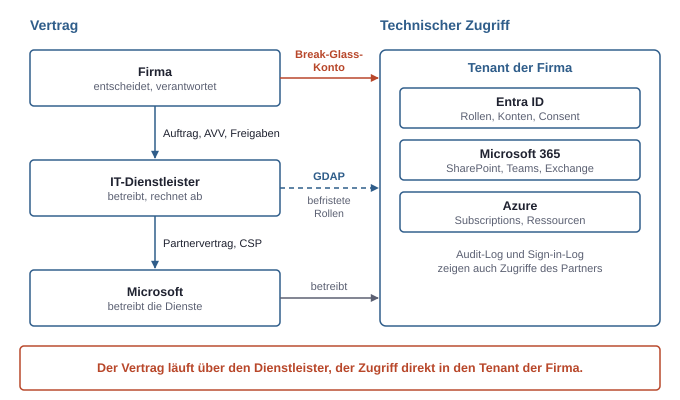
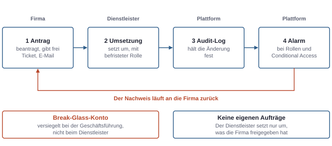
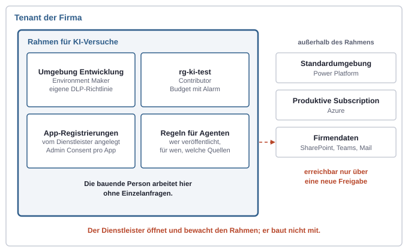

# 14. Mit externem IT-Dienstleister: Wer hält die Rollen, wer entscheidet, wer zahlt?

Viele kleine Firmen haben keine eigene IT. Tenant, Geräte, Lizenzen und Support liegen bei einem **IT-Dienstleister**, oft Managed Service Provider oder kurz MSP genannt. Die Technik bleibt dabei genau dieselbe: Tenant, Entra ID, Tokens, Azure RBAC und Consent funktionieren wie in einem selbst verwalteten Tenant. Anders ist, wer die Rollen hält, wer entscheidet und wer bezahlt. Genau diese drei Fragen bestimmen, was jemand, der in einer solchen Firma mit KI bauen will, selbst tun kann und wofür eine Anfrage nötig ist.

## Geteilte Verantwortung: drei Parteien

An einem Tenant mit Dienstleister sind drei Parteien beteiligt. Jede verantwortet etwas anderes.

| Wer | Verantwortet | Beispiele |
|---|---|---|
| Microsoft | den Dienst selbst | Rechenzentren, Verfügbarkeit, Sicherheit der Plattform, Updates von Microsoft 365 |
| IT-Dienstleister | Konfiguration und Betrieb des Tenants | Nutzer anlegen und sperren, Lizenzen, Geräte mit Intune, MFA, Conditional Access, Backup, Support |
| Firma | Entscheidungen und Inhalte | wer welche Daten sieht, welche Werkzeuge genutzt werden, Ordnung in SharePoint und Teams, Verträge und AVV, Freigaben, Prozesse |

Der wichtigste Punkt der Tabelle steckt in der dritten Zeile. Der Dienstleister weiß, **wie** man Rechte vergibt, aber nicht, **wer** sie fachlich bekommen soll. Ob die Projektleitung die Site der Buchhaltung sehen darf, kann nur die Firma beantworten. Fehlt intern jemand, der solche Fragen beantwortet, vergibt der Dienstleister im Zweifel großzügig, damit niemand blockiert ist. So entsteht Oversharing (siehe Kapitel 5, Daten und Freigaben), ohne dass jemand einen Fehler im technischen Sinn gemacht hätte.

Zwei weitere Grundsätze gelten unabhängig vom Vertrag:

- **Der Tenant gehört der Firma, nicht dem Dienstleister.** Die Firma braucht deshalb ein eigenes Break-Glass-Konto mit Global Administrator (siehe Kapitel 4, Admin-Rollen). Ohne dieses Konto hängt die Firma beim Wechsel oder Ausfall des Dienstleisters an dessen Mitwirkung. Dasselbe gilt sinngemäß für den Zugang zur Domain und zum DNS, an dem Anmeldung und Mail hängen.
- **Microsoft sichert die Inhalte nicht gegen eigene Fehler.** Microsoft hält den Dienst verfügbar und repliziert Daten gegen Hardwareausfälle. Gegen Löschen, Überschreiben oder Verschlüsseln durch ein kompromittiertes Konto helfen Papierkorb und Versionen nur für begrenzte Zeit. Ein echtes Backup ist Aufgabe der Firma, umgesetzt meist durch den Dienstleister.

## Konstellationen zwischen Firma, Dienstleister und Microsoft

Die Aufteilung zwischen Firma und Dienstleister ist nicht überall gleich. In der Praxis kommen fünf Grundmodelle vor.

| Modell | Lizenzen von | Verwaltung | Typisch für |
|---|---|---|---|
| Vollständig betreut | Dienstleister als CSP-Partner | Dienstleister; intern nur ein Ansprechpartner | kleine Firmen ohne IT |
| Geteilter Betrieb (co-managed) | Partner oder direkt | Dienstleister: Geräte und Sicherheit; intern: Apps, Inhalte, Projekte | Mittelstand mit ein bis drei IT-Leuten |
| Selbst verwaltet | direkt bei Microsoft über eine MCA | interne IT; Dienstleister nur für Projekte | größere Firmen |
| Betrieb plus Spezialist | wie oben | Betriebsdienstleister plus zweite Firma für Copilot, Power Platform oder Security | wenn dem Betriebsdienstleister KI-Wissen fehlt |
| Nur Lizenzhändler | CSP | niemand oder die Firma selbst | Kleinstfirmen; riskant, weil niemand den Tenant pflegt |

Hinter jedem Modell steht eine Kette von Verträgen. Die Firma beauftragt den Dienstleister und gibt ihm Freigaben. Der Dienstleister hat einen Partnervertrag mit Microsoft und kauft dort ein. Microsoft betreibt die Dienste. Technisch verläuft der Zugriff anders als der Vertrag: Der Dienstleister greift direkt in den Tenant der Firma zu, nicht über Microsoft.



*Der Vertrag läuft über den Dienstleister zu Microsoft, der Zugriff aber direkt in den Tenant der Firma. Nur das eigene Break-Glass-Konto sichert, dass die Firma dort selbst bestimmt.*

### CSP: der Dienstleister als Händler

**CSP** (Cloud Solution Provider) ist das Programm, in dem ein Partner Lizenzen und Azure-Verbrauch im eigenen Namen weiterverkauft und dem Kunden selbst in Rechnung stellt. Für die Firma hat das einige Folgen, die in einem Direktvertrag nicht auftreten:

- **Rechnung vom Partner.** Für diese Produkte gibt es kein Rechnungskonto der Firma unter einer MCA (siehe Kapitel 11, Lizenzen und Abrechnung). Kaufen, Erhöhen und Kündigen laufen über den Dienstleister. Die Abos erscheinen im Microsoft 365 Admin Center trotzdem, lassen sich dort aber nicht immer selbst ändern.
- **Laufzeiten.** Bei Jahresverträgen lassen sich Lizenzen nach einer kurzen Frist meist nicht mehr reduzieren. Die genauen Bedingungen nennt der Partner.
- **Azure in CSP.** Die Subscription hängt an der Abrechnung des Partners. Ob die Firma im Azure-Portal Kosten sieht, hängt davon ab, ob der Partner die Kostenansicht freigegeben hat. Ein Budget ist dann das Mittel für Warnungen; ein Ausgabenlimit wie bei einem Guthaben-Angebot gibt es dort in der Regel nicht.
- **Verbrauch in Foundry und Power Platform.** Modellaufrufe, Copilot Credits und eine Abrechnungsrichtlinie (siehe Kapitel 12, Plattformen und Verwaltungsorte) landen auf der CSP-Rechnung des Dienstleisters. Wer einen Versuch mit Modellen plant, sollte deshalb vorher klären, wie Verbrauch weiterberechnet wird.

### GDAP: wie der Dienstleister in den Tenant kommt

Der Dienstleister braucht Admin-Rechte im Tenant der Firma. Der saubere Weg dafür heißt **GDAP** (Granular Delegated Admin Privileges). Der Ablauf:

1. Der Partner fragt im Partner Center eine Beziehung an. Die Anfrage nennt eine Liste von Entra-Rollen und eine Laufzeit, höchstens zwei Jahre.
2. Ein Global Administrator der Firma bestätigt die Anfrage über einen Link. Erst damit gilt die Beziehung.
3. Der Partner weist die Rollen Sicherheitsgruppen **in seinem eigenen Tenant** zu. Seine Techniker bekommen keine Konten im Tenant der Firma, sondern melden sich mit ihren Partnerkonten an.

Daraus ergibt sich, wo die Firma hinschauen kann. Die Beziehungen stehen im Microsoft 365 Admin Center unter den Einstellungen bei den Partnerbeziehungen; dort sind Rollen und Laufzeit sichtbar, und die Firma kann eine Beziehung beenden. Anmeldungen der Partnerkonten erscheinen im Sign-in-Log als Zugriffe aus einem fremden Tenant, ihre Änderungen im Audit-Log. Conditional Access kann Dienstleister-Konten als eigene Gruppe externer Nutzer ansprechen, etwa um MFA oder bestimmte Standorte zu verlangen.

Der Vorläufer DAP gab dem Partner dauerhaft Global Administrator in allen Kundentenants. Microsoft hat ihn abgelöst. Eine GDAP-Beziehung kann aber ebenfalls Global Administrator enthalten. Ein dauerhafter Global Administrator für den Partner gilt als Risiko, weil ein kompromittierter Partner-Tenant dann alle Kunden zugleich trifft. Besser ist eine Rollenliste, die zu den Aufgaben passt, etwa User Administrator, Groups Administrator, Intune Administrator und Exchange Administrator, und Global Administrator nur befristet für Sonderfälle.

In Azure sieht die Firma den Zugriff des Partners in den Rollenzuweisungen der Subscription. Bei Subscriptions aus CSP steht dort typischerweise eine Zuweisung des Partners, die nicht zu einem Konto der Firma gehört:

```bash
az role assignment list --all --include-inherited \
  --query "[].{wer:principalName, typ:principalType, rolle:roleDefinitionName, scope:scope}" \
  -o table
```

Einträge des Partners fallen dabei durch ihren Typ auf, etwa als Gruppe aus einem fremden Tenant. Für Azure gibt es zusätzlich Azure Lighthouse. Damit delegiert die Firma einzelne Subscriptions oder Resource Groups an den Tenant des Dienstleisters; im Azure-Portal steht das unter „Service providers".

### Der Dienstleister ist selbst Auftragsverarbeiter

Wer Global Administrator oder Exchange Administrator hält, kann sich Zugang zu Postfächern und Dateien verschaffen (siehe Kapitel 4, Admin-Rollen). Der Dienstleister verarbeitet damit Personenbezogene Daten im Auftrag der Firma. Die Firma braucht deshalb auch mit ihm einen AVV, nicht nur mit Microsoft (siehe Kapitel 13, Rechtliche Einordnung). Setzt der Dienstleister selbst Werkzeuge mit Datenzugriff ein, etwa für Backup oder Fernwartung, sind deren Anbieter Unterauftragsverarbeiter und gehören in diesen AVV.

### Prüffragen an den Dienstleister

| Frage | Warum sie zählt | Wo die Firma es selbst sieht |
|---|---|---|
| Hat die Firma ein eigenes Break-Glass-Konto? | Sonst gehört der Tenant faktisch dem Dienstleister | Entra Admin Center, Rollen: wer hält Global Administrator |
| Nutzt der Dienstleister GDAP, und mit welchen Rollen? | Dauerhafter Global Administrator für den Partner ist ein Risiko | Microsoft 365 Admin Center, Partnerbeziehungen |
| Laufen Lizenzen und Azure-Kosten über CSP oder direkt bei Microsoft? | Entscheidet, wer kaufen und kündigen kann und wer Kosten sieht | Microsoft 365 Admin Center, Abrechnung; Azure-Portal, Kostenverwaltung |
| Gibt es einen AVV mit dem Dienstleister? | Der Dienstleister hat Zugriff auf alle Daten | Vertragsunterlagen |
| Was ist Betrieb (pauschal), was ist Projekt (nach Stunden)? | Jede Anfrage mit Rechten kann sonst eine Rechnung erzeugen | Dienstleistungsvertrag |
| Gibt es ein Backup, und wer hat einen Wiederherstellungstest gesehen? | Microsoft sichert nicht gegen eigene Fehler | Bericht des Dienstleisters |

## Vier-Augen-Prinzip in kleinen Firmen

Eine große Firma trennt Rollen auf verschiedene Personen (siehe Kapitel 4, Admin-Rollen). Eine kleine Firma kann das nicht. Mit einem Dienstleister lässt sich trotzdem eine leichte Form des Vier-Augen-Prinzips herstellen. Die zwei Augen sind dabei zwei Parteien, nicht zwei Techniker:

- **Die Firma beantragt und gibt frei**, durch die Geschäftsführung oder einen benannten Ansprechpartner, per Ticket oder E-Mail. Sie entscheidet, **ob** etwas geschieht, nicht **wie**.
- **Der Dienstleister setzt um** und gibt sich keine eigenen Aufträge.
- **Es bleibt ein Nachweis**: das Ticket mit der Freigabe und der Eintrag im Audit-Log.



*Die Kontrolle entsteht nicht durch eine zweite Person im selben Team, sondern dadurch, dass Antrag, Umsetzung und Nachweis bei verschiedenen Parteien liegen.*

Für die fehlende zweite Person gibt es technischen Ersatz:

- **PIM:** Hohe Rechte sind nur befristet aktiv und verlangen eine Begründung. PIM setzt eine Entra-ID-P2-Lizenz voraus.
- **Break-Glass-Konto:** Die Zugangsdaten und der zweite Faktor liegen versiegelt bei der Geschäftsführung, nicht beim Dienstleister.
- **Alarme:** Änderungen an Admin-Rollen, an Conditional Access und an Partnerbeziehungen lösen eine Meldung aus, die auch an ein Postfach der Firma geht. Entscheidend ist, dass der Dienstleister diese Meldung nicht unbemerkt abschalten kann; sonst gilt dasselbe wie für Protokolle, die nur bei einer zweiten Stelle Beweiskraft haben (siehe Kapitel 4, Admin-Rollen).
- **Admin-Consent-Workflow:** Entra ID kann Nutzern erlauben, für eine App ohne Consent-Recht eine Freigabe zu **beantragen**. Die Anfrage landet bei benannten Prüfern, die zustimmen oder ablehnen. Das ist das eingebaute Vier-Augen-Prinzip für App-Rechte und passt genau zur Aufteilung „Firma beantragt, Dienstleister prüft".

Genau das prüfen Auditoren und Cyber-Versicherer bei kleinen Firmen: nicht, ob es ein Sicherheitsteam gibt, sondern dass niemand unbemerkt allein alles kann.

## Was intern selbst geht und was nur mit Dienstleister

Was die bauende Person selbst tun kann, hängt von zwei Dingen ab: welche Einstellungen der Dienstleister gesperrt hat und welche Rollen ihr Konto hat. Die folgende Tabelle beschreibt den typischen Fall.

| Vorhaben | Selbst möglich? | Dienstleister nötig für |
|---|---|---|
| Agent in Copilot Studio bauen | oft ja, in der Standardumgebung, sofern nicht gesperrt | Veröffentlichen für alle in Teams und Copilot, DLP-Richtlinie und Connectors, eigene Umgebung, Abrechnung von Copilot Credits |
| Power Apps und Flows in Teams | oft ja | Premium-Connectors, Lizenzen, DLP-Richtlinie |
| App-Registrierung anlegen | standardmäßig ja, oft vom Dienstleister abgeschaltet | Admin Consent für Graph-Rechte, vor allem Anwendungsberechtigungen; Freigabe pro Site bei Sites.Selected |
| Graph mit eigenem Konto testen (delegiert) | oft ja, geringes Risiko | nur wenn der Consent durch Nutzer gesperrt ist |
| Eigene Teams-App hochladen | je nach Teams-Richtlinie | Freigabe der App für die Organisation |
| Azure-Ressourcen wie App Service, Container, Key Vault | nein | Subscription und eine Rolle, etwa Contributor auf einer Resource Group |
| Modelle in Foundry | nein, weil Azure-Ressource | wie Azure, dazu Data-Plane-Rollen, Region, Deployment-Typ und gegebenenfalls Azure Policy |
| Rechte für eine Managed Identity | nein | Rollenzuweisung in Azure oder Graph-Consent |

Wo die Sperren sitzen, lässt sich meist selbst nachsehen, auch ohne Admin-Rolle, oder gezielt erfragen:

| Einstellung | Ort | Wirkung |
|---|---|---|
| Nutzer dürfen Apps registrieren | Entra Admin Center, Nutzer, Benutzereinstellungen | Steht sie auf „Nein", legt der Dienstleister jede App-Registrierung an |
| Consent durch Nutzer | Entra Admin Center, Enterprise Applications, Consent und Berechtigungen | Gesperrt heißt: auch delegierte Rechte brauchen Admin Consent |
| Admin-Consent-Workflow | Entra Admin Center, Enterprise Applications, Admin-Consent-Einstellungen | Ob Nutzer Freigaben beantragen können und wer sie prüft |
| Hochladen eigener Apps | Teams Admin Center, Teams-Apps, Einrichtungsrichtlinien | Ob ein App-Paket außerhalb des Katalogs hochgeladen werden darf |
| Anlegen von Umgebungen | Power Platform Admin Center, Einstellungen des Tenants | Ob Developer-Umgebungen selbst angelegt werden dürfen |

Die eigene Lage zeigt sich schnell. `az login` mit dem Firmenkonto und danach `az account list` zeigt, ob überhaupt eine Subscription sichtbar ist; ohne Rollenzuweisung bleibt die Liste leer. Im Graph Explorer zeigt `GET /me/memberOf`, in welchen Gruppen und Rollen das eigene Konto steckt.

Als Faustregel gilt: Bauen geht oft selbst. Alles, was an echte Firmendaten anbindet, Rechte vergibt oder Geld kostet, läuft über den Dienstleister. Der Dienstleister ist dabei der Wächter über die Einstellungen. Er baut nicht selbst, er öffnet einen Rahmen.

## Ein Rahmen für KI-Versuche

Statt jede Kleinigkeit einzeln anzufragen, lohnt es sich, beim Dienstleister einmal einen festen Rahmen zu beantragen. Er grenzt ab, wo die bauende Person frei arbeitet, und lässt den Rest des Tenants unberührt.



*Der Dienstleister öffnet einen begrenzten Bereich, in dem ohne Einzelanfragen gebaut wird. Firmendaten und Produktion bleiben hinter einer neuen Freigabe.*

Typische Bausteine eines solchen Rahmens:

- **Power-Platform-Umgebung für Entwicklung**, getrennt von der Standardumgebung, mit der Umgebungsrolle `Environment Maker` für die bauende Person und einer eigenen DLP-Richtlinie (siehe Kapitel 12, Plattformen und Verwaltungsorte).
- **Resource Group** wie `rg-ki-test` mit `Contributor` für die bauende Person und einem Budget mit Alarm (siehe Kapitel 11, Lizenzen und Abrechnung). Contributor kann keine Rollen vergeben. Braucht eine Managed Identity eine Rolle, etwa `Cognitive Services OpenAI User`, muss der Dienstleister sie setzen. Alternativ kann er die Rolle `Role Based Access Control Administrator` auf die Resource Group vergeben, mit einer Bedingung, die nur bestimmte Rollen zuweisbar macht. Zu beachten ist außerdem, dass Contributor die Schlüssel einer Foundry-Ressource lesen darf, solange sie nicht abgeschaltet sind (siehe Kapitel 12, Plattformen und Verwaltungsorte).
- **App-Registrierungen** legt der Dienstleister an, oder er erlaubt es. Admin Consent erteilt er pro App nach Prüfung eines Rechtekonzepts.
- **Regeln für Agenten**: wer veröffentlichen darf, für wen und mit welchen Datenquellen.
- **Klärung der Kosten**: was mit den vorhandenen Lizenzen geht und was zusätzlich kostet, etwa Copilot Credits, Premium-Connectors oder Verbrauch in Azure.

Eine gebündelte Anfrage ist dann eine kurze Liste, die der Dienstleister ohne Rückfragen umsetzen kann:

| Punkt | Inhalt |
|---|---|
| Was | App-Registrierung `meine-app`, Single-Tenant |
| Rechte | delegiert: `User.Read`, `Files.Read`; Anwendung: Sites.Selected mit Lesen auf genau einer Site |
| Warum | Auswertung der Projektsite für eine Übersicht; keine anderen Sites nötig |
| Azure | `Contributor` auf `rg-ki-test`; Rolle `Cognitive Services OpenAI User` für die Managed Identity der Web-App auf der Foundry-Ressource |
| Daten und Ort | nur interne Testdaten; Deployment-Typ Data Zone EU |
| Verantwortlich | benannte Person für Betrieb und Löschung |
| Laufzeit | Versuch bis zu einem festen Datum, danach Prüfung oder Rückbau |
| Freigabe | Geschäftsführung per E-Mail vom Datum |

## Bewährte Arbeitsweise

Der Weg, der in kleinen Firmen mit Dienstleister am wenigsten reibt, entspricht dem Weg von Test zu Produktion in großen Firmen (siehe Kapitel 8, Ein Beispielprojekt eingeordnet):

1. **Frei bauen im eigenen Test-Tenant.** App-Registrierung, Foundry, Managed Identity und Consent lassen sich dort ohne Dienstleister ausprobieren, weil die bauende Person dort selbst Global Administrator und Owner ist.
2. **Eine fertige Liste an den Dienstleister.** Wenn es funktioniert und sich lohnt, geht eine Anfrage wie oben hinaus: welche App, welche Rechte, welche Rolle auf welcher Resource Group, und warum.
3. **Anfragen bündeln.** Viele Verträge rechnen pro Ticket eine Mindestzeit ab, oft 15 bis 60 Minuten. Fünf Einzelanfragen kosten dann deutlich mehr als eine gebündelte.
4. **Vorher klären, wer die Lösung danach betreut.** Sonst landen Updates, Fehler und Fragen beim Dienstleister und werden nach Stunden abgerechnet.

Was im Betrieb typischerweise anfällt, ist vorhersehbar:

| Ereignis | Folge ohne Zuständigkeit |
|---|---|
| Client Secret oder Zertifikat läuft ab | App fällt aus, Ticket beim Dienstleister |
| Person mit Flow-Verbindung verlässt die Firma | Flow läuft nicht mehr oder unter einem gesperrten Konto |
| Modellversion wird von Microsoft zurückgezogen | Deployment muss umgestellt und getestet werden |
| Neue Mitarbeitende brauchen Zugriff | Rechtevergabe über Gruppe oder Einzelfreigabe |
| Testzeitraum oder Budget endet | Ressourcen laufen weiter oder stoppen unangekündigt |

## Kosten: Richtwerte

Die folgenden Zahlen sind Richtwerte für 2026 nach Angaben von Anbietern, netto. Sie sind keine Angebote und schwanken stark nach Region und Vertrag.

| Posten | Richtwert |
|---|---|
| Pauschale für Managed Service (Monitoring, Patches, Helpdesk, Basis-Sicherheit, Lizenzverwaltung; Lizenzen meist extra) | ca. 50–90 € pro Arbeitsplatz und Monat |
| Änderungen und Projekte nach Stunden | ca. 110–140 € je Stunde, Spanne 90–180 € |
| Spezialisten für Security oder Architektur von Microsoft 365 | ca. 140–220 € je Stunde |

Geschätzter Aufwand pro Anfrage:

| Anfrage | Aufwand |
|---|---|
| Resource Group mit Rolle und Budget-Alarm | 0,5–1 h |
| App-Registrierung mit Admin Consent nach Prüfung | 0,5–2 h |
| Power-Platform-Umgebung für Entwicklung mit DLP-Richtlinie | 1–3 h |
| Prüfung eines Rechtekonzepts | 1–4 h |
| Mini-App in Teams (Registrierung, Consent, Freigabe) | 1–2 h, ca. 150–300 € |
| Ganzer Rahmen auf einmal | ca. 400–1.500 € einmalig |

Dazu kommt der Verbrauch in Azure und Foundry, oft über die CSP-Abrechnung des Dienstleisters. Günstiger ohne eigene Infrastruktur sind Power Apps oder Copilot Studio in Teams, weil sie meist weder App-Registrierung noch Azure brauchen.

Die eigentlichen Kosten entstehen im Betrieb danach, nicht bei der Einrichtung. Eine eigene Lösung lohnt sich nur, wenn klar ist, wer sie betreut und wofür sie spürbar Zeit spart.

## Copilot und KI in solchen Firmen

In Firmen mit Dienstleister funktionieren Anstöße am besten vom Fachbereich her, also von einem echten Problem aus. Die Technik zeigt Möglichkeiten und Grenzen, der Fachbereich entscheidet. Der Dienstleister ist dabei selten der Treiber, weil er für Betrieb bezahlt wird und nicht für Experimente.

Vor Copilot steht die Frage nach den Rechten im Datenbestand: Freigabelinks für „Jeder", offene Teams und Sites. Copilot findet alles, worauf jemand Zugriff hat (siehe Kapitel 5, Daten und Freigaben). In einem Tenant mit Dienstleister ist diese Prüfung doppelt wichtig, weil die Rechte oft über Jahre auf Zuruf vergeben wurden.

Statt „Copilot für alle oder keiner" hat sich ein Pilot bewährt: wenige Lizenzen über zwei bis drei Monate, echte Aufgaben, die mit Copilot, mit agentischen Funktionen und mit einem starken Modell direkt verglichen werden, und eine Messung der Nutzung.

In der Praxis ist Copilot meist stark bei Aufgaben direkt in den Apps, etwa Meetings zusammenfassen, Mails entwerfen oder Fragen an ein Dokument stellen. Bei tiefer Analyse über viele Dokumente ist er oft schwach. Die Gründe sind strukturell: Er sieht nur Ausschnitte aus der Suche, arbeitet mit Leitplanken und begrenztem Kontext und kann kaum in mehreren Schritten arbeiten.

Ein Mittelweg mit besseren Ergebnissen ist Foundry mit Zugriff über die Graph API innerhalb der Microsoft-Welt. Die Daten bleiben im Microsoft-Vertrag, die Rechte laufen über Entra ID, Managed Identity und Sites.Selected (siehe Kapitel 12, Plattformen und Verwaltungsorte). Der Preis dafür: Die Firma betreibt eigene Software, braucht Freigaben vom Dienstleister und muss den Datenweg prüfen, also den Deployment-Typ Global oder Data Zone EU und bei Fremdmodellen in Foundry die Bedingungen der Inferenz (siehe Kapitel 13, Rechtliche Einordnung).

## Was sich gegenüber einem selbst verwalteten Tenant ändert

| Thema | Selbst verwaltet | Mit Dienstleister |
|---|---|---|
| Admin-Rollen | intern, mit PIM | überwiegend beim Dienstleister über GDAP; die Firma hält das Break-Glass-Konto |
| Geräte | interne IT | komplett beim Dienstleister |
| Projekte mit Rechten | intern umsetzbar | jeder Schritt mit Rechten wird zur Anfrage, die Zeit und Geld kostet |
| Rolle der bauenden Person | gegebenenfalls Admin | Antragsteller; frei bauen nur im Test-Tenant |
| Lizenzen und Abrechnung | Rechnungskonto unter einer MCA bei der Firma | oft über den CSP-Partner; Abrechnungsrollen teils beim Dienstleister |
| Datenschutz | AVV mit Microsoft und gegebenenfalls dem KI-Anbieter | zusätzlich AVV mit dem Dienstleister |
| Nachweise | interne Protokolle | Ticket mit Freigabe, Audit-Log, Alarm an die Firma |

Die Technik bleibt gleich: Tenant, Entra ID, Tokens, Azure RBAC und Consent. Es ändert sich, wer die Rollen hält, wer entscheidet und wer bezahlt.
