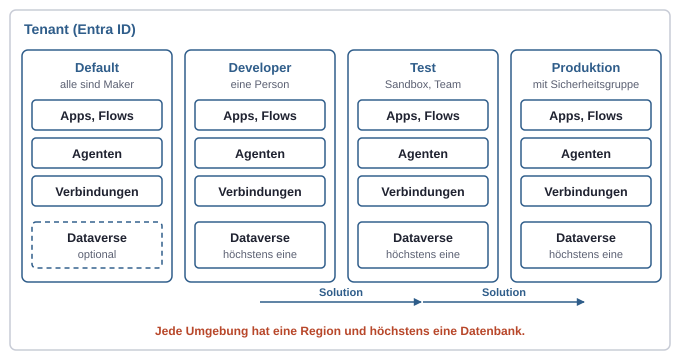
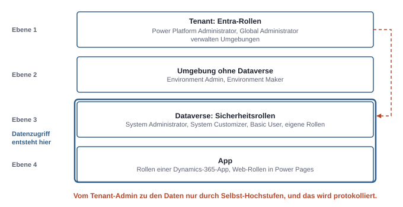

# 15. Power Platform von innen: Bausteine und Umgebungen

Die Power Platform wirkt von außen wie eine Sammlung von Werkzeugen für Leute, die nicht programmieren. Von innen ist sie eine Plattform mit klarer Struktur: Bausteine, die in Umgebungen leben, eine Datenbank pro Umgebung und mehrere Rechtesysteme übereinander. Wer diese Struktur kennt, versteht schnell, warum eine App „nicht startet", ein Flow „verschwunden" ist oder ein Admin „keine Daten sieht". Die Rechte- und Abrechnungsseite der Umgebungen ist bereits beschrieben (siehe Kapitel 12, Plattformen und Verwaltungsorte). Hier geht es darum, was man in der Power Platform baut und wo es liegt.

## Die Bausteine

Die Power Platform besteht aus wenigen Bausteinen. Jeder hat einen eigenen Ausgangspunkt.

| Baustein | Was er ist | Ausgangspunkt | Braucht Dataverse? |
|---|---|---|---|
| **Canvas App** | App, deren Oberfläche frei auf einer Leinwand gestaltet wird | die Oberfläche | nein, Daten kommen über Connectors |
| **Model-driven App** | App, deren Oberfläche aus dem Datenmodell erzeugt wird | das Datenmodell | ja |
| **Cloud Flow** | automatisierter Ablauf in Microsofts Cloud | ein Auslöser | nein |
| **Desktop Flow** | Automatisierung von Bedienschritten auf einem Windows-Rechner | ein Bildschirm, eine Anwendung | nein, aber meist aus einem Cloud Flow gestartet |
| **Agent** in Copilot Studio | Chat- oder Hintergrundagent mit Wissen und Tools | eine Aufgabe | ja, er liegt in Dataverse |
| **Power Pages** | Website für externe Besucher | die Website | ja |
| **Dataverse** | Datenbank der Umgebung mit eigenem Rechtemodell | Tabellen | ist selbst die Datenbank |

Zwei Merksätze ordnen die Apps. Eine **Canvas App** heißt „Oberfläche zuerst, Daten irgendwo": Sie kann SharePoint, Excel, SQL oder Dataverse lesen, je nach Connector. Eine **Model-driven App** heißt „Daten zuerst, Oberfläche folgt": Formulare und Ansichten entstehen aus Tabellen in Dataverse, und die Rechte kommen aus dessen Sicherheitsrollen. Die Logik in Canvas Apps schreibt man in Power Fx, einer Formelsprache ähnlich wie in Excel.

Bei den Flows trennt sich die Welt nach dem Ort der Ausführung. Ein **Cloud Flow** läuft in Microsofts Rechenzentrum und spricht Dienste über Connectors an. Ein **Desktop Flow** ist RPA (Robotic Process Automation): Er klickt und tippt auf einem Windows-Rechner in Anwendungen, die keine API haben. Das geht beaufsichtigt (attended), mit angemeldeter Person am Rechner, oder unbeaufsichtigt (unattended), auf einer Maschine ohne Person. Für Altsysteme ohne Schnittstelle ist das oft der einzige Weg, aber auch der zerbrechlichste.

**Power Pages** fällt aus dem Rahmen. Besucher einer solchen Website sind keine Konten im Tenant, sondern Kontakte in Dataverse. Sie melden sich über einen eigenen Identitätsanbieter an, und ihre Rechte regeln Web-Rollen und Tabellenberechtigungen, ein weiteres eigenes Rechtesystem.

## Die Umgebung als Grenze

Alle Bausteine leben in einer **Umgebung** (siehe Kapitel 12, Plattformen und Verwaltungsorte). Drei Eigenschaften machen sie zur wichtigsten Grenze der Plattform:

- **Höchstens eine Datenbank.** Eine Umgebung hat keine oder genau eine Dataverse-Datenbank.
- **Nur eigene Quellen.** Eine App oder ein Flow kann nur Verbindungen, Gateways und Dataverse derselben Umgebung nutzen. Was in eine andere Umgebung soll, wandert als Solution (siehe Kapitel 18, Solutions und ALM).
- **Eine Region.** Alles, was in der Umgebung entsteht, liegt in ihrer Region.



*Die Umgebung ist die Grenze für Daten, Verbindungen und Rechte. Zwischen Umgebungen wandert nur, was als Solution exportiert und importiert wird.*

### Umgebungstypen und wofür sie da sind

| Typ | Zweck | Wichtige Eigenschaft |
|---|---|---|
| **Default** | persönliche Produktivität, kleine Experimente | gibt es genau einmal, nicht löschbar; jeder lizenzierte Nutzer ist dort Maker |
| **Developer** | eigene Entwicklungsumgebung einer Person | nur der Besitzer hat Zugang |
| **Sandbox** | Entwicklung und Test im Team | lässt sich kopieren und zurücksetzen |
| **Production** | Betrieb | volle Kontrolle, dauerhaft |
| **Trial** | kurzer Versuch | läuft nach einer festen Frist ab |

Die Default-Umgebung ist das typische Problem in Firmen. Weil jeder dort bauen darf, sammeln sich über Jahre Apps und Flows, die mit persönlichen Verbindungen an Firmendaten hängen. Microsoft empfiehlt, sie als Ort für persönliche Produktivität zu behandeln, mit einer strengen DLP-Richtlinie abzusichern und alles Ernsthafte in eigene Umgebungen zu verlegen.

Die Developer-Umgebung verändert sich gerade. Microsoft führt sie künftig nur noch als Managed Environment, eine pro Person. Wer im Test-Tenant mit einer älteren Developer-Umgebung arbeitet, sollte die eigenen Solutions exportieren und die angekündigten Fristen im Admin Center im Blick behalten. Am Modell ändert das nichts: Entwickeln findet getrennt von Test und Betrieb statt.

### Eine sinnvolle Aufteilung für eine kleine Firma

Für eine kleine Firma reicht meist ein einfaches Muster:

1. **Default** für persönliche Kleinigkeiten, mit strenger DLP-Richtlinie und umbenannt, damit niemand sie für den Ort des Betriebs hält.
2. **Entwicklung** als Sandbox oder Developer-Umgebung für die Person, die baut.
3. **Test** als Sandbox, wenn mehrere Leute prüfen sollen; bei sehr kleinen Vorhaben kann sie entfallen.
4. **Produktion** für alles, worauf sich der Betrieb verlässt, mit Sicherheitsgruppe und eigener DLP-Richtlinie.

Mit einem IT-Dienstleister ist genau das der Teil des Rahmens, den er einmal einrichtet (siehe Kapitel 14, Mit externem IT-Dienstleister).

## Managed Environments: ein Schalter, kein Typ

**Managed Environments** sind kein weiterer Umgebungstyp, sondern ein Bündel von Verwaltungsfunktionen, das man auf einer bestehenden Umgebung einschaltet. Die Funktionsliste wächst ständig. Didaktisch lässt sie sich in drei Gruppen ordnen:

- **Sichtbarkeit:** Berichte darüber, welche Apps, Flows und Agenten wie oft genutzt werden.
- **Begrenzung:** Freigabe von Apps und Agenten nur an begrenzte Personenkreise, Durchsetzen von Prüfungen vor dem Import, Pipelines für den Transport, Zulassung einzelner Apps.
- **Härtung:** Zugriffsregeln nach IP-Adresse, eigene Schlüssel, Netzwerkanbindung, erweiterte Sicherung.

Der Preis ist eine Lizenzfolge. In einer Managed Environment braucht jede aktive Nutzung eine eigenständige Lizenz wie Power Apps Premium oder einen Pay-as-you-go-Zähler; die in Microsoft 365 enthaltenen Rechte reichen dort nicht. Microsoft setzt das zunehmend technisch durch. Wer also für eine Abteilung eine Umgebung „managed" macht, entscheidet zugleich über Lizenzkosten für alle, die darin Apps öffnen.

## Wer baut, wer verwaltet

In der Power Platform sind Bauen und Verwalten getrennt, und beide sind getrennt vom Zugriff auf Daten.



*Wer Umgebungen verwaltet, sieht dadurch noch keine Daten. Der Datenzugriff hängt an der Sicherheitsrolle in Dataverse, und ein Tenant-Admin muss sich dafür ausdrücklich selbst hochstufen.*

- Ein **Maker** baut in einer Umgebung: Apps, Flows, Agenten, Verbindungen. Die Rolle `Environment Maker` erlaubt genau das, gibt aber keine Rechte auf Daten. Wer Tabellen anlegen will, braucht zusätzlich eine Rolle wie `System Customizer`.
- Ein **Admin** verwaltet Umgebungen: anlegen, Sicherheitsgruppe zuweisen, DLP-Richtlinien, Kapazität. Auf Tenant-Ebene ist das die Entra-Rolle `Power Platform Administrator`.
- **Datenzugriff** entsteht erst durch eine Sicherheitsrolle in Dataverse (siehe Kapitel 16, Dataverse).

Eine wichtige Folge: Ein `Power Platform Administrator` oder Global Administrator ist in einer Umgebung mit Dataverse nicht automatisch `System Administrator`. Er kann sich selbst hochstufen, und dieser Schritt wird protokolliert. Das ist dasselbe Muster wie „Elevate Access" in Azure (siehe Kapitel 4, Admin-Rollen): Die Verwaltungsrolle öffnet die Tür, aber das Hineingehen hinterlässt eine Spur.

## Die Werkzeuge

| Werkzeug | Wofür |
|---|---|
| Maker-Portale `make.powerapps.com`, `make.powerautomate.com`, `copilotstudio.microsoft.com` | Bauen; arbeiten immer in der oben rechts gewählten Umgebung |
| Power Platform Admin Center | Umgebungen, Nutzer und Rollen je Umgebung, Application Users, DLP-Richtlinien, Kapazität |
| `pac` CLI | Anmelden an Umgebungen, Solutions exportieren und importieren, Dataverse, Power Pages |

Die `pac` CLI ist für jemanden mit Entwicklerhintergrund der natürliche Einstieg, weil sie den Weg zur Automatisierung öffnet. Sie arbeitet mit Profilen, ähnlich wie `az`:

```bash
pac auth create --environment https://<org>.crm4.dynamics.com
pac auth list
pac org who
```

`pac org who` zeigt, mit welchem Konto und in welcher Umgebung die Sitzung läuft. Das ist dieselbe Frage wie bei jedem Token: Wer bin ich gerade, und wofür gilt das?

## Lizenzen als Modell

Die Einzelheiten der Lizenzen ändern sich oft (siehe Kapitel 11, Lizenzen und Abrechnung). Das Modell bleibt stabil und besteht aus drei Säulen:

- **In Microsoft 365 enthalten:** Apps und Flows mit Standard-Connectors im Kontext von Microsoft 365, etwa auf SharePoint-Listen.
- **Premium pro Person:** Power Apps Premium oder Power Automate Premium für Premium- und Custom Connectors, Dataverse außerhalb des Microsoft-365-Kontexts und Managed Environments.
- **Kapazität und Verbrauch:** Speicher in Dataverse, Copilot Credits, unbeaufsichtigte Desktop Flows oder Pay-as-you-go über eine Azure-Subscription.

Eine Lizenz schaltet einen Dienst frei, gibt aber keine Rechte auf Daten. Auch eine Person mit Premium-Lizenz sieht in Dataverse nichts ohne Sicherheitsrolle.

## Typische Missverständnisse

| Annahme | Was stimmt |
|---|---|
| „Global Administrator sieht alle Daten in der Power Platform." | Er verwaltet Umgebungen, muss sich für Daten aber erst selbst zum System Administrator hochstufen. |
| „Managed Environment ist ein Umgebungstyp." | Es ist ein Schalter auf einer beliebigen Umgebung, mit Lizenzfolgen für alle Nutzer. |
| „Environment Maker darf Daten lesen." | Nein. Bauen und Datenzugriff sind getrennt. |
| „Die Default-Umgebung ist für Produktion gedacht." | Sie ist für persönliche Produktivität gedacht und sollte eng abgesichert werden. |
| „Mit Microsoft 365 E3 kann ich jede App auf Dataverse bauen." | Die enthaltenen Rechte decken nur Standard-Connectors im Microsoft-365-Kontext ab. |
| „Ein Flow ist weg." | Meist ist im Portal die falsche Umgebung gewählt. |
