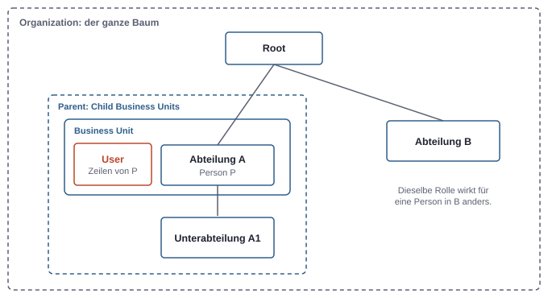
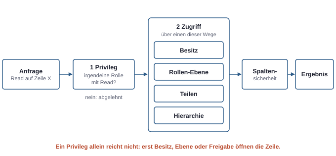
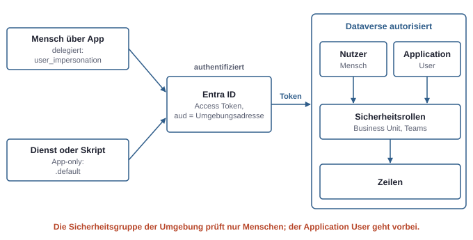

# 16. Dataverse: Datenmodell und Sicherheitsmodell

Dataverse ist die Datenbank einer Power-Platform-Umgebung. Für Entwickler ist sie zunächst eine relationale Datenbank mit Tabellen, Spalten und Beziehungen, erreichbar über eine REST-API. Der eigentliche Unterschied zu einer SharePoint-Liste oder einer SQL-Datenbank liegt woanders: Dataverse bringt ein eigenes, fein abgestuftes Rechtemodell mit, das jede Anfrage prüft, egal ob sie aus einer App, einem Flow, einem Agenten oder einem Skript kommt. Wer dieses Modell versteht, kann Fragen beantworten wie „Warum sieht die Vertriebsleitung diesen Datensatz, der Kollege aber nicht?".

## Das Datenmodell

Die Begriffe in der Oberfläche haben sich vor einigen Jahren geändert. In APIs und SDKs leben die alten Namen weiter, deshalb hilft eine kleine Übersetzung:

| Oberfläche | Früher und in APIs |
|---|---|
| Tabelle | Entity, `EntityDefinitions` |
| Spalte | Field, Attribute |
| Zeile | Record |
| Auswahl (Choice) | Option Set, Picklist |

Es gibt **Standardtabellen**, die Dataverse mitbringt, etwa Account, Contact, User, Business Unit und Task, und **eigene Tabellen**. Eigene Tabellen und Spalten tragen im technischen Namen das Präfix ihres Publishers, etwa `contoso_projekt` (siehe Kapitel 18, Solutions und ALM). Der technische Name lässt sich nach dem Speichern nicht mehr ändern.

Daneben gibt es Sonderformen, die man kennen, aber nicht sofort nutzen muss: **Aktivitätstabellen** für zeitbezogene Dinge wie E-Mails und Termine, **virtuelle Tabellen**, die Daten live aus einer externen Quelle zeigen, und **elastische Tabellen** für sehr große Datenmengen.

Spalten haben Datentypen wie Text, Zahl, Datum, Datei, Bild, Formel, Auswahl und **Lookup**. Ein Lookup ist ein Verweis auf eine Zeile einer anderen Tabelle. Eine **Auswahl** speichert eine Zahl und zeigt ein Label; sie kann lokal für eine Spalte oder global für mehrere Tabellen definiert sein.

### Beziehungen

Dataverse kennt zwei echte Beziehungstypen:

- **1:N:** Die Kind-Tabelle erhält eine Lookup-Spalte auf die Eltern-Tabelle. Ein Projekt hat viele Aufgaben.
- **N:N:** Dataverse legt intern eine Zwischentabelle an. Ein Projekt hat viele Beteiligte, ein Beteiligter viele Projekte.

N:1 ist nur die Sicht der Kind-Tabelle auf eine 1:N-Beziehung.

Jede 1:N-Beziehung hat ein **Verhalten** für Aktionen wie Zuweisen, Teilen und Löschen. Bei einer Eltern-Beziehung (parental) wandern diese Aktionen vom Elternteil zu den Kindern: Wer ein Projekt löscht, löscht seine Aufgaben, und wer ein Projekt teilt, teilt seine Aufgaben mit. Bei einer Verweis-Beziehung (referential) bleibt das Kind unberührt. Für die Sicherheit ist das wichtig, denn ein harmlos wirkendes Teilen kann so mehr freigeben als beabsichtigt.

Eine zweite Feinheit: Wer eine Zeile mit Lookup lesen darf, sieht den **Primärnamen** der verknüpften Zeile, auch ohne Leserecht darauf. In Primärnamen gehören deshalb keine vertraulichen Angaben.

### Wann Dataverse, wann eine SharePoint-Liste

| Frage | SharePoint-Liste | Dataverse |
|---|---|---|
| Lizenz | in Microsoft 365 enthalten | Premium (außerhalb des Microsoft-365-Kontexts) |
| Rechte | auf Liste, Ordner, Element; Vererbung wie bei Dateien (siehe Kapitel 5, Daten und Freigaben) | Rollen mit Zugriffsebenen pro Tabelle, Besitz pro Zeile, Spaltensicherheit |
| Beziehungen | einfache Nachschlagefelder | echte 1:N- und N:N-Beziehungen mit Verhalten |
| Datenmenge und Abfragen | begrenzt, Delegation wird schnell zum Problem (siehe Kapitel 17, Apps und Flows bauen) | für große Mengen und serverseitige Abfragen gebaut |
| Model-driven App | nicht möglich | möglich |

Faustregel: Für eine Teamliste mit wenigen hundert Einträgen ohne feine Rechte reicht SharePoint. Sobald verschiedene Personen verschiedene Zeilen sehen sollen, Beziehungen wichtig werden oder eine Model-driven App gewünscht ist, ist Dataverse der richtige Ort.

## Das Sicherheitsmodell

Das Rechtemodell von Dataverse hat mehrere Bausteine. Sie wirken zusammen, lassen sich aber einzeln erklären.

### Sicherheitsrollen: Privileg mal Zugriffsebene

Eine **Sicherheitsrolle** ist eine Sammlung von Privilegien pro Tabelle. Die acht Privilegien sind Create, Read, Write, Delete, Append, Append To, Assign und Share. Append und Append To regeln das Verknüpfen: Wer eine Aufgabe an ein Projekt hängt, braucht Append auf der Aufgabe und Append To auf dem Projekt.

Jedes Privileg hat eine **Zugriffsebene**:

| Ebene | Gilt für |
|---|---|
| None | nichts |
| User | eigene Zeilen, Zeilen der eigenen Teams und mit einem geteilte Zeilen |
| Business Unit | alle Zeilen der eigenen Business Unit |
| Parent: Child Business Units | eigene Business Unit und alle darunter |
| Organization | alle Zeilen der Tabelle |

Eine Rolle sagt also nicht nur „darf lesen", sondern „darf lesen, und zwar die eigenen" oder „darf lesen, und zwar alle der Abteilung".

Rollen sind **kumulativ**. Hat eine Person zwei Rollen, gilt die Vereinigung. Es gibt kein Verbot, das eine Rolle aussprechen könnte, um ein Recht einer anderen aufzuheben. Wer weniger Rechte will, muss Rollen enger schneiden, nicht eine Sperrrolle hinzufügen.

### Business Units

Jede Dataverse-Datenbank hat eine oberste **Business Unit** (Root) und darunter einen Baum weiterer Business Units. Jede Person gehört genau einer an. Jede Zeile hat einen Besitzer und eine besitzende Business Unit. Business Units sind Sicherheitsgrenzen und müssen nicht dem Organigramm entsprechen. In kleinen Firmen reicht oft die Root allein.



*Die Zugriffsebene einer Rolle ist relativ zur Business Unit der Person. Dieselbe Rolle erlaubt einer Person in Abteilung A etwas anderes als einer in Abteilung B.*

### Besitz, Teams und Teilen

Zeilen in den meisten Tabellen gehören einer Person oder einem Team. Ob eine Tabelle so funktioniert, wird beim Anlegen festgelegt und ist danach unveränderlich: **user- oder teambesessene** Tabellen kennen alle Zugriffsebenen, **organisationsbesessene** Tabellen nur „alle oder keine".

Teams gibt es in drei Formen:

| Team | Besitzt Zeilen? | Hat Rollen? | Mitglieder |
|---|---|---|---|
| **Owner Team** | ja | ja | manuell gepflegt |
| **Access Team** | nein | nein | dient nur als Empfänger beim Teilen, oft pro Zeile automatisch erzeugt |
| **Entra-Gruppen-Team** | ja | ja | aus einer Gruppe in Entra ID abgeleitet |

Das **Entra-Gruppen-Team** ist für Firmen der praktischste Weg. Die Rolle hängt am Team, die Mitgliedschaft pflegt die Person, die ohnehin Gruppen in Entra verwaltet. Dataverse übernimmt die Mitgliedschaft bei der Anmeldung; sie wird zwischengespeichert, Änderungen wirken also nicht immer sofort.

**Teilen** (Share) gibt einer Person oder einem Team Zugriff auf eine einzelne Zeile, zusätzlich zu dem, was die Rolle erlaubt. Es ist für Ausnahmen gedacht. Viele geteilte Zeilen sind schwer zu überblicken und machen Abfragen langsamer. **Zuweisen** (Assign) wechselt dagegen den Besitzer.

### Zwei Prüfungen bei jedem Zugriff

Bei jedem Zugriff prüft Dataverse zwei Dinge nacheinander.



*Ein Privileg allein reicht nicht. Erst Ebene, Besitz oder Freigabe entscheiden, welche Zeilen sichtbar sind, und die Spaltensicherheit schränkt innerhalb davon weiter ein.*

1. **Privileg-Prüfung:** Hat die Identität überhaupt ein Read-Privileg auf dieser Tabelle, egal auf welcher Ebene?
2. **Zugriffs-Prüfung:** Erreicht sie diese bestimmte Zeile, über Besitz, über die Ebene ihrer Rolle, über eine Freigabe oder über eine Hierarchie von Vorgesetzten?

In Model-driven Apps zeigt die Funktion „Check Access" an einer Zeile, über welchen Weg eine bestimmte Person Zugriff hat. Für die Fehlersuche ist das unbezahlbar.

### Spaltensicherheit

**Spaltensicherheit** schützt einzelne Spalten, etwa ein Gehalt oder eine private Telefonnummer. Die Spalte wird als gesichert markiert, ein Sicherheitsprofil legt fest, wer sie lesen, anlegen oder ändern darf. Zwei Dinge sind dabei wichtig: Spaltensicherheit gibt keinen Zugriff auf Zeilen, sie schränkt nur innerhalb des vorhandenen Zugriffs ein. Und sie gilt für alle Zugriffswege, auch die API, aber nicht für `System Administrator`.

Einstellungen in der Oberfläche schützen dagegen nichts. Eine ausgeblendete Spalte im Formular oder eine als versteckt markierte Auswahloption bleibt über die API lesbar.

## Die Kette bis zur Zeile

Zwischen einem Konto in Entra ID und einer sichtbaren Zeile liegen mehrere Stufen. Jede kann einzeln scheitern:

1. **Konto in Entra ID**
2. **Lizenz** für die Nutzung
3. **Sicherheitsgruppe der Umgebung**, falls gesetzt: Sie ist ein Türsteher. Mitglieder werden als Nutzer in der Umgebung angelegt, Nichtmitglieder werden deaktiviert. Rechte gibt sie keine.
4. **Nutzer in Dataverse** mit Business Unit
5. **Sicherheitsrolle**, direkt oder über ein Team
6. **Zugriff auf die Zeile** über Ebene, Besitz oder Freigabe
7. **Spaltensicherheit**

Wer „Ich sehe nichts" meldet, wird diese Kette von oben nach unten abgehen.

## Dienste und Skripte: der Application User

Ein Hintergrunddienst, ein Skript oder eine Pipeline greift nicht als Mensch auf Dataverse zu. Dafür gibt es den **Application User**: einen Nutzerdatensatz in Dataverse, der an eine App-Registrierung oder eine Managed Identity gebunden ist (siehe Kapitel 2, Identitäten und Tokens). Er bekommt eine Business Unit und Sicherheitsrollen wie ein Mensch, braucht aber keine Lizenz und muss nicht Mitglied der Sicherheitsgruppe der Umgebung sein.

Das ist der saubere Weg gegenüber einem lizenzierten „Dienstkonto" mit Passwort. Er folgt demselben Prinzip wie Sites.Selected bei SharePoint (siehe Kapitel 3, Die drei Rechtesysteme): Entra ID stellt nur fest, wer die App ist. Was sie darf, entscheidet Dataverse über die zugewiesene Rolle. Für den App-only-Zugriff braucht die App-Registrierung deshalb keine Graph-ähnliche Anwendungsberechtigung, sondern einen Application User mit eng geschnittener eigener Rolle.

### Die Web API mit einem Entra-Token

Dataverse ist über eine OData-REST-API unter der Adresse der Umgebung erreichbar. Jede Anfrage läuft durch dieselbe Sicherheitsprüfung wie die Oberfläche. Die Audience des Tokens ist die Adresse der Umgebung, nicht `graph.microsoft.com`.



*Entra ID authentifiziert, Dataverse autorisiert. Dieselbe Anfrage liefert je nach zugeordnetem Nutzer und dessen Rollen unterschiedliche Zeilen.*

Ein kurzer Test mit dem eigenen Konto über die Azure CLI:

```bash
URL=https://<org>.crm4.dynamics.com
TOKEN=$(az account get-access-token --resource $URL --query accessToken -o tsv)
curl -s -H "Authorization: Bearer $TOKEN" -H "OData-Version: 4.0" \
  "$URL/api/data/v9.2/WhoAmI"
```

`WhoAmI` gibt die ID des Dataverse-Nutzers und seiner Business Unit zurück. Delegiert fragt eine App den Scope `<umgebungsadresse>/user_impersonation` an, und es gelten die Rollen der angemeldeten Person. App-only fragt sie `<umgebungsadresse>/.default` an, und es gelten die Rollen des Application Users.

## Typische Missverständnisse

| Annahme | Was stimmt |
|---|---|
| „Die Sicherheitsgruppe der Umgebung gibt Zugriff auf Daten." | Sie entscheidet nur, wer Nutzer der Umgebung ist. Rechte kommen aus Rollen. |
| „Mit einer zweiten Rolle kann ich Rechte entziehen." | Rollen sind kumulativ, es gibt kein Verbot. |
| „Formular ausblenden schützt die Spalte." | Die API umgeht die Oberfläche; nur Rollen und Spaltensicherheit zählen. |
| „Spaltensicherheit schützt auch vor Admins." | Für System Administrator gilt sie nicht. |
| „Ein Hintergrunddienst braucht ein lizenziertes Dienstkonto." | Der Application User ist der vorgesehene Weg, ohne Lizenz und ohne Passwort. |
| „Teilen eines Projekts betrifft nur das Projekt." | Bei einer Eltern-Beziehung werden die Kinder mitgeteilt. |
