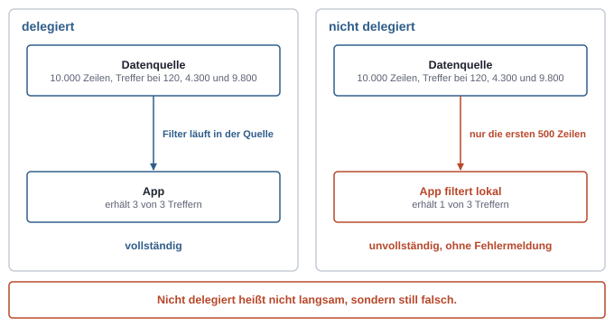
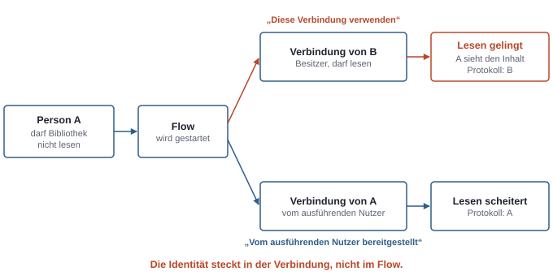

# 17. Apps und Flows bauen: Canvas, Model-driven, Cloud Flows

Eine App oder einen Flow zum Laufen zu bringen, ist in der Power Platform selten schwer. Die Schwierigkeiten zeigen sich später: Eine App findet ab einer bestimmten Datenmenge Einträge nicht mehr, ein Flow handelt mit Rechten, die der auslösenden Person gar nicht zustehen, oder ein wichtiger Ablauf steht still, weil jemand die Firma verlassen hat. Alle drei Probleme haben dieselbe Wurzel. Sie entstehen, wenn man nicht weiß, wo eine Abfrage ausgeführt wird und mit wessen Identität ein Schritt läuft.

## Canvas oder Model-driven

Die beiden App-Arten sind bereits beschrieben (siehe Kapitel 15, Power Platform von innen). Für die Wahl hilft eine einfache Regel:

| Kriterium | Canvas App | Model-driven App |
|---|---|---|
| Typischer Einsatz | aufgabenbezogene App mit wenigen Bildschirmen, oft mobil | datenlastige Prozess-App mit vielen Tabellen und Rollen |
| Gestaltung | frei | aus Formularen und Ansichten erzeugt |
| Datenquellen | viele über Connectors, gemischt | Dataverse |
| Rechte auf Daten | kommen aus der jeweiligen Datenquelle | kommen aus den Sicherheitsrollen in Dataverse |

Beide lassen sich verbinden: Eine Model-driven App kann einzelne Seiten enthalten, die wie eine Canvas App gestaltet sind.

Ein Punkt verwechselt sich besonders leicht. **Wer eine Canvas App teilt, gibt damit keinen Zugriff auf die Daten.** Das Teilen erlaubt nur, die App zu öffnen. Ob die Person die SharePoint-Liste oder die Dataverse-Tabelle dahinter lesen kann, entscheidet die Datenquelle mit ihren eigenen Rechten. Eine App, die ein Kollege öffnet und die dann leer bleibt, ist deshalb meist kein Fehler der App, sondern eine fehlende Berechtigung in der Quelle.

## Delegation: wo die Abfrage läuft

Eine Canvas App holt Daten über einen Connector. Ein Filter wie „alle offenen Aufträge dieses Kunden" kann auf zwei Arten ausgeführt werden. Entweder übersetzt die App die Formel in eine Abfrage, die die Datenquelle selbst ausführt. Das heißt **Delegation**. Oder die App holt eine begrenzte Zahl von Zeilen und filtert sie lokal.

*Eine nicht delegierte Abfrage ist nicht langsam, sondern still falsch: Sie liefert ein unvollständiges Ergebnis ohne Fehlermeldung.*

Ist eine Abfrage nicht delegierbar, holt die App nur die ersten Zeilen bis zu einem Limit, standardmäßig 500, und rechnet damit weiter. Das Ergebnis ist **still falsch**: Ein Filter findet Zeile 501 nicht, eine Summe gilt nur für einen Ausschnitt. Es kommt keine Fehlermeldung, nur im Studio ein Warnhinweis an der Formel.

Drei Dinge helfen in der Praxis:

- **Warnungen ernst nehmen.** Der Hinweis an der Formel ist kein Schönheitsfehler. Enthält eine Abfrage auch nur einen nicht delegierbaren Teil, wird die ganze Abfrage nicht delegiert.
- **Im Test das Limit auf 1 setzen.** Dann fällt jede nicht delegierte Abfrage sofort auf, statt erst bei der 501. Zeile im Betrieb.
- **Die Quelle passend wählen.** Dataverse delegiert deutlich mehr als SharePoint. Das Limit hochzusetzen verschiebt die Grenze nur und kostet Leistung.

Welche Funktionen eine Quelle delegiert, steht in der Dokumentation des jeweiligen Connectors und ändert sich gelegentlich. Das Modell bleibt: Filtern, Sortieren und Suchen sollen dort passieren, wo die Daten liegen.

## Cloud Flows: Auslöser, Aktionen, Verbindungen

Ein Cloud Flow besteht aus einem **Auslöser** und **Aktionen**. Es gibt drei Arten von Auslösern:

- **automatisiert:** ein Ereignis, etwa „Element in einer Liste erstellt" oder „Mail eingegangen"
- **sofort:** ein Knopf, ein Aufruf aus einer App oder aus einem Agenten
- **geplant:** eine Wiederholung, etwa jeden Morgen um sieben

Jede Aktion, die einen Dienst anspricht, nutzt eine **Verbindung**: eine gespeicherte Anmeldung einer bestimmten Identität bei einem Connector (siehe Kapitel 12, Plattformen und Verwaltungsorte).

### Wessen Rechte ein Flow benutzt

Der wichtigste Satz dieses Kapitels: **Ein Flow hat keine eigene Identität. Er handelt mit den Verbindungen, die in ihm hinterlegt sind.** Wem eine Verbindung gehört, mit dessen Rechten greift der Flow auf SharePoint, Outlook oder Dataverse zu.

*Die Identität steckt in der Verbindung, nicht im Flow. Ein geteilter Flow mit der Verbindung des Besitzers kann Personen Daten zugänglich machen, die sie selbst nicht sehen dürften.*

Im Normalfall sind die Verbindungen die des Erstellers. Wer einen sofort ausgelösten Flow für andere freigibt, kann für jede Verbindung festlegen:

- **Diese Verbindung verwenden:** Der Flow handelt mit den Rechten des Besitzers, egal wer ihn startet.
- **Vom ausführenden Nutzer bereitgestellt:** Der Startende bringt die eigene Verbindung mit, und der Flow handelt mit dessen Rechten.

Die erste Variante ist bequem und manchmal gewollt, etwa wenn ein Flow im Namen eines Funktionspostfachs Mails versendet. Sie ist aber eine **Rechteausweitung**: Jemand ohne Zugriff auf eine Bibliothek kann über den Flow trotzdem daraus lesen. Das muss eine bewusste Entscheidung sein. Für das Protokoll gilt dasselbe. Im Audit-Log von SharePoint erscheint die Person, deren Verbindung benutzt wurde, nicht die Person, die den Flow ausgelöst hat.

Auch die Lizenz hängt an der Identität: Geplante und automatisierte Flows laufen unter der Lizenz des Besitzers, sofort ausgelöste unter der Lizenz der ausführenden Person.

### Besitzer, Mitbesitzer, Service-Konto, Service Principal

| Wer besitzt den Flow | Vorteil | Nachteil |
|---|---|---|
| eine Person | einfach | hängt am Arbeitsvertrag dieser Person |
| mehrere Personen als Mitbesitzer | Bearbeitung bleibt möglich | die Verbindungen bleiben trotzdem persönlich |
| ein Service-Konto (normales Konto für einen Zweck) | unabhängig von einer Person | braucht Lizenz, Passwort und MFA-Lösung; ist ein Konto, das niemand richtig besitzt |
| ein Service Principal als Application User | keine Person, kein Passwort, nicht interaktiv | nur bei Flows in Solutions; eigene Lizenzierung für Premium-Flows; kann nicht Mitbesitzer sein |

Wer nur einen Flow nutzen soll, bekommt das Recht zum Ausführen, nicht die Mitbesitzerschaft. Mitbesitzer dürfen den Flow ändern und damit auch, was er mit den hinterlegten Verbindungen tut.

### Was passiert, wenn eine Person geht

Ein typischer Ablauf, wenn das Konto einer Person deaktiviert wird:

1. **Gibt es Mitbesitzer,** läuft der Flow formal weiter. Jede Aktion, die eine Verbindung der ausgeschiedenen Person nutzt, schlägt aber fehl. Neue Besitzer übernehmen keine Verbindungen automatisch.
2. **Gibt es keine Mitbesitzer,** ist der Flow verwaist. Admins finden solche Flows im Power Platform Admin Center und können neue Besitzer zuweisen.
3. **Schlägt ein Flow längere Zeit durchgehend fehl,** schaltet die Plattform ihn irgendwann ab.

Vorbeugen ist einfacher als reparieren: Wichtige Flows liegen in Solutions, nutzen Verbindungsreferenzen (siehe Kapitel 18, Solutions und ALM) und gehören einem Service Principal oder einem Service-Konto. Mitbesitzer sind eine Gruppe, keine Einzelperson. Und das Offboarding fragt ausdrücklich: Welche Flows und Verbindungen hängen an dieser Person?

### Flows in Solutions und Child Flows

Flows, die in einer Solution liegen, können Verbindungsreferenzen und Umgebungsvariablen nutzen, den Besitzer ohne Neuanlage wechseln und einem Service Principal gehören. Microsoft legt neue Flows in Umgebungen mit Dataverse zunehmend standardmäßig in Solutions an. Für alles, was länger leben soll, ist das der richtige Ort.

Ein **Child Flow** ist ein Flow, den ein anderer Flow aufruft, ähnlich einer Funktion. So lassen sich wiederkehrende Schritte einmal bauen und mehrfach nutzen. Ein Child Flow nutzt seine eigenen, eingebetteten Verbindungen. Der aufrufende Flow kann seine Verbindungen nicht weiterreichen. Auch hier gilt also: Der Child Flow handelt mit den Rechten seines Besitzers.

## Fehlerbehandlung

Ein Flow, der in einem von hundert Läufen scheitert, ist ohne Fehlerbehandlung ein Flow, der still Arbeit liegen lässt. Die Plattform bietet dafür einfache Bausteine:

- **Nach welchem Ergebnis eine Aktion läuft:** Jede Aktion kann so eingestellt werden, dass sie nach Erfolg, Fehler, Zeitüberschreitung oder Überspringen der vorherigen läuft. Daraus entstehen Fehlerpfade.
- **Try und Catch mit Bereichen:** Die eigentlichen Schritte stehen in einem Bereich (Scope) „Try". Ein zweiter Bereich „Catch" läuft nur, wenn „Try" fehlgeschlagen ist, und meldet den Fehler, etwa per Mail oder Teams-Nachricht mit Link zum Lauf.
- **Wiederholungen:** Bei vorübergehenden Fehlern wiederholt eine Aktion den Aufruf. Fachliche Fehler löst das nicht.
- **Beenden mit Status:** Am Ende des Catch-Bereichs markiert eine Aktion den Lauf als fehlgeschlagen, damit er in Übersichten auch so erscheint.
- **Gesicherte Ein- und Ausgaben:** Aktionen, die Geheimnisse oder personenbezogene Daten verarbeiten, sollten ihre Werte nicht im Laufverlauf zeigen.

Dazu kommen Grenzen: Anzahl der Aktionen, Anfragen pro Tag, Laufdauer. Sie hängen von der Lizenz des Besitzers ab und ändern sich gelegentlich. Wer große Datenmengen in Schleifen verarbeitet, sollte sie früh prüfen.

## Desktop Flows

**Desktop Flows** bedienen Oberflächen auf einem Windows-Rechner (siehe Kapitel 15, Power Platform von innen). Für die Identität gilt dasselbe Muster wie bei Cloud Flows, nur auf einer anderen Ebene: Ein beaufsichtigter Desktop Flow läuft in der Sitzung der angemeldeten Person, ein unbeaufsichtigter unter einem Konto auf einer registrierten Maschine. Dieses Konto braucht Rechte in den Anwendungen, die der Flow bedient, und ist damit genauso zu behandeln wie ein Service-Konto.

## Typische Missverständnisse

| Annahme | Was stimmt |
|---|---|
| „Wenn ich die App teile, sehen die Leute die Daten." | Teilen erlaubt nur das Öffnen; die Daten schützt die Quelle. |
| „Die Delegationswarnung ist kosmetisch." | Ohne Delegation sind Ergebnisse ab der Grenze still unvollständig. |
| „Das Zeilenlimit auf das Maximum setzen löst das Problem." | Es verschiebt nur die Grenze. Die Lösung ist eine delegierbare Abfrage oder eine andere Quelle. |
| „Ein Flow läuft als die Person, die ihn startet." | Nur, wenn die Verbindung vom ausführenden Nutzer kommt. Sonst handelt er mit den Rechten des Besitzers. |
| „Mitbesitzer reichen, dann ist ein Weggang egal." | Die Verbindungen der ausgeschiedenen Person brechen trotzdem. |
| „Fehlerbehandlung heißt Wiederholen." | Wiederholungen helfen bei vorübergehenden Fehlern; fachliche Fehler brauchen Try und Catch. |
