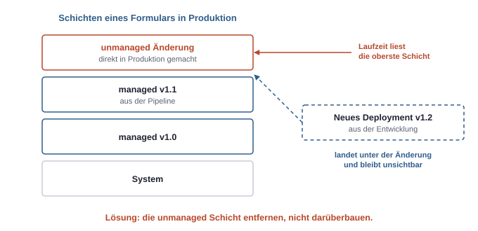
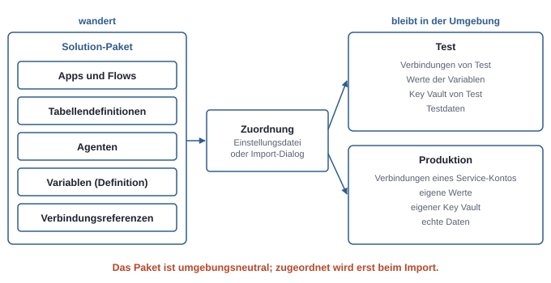
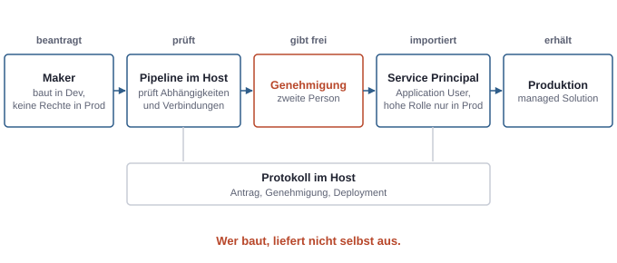

# 18. Solutions und ALM: von Dev nach Prod

In einem Softwareprojekt ist es selbstverständlich, dass Code in Git liegt, gebaut und über eine Pipeline ausgeliefert wird. In der Power Platform entsteht dagegen vieles direkt im Browser, in einer Umgebung, mit einem Klick auf „Speichern". Damit daraus trotzdem eine kontrollierte Auslieferung wird, gibt es **Solutions** und **ALM** (Application Lifecycle Management): den geordneten Weg einer Lösung von der Entwicklung über den Test in den Betrieb. Für jemanden mit Entwicklerhintergrund ist das der vertrauteste Teil der Plattform, auch wenn die Begriffe anders heißen.

## Was eine Solution ist

Eine **Solution** ist ein Paket aus Komponenten: Tabellen und Spalten, Apps, Flows, Agenten, Sicherheitsrollen, Umgebungsvariablen, Verbindungsreferenzen und mehr. Sie enthält Metadaten und Definitionen, **keine Daten**. Die Zeilen einer Tabelle wandern nicht mit.

### Unmanaged und managed

| | Unmanaged | Managed |
|---|---|---|
| Rolle | Quelle | Build-Artefakt |
| Wo | in der Entwicklungsumgebung und in Git | in Test und Produktion |
| Bearbeitbar | ja | nein, nicht direkt in der Zielumgebung |
| Beim Löschen | nur der Container verschwindet, die Komponenten bleiben | Komponenten verschwinden samt Daten in ihren eigenen Tabellen |

Die Analogie zur Softwareentwicklung trägt gut: Die unmanaged Solution ist der Quellcode, die managed Solution das gebaute Paket. Nach Produktion geht immer managed.

### Publisher und Präfix

Jede Solution hat einen **Publisher**. Er bestimmt das **Präfix**, das vor den technischen Namen aller neuen Komponenten steht, etwa `contoso_projekt`. Das Präfix lässt sich danach nicht mehr ändern, und eine Komponente kann ihren Publisher nicht wechseln. Deshalb gehört ein eigener Publisher mit einem sinnvollen Präfix an den Anfang jedes Vorhabens, nicht der vorgegebene Standard-Publisher.

## Schichten: warum Änderungen in Produktion schaden

Dataverse speichert für jede Komponente einen Stapel von **Schichten** (Layers). Ganz unten liegt der Systemstand, darüber jede installierte managed Solution in der Reihenfolge ihres Imports, ganz oben eine gemeinsame unmanaged Schicht. Zur Laufzeit gilt die oberste Schicht.



*Eine kleine Änderung direkt in Produktion liegt über allen ausgelieferten Versionen und verdeckt jedes künftige Deployment, bis sie entfernt wird.*

Daraus folgt die wichtigste Regel des ganzen ALM: **In Produktion wird nicht direkt angepasst.** Wer dort „nur schnell" ein Formular ändert, erzeugt eine unmanaged Schicht über der managed Solution. Das nächste Deployment aus der Entwicklung kommt an, liegt aber darunter und bleibt unsichtbar. Die Frage „Warum kommt mein Update in Produktion nicht an?" hat fast immer diese Antwort. Die Ansicht der Schichten einer Komponente zeigt den Stapel; die Lösung ist, die unmanaged Schicht zu entfernen. Umgebungen lassen sich zudem so einstellen, dass unmanaged Anpassungen dort gar nicht erst möglich sind.

### Abhängigkeiten und Versionen

Komponenten hängen voneinander ab: eine Spalte von ihrer Tabelle, ein Flow von einer Verbindungsreferenz, eine Solution von einer Basis-Solution. Fehlt eine Abhängigkeit in der Zielumgebung, scheitert der Import. Custom Connectors gehören deshalb oft in eine eigene Solution, die vor den Flows ausgeliefert wird.

Solutions haben Versionen im Format `Major.Minor.Build.Revision`. Ein **Update** ersetzt Komponenten, ein **Upgrade** entfernt zusätzlich, was in der neuen Version nicht mehr enthalten ist. Patches gibt es auch, Microsoft rät aber zu normalen Versionssprüngen.

## Was wandert und was bleibt

Eine Solution soll in jeder Umgebung funktionieren, ohne sie anzupassen. Dafür trennt die Plattform, was mit dem Paket wandert, von dem, was jede Umgebung selbst mitbringt.



*Das Paket ist umgebungsneutral. Verbindungen, Werte und Daten gehören zur Umgebung und werden erst beim Import zugeordnet.*

- **Umgebungsvariablen** halten Werte, die sich je Umgebung unterscheiden: die URL einer SharePoint-Site, eine Listen-ID, einen Schwellenwert. Die Solution enthält die Definition, jede Umgebung ihren eigenen Wert. Ein Sonderfall ist der Typ **Geheimnis**: Die Variable verweist auf einen Wert in einem Azure Key Vault, der Wert selbst liegt nie in der Solution. Das setzt Rollen in Azure RBAC am Key Vault voraus, für die Person, die die Variable anlegt, und für den Dienst von Dataverse (siehe Kapitel 12, Plattformen und Verwaltungsorte).
- **Verbindungsreferenzen** sind Platzhalter für Verbindungen. Ein Flow in einer Solution zeigt auf eine Verbindungsreferenz, nicht auf eine konkrete Verbindung. Beim Import wird jeder Referenz eine Verbindung der Zielumgebung zugeordnet. So handelt der Flow in Test mit einer Testverbindung und in Produktion mit der Verbindung eines Service-Kontos, ohne dass jemand den Flow ändert.

Wer einen Flow einschaltet, muss die benutzten Verbindungen besitzen oder sie geteilt bekommen haben. Das ist dieselbe Identitätsfrage wie beim Bauen (siehe Kapitel 17, Apps und Flows bauen), nur zum Zeitpunkt der Auslieferung.

## Drei Wege der Auslieferung

### Manuell

Solution in der Entwicklung als managed exportieren, in der Zielumgebung importieren. Das geht im Maker-Portal und reicht für erste Versuche. Es hinterlässt aber keine Spur außer dem Import selbst, und es braucht eine Person mit Importrechten in Produktion.

### Pipelines in der Power Platform

**Pipelines** sind die eingebaute Auslieferung. Ein Maker klickt in der Entwicklungsumgebung auf „Bereitstellen". Die Plattform exportiert die Solution einmal, prüft Abhängigkeiten, Verbindungen und Umgebungsvariablen und importiert sie als managed nacheinander in die Stufen, etwa Test und Produktion. Das Artefakt bleibt dabei unverändert, und keine Stufe lässt sich überspringen.

Die Konfiguration und der Verlauf liegen in einer **Host-Umgebung**. Die Zielumgebungen müssen Managed Environments sein (siehe Kapitel 15, Power Platform von innen).

Entscheidend für die Sicherheit ist, **wer** in die Zielumgebung schreibt. Im einfachen Fall ist es der Maker selbst, der dann Importrechte in Produktion braucht. Beim **delegierten Deployment** schreibt stattdessen ein Service Principal, der in der Zielumgebung als Application User mit hoher Rolle angelegt ist. Der Maker beantragt nur. Ein Genehmigungsschritt, etwa ein Flow mit einer Freigabe, entscheidet, ob das Deployment läuft.



*Ins Ziel schreibt nicht die Person, die gebaut hat, sondern eine kontrollierte nichtmenschliche Identität nach einer Genehmigung.*

Das ist dieselbe Trennung wie zwischen Deployment-Identität und Laufzeit-Identität bei Code (siehe Kapitel 7, Server und GitHub) und dasselbe Vier-Augen-Prinzip wie mit einem IT-Dienstleister (siehe Kapitel 14, Mit externem IT-Dienstleister): Wer baut, liefert nicht selbst aus.

### `pac` CLI mit GitHub Actions oder Azure DevOps

Wer ohnehin mit Git und CI/CD arbeitet, kann denselben Ablauf mit der `pac` CLI automatisieren. Die Werkzeuge für GitHub Actions und Azure DevOps sind Hüllen um diese CLI. Ein typischer Ablauf von Hand:

```bash
# Als Mensch an der Entwicklungsumgebung anmelden
pac auth create --name dev --environment https://<dev-org>.crm4.dynamics.com

# Unmanaged für Git und managed als Artefakt exportieren
pac solution export --name <solution> --path ./out/<solution>.zip
pac solution export --name <solution> --path ./out/<solution>_managed.zip --managed

# Unmanaged in lesbare Dateien entpacken und in Git einchecken
pac solution unpack --zipfile ./out/<solution>.zip --folder ./src/<solution>

# Einstellungsdatei für Verbindungen und Umgebungsvariablen der Zielumgebung erzeugen
pac solution create-settings --solution-zip ./out/<solution>_managed.zip \
  --settings-file ./deploy/settings.test.json

# Als Service Principal an Test anmelden und importieren
pac auth create --name test --applicationId <app-id> --clientSecret "$SECRET" \
  --tenant <tenant-id> --environment https://<test-org>.crm4.dynamics.com
pac solution import --path ./out/<solution>_managed.zip \
  --settings-file ./deploy/settings.test.json
```

In einer Pipeline übernimmt ein Workflow die letzten Schritte. Die Identität ist ein Service Principal, der in jeder Zielumgebung als Application User mit passender Rolle angelegt ist (siehe Kapitel 16, Dataverse). Statt eines Client Secrets ist auch hier Workload Identity Federation mit OIDC der bessere Weg (siehe Kapitel 7, Server und GitHub); die Werkzeuge unterstützen das, die genauen Parameter stehen in ihrer jeweiligen Dokumentation.

### Git-Anbindung direkt in Dataverse

Neuer ist die Möglichkeit, eine Entwicklungsumgebung direkt an ein Git-Repository zu binden. Änderungen werden dann aus der Oberfläche heraus als Commit gespeichert, Merges und Pull Requests laufen beim Git-Anbieter. Das Modell ist dasselbe: Nur die Entwicklungsumgebung mit unmanaged Solutions hängt an Git, Test und Produktion bekommen managed Builds über Pipelines oder CI/CD. Git ist die Quelle der Wahrheit, nicht die Entwicklungsumgebung. Welche Git-Anbieter in welchem Reifegrad unterstützt werden, ändert sich noch.

## Wer welche Rolle bei welchem Schritt braucht

| Schritt | Identität | Braucht |
|---|---|---|
| Bauen | Maker | Rolle zum Bauen in der Entwicklungsumgebung, etwa Environment Maker und System Customizer |
| Geheimnis als Umgebungsvariable | Maker und der Dienst von Dataverse | Leserolle für Geheimnisse am Key Vault in Azure RBAC |
| Pipeline einrichten | Admin | Admin-Rolle in der Host-Umgebung |
| Pipeline auslösen | Maker | Nutzerrolle für Pipelines im Host |
| Delegiert ausliefern | Service Principal | Application User mit hoher Rolle in der Zielumgebung, Pipeline-Rolle im Host |
| Genehmigen | zweite Person | Recht, den Genehmigungsschritt auszuführen |
| CI/CD mit `pac` | Service Principal | Application User mit Rolle in jeder Zielumgebung; Secret oder besser Federation |
| Produktion schützen | Admin | Managed Environment, unmanaged Anpassungen sperren |

## Typische Missverständnisse

| Annahme | Was stimmt |
|---|---|
| „Managed oder unmanaged ist eine Exportoption." | Unmanaged ist die Quelle, managed das Artefakt für alle anderen Umgebungen. |
| „Ein kleiner Hotfix direkt in Produktion ist in Ordnung." | Er liegt als oberste Schicht über jedem künftigen Deployment. |
| „Das Präfix ändere ich später." | Technische Namen und Publisher-Zuordnung bleiben. |
| „Eine Solution nimmt die Daten mit." | Sie enthält nur Definitionen. Daten werden getrennt übertragen. |
| „Ein API-Schlüssel gehört in eine Umgebungsvariable vom Typ Text." | Dafür gibt es den Typ Geheimnis mit Key Vault. |
| „Git-Anbindung ersetzt Pipelines." | Git versioniert die Entwicklung; ausgeliefert wird weiterhin managed über Pipelines oder CI/CD. |
