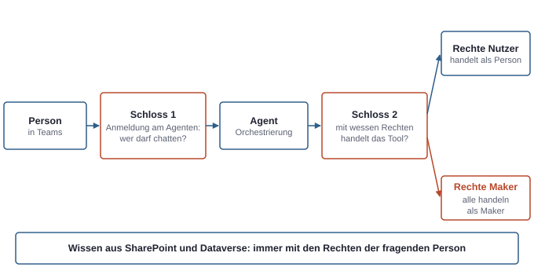
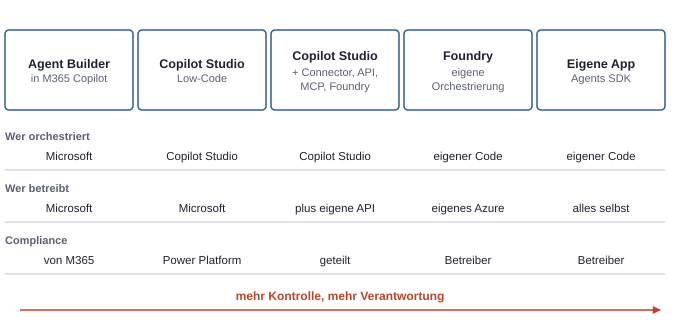

# 19. Copilot Studio von innen und Pro-Code-Anbindung

Copilot Studio ist das Werkzeug der Power Platform für Agenten. Ein Agent dort ist kein einzelnes Programm, sondern eine Konfiguration aus Anweisungen, Wissen und Werkzeugen, die ein Modell zur Laufzeit zusammensetzt. Kaum ein Teil der Microsoft-Welt ändert sich derzeit so schnell: Namen, Laufzeitmodelle und Abrechnungsdetails wechseln im Abstand von Monaten. Das Grundmodell darunter ist dagegen stabil, und genau das braucht man, um Agenten sicher zu bauen und Kunden zu beraten. Es beantwortet drei Fragen: Woraus besteht ein Agent? Mit wessen Rechten handelt er? Und was kostet er?

## Woraus ein Agent besteht

Jeder Agent lässt sich in drei Schichten zerlegen:

- **Modell:** das Sprachmodell, das liest, plant und antwortet.
- **Orchestrierung:** die Laufzeit, die entscheidet, welche Bausteine bei einer Anfrage benutzt werden.
- **Bausteine:** das, was der Maker konfiguriert hat.

Die Bausteine im Einzelnen:

| Baustein | Was er ist |
|---|---|
| **Anweisungen** | Text, der Rolle, Ton, Grenzen und Vorgehen des Agenten beschreibt |
| **Wissen** | Quellen, aus denen der Agent Antworten belegt: SharePoint, Dataverse, hochgeladene Dateien, Websites, Unternehmensdaten über Connectors |
| **Tools** | Aktionen, die der Agent ausführen kann: Connectors, Flows, Prompts, REST-APIs, MCP-Server, andere Agenten |
| **Topics** | fest gebaute Gesprächsabläufe für Fälle, die genau so ablaufen sollen |
| **Auslöser** | Ereignisse, auf die ein Agent ohne Chat reagiert, etwa eine neue Mail |
| **Kanäle** | Orte, an denen der Agent erreichbar ist: Teams und Microsoft 365 Copilot, SharePoint, eine Website, weitere |

Bei der **klassischen Orchestrierung** lösen Trigger-Phrasen bestimmte Topics aus, und der Maker legt fest, wann welches Tool läuft. Bei der **generativen Orchestrierung** plant das Modell selbst und kann mehrere Topics, Tools und Wissensquellen für eine Anfrage kombinieren. Es wählt dabei anhand von **Name und Beschreibung** der Bausteine. Eine gute Beschreibung eines Tools ist deshalb kein Kommentar, sondern Steuerung: Sie entscheidet, wann das Modell es benutzt.

Eine wichtige Grenze gilt immer: Ein Agent nutzt nur Wissen, Tools und Topics, die der Maker ausdrücklich konfiguriert hat. Er findet nicht von selbst neue Datenquellen.

Agenten liegen in einer Power-Platform-Umgebung mit Dataverse und lassen sich in Solutions paketieren (siehe Kapitel 18, Solutions und ALM). Für ernsthafte Agenten gilt dasselbe wie für Apps und Flows: Entwicklung, Test und Produktion in getrennten Umgebungen, nicht in der Default-Umgebung.

### Agent Builder, Declarative Agent, Custom Engine Agent

In der Microsoft-Welt gibt es mehrere Wege, einen Agenten zu bauen. Sie unterscheiden sich vor allem darin, wessen Orchestrierung läuft.

| Weg | Orchestrierung und Modell | Typischer Einsatz |
|---|---|---|
| **Agent Builder** in Microsoft 365 Copilot | die von Microsoft 365 Copilot | persönlicher oder Team-Agent auf eigenem Wissen, ohne eigene Aktionen |
| **Declarative Agent** | die von Microsoft 365 Copilot, ergänzt um Anweisungen, Wissen und Aktionen | Erweiterung von Copilot, auch per Code mit dem Agents Toolkit |
| **Copilot Studio** | eigene Orchestrierung in Copilot Studio | Fachbereichs- und Prozess-Agenten mit Connectors, Flows und Kanälen |
| **Foundry** oder eigene App | eigene Orchestrierung, eigene Modelle | Entwicklerlösungen mit voller Kontrolle |

Aus Sicht von Microsoft 365 ist ein Agent mit eigener Orchestrierung ein **Custom Engine Agent**. Damit verschiebt sich auch die Verantwortung: Bei einem Declarative Agent erbt man die Compliance von Microsoft 365 Copilot, bei einem Custom Engine Agent trägt sie der Betreiber.

Copilot Studio selbst bietet inzwischen mehrere Laufzeitmodelle für Agenten, etwa für zielgerichtete Agenten, die selbst planen, oder für Kundendialoge. Die Namen und Grenzen sind noch in Bewegung. Am Grundmodell aus Modell, Orchestrierung und Bausteinen ändert das nichts.

## Mit wessen Rechten ein Agent handelt

Bei Agenten gibt es zwei getrennte Fragen, die leicht verwechselt werden. Man kann sie sich als zwei Schlösser vorstellen.

*Eine saubere Anmeldung am Agenten sagt nichts darüber, mit wessen Rechten ein Tool danach handelt. Beide Schlösser müssen einzeln geprüft werden.*

### Schloss 1: Wer darf mit dem Agenten sprechen?

| Einstellung | Bedeutung |
|---|---|
| **Keine Authentifizierung** | Jeder mit Zugang zum Kanal oder Link kann chatten. Nur für öffentliche Inhalte geeignet; wer chatten darf, lässt sich nicht steuern. |
| **Mit Microsoft authentifizieren** | Anmeldung über Entra ID in Microsoft-eigenen Oberflächen wie Teams, SharePoint und Microsoft 365 Copilot. Der übliche Fall für interne Agenten. |
| **Manuell authentifizieren** | Eigene Konfiguration mit Entra ID oder einem anderen OAuth-Anbieter, nötig etwa für eine eigene Website. |

Für interne Agenten mit Firmendaten ist „keine Authentifizierung" falsch, auch wenn es im Test schneller geht.

### Schloss 2: Mit wessen Rechten handeln Tools und Wissen?

Für **Wissen** aus SharePoint, Dataverse und Unternehmensdaten über Connectors ist die Antwort einfach: Der Agent sieht nur, was die **fragende Person** sehen darf. Das ist Security Trimming wie bei Copilot (siehe Kapitel 5, Daten und Freigaben). Daraus folgt aber auch: Der Agent repariert kein Oversharing. Was in SharePoint zu breit freigegeben ist, findet er genauso. Hochgeladene Dateien sind dagegen für alle Nutzer des Agenten sichtbar.

Bei **Tools** gibt es zwei Möglichkeiten:

- **Rechte der Nutzerin oder des Nutzers:** Die fragende Person meldet sich beim Dienst an, und das Tool handelt mit ihren Rechten.
- **Rechte des Makers:** Das Tool nutzt die Verbindung der Person, die den Agenten gebaut hat. Dann handeln alle Nutzer mit deren Rechten.

Die zweite Variante ist dieselbe Rechteausweitung wie bei einem Flow mit der Verbindung des Besitzers (siehe Kapitel 17, Apps und Flows bauen). Sie kann gewollt sein, etwa wenn ein Agent ein Ticket in einem System anlegt, auf das Nutzer keinen Zugriff haben. Sie muss aber bewusst entschieden und dokumentiert werden. Admins können das Teilen von Agenten mit eingebetteten Maker-Rechten einschränken. Für Agenten, die ohne Chat auf Ereignisse reagieren, gibt es keine fragende Person, sie handeln deshalb praktisch immer mit hinterlegten Rechten.

### Agenten als eigene Identität

Microsoft gibt Agenten zunehmend eine eigene Identität in Entra ID, ähnlich einem Service Principal. Das macht Agenten in Entra sichtbar und verwaltbar, und es eröffnet Regeln wie Conditional Access für Agenten. Wie weit das reicht und für welche Kanäle es gilt, ändert sich noch. Das Prinzip passt zum Rest des Buchs: Was handelt, braucht eine Identität, an der Rechte und Protokolle hängen.

### Steuerung durch Admins

Was ein Agent darf, steuern Admins an drei getrennten Stellen. Alle drei müssen passen:

1. **DLP-Richtlinien** der Power Platform (siehe Kapitel 12, Plattformen und Verwaltungsorte): welche Connectors, Kanäle und Wissensquellen erlaubt sind, ob Authentifizierung Pflicht ist, ob HTTP-Aufrufe erlaubt sind und an welche Adressen. Auch MCP-Server laufen technisch über Connectors und fallen darunter.
2. **Freigabe in der Umgebung:** mit wem ein Agent geteilt werden darf, in Managed Environments begrenzbar.
3. **Freigabe als App** in Teams und Microsoft 365: Ein Agent, der für die ganze Organisation erscheinen soll, wird als App eingereicht und von Admins freigegeben.

Wer „nicht veröffentlichen kann", hängt meist an einer dieser drei Stellen.

## Was ein Agent kostet

Copilot Studio rechnet in **Copilot Credits** ab (siehe Kapitel 12, Plattformen und Verwaltungsorte). Die genauen Sätze ändern sich, das Modell nicht:

- Verschiedene Schritte kosten unterschiedlich viel. Eine fest gebaute Antwort ist billig, eine generative Antwort teurer, ein Tool-Aufruf oder eine Aktion noch teurer, und aufwendige Modelle oder Suchen im ganzen Tenant kosten zusätzlich.
- Eine einzelne Frage kann mehrere Posten erzeugen, wenn der Agent mehrere Werkzeuge nutzt.
- Credits kommen aus Prepaid-Paketen für den Tenant, die Admins auf Umgebungen verteilen, oder über Pay-as-you-go aus einer Azure-Subscription.
- Mit einer Lizenz für Microsoft 365 Copilot ist die Nutzung durch lizenzierte, angemeldete Mitarbeitende in Microsoft-365-Kanälen weitgehend abgedeckt. Externe Nutzer, nicht lizenzierte Nutzer und Agenten, die ohne Chat laufen, kosten weiterhin Credits.
- Eigene Modelle aus Foundry laufen nicht über Credits, sondern über die Azure-Rechnung.

Die wichtigste Folgerung: **Die Kosten hängen am Design des Agenten, nicht an der Zahl der Nutzer.** Lange Anweisungen, viele Tool-Aufrufe und ein großes Modell machen jede Frage teurer. Eine Kostenschätzung beginnt deshalb mit der Frage, was ein typischer Dialog an Schritten auslöst.

## Wo eigener Code andockt

Copilot Studio ist Low-Code, aber nicht abgeschlossen. Es gibt mehrere Stellen, an denen eigener Code ansetzt.

*Mehr Kontrolle heißt mehr Verantwortung. Die Übergänge sind fließend: Copilot Studio kann vorn in Microsoft 365 stehen und hinten eigenen Code oder Foundry aufrufen.*

- **Custom Connector:** Eine eigene API wird mit einer OpenAPI-Beschreibung als Connector eingebunden. Für die Anmeldung mit Entra ID braucht es eine App-Registrierung, deren Redirect-URI der Connector vorgibt; das Token wird delegiert im Namen der Person geholt. Der Connector ist dann in Flows, Apps und Agenten nutzbar und unterliegt den DLP-Richtlinien.
- **Eigene API oder Azure Function:** Hinter dem Connector oder einem REST-API-Tool steht oft eine Azure Function oder ein App Service mit Entra-Anmeldung (siehe Kapitel 7, Server und GitHub). Die API prüft das Token und entscheidet selbst über Rechte. So bleibt die eigentliche Rechtelogik im eigenen Code.
- **MCP-Server:** Ein Agent kann Tools eines MCP-Servers nutzen, mit Anmeldung über API-Schlüssel oder OAuth. Damit werden Werkzeuge, die für andere KI-Agenten gebaut wurden (siehe Kapitel 9, KI-Agenten im Rechtemodell), auch in Copilot Studio nutzbar.
- **Foundry:** Ein Modell aus Foundry lässt sich für einzelne Prompt-Tools einbinden, und ein Agent aus Foundry kann als verbundener Agent aufgerufen werden. Copilot Studio steht dann vorn in Teams, die eigentliche Logik läuft in Foundry mit eigener Managed Identity und eigenem Deployment-Typ (siehe Kapitel 13, Rechtliche Einordnung).
- **Agents SDK und Agents Toolkit:** Für vollständig eigene Agenten in Teams und Microsoft 365 gibt es ein SDK, das Kanäle und Nachrichten abwickelt, und eine Erweiterung für VS Code. Modell und Logik bringt man selbst mit.

### Wann was

| Situation | Sinnvoller Weg |
|---|---|
| Persönlicher Agent auf eigenen Dokumenten | Agent Builder |
| Fachbereichs-Agent in Teams mit Firmenwissen und einigen Aktionen | Copilot Studio |
| Agent braucht eine eigene Geschäftslogik oder ein internes System | Copilot Studio mit Custom Connector oder eigener API |
| Tiefe Analyse über viele Dokumente, eigene Modelle, Auswertung der Qualität | Foundry, eventuell mit Copilot Studio als Oberfläche in Teams |
| Eigene Oberfläche, eigene Kanäle, volle Kontrolle | eigene App |

Die Wahl ist auch eine Frage von Betrieb und Freigaben. Copilot Studio nutzt die Governance der Power Platform, die in einer Firma meist schon da ist. Foundry und eigene Apps bringen eigene Ressourcen, eigene Identitäten und eigene Kosten mit, die jemand betreuen muss (siehe Kapitel 14, Mit externem IT-Dienstleister).

## Typische Missverständnisse

| Annahme | Was stimmt |
|---|---|
| „Der Agent sieht alles in SharePoint." | Er sieht nur, was die fragende Person sieht. Er macht Oversharing aber sichtbar und repariert es nicht. |
| „Die Person ist angemeldet, also handelt das Tool mit ihren Rechten." | Anmeldung am Agenten und Rechte des Tools sind getrennte Einstellungen. |
| „Für einen internen Agenten reicht keine Authentifizierung." | Dann kann jeder mit Zugang chatten, und Teilen lässt sich nicht steuern. |
| „Mit Microsoft 365 Copilot ist Copilot Studio kostenlos." | Nur für lizenzierte, angemeldete Mitarbeitende in Microsoft-365-Kanälen; anderes kostet Credits. |
| „Die Kosten richten sich nach der Zahl der Nutzer." | Sie richten sich nach den Schritten, die ein Dialog auslöst. |
| „Bessere Anweisungen lösen jedes Routing-Problem." | Bei generativer Orchestrierung steuern die Beschreibungen der Tools und Topics, welcher Baustein benutzt wird. |
| „Veröffentlichen scheitert an Copilot Studio." | Meist fehlt eine Freigabe in DLP, in der Umgebung oder als App in Teams. |
