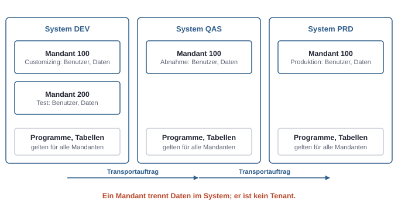
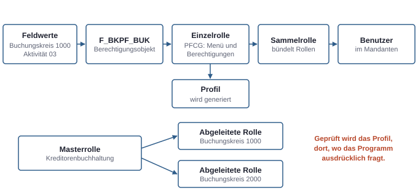
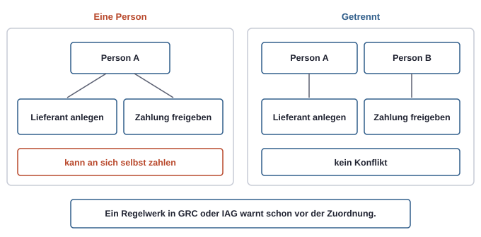

# 20. SAP für Microsoft-Leute: Systemlandschaft und Rechtemodell

In vielen Firmen laufen Buchhaltung, Einkauf, Lager und Personal in SAP. Microsoft 365 ist dort der Arbeitsplatz, SAP das System, in dem das Geschäft steht. Wer an der Grenze zwischen beiden arbeitet, etwa mit einem Agenten, der Bestellungen abfragt, oder mit einer Anmeldung über Entra ID, muss SAP nicht bedienen können. Er muss aber verstehen, wie SAP Systeme gliedert und Rechte vergibt. Vieles klingt vertraut und ist doch anders: Ein Mandant ist kein Tenant, und eine Rolle prüft nicht von selbst. Dieses Kapitel ordnet die Begriffe so, dass sie sich an die Modelle der vorigen Kapitel anschließen lassen.

## Die Produktlandschaft

| Produkt | Was es ist |
|---|---|
| **SAP ERP (ECC)** | das klassische ERP-System, das viele Firmen seit Jahrzehnten betreiben; Microsoft-Vergleich: ein großer, selbst betriebener Anwendungsserver mit eigener Datenbank |
| **S/4HANA** | der Nachfolger von ECC, nur auf der Datenbank HANA, mit vereinfachtem Datenmodell; ein neues Produkt, kein einfaches Upgrade |
| **SAP BTP** | Business Technology Platform: SAPs Plattform für Integration, Erweiterungen, Daten, KI und Identität, grob vergleichbar mit Azure plus Power Platform für die SAP-Welt |
| **SuccessFactors, Ariba, Concur** | zugekaufte SaaS-Produkte für Personal, Einkauf und Reisekosten, jeweils mit eigenem Rechtemodell |

S/4HANA gibt es in drei Betriebsformen:

- **On-Premise:** Die Firma betreibt das System selbst oder lässt es betreiben.
- **Private Cloud:** Ein eigenes System für eine Firma, betrieben von SAP oder bei einem Hyperscaler wie Azure, vertraglich meist im Paket **RISE with SAP**.
- **Public Cloud:** Ein SaaS-System, das sich viele Kunden teilen, mit festen Standardprozessen und regelmäßigen Updates durch SAP.

SAP fasst die Cloud-Varianten inzwischen unter dem Dach „SAP Cloud ERP" zusammen; in Projekten heißen sie weiter Public und Private Cloud.

Für den Markt ist ein Datum wichtig: Die reguläre Wartung von ECC endet Ende 2027, gegen Aufpreis gibt es eine Verlängerung bis 2030. Deshalb stecken gerade sehr viele Firmen in der Umstellung auf S/4HANA, und mit ihr werden auch Rollen, Anmeldung und Schnittstellen neu gebaut. Das ist einer der Gründe, warum es so viele SAP-nahe Stellen gibt.

Ein weiterer Begriff fällt in fast jedem Projekt: **Clean Core**. Das ERP soll möglichst nah am Standard bleiben, Erweiterungen laufen über freigegebene Schnittstellen oder daneben auf der BTP. Das ist dieselbe Idee wie „in Produktion wird nicht direkt angepasst" (siehe Kapitel 18, Solutions und ALM), nur über ein ganzes ERP-System gedacht.

Als Oberflächen gibt es das **SAP GUI**, einen Windows-Client, der mit Transaktionscodes wie `SU01` oder `PFCG` arbeitet, und **Fiori**, die Web-Oberfläche, deren Apps im Hintergrund OData-Services aufrufen. In S/4HANA laufen beide nebeneinander. **Joule** ist SAPs KI-Assistent über die Cloud-Produkte hinweg; wie Copilot soll er nur zeigen, was die angemeldete Person sehen darf.

## System, Mandant, Landschaft

Drei Begriffe tragen die ganze Struktur:

- Ein **System** ist eine SAP-Installation mit Datenbank und Anwendungsservern. Es hat eine dreistellige Kennung, die **SID**, etwa `PRD`.
- Ein **Mandant** (Client) ist eine dreistellige Nummer wie `100` und trennt Daten **innerhalb** eines Systems. Benutzer, Rollenzuordnungen und Geschäftsdaten gehören zu einem Mandanten. Programmcode und Tabellendefinitionen gelten für alle Mandanten eines Systems.
- Die **Drei-System-Landschaft** besteht aus Entwicklung (DEV), Qualitätssicherung (QAS) und Produktion (PRD).

Wer sich anmeldet, gibt deshalb immer drei Dinge an: System, Mandant und Benutzer.

*Ein Mandant trennt Daten innerhalb eines Systems, ist aber kein Tenant mit eigener Identitätswelt. Rollen und Programme entstehen in DEV und wandern per Transport nach Produktion.*

Der Vergleich mit Microsoft hilft, wenn man ihn richtig zieht. Ein Mandant ist **kein Tenant**. Ein Tenant ist eine eigene Identitätswelt mit eigenem Verzeichnis. Ein Mandant teilt sich dagegen Code und vieles an Technik mit den anderen Mandanten desselben Systems. Er ähnelt eher einer Dataverse-Umgebung auf einer gemeinsamen Plattform.

### Transporte

Änderungen an Programmen, Einstellungen und Rollen entstehen in DEV und werden in **Transportaufträgen** gesammelt. Ein Transportauftrag wird freigegeben und dann entlang eines festen Wegs nach QAS und PRD importiert. In Produktion ändert man nicht direkt. Das ist dasselbe Modell wie Solutions und Pipelines in der Power Platform (siehe Kapitel 18, Solutions und ALM), nur älter, feiner und seit Jahrzehnten Gegenstand jeder Prüfung.

## Das Rechtemodell

Das klassische SAP-Rechtemodell ist sehr fein, und es funktioniert in einem entscheidenden Punkt anders als die Modelle der Microsoft-Welt.

### Benutzertypen

| Typ | Für wen | Anmeldung |
|---|---|---|
| Dialog | eine Person | interaktiv |
| System | Hintergrundprozesse, Schnittstellen im System | keine interaktive Anmeldung |
| Kommunikation | Schnittstellen von außen | keine interaktive Anmeldung |
| Service | geteilte oder anonyme Zugänge | interaktiv möglich, Rechte sehr eng halten |
| Referenz | Vorlage, um Rechte zu vererben | keine Anmeldung |

System- und Kommunikationsbenutzer sind die SAP-Fassung eines Service Principals: Identitäten für Maschinen, nicht für Menschen. An der Schnittstelle zu Microsoft spielen sie eine große Rolle (siehe Kapitel 21, Microsoft und SAP).

### Berechtigungsobjekte

Das Kernkonzept ist das **Berechtigungsobjekt**. Es beschreibt eine Art von Recht und hat Felder. Eine **Berechtigung** ist eine konkrete Belegung dieser Felder. Zwei Beispiele:

| Objekt | Felder | Bedeutung einer Berechtigung |
|---|---|---|
| `S_TCODE` | Transaktion | darf die Transaktion starten, etwa `FB03` |
| `F_BKPF_BUK` | Buchungskreis, Aktivität | darf Buchhaltungsbelege im Buchungskreis 1000 anzeigen (Aktivität 03) |

Die Aktivität `ACTVT` taucht in vielen Objekten auf: `01` heißt anlegen, `02` ändern, `03` anzeigen. Ein **Buchungskreis** ist eine rechtlich selbständige Einheit der Buchhaltung, meist eine Firma im Konzern.

Der Unterschied zu Azure RBAC liegt im Scope. Azure grenzt über die Ressource ab, etwa eine Resource Group. SAP grenzt über **Organisationswerte** ab: Buchungskreis, Werk, Verkaufsorganisation. Das ähnelt eher den Zugriffsebenen und Business Units in Dataverse (siehe Kapitel 16, Dataverse).

### Wer prüft

Hier liegt der wichtigste Unterschied zu Entra ID und Dataverse. In Dataverse prüft die Plattform jeden Zugriff selbst. Im klassischen SAP prüft das **Programm**: Der ABAP-Code ruft an den Stellen, an denen er Schutz braucht, ausdrücklich eine Prüfung auf, den `AUTHORITY-CHECK`. Beim Start einer Transaktion prüft das System zuerst `S_TCODE`, danach prüft das Programm die Objekte, die es selbst abfragt.

Daraus folgt: Ein selbst entwickeltes Programm ohne Prüfung schützt seine Daten nicht, egal wie sauber die Rollen sind. Eigenentwicklungen, in SAP oft an Namen mit `Z` oder `Y` zu erkennen, sind deshalb ein eigenes Prüfthema.

### Rollen in PFCG

Rollen werden im **Profilgenerator** gepflegt, der Transaktion `PFCG`.

- Eine **Einzelrolle** enthält ein Menü aus Transaktionen oder Apps und die Berechtigungsdaten dazu. Aus ihr erzeugt das System ein **Profil**, gegen das technisch geprüft wird.
- Eine **Sammelrolle** bündelt mehrere Einzelrollen, ohne eigene Berechtigungen.
- Aus einer **Masterrolle** werden **abgeleitete Rollen** erzeugt, die dieselbe Funktion mit anderen Organisationswerten haben: dieselbe Rolle „Kreditorenbuchhaltung", einmal für Buchungskreis 1000, einmal für 2000.

*Eine SAP-Rolle ist ein Bündel aus Funktion und Organisationswert. Wirksam wird sie erst, wenn das Programm an der richtigen Stelle prüft.*

Die Rollen entstehen in DEV und werden transportiert. In Produktion werden sie nur Benutzern zugeordnet.

Für die Fehlersuche gibt es eigene Werkzeuge: `SU53` zeigt die letzte fehlgeschlagene Prüfung eines Benutzers, ein Berechtigungs-Trace zeichnet alle Prüfungen auf, `SUIM` wertet Benutzer und Rollen aus. Das entspricht grob dem Sign-in-Log und der Funktion „Check Access" in Dataverse.

### Kritische Rechte und Notfallzugriff

Zwei Profile sind Standardfunde jeder Prüfung: **`SAP_ALL`** gibt alle Rechte, vergleichbar mit einem dauerhaften Global Administrator ohne PIM, und **`SAP_NEW`** gibt pauschal Rechte für neue Prüfungen nach einem Upgrade. Dialogbenutzer in Produktion sollten keines von beiden haben. Auch die bei der Installation angelegten Standardbenutzer gehören gesperrt oder mit geändertem Kennwort abgesichert.

Für Notfälle gibt es den **Firefighter**: einen Zugang mit weitreichenden Rechten, der nur befristet, mit Begründung und protokolliert genutzt wird, und dessen Protokoll eine zweite Person nachträglich prüft. Das ist inhaltlich PIM (siehe Kapitel 4, Admin-Rollen), nur in SAP-Werkzeugen.

### Fiori: drei Ebenen für eine App

Eine Fiori-App braucht drei getrennte Freigaben:

1. die **Kachel** aus einem Business Catalog im Menü der Rolle,
2. die Berechtigung, den **OData-Service** im Hintergrund aufzurufen,
3. die klassischen **Berechtigungsobjekte** für die eigentlichen Daten.

Fehlt die erste, sieht man die App nicht. Fehlt die zweite, startet sie mit einem Fehler. Fehlt die dritte, bleibt sie leer. Wer „Die App ist da, aber leer" hört, kennt jetzt die drei Stellen, an denen es hängen kann.

### Rechte in der Public Cloud

In der Public Cloud von S/4HANA gibt es keinen Profilgenerator und keinen direkten Zugriff auf Berechtigungsobjekte. Das Modell ist vereinfacht: Eine **Business Role** wird aus einer Vorlage von SAP erzeugt, enthält **Business Catalogs** als Funktionsbündel und **Restrictions**, die auf Organisationswerte wie Buchungskreis oder Werk einschränken. Business Users bekommen Business Roles. Das Prinzip „Funktion mal Organisationswert" bleibt, die Werkzeuge sind andere.

## Governance: Funktionstrennung und Prüfung

In der Microsoft-Welt ist die große Frage meist „Wer ist Admin?". In der SAP-Welt ist es die **Funktionstrennung** (Segregation of Duties, SoD). Bestimmte Kombinationen von Rechten bei einer Person sind ein Risiko, auch wenn jedes Recht für sich harmlos ist. Das klassische Beispiel: Wer einen neuen Lieferanten anlegen **und** eine Zahlung an ihn freigeben kann, kann Geld an sich selbst überweisen.

Ein Regelwerk beschreibt deshalb Funktionen und die Konflikte zwischen ihnen, und Werkzeuge prüfen Rollen und Benutzer dagegen, am besten schon vor der Zuordnung.

*In SAP entsteht das Risiko oft nicht durch ein zu starkes Recht, sondern durch die Kombination zweier normaler Rechte bei derselben Person.*

Dafür gibt es zwei Werkzeugfamilien:

- **SAP GRC Access Control** für die klassischen Systeme: Prüfung der Funktionstrennung, Anträge mit Genehmigung, Notfallzugriff mit Firefighter, regelmäßige Bestätigung der Rechte durch die Fachbereiche. Die heutige Version wird auf eine neue Generation umgestellt; das Produkt lebt weiter.
- **SAP Cloud Identity Access Governance** für die Cloud-Produkte. Es ergänzt GRC und ersetzt es nicht vollständig. In vielen Firmen laufen beide nebeneinander.

Der Grund für diese Strenge sind **Wirtschaftsprüfer**. Bei der Jahresabschlussprüfung testen sie die IT-Kontrollen rund um das System, in dem die Buchhaltung steht: Wie werden Rechte beantragt und genehmigt? Werden sie beim Austritt entzogen? Wer hat `SAP_ALL` oder Notfallzugriff, und wer prüft die Protokolle? Werden Änderungen nur über Transporte gemacht? Gibt es Konflikte in der Funktionstrennung? Was in Microsoft 365 oft als „gute Praxis" gilt, ist in SAP prüfungsrelevant.

Eine weitere Nachricht betrifft direkt die Microsoft-Welt: SAPs eigenes Produkt für Identitätsverwaltung, **SAP Identity Management**, läuft aus. SAP nennt Entra ID als empfohlenen Nachfolger. Wer Entra ID Governance kennt, hat in SAP-Firmen damit gerade ein gesuchtes Wissen (siehe Kapitel 21, Microsoft und SAP).

## Rechte auf der BTP

Auf der BTP gilt ein drittes, einfacheres Modell:

- Das Vertragskonto heißt **Global Account**. Darunter liegen **Subaccounts**, jeweils in einer Region, vergleichbar mit Subscriptions.
- Eine Anwendung definiert **Role Templates**. Daraus werden **Roles**, die zu **Role Collections** gebündelt werden. Nur Role Collections werden Benutzern oder Gruppen zugewiesen.
- Die Anmeldung läuft über eine Vertrauensbeziehung (Trust) zu einem Identitätsanbieter, empfohlen ist der **Identity Authentication Service** (IAS) aus den SAP Cloud Identity Services. Der IAS ist oft nur ein Vermittler vor Entra ID. Gruppen aus dem Identitätsanbieter werden auf Role Collections abgebildet.

Das Muster ist dasselbe wie bei App-Rollen in Entra ID (siehe Kapitel 2, Identitäten und Tokens): Die Anmeldung kommt von außen, die Rechte definiert die Anwendung.

## SAP und Microsoft im Vergleich

| SAP | Microsoft | Wie gut der Vergleich trägt |
|---|---|---|
| Mandant | Dataverse-Umgebung | teilweise; kein Tenant, Code ist geteilt |
| Einzelrolle in PFCG | Sicherheitsrolle in Dataverse | gut: Funktion mal Reichweite |
| Organisationswert wie Buchungskreis | Business Unit, Zugriffsebene | grob |
| Sammelrolle | Gruppe mit mehreren Rollen, Access Package | grob |
| Transportauftrag und Transportweg | Solution und Pipeline | gut; SAP ist feiner und strenger geprüft |
| Firefighter | PIM | gut |
| Notfallbenutzer ohne Werkzeug | Break-Glass-Konto | gut |
| Prüfung der Funktionstrennung | kaum ein direktes Gegenstück | Lücke auf Microsoft-Seite |
| Bestätigung der Rechte durch Fachbereiche | Access Reviews in Entra ID | gut |
| IAS | Entra ID als Identitätsanbieter | IAS steht meist hinter Entra ID |
| `SU53`, Berechtigungs-Trace | Sign-in-Log, „Check Access" | grob |

## Typische Missverständnisse

| Annahme | Was stimmt |
|---|---|
| „Mandant ist dasselbe wie Tenant." | Ein Mandant trennt Daten innerhalb eines Systems; Code und Technik sind geteilt. |
| „Die Plattform prüft jeden Zugriff." | Im klassischen SAP prüft das Programm; Eigenentwicklungen ohne Prüfung sind offen. |
| „Die Kachel ist sichtbar, also ist die Person berechtigt." | Kachel, OData-Service und Datenobjekt sind drei getrennte Freigaben. |
| „Das größte Risiko ist der Admin." | In SAP ist es oft die Kombination zweier normaler Rechte bei einer Person. |
| „Rollen passt man in Produktion an." | Rollen entstehen in DEV und werden transportiert. |
| „Public Cloud funktioniert wie On-Premise." | Dort gibt es Business Roles, Catalogs und Restrictions statt PFCG. |
| „GRC wird abgeschaltet." | Es wird modernisiert; für die Cloud kommt ein zweites Werkzeug dazu. |
