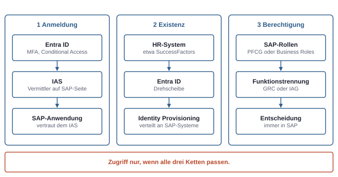
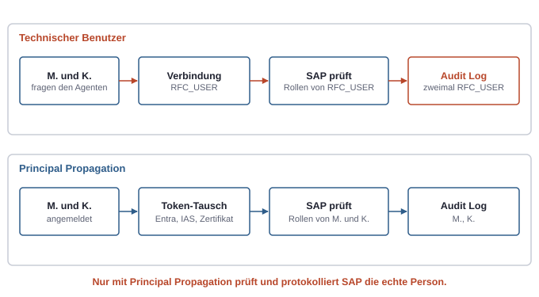

# 21. Microsoft und SAP: Identität und Datenzugriff an der Schnittstelle

Sobald eine Firma Microsoft 365 und SAP zugleich nutzt, entstehen Wege zwischen beiden: Anmeldung an SAP mit dem Microsoft-Konto, Konten in SAP, die aus Entra ID kommen, Apps, Flows und Agenten, die SAP-Daten lesen oder Bestellungen anlegen. An jedem dieser Wege stellt sich dieselbe Frage wie im Rest des Buchs: Wer handelt, und mit welchen Rechten? Die Antwort ist an der Schnittstelle besonders oft falsch, weil zwei Rechtesysteme aufeinandertreffen und jedes glaubt, das andere kümmere sich darum.

## Drei getrennte Ketten

Wer „Single Sign-on zu SAP" sagt, meint oft alles auf einmal. Tatsächlich sind es drei getrennte Ketten, und erst zusammen ergeben sie Zugriff:

1. **Anmeldung:** Wer ist die Person? Das beantwortet Entra ID.
2. **Existenz:** Gibt es die Person in SAP, mit Benutzer und Rollen? Das regelt die Provisionierung.
3. **Berechtigung:** Was darf sie dort? Das entscheidet immer SAP mit seinen eigenen Rollen (siehe Kapitel 20, SAP für Microsoft-Leute).

*Single Sign-on, Provisionierung und Berechtigung sind drei verschiedene Ketten mit verschiedenen Verantwortlichen. Eine erfolgreiche Anmeldung beweist nur die Identität.*

Eine erfolgreiche Anmeldung beweist also nur, wer jemand ist. Fehlt der SAP-Benutzer oder seine Rolle, endet der Weg danach.

## Anmeldung: Entra ID vor SAP

Für Anwendungen im Browser, also Fiori, die BTP und die Cloud-Produkte, läuft die Anmeldung über SAML oder OpenID Connect:

- **Direkt:** Ein SAP-System vertraut Entra ID als Identitätsanbieter. Dafür gibt es in Entra fertige Vorlagen für SAP-Anwendungen, ähnlich wie für andere SaaS-Dienste.
- **Über den IAS:** Häufiger steht der **Identity Authentication Service** aus den SAP Cloud Identity Services dazwischen. Entra ID vertraut dem IAS, und der IAS stellt für alle SAP-Anwendungen eigene Tokens aus. So gibt es eine Vertrauensbeziehung in Entra statt vieler.

Entra ID bleibt dabei der führende Identitätsanbieter. MFA und Conditional Access greifen also auch für SAP (siehe Kapitel 6, Geräte und Zugriffsregeln).

Das **SAP GUI** spricht weder SAML noch OpenID Connect. Es meldet sich über SNC (Secure Network Communications) an, mit Kerberos aus dem Active Directory oder mit einem Zertifikat. Ein neuerer Weg verbindet beides: Die Person meldet sich über IAS und Entra ID an, mit MFA, und erhält dafür ein kurzlebiges Zertifikat, mit dem das SAP GUI sich anmeldet. Als Faustregel gilt: Browser und Cloud nutzen SAML oder OpenID Connect, das SAP GUI nutzt Kerberos oder Zertifikate.

## Existenz: Konten aus Entra ID nach SAP

Single Sign-on legt keinen SAP-Benutzer an. Dafür braucht es **Provisionierung**, den automatischen Abgleich von Konten und Gruppen. Eine typische Kette:

1. **HR als Quelle:** Ein Personalsystem wie SuccessFactors meldet Eintritt, Wechsel und Austritt. Entra ID legt daraufhin Konten an, ändert sie oder sperrt sie.
2. **Entra ID als Drehscheibe:** Entra ID überträgt Konten und Gruppen an die SAP Cloud Identity Services.
3. **SAP verteilt weiter:** Deren Identity Provisioning legt die Benutzer in S/4HANA, der BTP oder anderen SAP-Systemen an, für ältere Systeme auch über eine Verbindung ins eigene Netz.

Für ältere ECC-Systeme ohne diese Dienste kann Entra ID Benutzer auch direkt über einen Agenten im lokalen Netz anlegen.

Damit das zuverlässig funktioniert, braucht jede Person eine stabile Verknüpfung zwischen ihrem Konto in Entra ID und ihrem Benutzer in SAP. Fehlt diese, scheitert die Zuordnung bei der Anmeldung, und Rechte lassen sich nicht sauber verwalten. In Projekten ist das oft der mühsamste Teil, weil alte SAP-Benutzer nach eigenen Namensregeln angelegt wurden.

### Das Ende von SAP Identity Management

SAP beendet die reguläre Wartung seines Produkts SAP Identity Management 2027 und plant keinen direkten Nachfolger. Microsoft und SAP beschreiben gemeinsam den Umstieg auf Entra ID Governance, Szenario für Szenario statt als Nachbau. Die Aufgaben verteilen sich dann so:

| Aufgabe | Wo |
|---|---|
| Lebenszyklus: Eintritt, Wechsel, Austritt | Entra ID Governance, mit HR als Quelle |
| Anträge und Genehmigungen | Access Packages in Entra ID; SAP-Rollen lassen sich dort als Ressourcen anbieten |
| Verteilung in die SAP-Systeme | SAP Cloud Identity Services |
| Prüfung der Funktionstrennung auf Ebene einzelner Rechte | SAP GRC, SAP Cloud Identity Access Governance oder Partnerwerkzeuge |

Entra ID kann Access Packages als unvereinbar markieren, eine grobe Form der Funktionstrennung. Die feine Prüfung auf Ebene von Transaktionen und Berechtigungsobjekten bleibt bei den SAP-Werkzeugen. Für jemanden mit Entra-Wissen ist genau diese Aufteilung derzeit ein gesuchtes Thema in SAP-Firmen.

## Als wer greift eine Integration zu?

Die wichtigste Frage an der Schnittstelle ist die dritte: Wenn eine App, ein Flow oder ein Agent SAP aufruft, **als welcher SAP-Benutzer** geschieht das? Es gibt zwei Antworten, und sie entsprechen genau der Unterscheidung zwischen delegierter Berechtigung und Anwendungsberechtigung (siehe Kapitel 3, Die drei Rechtesysteme).

| | Principal Propagation | Technischer Benutzer |
|---|---|---|
| Entspricht in Microsoft | delegierte Berechtigung | Anwendungsberechtigung (App-only) |
| SAP sieht | die echte Person mit ihrem SAP-Benutzer | einen Sammelbenutzer für alle |
| Rechte | die der Person | die des Sammelbenutzers |
| Im Security Audit Log von SAP | die Person | der Sammelbenutzer |
| Richtig für | Menschen, die interaktiv mit SAP-Daten arbeiten | Hintergrundprozesse ohne Personenbezug |

**Principal Propagation** heißt: Die Identität der angemeldeten Person wird über alle Zwischenstationen bis in das SAP-System durchgereicht und dort einem echten SAP-Benutzer zugeordnet. SAP prüft dann deren Rollen, und das Protokoll zeigt sie. Technisch gibt es dafür mehrere Wege, die auf dasselbe hinauslaufen:

- **Über die BTP und den Cloud Connector:** Das Entra-Token wird gegen ein Token des IAS getauscht. Der Cloud Connector, eine Brücke von der BTP ins eigene Netz, erzeugt daraus ein kurzlebiges Zertifikat mit dem Namen der Person. Das SAP-System bildet das Zertifikat über eine Regel auf den SAP-Benutzer ab.
- **Über Azure API Management:** Ein vorgeschaltetes API Management tauscht das Entra-Token in eine Bestätigung, für die der SAP-eigene OAuth-Server ein Token im Namen der Person ausstellt.
- **Über das Gateway mit Kerberos oder Zertifikat:** Für ältere Schnittstellen meldet ein Gateway im lokalen Netz die Person mit Kerberos-Delegation oder einem Zertifikat an.

*Nur mit Principal Propagation prüft und protokolliert SAP die echte Person. Mit einem technischen Benutzer wendet SAP seine Rechte korrekt an, aber auf die falsche Identität.*

Auch mit Principal Propagation braucht jede Person einen SAP-Benutzer mit Rollen. Der Weg spart das Passwort, nicht den Benutzer.

Ein **technischer Benutzer** ist dagegen ein System- oder Kommunikationsbenutzer mit festen Zugangsdaten. Für einen nächtlichen Abgleich oder den Austausch von Belegen zwischen Systemen ist das richtig. Dann gilt aber dasselbe wie für einen Service Principal: Er bekommt nur die Rechte, die genau diese Schnittstelle braucht, ein Zertifikat statt eines Passworts, und jede Schnittstelle einen eigenen Benutzer.

## Datenzugriff aus der Microsoft-Welt

### Power Platform und Copilot Studio

Für Power Apps, Power Automate und Copilot Studio gibt es zwei Connectors zu SAP:

- **SAP ERP:** ruft Funktionsbausteine und BAPIs auf, die klassischen Schnittstellen von SAP. Er braucht ein **On-Premises Data Gateway** im eigenen Netz mit einer SAP-Bibliothek darauf. Er unterstützt Anmeldung mit SAP-Benutzer und Passwort, mit Windows-Anmeldung und mit Entra ID über Kerberos oder Zertifikat; die letzten beiden sind Principal Propagation.
- **SAP OData:** spricht die OData-Services an, die Fiori, S/4HANA und die Cloud-Produkte nutzen. Neben Benutzer und Passwort gibt es Anmeldungen mit Entra ID über API Management und mit OAuth gegen den IAS.

Bei beiden gelten die Regeln für Verbindungen (siehe Kapitel 17, Apps und Flows bauen). In einer App meldet sich jede Person mit ihrer eigenen Verbindung an. In einem Flow läuft die Aktion mit der hinterlegten Verbindung, meist der des Besitzers. Genau dort entsteht in der Praxis der Sammelbenutzer: Ein Flow mit der Verbindung eines SAP-Kontos, das viel darf, gibt jedem, der den Flow auslösen kann, diese Rechte.

Für Agenten in Copilot Studio kommt hinzu: Damit ein Token der Person zum Durchreichen existiert, muss sich die Person am Agenten anmelden (siehe Kapitel 19, Copilot Studio von innen). Ein Agent ohne Anmeldung kann SAP nur mit einem technischen Benutzer erreichen.

### Joule und Microsoft 365 Copilot

SAP und Microsoft verbinden ihre Assistenten: In Microsoft 365 Copilot und Teams lässt sich Joule ansprechen, und Joule kann Inhalte aus Microsoft 365 einbeziehen. Grundlage ist wieder die Vertrauensbeziehung zwischen Entra ID und den SAP Cloud Identity Services, die die Person auf ihren SAP-Benutzer abbildet. Diese fertige Integration deckt die Standardfähigkeiten von Joule ab. Eigene Agenten aus Copilot Studio gehen den Weg über Connectors, MCP oder einen Aufruf von Agent zu Agent und brauchen ihre eigene Identitätskette.

### Indizieren oder live abfragen

Für Dokumente in SharePoint ist ein Index mit Security Trimming der normale Weg (siehe Kapitel 5, Daten und Freigaben). Für SAP-Geschäftsdaten passt das schlecht, weil sich ein Recht wie „Belege im Buchungskreis 1000 anzeigen" kaum auf die Zugriffslisten einzelner Einträge abbilden lässt. Für Geschäftsdaten ist deshalb die **Live-Abfrage mit Principal Propagation** meist der richtige Weg: SAP prüft bei jeder Frage selbst.

Wer SAP-Daten für Auswertungen kopiert, etwa nach Microsoft Fabric oder Power BI, verlässt das SAP-Rechtemodell. Ab der Kopie gelten die Rechte der Analyseplattform, und wer die SAP-Rechte dort will, muss sie nachbauen, etwa mit Sicherheit auf Zeilenebene. Dazu kommen Lizenzfragen: SAP regelt in eigenen Bedingungen, welche Schnittstellen Werkzeuge anderer Hersteller für die Extraktion nutzen dürfen.

### Logic Apps und SAP auf Azure

**Azure Logic Apps** bietet ebenfalls einen SAP-Connector, eher für Integration zwischen Systemen: Er kann Belege senden und empfangen und auf Ereignisse aus SAP reagieren. Hier ist ein technischer Benutzer meist richtig, eng berechtigt.

Läuft SAP selbst auf Azure, auch im Rahmen von RISE, lassen sich die Netze direkt verbinden. Das ändert den Netzweg, nicht das Identitätsmodell.

## Risiken an der Schnittstelle

| Risiko | Was passiert | Gegenmittel |
|---|---|---|
| **Sammelbenutzer mit weitreichenden Rechten** | Jeder, der Flow, App oder Agent nutzt, handelt mit den Rechten dieses Benutzers | Principal Propagation oder ein eng geschnittener technischer Benutzer |
| **Gateway als Brücke ins lokale Netz** | Es öffnet keine Ports von außen, ist aber logisch eine Brücke zu internen Systemen | Wenige Gateway-Admins, DLP-Richtlinien, eingeschränkte Verbindungsersteller; das Dienstkonto bei Kerberos-Delegation als hoch privilegiert behandeln |
| **Umgehung der Funktionstrennung** | Ein technischer Benutzer legt Bestellungen an und gibt Rechnungen frei, GRC sieht nur ihn | Principal Propagation, damit SAP die Person prüft, oder die Trennung im Flow selbst |
| **Falsches Protokoll** | Das Security Audit Log zeigt den Sammelbenutzer, die Person steht nur im Protokoll der Power Platform | Principal Propagation; Protokolle beider Seiten zusammenführen |
| **Agent mit SAP-Zugriff** | Ein Agent mit technischer Verbindung beantwortet jedem Fragen mit dessen Rechten; Prompt Injection kann Aktionen auslösen | Principal Propagation, schreibende Aktionen nur mit Bestätigung (siehe Kapitel 9, KI-Agenten im Rechtemodell) |
| **Universelle Lesebausteine** | Bausteine, die beliebige Tabellen lesen, umgehen die Prüfungen der Anwendung | solche Bausteine nicht freigeben, stattdessen fachliche Schnittstellen |

Der Grundgedanke ist immer derselbe: SAP wendet seine Rechte korrekt an, aber nur auf den Benutzer, den es zu sehen bekommt. Ist das ein Sammelbenutzer, ist die Prüfung formal richtig und fachlich wertlos.

## Wann welcher Weg

| Situation | Sinnvoller Weg |
|---|---|
| Person arbeitet interaktiv mit SAP-Daten in einer App oder einem Agenten | Principal Propagation, über OData mit API Management oder BTP, oder über den ERP-Connector mit Kerberos oder Zertifikat |
| System zu System ohne Personenbezug | technischer Benutzer, eng berechtigt, mit Zertifikat, je Schnittstelle ein eigener |
| neues S/4HANA oder Cloud-Produkt | OData mit OAuth über den IAS |
| altes ECC mit vielen eigenen Funktionsbausteinen | ERP-Connector mit Gateway |
| BTP ist schon im Einsatz | BTP mit Cloud Connector |
| SAP läuft auf Azure | API Management mit direkter Netzverbindung |
| Standardfragen an SAP aus Copilot | die fertige Integration von Joule |
| große Datenmengen für Auswertungen | ein eigener Analyseweg, mit dort neu definierten Rechten |

## Typische Missverständnisse

| Annahme | Was stimmt |
|---|---|
| „Mit Single Sign-on hat die Person Zugriff auf SAP." | Sie ist angemeldet; ohne SAP-Benutzer mit Rollen gibt es keinen Zugriff. |
| „Wozu den IAS, wir haben doch Entra ID?" | Der IAS ist der Vermittler auf SAP-Seite, Entra ID bleibt führend. |
| „Entra ID ersetzt SAP Identity Management vollständig." | Lebenszyklus und Anträge ja; die feine Prüfung der Funktionstrennung bleibt bei SAP-Werkzeugen. |
| „SAML funktioniert auch für das SAP GUI." | Das SAP GUI nutzt SNC mit Kerberos oder Zertifikaten. |
| „Ein Flow mit einem SAP-Konto, das alles darf, ist praktisch." | Er gibt allen Nutzern diese Rechte und macht die Funktionstrennung unsichtbar. |
| „Das Gateway ist eine Lücke in der Firewall." | Es öffnet keine Ports, ist aber logisch eine Brücke und muss so verwaltet werden. |
| „Ein Index von SAP-Daten in Microsoft 365 ist der einfachste Weg." | SAP-Rechte lassen sich kaum auf Einträge abbilden; die Live-Abfrage mit Principal Propagation passt besser. |
